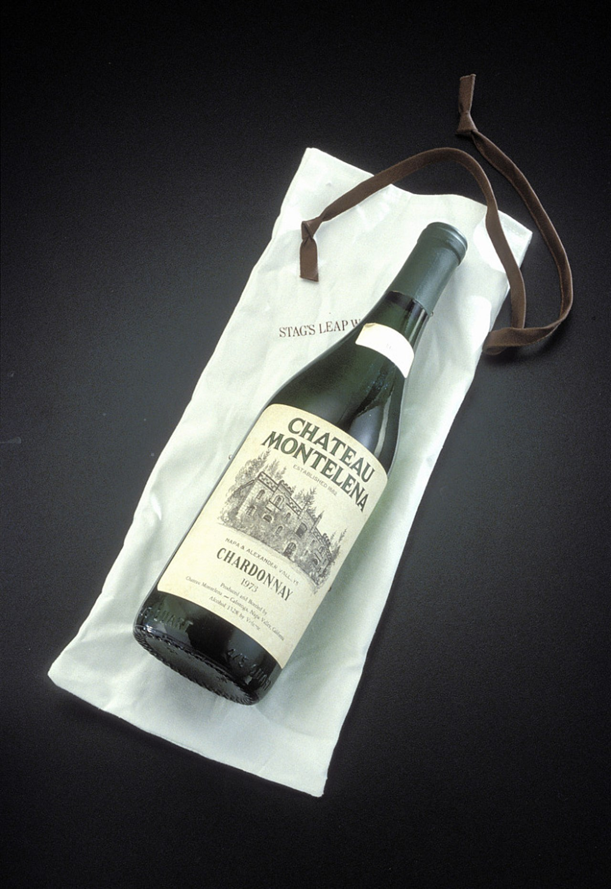

# 吉姆·巴雷特

吉姆·巴雷特（Jim Barrett，1926–2013）是美国酒庄经营者、律师与商人。他 1972 年与 Ernie Hahn 买下纳帕谷 Calistoga 的 Chateau Montelena，把一座禁酒令后荒废的石砌酒厂重新推上生产；1976 年巴黎审判中，酒庄 1973 年的霞多丽获得白葡萄酒组第一名。这个故事常被讲成“律师改行做酒”，但真正关键的是他如何组织资本、土地、葡萄与人才。

图：1973 年蒙特莱纳霞多丽，1976 年巴黎审判白葡萄酒组冠军酒瓶；史密森尼国家美国历史博物馆藏。图片：Unknown author Unknown author，Public domain，via Wikimedia Commons（[原图页面](https://commons.wikimedia.org/wiki/File:Judgment_of_Paris_Winner_1973_Chateau_Montelena_Chardonnay.jpg)）。

## 从律师到酒庄老板

巴雷特 1926 年 11 月 8 日生于芝加哥，父母是爱尔兰移民；全家后来搬到洛杉矶。他在二战期间服役于美国海军，1946 年获加州大学洛杉矶分校学士学位，1950 年获洛约拉法学院法学博士。此后他在洛杉矶做律师与房地产投资，属于“有钱、有兴趣、但不懂酿酒”的典型买家。

1972 年，他与 Ernie Hahn 从 Lee Paschich 手中买下 Chateau Montelena。酒庄由 Alfred L. Tubbs 于 1882 年建造，曾是纳帕谷第七大酒厂；禁酒令后长期沉寂，葡萄园里种着 Chasselas、Alicante Bouschet 与 Carignane 等当时常见的 high-yield 品种。巴雷特接手后，把不符合目标的品种拔掉，重植 Cabernet Sauvignon；在 Cabernet 还没成熟前，他收购霞多丽葡萄来维持生产。

他请来 Mike Grgich 做酿酒师。Grgich 是克罗地亚移民，曾在法国、加州多家酒庄工作，擅长温控发酵与霞多丽。巴雷特负责资金、设备、葡萄采购与市场，Grgich 负责酿造；两人分工明确。1973 年那批霞多丽，用的是收购来的葡萄，不是酒庄自有园；这一点在后来的“酒庄神话”里经常被忽略。

巴雷特的经营风格带有律师色彩：他把酒庄当成一项需要谈判、融资与长期持有的资产，而不是单纯的农场。他会在合同里写清葡萄采购的糖度与交付时间，也会在酒庄扩建时亲自跑许可与设备。他不太在镜头前谈论风味，更愿意谈资产负债表与现金流；这种“生意人”视角在 1970 年代的纳帕谷并不常见，却也让他有能力撑过酒庄早期的亏损。对家族来说，这种安排也意味着酒庄不是“玩票”：它需要每年产出、每年销售、每年还贷，任何一次歉收都可能影响下一年的设备与人员。这也是他后来在 2008 年出售风波中仍坚持家族持股、不肯轻易放手的原因之一。

## 1976 年巴黎审判

1976 年 5 月 24 日，巴黎的盲品会比较加州与法国的红、白葡萄酒。白葡萄酒组里，Chateau Montelena 1973 年霞多丽获得最高分，排在 Meursault-Charmes 1973 等勃艮第白葡萄酒之前。结果公布后，巴雷特据称说了句“来自乡下的孩子干得不错”，这句话后来被反复引用。

这场胜利让 Chateau Montelena 从“纳帕谷一座复兴中的老酒庄”变成国际新闻里的名字。它证明加州可以做出与勃艮第白葡萄酒竞争的霞多丽，也让“Calistoga”“Napa Valley”进入更多酒单。但它同样有局限：这是一次盲品，不是长期产区比较；1973 年是特定年份；参赛的霞多丽是收购葡萄，不是酒庄自有园；酿酒师是 Grgich，不是巴雷特本人。

## 酒庄经营与后续

1976 年之后，Chateau Montelena 继续扩张。巴雷特把酒庄的产量与品牌做起来，1982 年把酿酒职责交给儿子 Bo Barrett。酒庄在 1980 至 1990 年代成为纳帕谷重要名字，2000 年代初期经历过 TCA（软木塞污染）与酒质波动的公开争议；2008 年曾与 Michel Reybier 达成出售协议，后来交易破裂并进入诉讼，酒庄最终留在 Barrett 家族手中。

## 出售风波与晚年

2008 年的出售协议破裂后，酒庄进入诉讼，巴雷特家族最终保住了所有权。这场风波说明，Montelena 的品牌价值既来自 1976 年的奖杯，也来自长期经营的资产与家族控制；对买家而言，买下的不只是一座酒厂，还有一段难以复制、也难以估价的声誉。

巴雷特本人还担任过 Napa Valley Vintners 主席，参与过 Family Winemakers 等组织。2013 年 3 月 14 日，他在旧金山去世，享年 86 岁。他的五个孩子中，Bo Barrett 长期负责酒庄，延续了家族经营。

## 评价与争议

正面评价把他视为“把一座废弃酒庄重新做成纳帕名庄”的经营者：他识别资产、组织资本、重植葡萄、请对酿酒师，并在 1976 年之后把名声转成生意。这个评价有事实基础，尤其是 1972 年收购与 1973 年生产决策。

批评主要有三点。第一，媒体常把“酒庄获胜”写成“巴雷特酿酒获胜”，忽略 Mike Grgich 的酿造角色；Grgich 后来离开并创立自己的酒庄，这段关系本身也说明功劳不能只归一个人。第二，1973 年霞多丽是收购葡萄，把它说成“酒庄自有园的风土胜利”不准确。第三，2008 年出售交易与 TCA 争议让酒庄声誉经历波动；品牌故事不能只讲 1976 年。

## 常见误读

第一，把巴雷特当成 Chateau Montelena 的创始人。酒庄由 Alfred Tubbs 于 1882 年建立，巴雷特是 1972 年的复兴者。

第二，把他当成酿酒师。他的角色是所有者与经营者；1973 年霞多丽的酿造由 Mike Grgich 负责。

第三，把 1973 年霞多丽说成“自有葡萄园”。那批酒用的是收购来的葡萄，酒庄自有园的重植与成熟还需要时间。

第四，把巴黎审判的胜利当成“加州全面超越法国”。它是一次特定年份、特定样本的盲品，不能替代长期比较。

相关条目：[霞多丽](ref:chardonnay)。

## 另见

- [纳帕谷](ref:napa)：Chateau Montelena 与 Calistoga 所在地。
- [霞多丽](ref:chardonnay)：1973 年参赛酒的品种。
- [白葡萄酒](ref:white-wine)：理解巴黎审判白葡萄酒组的类别背景。
- [1976 年巴黎审判](ref:paris-1976)：把 Montelena 与 Stag's Leap 的两场胜利放在同一事件里。
- [美国](ref:usa)：加州酒业在 1970 年代的国际崛起。

对照阅读：[纳帕谷](ref:napa)、[白葡萄酒](ref:white-wine)。

**关键事实。**

| 项目 | 内容 |
| --- | --- |
| 一句话定位 | 美国酒庄经营者（1926–2013），1972 年与 Ernie Hahn 买下并复兴纳帕谷 Chateau Montelena；其 1973 年霞多丽在 1976 年巴黎审判白葡萄酒组获第一名 |
| 生卒 | 1926–2013 |
| 身份 | 酒庄经营者、律师、商人 |
| 关联地区 | 美国、纳帕谷 |

**来源与边界。** 本页关于「吉姆·巴雷特」的关键事实，主要由以下来源交叉核对：Chateau Montelena Winery（酒庄 1882 年建庄、1972 年由 Barrett 与 Hahn 收购、Mike Grgich 任酿酒师与 1973 年霞多丽的基本信息）、The Wine Cellar Insider（1972 年收购、葡萄园重植、1976 年巴黎审判白葡萄酒组结果、2008 年出售交易与 2013 年去世）、Wine History Tours（交叉核对律师背景、1972 年与 Ernie Hahn 收购、Mike Grgich 聘用与 1976 年结果）等 5 条来源。价格、批次与状态会变，涉及这些字段时以页面所列来源的最新版本为准。正文为项目自写，来源只作核验，不复制原文。

**并读。** 把「吉姆·巴雷特」与「纳帕谷」、「霞多丽」、「白葡萄酒」放在一起读时，先确认它们是同一层级还是上下游关系：先确认时代与作品，再比较经历、风格与史料边界。本页负责给出人物的基本坐标，对照条目补上具体案例与差异；读完再回到本页，才能分清哪些差别属于人物本身，哪些只是产地、批次或品牌选择。
