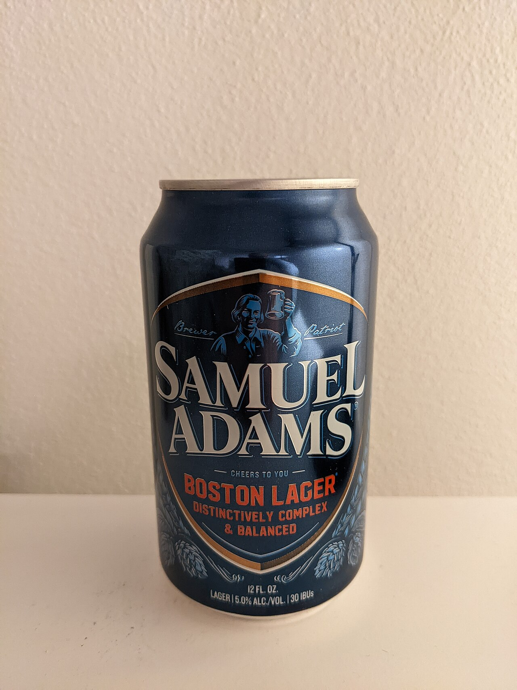

# 吉姆·科赫

吉姆·科赫（Jim Koch，1949 年生）是美国精酿啤酒商业化最成功的案例之一，也是最不像“酿酒师”的酿酒师。他出身波士顿啤酒世家，做过管理咨询，1984 年却在自家厨房用曾曾祖父的配方试酿，随后创立 Boston Beer Company。四年后，Samuel Adams Boston Lager 成为全美货架上最容易被认出的“精酿”之一。

图：Samuel Adams Boston Lager 酒瓶；Jim Koch 1984 年以此配方起步，画面不是他本人。图片：Pansebert，CC0，via Wikimedia Commons（[原图页面](https://commons.wikimedia.org/wiki/File:Samuel_Adams_Boston_Lager_(The_Boston_Beer_Co.).jpg)）。

## 人物小传

科赫出生在俄亥俄州辛辛那提，家族五代做啤酒。父亲在大型酒厂工作，后来因行业整合离开；科赫本人读的是哈佛，先后拿到法学与商学学位，并在咨询公司工作。1984 年，他在自家阁楼找到曾曾祖父 Louis Koch 的拉格配方，决定不再替别人做战略，而是自己做一款“有味道、但美国人喝得惯”的啤酒。他后来说，自己当时已经三十多岁，如果失败，至少还能回去做咨询；但第一批酒的成功率并不高，他必须把配方、成本与销售同时算清楚。

## 1984：厨房里的第一批酒

第一次试酿并不顺利：设备简陋、温控不稳，发酵产生的气味甚至把厨房墙纸熏起来。他没有放弃，改用更稳定的拉格酵母与低温发酵，反复调整麦芽与酒花比例。1984 年公司成立，银行拒绝贷款，他从家人朋友处筹到约 20 万美元；1985 年 4 月 15 日，Boston Lager 在波士顿约 35 家餐馆与酒吧上市。

## 代表酒款

Samuel Adams Boston Lager 是核心作品：琥珀色、麦芽甜感明显、酒花辛香克制，比当时主流拉格更有层次，又不像英式艾尔那样陌生。1985 年 6 月，它在 Great American Beer Festival 的消费者投票中被评为“美国最佳啤酒”。此后，Boston Beer 用同一套“拉格为底、风味做加法”的思路，推出 Seasonal、Double Bock、Triple Bock 与 2001 年的 Utopias。

## 方法或制度影响

科赫的贡献在于把精酿从“本地小酒馆”推到全国货架。他采用合同酿造与多厂布局，在需求增长时保持供应；他用“教育消费者”的方式做营销，把酒花、麦芽与新鲜度写成可读的故事；2008 年，他发起 Brewing the American Dream，为食品饮料创业者提供资金、导师与网络。1995 年，Boston Beer 在纽交所上市，成为少数以精酿为主业的上市公司。2008 年，公司买下宾夕法尼亚州 Lehigh Valley 的一座旧厂，进一步把生产从合同酿造转向自有产能；2024 年，Boston Beer 迎来 40 周年，Samuel Adams 仍是美国最容易被认出的精酿品牌之一。

## 评价与争议

正面评价认为他证明了精酿可以规模化，也可以保持质量：Boston Lager 近四十年配方稳定，是许多美国人认识“啤酒可以有风味”的第一瓶。批评则指出，合同酿造、上市公司结构与全国分销，让 Boston Beer 更接近“大型区域酒厂”，与“本地小作坊”的精酿想象有距离；此外，精酿定义中的“独立”与“小”标准，也因这类公司而不断被重新讨论。科赫对此的回应很直接：如果精酿只能在本地小馆里活，它就无法改变美国人的日常饮酒；规模本身不是罪，关键是别把风味做成同质化的拉格。

## 常见误读

第一，把科赫当成“从零自学”的酿酒师。他有家族配方与行业资源，也接受过系统教育。第二，把 Samuel Adams 当成马萨诸塞州本地小厂。它很早就通过合同酿造与多厂布局覆盖全国。第三，把 Boston Lager 当成艾尔。它是拉格，使用低温发酵与拉格酵母。第四，把“精酿”当成口味标准。精酿更多是所有权、规模与工艺取向的行业定义，不等于一定苦或一定浓。

对照阅读：[拉格啤酒](ref:lager)、[精酿啤酒](ref:craft)。

## 延伸阅读

Boston Beer 官方历史页与投资者问答在 1984/1985 年节点上各有侧重：前者讲配方发现与厨房试酿，后者讲公司注册、爱国者日上市与 1988 年产量。SEC 年报则提供了可核对的营收、产能与品牌组合数据。把营销叙事与监管文件对读，是理解一家上市精酿酒厂最可靠的方法；科赫的自述《Quench Your Own Thirst》适合作为创业过程的补充，而不宜当作财务事实来源。产品线上，1994 年的 Triple Bock 与 2001 年的 Utopias 代表另一种极端：高酒精度、长时间木桶陈年、甜感明显，它们不是日常拉格，而是把“啤酒可以像威士忌一样收藏”这句话做成产品。合同酿造也带来质量控制难题：Boston Beer 长期派人驻厂、统一原料与微生物标准，确保不同厂生产的 Boston Lager 风味一致；这套“品牌方管标准、工厂方管产能”的模式，后来被许多精酿企业采用。1985 年 4 月 15 日的上市也不是一夜成功：科赫和合伙人亲自跑酒吧、请人试饮、解释什么是拉格与艾尔的区别；第一年卖出约 500 桶，靠的是波士顿本地餐馆的口碑，而不是全国广告。

相关条目：[啤酒](ref:beer)。

## 另见

- [拉格啤酒](ref:lager)：Boston Lager 的技术与风格基础。
- [啤酒](ref:beer)：理解科赫产品线的入门。
- [精酿啤酒](ref:craft)：他参与推动并不断被重新定义的概念。
- [发酵](ref:fermentation)：低温拉格发酵与风味控制的关键。
- [美国酿酒师协会](ref:brewers)：精酿定义与行业数据的来源。

**关键事实。**

| 项目 | 内容 |
| --- | --- |
| 一句话定位 | 美国 Samuel Adams 与 Boston Beer Company 创办人（1949 年生），1984 年用曾祖传下的配方在自家厨房试酿，1985 年让 Boston Lager 在波士顿酒吧上市；以拉格工艺、全国分销与“Brewing the American Dream”计划影响美国精酿产业 |
| 生卒 | 1949–? |
| 身份 | 啤酒酿酒师、企业创办人、企业家 |
| 关联地区 | united-states |

**来源与边界。** 本页关于「吉姆·科赫」的关键事实，主要由以下来源交叉核对：The Boston Beer Company（1984 年发现配方、厨房试酿、融资、1985 年 4 月 15 日上市与 6 月 GABF 获奖；1984 年创办、1985 年爱国者日售酒、1988 年 36,000 桶与 1995 年 IPO）、U.S. Securities and Exchange Commission（1984 年创办、第五代酿酒家族、曾曾祖父配方与 40 周年自述）、Flatiron Books（科赫的创业过程、销售策略与 Boston Beer 的经营理念；未复制正文）。价格、批次与状态会变，涉及这些字段时以页面所列来源的最新版本为准。正文为项目自写，来源只作核验，不复制原文。

**并读。** 把「吉姆·科赫」与「拉格啤酒」、「啤酒」、「精酿啤酒」放在一起读时，先确认它们是同一层级还是上下游关系：先确认时代与作品，再比较经历、风格与史料边界。本页负责给出人物的基本坐标，对照条目补上具体案例与差异；读完再回到本页，才能分清哪些差别属于人物本身，哪些只是产地、批次或品牌选择。

**适用边界。** 对「吉姆·科赫」而言，生卒年与作品系年存在异说；文学或艺术形象不能直接当作历史生活记录。

**更新提示。** 「吉姆·科赫」最近核对于 2026-11-21；生平日期、作品归属与研究文献会更新，引用前以权威机构条目为准。
