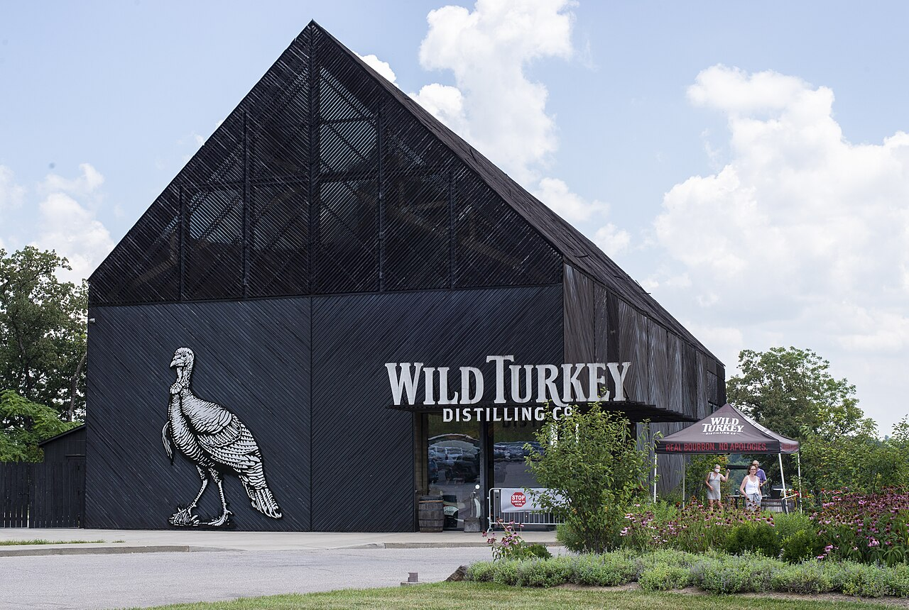

# 吉米·拉塞尔

吉米·拉塞尔（Jimmy Russell）是 Wild Turkey 酒厂任职时间最长的酿酒师，也是美国波本行业少见的“活着的制度”。他 1954 年 9 月 10 日进厂时只有 18 岁，第一份工作是扫地；七十多年后，他仍在参与蒸馏与陈年流程。同行叫他“波本佛陀”，他则自称“肯塔基的普通老吉米”。

图：肯塔基州劳伦斯堡的 Wild Turkey 游客中心；酒厂场景，不是吉米·拉塞尔本人。图片：Smerdis，CC BY-SA 4.0，via Wikimedia Commons（[原图页面](https://commons.wikimedia.org/wiki/File:Wild_Turkey_Visitor%27s_Center.jpg)）。

## 人物小传

拉塞尔在距离酒厂约五英里的地方长大，父亲也在酒厂工作。他先做清洁，再跟着 Bill Hughes 与 Ernest W. Ripy Jr. 学习制曲、糖化、蒸馏与选桶。1960 年代，他成为 Wild Turkey 的首席酿酒师；此后半个多世纪，品牌的核心配方、桶陈标准与 101 证明度，基本都在他的手里延续。1981 年，他的儿子 Eddie 以替班操作员的身份进厂，从底层岗位做起；2015 年，Eddie 正式成为首席酿酒师，父子二人同时在职，成为肯塔基波本行业少见的组合。2014 年，Wild Turkey 把这一年定为“吉米之年”，肯塔基州议会与美国国会记录都为他留下表彰文字，这种来自政界的认可在酒厂酿酒师中并不多见。

## 从扫地到首席酿酒师

Wild Turkey 的工艺并不神秘：玉米为主的配方、连续蒸馏、新烧焦橡木桶、长时间陈年。难的是在行业风向变化时不做多余的事。1970 至 80 年代，美国消费者转向伏特加、金酒与更清淡的酒，许多酒厂降低酒精度、缩短陈年；拉塞尔坚持原来的 101 配方，后来这句话被概括为“什么也没改”。这种固执让 Wild Turkey 在波本复兴时保住了辨识度。

## 代表酒款

Wild Turkey 101 是他的核心作品：高酒精度、重橡木、焦糖与香料，适合加冰或调酒，也成为美国酒吧的常备酒。它的配方以玉米为主，辅以小比例黑麦与大麦；新烧焦的美国橡木桶赋予香草、椰子与烤木气息，较长陈年则让酒精感与甜味结合。1991 年的 Rare Breed 是早期桶强波本之一，不走统一稀释路线；1995 年的 Kentucky Spirit 走单桶路线；他与儿子 Eddie 共同创作的 Russell's Reserve，则把“父子两代选桶”变成品牌叙事。1976 年的蜂蜜波本后来演化为 American Honey。

## 方法或制度影响

拉塞尔的影响不只在酒款。他代表了一种“酒厂内部传承”的职业路径：从清洁、糖化、蒸馏到品评，一层层做上去，而不是从商学院直接进入管理层。他长期坚持使用新烧焦的美国橡木桶、开放式的品评流程与固定的酵母—谷物体系，让 Wild Turkey 的酒体保持厚重、干燥、带香料尾韵。2000 年，他入选肯塔基波本名人堂；2015 年，Eddie Russell 正式获得首席酿酒师头衔，父子同厂任职成为行业少见的现象。2024 年，Wild Turkey 为他庆祝入职 70 周年，并发布纪念版 8 年波本。

## 评价与争议

正面评价强调他的稳定与可接近性：他不把波本讲成奢侈品，而讲成“每天都该喝得起的美国酒”。批评则指出，Wild Turkey 的“不变”本身也是品牌策略，强调传统可以帮助产品在货架上区分开来；此外，把一位酿酒师塑造成整个品牌的象征，容易掩盖团队、资本与分销体系的作用。拉塞尔本人对这些头衔态度轻松，常说如果酒不好喝，“我来喝掉”。他也长期担任国际葡萄酒与烈酒比赛的威士忌评委，把品评经验带回酒厂；这种“外部评审—内部调整”的循环，让 Wild Turkey 在保持风格的同时不至于脱离市场。官方 70 周年稿把入职日精确到 1954 年 9 月 10 日，并强调他一开始只是扫地；这类细节比“传奇大师”的笼统说法更有史料价值。

## 常见误读

第一，把他当成 Wild Turkey 的创办人。酒厂历史可追到 19 世纪 Ripy 家族，拉塞尔是 20 世纪中期以后的首席酿酒师。第二，把“101”当成陈年年份。它是酒精度 101 proof，不是 101 年。第三，把 Rare Breed 当成单桶。它通常是多桶调配的桶强产品。第四，把“波本佛陀”当成正式职称，它只是同行绰号。第五，把他当成“只是品牌吉祥物”。他直到 2020 年代仍参与品评与选桶，2024 年的 70 周年纪念酒就选自他偏爱的仓库。第六，把 1954 年入职说成“成为首席酿酒师”；他先做了十多年基层与学徒，1960 年代才接手首席职位。

对照阅读：[波本威士忌](ref:bourbon)、[肯塔基波本路线：法兰克福、巴兹敦与洛雷托的三座厂区](ref:bourbon-trail)。

## 延伸阅读

Wild Turkey 官方人物页偏重头衔与作品，70 周年新闻稿偏重日期与“没改变配方”的品牌叙事；两者都带有企业视角。要理解拉塞尔的行业位置，还需要把它放回 1970–90 年代波本衰退的背景下看：当时降低酒精度、缩短陈年是普遍做法，他的坚持因此显得突出。关于 Eddie Russell 接班与 2015 年双首席结构，官方年表提供了可靠时间点。另一个容易忽略的细节是，101 proof 约等于 50.5% ABV，既高于普通波本的 40%，又没有到桶强的极端区间，这个“中间值”正是 Wild Turkey 日常饮用的定位。

相关条目：[肯塔基州](ref:kentucky)。

## 另见

- [波本威士忌](ref:bourbon)：拉塞尔一生的核心品类。
- [肯塔基州](ref:kentucky)：Wild Turkey 与波本产业的地理中心。
- [肯塔基波本路线](ref:bourbon-trail)：把酒厂、仓库与小镇串起来的旅行框架。
- [蒸馏](ref:distillation)：理解波本从发酵到酒心的技术起点。
- [过桶](ref:finishing)：理解 Rare Breed、单桶与陈年风味差异的术语入口。

**关键事实。**

| 项目 | 内容 |
| --- | --- |
| 一句话定位 | 肯塔基州 Wild Turkey 酒厂的波本威士忌大师级酿酒师，1954 年 18 岁入职，从扫地做起，1960 年代出任首席酿酒师；以坚持 101 配方、Rare Breed、Kentucky Spirit 与 Russell's Reserve 影响现代波本行业 |
| 身份 | 波本威士忌酿酒师、酒厂首席酿酒师 |
| 关联地区 | 肯塔基州 |

**来源与边界。** 本页关于「吉米·拉塞尔」的关键事实，主要由以下来源交叉核对：Wild Turkey Bourbon（1954、1976、1991、1995、2000、2015 与 2024 年的品牌时间线；1954 年 9 月 10 日入职、18 岁、70 周年、1970–80 年代坚持不改变配方与 101 的地位）、Oxford University Press（波本威士忌的原料、蒸馏、入桶与陈年框架；未复制词条）、Voyageur Press（20 世纪后期波本行业衰退与复兴的背景；未复制正文）。价格、批次与状态会变，涉及这些字段时以页面所列来源的最新版本为准。正文为项目自写，来源只作核验，不复制原文。

**并读。** 把「吉米·拉塞尔」与「波本威士忌」、「肯塔基州」、「肯塔基波本路线：法兰克福、巴兹敦与洛雷托的三座厂区」放在一起读时，先确认它们是同一层级还是上下游关系：先确认时代与作品，再比较经历、风格与史料边界。本页负责给出人物的基本坐标，对照条目补上具体案例与差异；读完再回到本页，才能分清哪些差别属于人物本身，哪些只是产地、批次或品牌选择。
