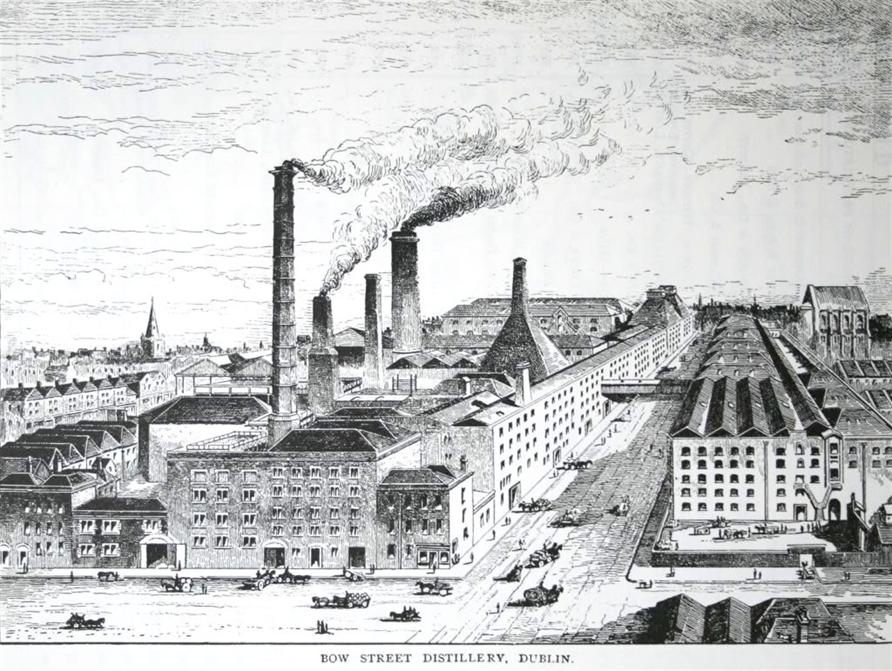

# 约翰·詹姆森

约翰·詹姆森（John Jameson，1740–1823）是 Jameson 威士忌的名字来源，但他最早并不是酿酒师，而是苏格兰 Alloa 的一位律师。18 世纪 70 年代末，他来到都柏林，1780 年在 Bow Street 开办蒸馏厂。此后四十多年，他把一个地方酒厂做成爱尔兰最有影响力的威士忌家族企业之一。

图：阿尔弗雷德·巴纳德所记的都柏林 Bow Street 蒸馏厂；历史厂区图，不是约翰·詹姆森肖像。图片：Alfred Barnard (1837-1918)，Public domain，via Wikimedia Commons（[原图页面](https://commons.wikimedia.org/wiki/File:Bow_Street_distillery_Alfred_Barnard.jpg)）。

## 人物小传

詹姆森 1740 年生于苏格兰 Alloa，接受法律训练。1768 年，他与 Margaret Haig 结婚；Margaret 的父亲 John Haig 是苏格兰蒸馏业主，这层婚姻把他带进了酒业网络。1770 年代末，他迁居都柏林，1780 年在 Smithfield 附近的 Bow Street 建立蒸馏厂。当时的都柏林是英伦第二大城市，城里有一百多家啤酒厂与蒸馏厂；竞争激烈，但城市市场、港口与英国帝国的贸易网络，也给了新酒厂扩张的空间。到 19 世纪初，Bow Street 已成为都柏林最大的蒸馏厂之一。

## 从法律到蒸馏

詹姆森的优势不只是资本，而是把贸易、法律与配方放在一起看。他知道税则如何影响原料选择，也知道都柏林的市场需要什么样的酒。1785 至 1825 年，英国对麦芽与烈酒同时征税，蒸馏业主自然倾向少用麦芽；詹姆森开始试验发芽大麦与未发芽大麦的混合比例，结果得到的酒更顺口，也逐渐形成爱尔兰单一壶式威士忌的典型配方。

## 代表酒款与工艺

Jameson 的核心不是某一瓶“古董酒”，而是一套工艺：三次蒸馏、发芽与未发芽大麦混合、壶式蒸馏器、长时间陈年。三次蒸馏让酒体更干净，未发芽大麦带来谷物与香料感，壶式蒸馏保留油脂与质地。今天的 Jameson Original 仍以这套工艺为品牌基础；Bow Street 酒厂则在 1970 年 6 月 5 日停止蒸馏，1975 年迁至 Midleton。

## 方法或制度影响

詹姆森的长期影响在于家族与制度。他的四个儿子进入爱尔兰蒸馏业，形成 Bow Street 与 Marrowbone Lane 两支；1804 年，John Jameson II 接班，1851 年再由 John Jameson III 接手。1901 年，公司正式注册为 John Jameson & Son Ltd；1966 年，它与另外两家都柏林酒厂合并为 Irish Distillers。这条家族—公司—集团的路径，是爱尔兰威士忌从地方作坊走向现代品牌的标准样本。Bow Street 在 1970 年 6 月 5 日蒸馏完最后一批壶式威士忌，1975 年生产迁至 Midleton；旧厂后来改为游客中心，成为都柏林酒业记忆的保存地。

## 评价与争议

正面评价把詹姆森视为爱尔兰威士忌“从地方烈酒变成国际商品”的关键人物：他抓住了都柏林城市市场、英国帝国的贸易网络与麦芽税的政策缝隙。批评则指出，早期酒厂的利润与殖民地贸易、酒税制度密不可分；品牌叙事容易把创始人写成孤胆英雄，忽略工人、桶匠、酒商与家族女性的作用。此外，“1780 年创立”是品牌年表，具体建厂月份与早期股权结构仍有档案空白。今天 Jameson 的绿色瓶、三次蒸馏与“顺滑”定位，更多是 20 世纪营销的产物，不能直接倒推成 1780 年的原味。

## 常见误读

第一，把约翰·詹姆森当成爱尔兰人。他生于苏格兰，后来才迁居都柏林。第二，把 Jameson 当成“单一麦芽”。它是单一壶式威士忌，使用发芽与未发芽大麦，不是只用发芽大麦的单一麦芽。第三，把三次蒸馏当成所有爱尔兰威士忌的强制工艺。它是 Jameson 的选择，不是法定统一要求。第四，把 Bow Street 当成今天的生产厂。它现在是博物馆与游客中心，实际蒸馏已迁至 Midleton。

对照阅读：[爱尔兰威士忌](ref:irish)、[尊美醇弓街酒厂](ref:bow-street)。

## 延伸阅读

Jameson 官方年表把 1780 年写成 Bow Street 的起点，但对具体月份、早期合伙人与股权结构语焉不详；品牌产品页则详细解释三次蒸馏与发芽/未发芽大麦的比例。爱尔兰威士忌工具书补足了 18–19 世纪的税法与都柏林酒厂生态。三者对读，可以把“品牌创世故事”与“可核对的制度史”分开，避免把营销时间线直接当成档案。Bow Street 在 19 世纪后期占地约六英亩，拥有自己的制桶、糖化、蒸馏与仓库；这种垂直整合让酒厂能控制从原料到装瓶的每一步，也解释了为什么它能在都柏林的竞争中活到 20 世纪。三次蒸馏的具体效果是提高酒精度、去除更多杂醇与酯类，让酒体更干净；代价是风味物质也被削去一部分，因此 Jameson 需要靠壶式蒸馏器的油脂感与未发芽大麦的谷物味来补回层次。18 世纪末的都柏林还有大量小型蒸馏厂，它们依赖本地麦芽、泥炭与城市酒馆；Bow Street 的规模优势让它能以更低成本采购大麦、雇佣桶匠，并把酒卖到英国与殖民地市场。

相关条目：[单一壶式威士忌](ref:pot-still)。

## 另见

- [爱尔兰威士忌](ref:irish)：詹姆森所属的品类。
- [单一壶式威士忌](ref:pot-still)：发芽与未发芽大麦混合的工艺传统。
- [尊美醇弓街酒厂](ref:bow-street)：从 1780 年到 1970 年的厂址。
- [爱尔兰威士忌路线](ref:irish-trail)：把都柏林、科克与海岸酒厂串起来的旅行框架。
- [蒸馏](ref:distillation)：理解三次蒸馏与壶式蒸馏器的技术入口。

**关键事实。**

| 项目 | 内容 |
| --- | --- |
| 一句话定位 | 苏格兰出生的爱尔兰酒商与蒸馏业主（1740–1823），1780 年在都柏林 Bow Street 开办蒸馏厂；在麦芽税时代试验发芽与未发芽大麦混合，奠定 Jameson 单一壶式威士忌的三次蒸馏传统 |
| 生卒 | 1740–1823 |
| 身份 | 酒商、蒸馏业主 |
| 关联地区 | 爱尔兰、英国 |

**来源与边界。** 本页关于「约翰·詹姆森」的关键事实，主要由以下来源交叉核对：Jameson Irish Whiskey（1740 年 Alloa 出生、1780 年 Bow Street、1785–1825 年麦芽税与混合谷物试验、1823 年去世；交叉核对同一品牌年表、1804 年 John II 接班与 1970 年 Bow Street 停蒸）、O'Brien Press（18–19 世纪爱尔兰蒸馏业、都柏林酒厂与单一壶式威士忌的历史背景；未复制正文）、Oxford University Press（单一壶式威士忌、三次蒸馏与麦芽税的技术背景；未复制词条）。价格、批次与状态会变，涉及这些字段时以页面所列来源的最新版本为准。正文为项目自写，来源只作核验，不复制原文。

**并读。** 把「约翰·詹姆森」与「爱尔兰威士忌」、「单一壶式威士忌」、「尊美醇弓街酒厂」放在一起读时，先确认它们是同一层级还是上下游关系：先确认时代与作品，再比较经历、风格与史料边界。本页负责给出人物的基本坐标，对照条目补上具体案例与差异；读完再回到本页，才能分清哪些差别属于人物本身，哪些只是产地、批次或品牌选择。

**适用边界。** 对「约翰·詹姆森」而言，生卒年与作品系年存在异说；文学或艺术形象不能直接当作历史生活记录。
