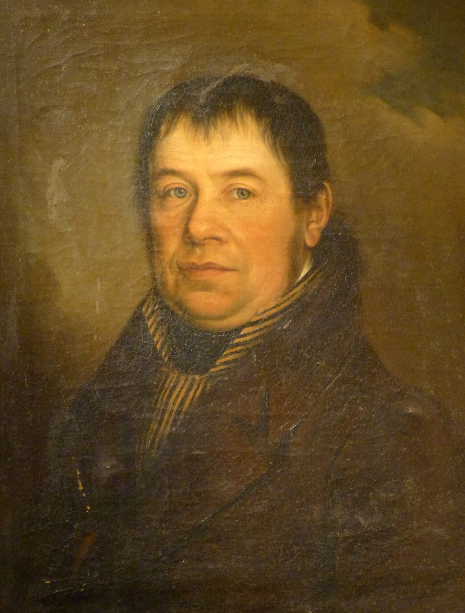

# 约瑟夫·格罗尔

约瑟夫·格罗尔（Josef Groll，1813—1887）是巴伐利亚酿酒师，现代皮尔森拉格的奠基者。1842 年，波希米亚城市皮尔森（Plzeň）的市民决定建一座“能与巴伐利亚啤酒竞争”的市营啤酒厂，从巴伐利亚请来格罗尔。同年 10 月，他用皮尔森的软水、萨兹（Žatec）酒花、摩拉维亚大麦与底部发酵酵母，酿出第一款金色、清澈、泡沫持久的拉格。这款酒后来以“Pilsner Urquell”（皮尔森原产）之名行世，改变了整个欧洲的啤酒口味。

图：约瑟夫·格罗尔肖像。图片：Wolfgang Sauber，CC BY-SA 4.0，via Wikimedia Commons（[原图页面](https://commons.wikimedia.org/wiki/File:BIB_-_Portrait_Groll.jpg)）。

## 皮尔森为什么需要一位巴伐利亚酿酒师

十九世纪的波希米亚是奥匈帝国的一部分，皮尔森是工业与商业重镇，城里有多家小酒厂，但质量不稳定。1838 至 1839 年，当地啤酒出现大面积变质，市民愤怒，决定集资建一座现代化的市营啤酒厂。他们想要的是“巴伐利亚式”的底部发酵、清澈、耐储存的啤酒，因为巴伐利亚在 19 世纪已经掌握了拉格（lager）技术。

1842 年，酿酒师约瑟夫·格罗尔从巴伐利亚的维尔茨霍芬（Vilshofen）来到皮尔森。他带来的不只是酵母，还有一套完整的工艺：浅色麦芽、三重煮沸（triple decoction）、开放发酵、低温长时间陈酿。皮尔森本地条件恰好配合：地下水极软、矿物质少，适合浅色麦芽；萨兹酒花香气细腻、苦味干净；摩拉维亚大麦淀粉含量高、发芽均匀。这些条件组合，才有后来“金色清澈”的皮尔森。

1842 年 10 月 5 日，格罗尔酿出第一批酒；11 月 11 日，酒在皮尔森的“金犁”酒馆首次公开供应。传说市民带着怀疑来喝，结果一杯下去，金色、清澈、泡沫细腻、苦味干净的啤酒让全城惊讶。这个故事有传奇色彩，但核心事实清楚：皮尔森的第一款市营啤酒，与当时流行的深色、浑浊、烟熏味啤酒完全不同。

## 他改变了什么

第一，他证明了“浅色拉格”可以稳定、清澈、量产。此前的拉格多为深色、浑浊，皮尔森用浅色麦芽、软水与低温陈酿做出金色酒体，让“看得到的清澈”成为质量信号。第二，他确立了皮尔森风格的工艺模板：三重煮沸、开放发酵、橡木桶长时间冷陈、底部发酵酵母。今天的大厂多用不锈钢罐与控温发酵，但基本逻辑仍是“低温、慢发酵、后熟”。

第三，他让“皮尔森”从地名变成风格名。十九世纪后期，欧洲与美洲的酒厂纷纷模仿皮尔森，出现“Pilsener”“Pilsner”“Pils”等拼法；到二十世纪，淡色拉格成为全球销量最大的啤酒类型。格罗尔没有“发明拉格”——巴伐利亚早有拉格——但他把拉格做成金色、清澈、适合大众消费的现代版本。

第四，他留下了“原产”概念。皮尔森的市营啤酒厂后来以“Pilsner Urquell”（Plzeňský Prazdroj，意为“原初之源”）为品牌，强调自己是皮尔森风格的原点。这个词既是地理标志，也是品牌故事；它提醒消费者，风格可以复制，但水源、酒花与工艺传统有地方性。

## 去皮尔森看什么

如果去皮尔森，重点看四件事。第一，水源：皮尔森的地下水软、矿物质少，是浅色麦芽与干净苦味的基础；参观时留意水处理与糖化车间。第二，麦芽与酒花：浅色麦芽的烘焙程度、萨兹酒花的香气，决定酒体的金色与花香；可以对比不同酒花品种的香气。第三，糖化与煮沸：三重煮沸是传统工艺的核心，目的是糊化淀粉、灭菌、浓缩麦芽香；现代设备可能简化，但原理仍在。第四，发酵与陈酿：开放发酵槽、橡木桶或不锈钢罐、低温酒窖，决定皮尔森的干净度与泡沫。

喝皮尔森，不要只追求“苦”。好的皮尔森有麦芽的甜、酒花的花香与草本、干净的苦味与持久的泡沫；温度在 6–8°C，用细长杯或郁金香杯，配捷克烤猪肉、面包、香肠、炸奶酪与鱼类。若喝瓶装或罐装，注意保质期与避光，啤酒花的香气会随时间衰减。

## 争议与常见误读

第一，格罗尔不是“拉格的发明者”。巴伐利亚在 15 至 16 世纪已有底部发酵与低温窖藏，拉格技术早于 1842 年；格罗尔的贡献是“浅色、清澈、稳定的皮尔森拉格”，不是“拉格”本身。第二，他不是“皮尔森啤酒的唯一创造者”。皮尔森市民、麦芽师、酒花商、桶匠、酵母培养者与后续酿酒师都参与其中；把一个人当成全部，会抹掉集体协作。

第三，皮尔森不是“世界上第一款浅色啤酒”。欧洲早有浅色小麦啤与其他浅色啤酒；皮尔森的特殊性在于“底部发酵、清澈、稳定、量产”，而不是颜色本身。第四，“Pilsner Urquell”不是“格罗尔的私人品牌”。它属于皮尔森市营啤酒厂后来的公司，格罗尔只在那里工作到 1845 年，之后回到巴伐利亚。

第五，格罗尔的生卒年与姓名拼写有差异。他生于 1813 年 8 月 21 日，卒于 1887 年 11 月 22 日；德语拼写 Josef 与 Joseph 都可见。第六，皮尔森的成功不只是配方，还包括铁路、玻璃瓶、冰块与广告。十九世纪后期，皮尔森能走向世界，靠的是工业基础设施与出口网络，而不是单一秘方。

## 与本站其他页面的关系

格罗尔的故事连接三条线。第一是[啤酒](ref:beer)的风格与工艺：拉格、底部发酵、浅色麦芽、萨兹酒花、三重煮沸与低温陈酿。第二是[捷克](ref:czechia)的啤酒史：皮尔森、布拉格、波希米亚的麦芽与酒花产区。第三是[巴伐利亚](ref:bavaria)的技术迁移：从慕尼黑与维尔茨霍芬到皮尔森，巴伐利亚酿酒师如何把拉格技术带到中欧。

如果想继续看“拉格如何征服世界”，可以对照慕尼黑啤酒节、荷兰喜力、日本朝日与青岛啤酒；如果想看“地方水源如何定义风格”，可以读皮尔森软水与萨兹酒花；如果想看“移民酿酒师如何改变产业”，可以对照德国酿酒师在美国、墨西哥与巴西的故事。格罗尔不是孤立的发明家，他是 19 世纪中欧工业、铁路与啤酒科学交汇的产物。

对照阅读：[比尔森啤酒厂：金色拉格的诞生地](ref:brewery)、[捷克共和国](ref:czechia)。

## 延伸阅读

- [皮尔森啤酒厂](ref:brewery)：皮尔森、Pilsner Urquell、工艺与参观信息。
- [啤酒](ref:beer)：拉格、底部发酵、麦芽、酒花与品鉴的基本框架。
- [捷克](ref:czechia)：皮尔森、布拉格、波希米亚的啤酒地理。
- [巴伐利亚](ref:bavaria)：慕尼黑、拉格传统与格罗尔的故乡维尔茨霍芬。
