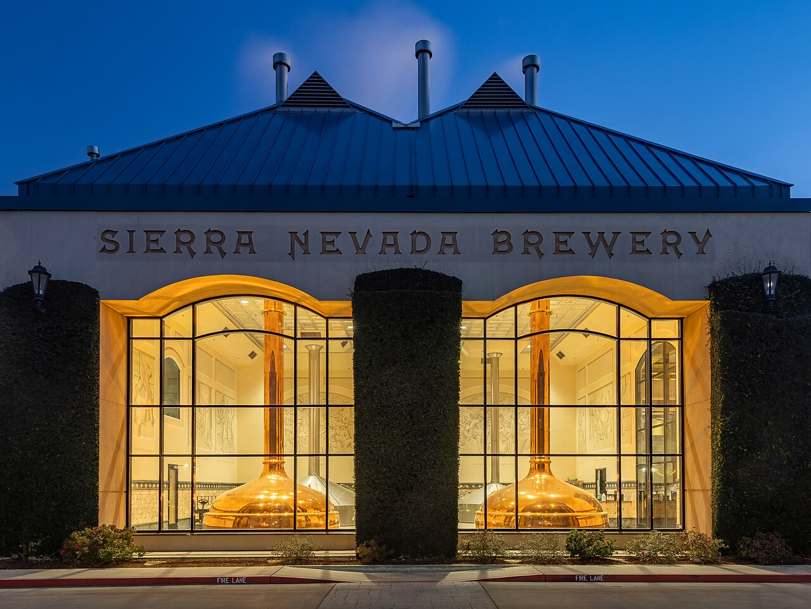

# 肯·格罗斯曼

肯·格罗斯曼（Ken Grossman，1955 年生）是 Sierra Nevada Brewing 的创办人，也是美国精酿啤酒从“车库 hobby”变成全国产业的代表人物。他的路径没有名庄光环：少年时买家庭酿酒套装，1976 年在加州奇科开家庭酿酒用品店，1980 年用回收的乳品设备、旧钢管与二手阀门搭出第一套糖化系统。真正让他出名的，是一瓶用 Cascade 酒花酿成的 Pale Ale。

图：蓝调时刻的奇科 Sierra Nevada 酒厂；厂区场景，不是肯·格罗斯曼本人。图片：Frank Schulenburg，CC BY-SA 4.0，via Wikimedia Commons（[原图页面](https://commons.wikimedia.org/wiki/File:Sierra_Nevada_Brewery,_Chico,_during_blue_hour.jpg)）。

## 人物小传

格罗斯曼在加州长大，少年时迷上发酵与机械。1969 年，他买了第一套家庭酿酒设备，怕母亲发现还藏了起来；1976 年，他在奇科开 The Home Brew Shop，一边卖原料，一边用五加仑小批次反复试配方。开店让他接触到本地酿酒爱好者、农户与设备商，也让他意识到，美国啤酒的问题不只是口味，而是原料与设备的供应链都被大厂垄断。1980 年，他与 Paul Camusi 合伙，在奇科一间仓库里正式成立 Sierra Nevada Brewing Co.。

## 1980：从废旧设备开始

当时的美国啤酒业处于历史低点，全国只剩几十家传统酒厂，货架被清淡拉格占据。格罗斯曼没有资金买新设备，就去废品场与倒闭乳品厂找不锈钢罐、管道和阀门，自己焊接、自己配管。1980 年 11 月 15 日，第一锅酒是 Stout；随后，他把重心转到一款重酒花、带松针与柑橘香气的 Pale Ale。

## 代表酒款

Sierra Nevada Pale Ale 是核心作品。它用整锥 Cascade 酒花，香气明亮，苦度不低，却仍有焦糖麦芽的平衡。1983 年，它在第二届 Great American Beer Festival 的消费者投票中拿到第一；此后成为美式淡色艾尔的基准，也为后来的 IPA 热潮铺路。Celebration IPA 于 1981 年首次推出，是酒厂最早的 IPA 之一；Torpedo 等酒款则把酒花强度继续推高。

## 方法或制度影响

格罗斯曼的贡献不只是配方。他把“新鲜、整锥、产地明确”的酒花采购做成品牌原则；他坚持在奇科与北卡罗来纳州米尔斯河两地建厂，靠近原料与市场；他拒绝把公司卖给大集团，保持 100% 家族所有。1988 年，酒厂搬入 100 桶糖化系统，产量与质量同时上一个台阶；2014 年，米尔斯河酒厂投产，把“西海岸精酿”带到美国东南。Sierra Nevada 还以光伏、燃料电池、闭环水利用与酒糟喂牛等做法，成为大型精酿酒厂可持续运营的样本。

## 评价与争议

正面评价把他与 Fritz Maytag、Jack McAuliffe 并列为美国精酿先驱，认为他把“酒花香气”从英国进口啤酒的专利变成了美国日常。批评则指出，Sierra Nevada 的成功依赖 1980 年代后的市场窗口、全国分销与规模经济，后来者很难复制；此外，Pale Ale 的“基准”地位也可能压缩其他风格的能见度。格罗斯曼本人更愿意把成功描述为“固执地做好同一件事”：从 1980 年的第一锅 Stout，到 2020 年代的两座大厂，配方可以微调，但酒花的新鲜度与瓶内发酵的质感不能丢。

## 常见误读

第一，把 Sierra Nevada 当成 1979 年成立。官方以 1980 年 11 月首酿为起点，部分资料把筹备期算作 1979。第二，把 Pale Ale 当成“淡色拉格”。它是上层发酵的淡色艾尔，酒花与苦度都明显更高。第三，把“家族所有”当成“从不扩张”。酒厂后来在南北卡两州建厂，规模已达区域级。第四，把 Cascade 当成格罗斯曼培育的品种；它由美国农业部与俄勒冈、华盛顿试验站育成，他只是最早把它做成标志性酒款的人之一。

对照阅读：[淡色艾尔](ref:pale-ale)、[精酿啤酒](ref:craft)。

## 延伸阅读

Sierra Nevada 官方历史页把 1980 年 11 月 15 日作为首酿日，Pale Ale 页面把 1983 年 GABF 第一写成品牌转折点；格罗斯曼的自传《Beyond the Pale》则补充了设备、债务与合伙关系的细节。官方叙述偏向“英雄创业”，自传更愿意谈失败与偶然。把两者对读，可以看到精酿运动的成功既有个人坚持，也有 1980 年代美国啤酒市场结构性变化的机会。Pale Ale 的技术细节也值得单独看：它使用两排淡色麦芽、整锥 Cascade 酒花与较长的干投，发酵后还要经过一段冷调节；这种“重酒花、轻酒体”的组合，后来成为美式淡色艾尔与 IPA 的共同语法。酒厂对酒花新鲜度的执念也带来了供应链创新：与种植者签订长期合同、在收获季直接锁定批次、用冷藏运输，这些做法在 1980 年代并不常见，却让“Cascade 的柑橘香”成为可稳定复现的产品特征。1988 年搬到 100 桶系统后，格罗斯曼仍保留原来的小批次试酿线，用它测试新酒花与新配方；这种“大厂里的小实验室”结构，让 Sierra Nevada 能在扩张时保持创新速度。酒厂后来还建立了自己的酒花试验园，与俄勒冈州立大学等机构合作筛选新品种，把“原料研发”变成长期能力，而不只是采购部门的任务。

相关条目：[印度淡色艾尔](ref:ipa)。

## 另见

- [淡色艾尔](ref:pale-ale)：Sierra Nevada 最核心的风格。
- [IPA](ref:ipa)：Pale Ale 之后的酒花强度升级。
- [精酿啤酒](ref:craft)：格罗斯曼参与定义的市场类别。
- [啤酒](ref:beer)：理解原料、发酵与酒花的基础入口。
- [美国酿酒师协会](ref:brewers)：精酿啤酒的行业定义与统计来源。

**关键事实。**

| 项目 | 内容 |
| --- | --- |
| 一句话定位 | 美国 Sierra Nevada Brewing 创办人（1955 年生），1976 年在奇科开家庭酿酒用品店，1980 年用废旧乳品设备搭出酒厂；以 Cascade 酒花与 Pale Ale 推动美国精酿啤酒革命，并坚持家族独立所有权 |
| 生卒 | 1955–? |
| 身份 | 啤酒酿酒师、酒庄创办人、企业家 |
| 关联地区 | united-states |

**来源与边界。** 本页关于「肯·格罗斯曼」的关键事实，主要由以下来源交叉核对：Sierra Nevada Brewing Co.（1980 年创办、家庭酿酒店、废旧乳品设备、Cascade 酒花、Pale Ale 试酿与家族所有权；1980 年首发、1983 年 GABF 第一、Cascade 酒花、1976 年家庭酿酒店与“精酿革命”叙述）、Wiley（格罗斯曼自述的 1980 年美国啤酒业低谷、40 家传统酒厂与创业细节；未复制正文）、Oxford University Press（美式淡色艾尔、Cascade 酒花与精酿啤酒风格背景；未复制词条）。价格、批次与状态会变，涉及这些字段时以页面所列来源的最新版本为准。正文为项目自写，来源只作核验，不复制原文。

**并读。** 把「肯·格罗斯曼」与「淡色艾尔」、「印度淡色艾尔」、「精酿啤酒」放在一起读时，先确认它们是同一层级还是上下游关系：先确认时代与作品，再比较经历、风格与史料边界。本页负责给出人物的基本坐标，对照条目补上具体案例与差异；读完再回到本页，才能分清哪些差别属于人物本身，哪些只是产地、批次或品牌选择。

**适用边界。** 对「肯·格罗斯曼」而言，生卒年与作品系年存在异说；文学或艺术形象不能直接当作历史生活记录。
