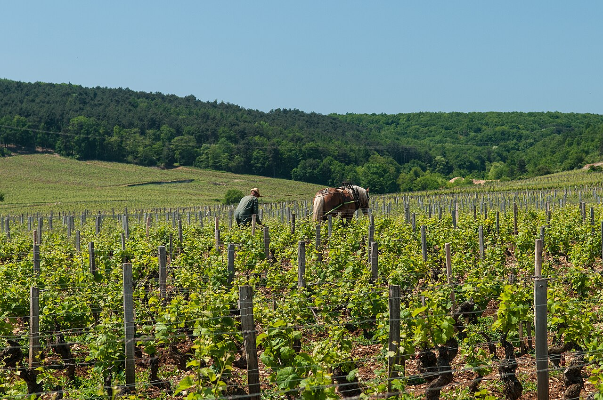

# 拉露·比兹-勒鲁瓦

拉露·比兹-勒鲁瓦（Lalou Bize-Leroy，1932 年生）是勃艮第最受关注、也最容易被神话化的人物之一。她本名 Marcelle Leroy，父亲 Henri Leroy 是 Maison Leroy 的酒商，也是 Domaine de la Romanée-Conti 的股东。她 23 岁接手家族的酒商业务，后来进入 DRC 管理层，又在 1988 年买下两块葡萄园，创立自己的 Domaine Leroy。她的名字今天同时代表顶级酒商、生物动力法与“极低产量”的极端实践。

图：沃恩-罗曼尼附近人工翻土的葡萄园工人；生物动力法所强调的人工耕作场景，不是拉露·比兹-勒鲁瓦本人，也不是其地块。图片：Michal Osmenda from Brussels, Belgium，CC BY 2.0，via Wikimedia Commons（[原图页面](https://commons.wikimedia.org/wiki/File:A_vineyard_worker_manually_tills_the_soil_near_Vosne-Roman%C3%A9e_in_Burgundy_(7309839432).jpg)）。

## 人物小传

拉露 1932 年生于巴黎，成长于一个与勃艮第酒商、葡萄园和 DRC 紧密相连的家庭。1955 年，父亲把 Maison Leroy 的酒商业务交给她；她开始在勃艮第逐家试酒、买酒，训练出极强的感官记忆。1971 年，她成为 Maison Leroy 的总经理；1974 年，父亲退休后，她与 Aubert de Villaine 共同管理 DRC。她在 DRC 负责营销与部分选酒，也亲眼看到顶级地块在 1970 年代如何被重新定义；这段经历让她后来在自己酒庄里更强调“从葡萄到瓶”的完整控制。

## 从酒商到酒庄主人

Maison Leroy 是酒商，不是酒庄：它收购葡萄或成品酒，再以自己的标签出售。拉露很快发现，能够达到她标准的酒越来越少，于是决定自己拥有葡萄园。1988 年，她买下 Vosne-Romanée 的 Charles Noëllat 与 Gevrey-Chambertin 的 Philippe Rémy，合并为 Domaine Leroy；同年 9 月起，所有地块全面转为生物动力法。

## 代表酒款

Domaine Leroy 的旗舰包括 Musigny、Richebourg、Romanée-Saint-Vivant、Chambertin 等特级园，以及一系列一级园与村名酒。它的风格常被描述为“浓度高、质地细、香气复杂”：低产量、老藤、整串发酵比例、长时间浸渍与严格筛果，共同造成一种近乎浓缩的表达。酒庄目前约有 22 公顷，分布在 20 多个 appellation，其中包括 9 个特级园；平均产量常低于每公顷 20 百升，只有法定上限的一半左右。Domaine d'Auvenay 则是她另一处规模更小的酒庄，酒款更稀缺。

## 方法或制度影响

拉露的方法有三个关键词。第一是“逐株补植”：她不让整块葡萄园被拔掉重种，而是从同园老藤上选芽、逐株替换，保持遗传多样性。第二是“不截顶”：让藤蔓自然生长，而不是把顶端剪平，以维持光合作用与植株活力。第三是“日历”：修剪、喷剂与装瓶都参考生物动力日历。她不是生物动力法的发明者，但她是把它在勃艮第顶级酒庄里做到极致的人。

## 评价与争议

正面评价把她称为“勃艮第女王”，认为她证明了生物动力法可以产出世界最贵的酒，也证明了酒商可以转为拥有土地的酒庄。批评则集中在三点：一是生物动力法的科学争议；二是极端低产与晚收带来的风险，1993 年霜霉病就造成严重损失；三是“拉露神话”让酒价与稀缺性互相强化，收藏市场有时压过了对酒本身的讨论。2026 年，Decanter 把她选入名人堂，算是对这套方法的制度性承认。她的女儿 Perrine Fenal 在 1992 年接替她在 DRC 的角色，而 Domaine Leroy 仍由拉露本人主导；这种“家族在机构、个人在酒庄”的分工，也是理解勃艮第权力结构的一个切口。

## 常见误读

第一，把 Domaine Leroy 当成 Maison Leroy。前者拥有葡萄园、自己种、自己酿；后者是酒商，收购酒或葡萄。第二，把生物动力法当成“完全不干预”。它其实是一套严格的耕作与制剂体系，干预并不少。第三，把拉露当成 DRC 的唯一管理者。她 1974–1992 年与 Aubert de Villaine 共同管理。第四，把“低产量”当成营销数字。她的产量确实远低于法定上限，但这也意味着年份差异与风险被放大。

对照阅读：[勃艮第](ref:burgundy)、[勃艮第 AOC 法令](ref:aoc)。

## 延伸阅读

Domaine Leroy 官方页提供家族史、DRC 任期与生物动力法转向的框架；Decanter 2026 名人堂报道与行业专访补充了 1988 年购园、1992 年离开 DRC、逐株补植与 1993 年霜霉病损失。索姆选酒的文章则代表收藏市场的评价口径，容易把“稀缺”与“质量”混在一起。把官方年表、行业报道与市场叙述分开读，才能看清拉露的方法与神话各自的边界。生物动力法的具体操作包括 500 与 501 制剂、堆肥准备与月相日历；这些做法在勃艮第并非拉露首创，但她把整套体系与顶级地块、极低产量结合在一起，才形成今天被广泛讨论的“勒鲁瓦风格”。1992 年她离开 DRC 后，女儿 Perrine Fenal 接替她在 DRC 的联合管理角色，拉露则把全部精力放回 Maison 与 Domaine Leroy；这次分道也标志着 Leroy 家族在勃艮第权力结构中的位置从“共同管理者”转向“独立酒庄”。2026 年的 Decanter 名人堂评选，则把她的影响从“高价酒”扩展到“女性、生物动力法与家族酒商”的三重叙事。

相关条目：[黑皮诺](ref:pinot)。

## 另见

- [勃艮第](ref:burgundy)：拉露全部工作的产区。
- [黑皮诺](ref:pinot)：Domaine Leroy 红葡萄酒的品种基础。
- [勃艮第 AOC 法令](ref:aoc)：理解地块分级与产量限制的制度背景。
- [勃艮第特级园路线](ref:burgundy-route)：从博讷到沃恩-罗曼尼的旅行框架。
- [沃恩-罗曼尼](ref:vosne)：Domaine Leroy 的核心地块所在地。

**关键事实。**

| 项目 | 内容 |
| --- | --- |
| 一句话定位 | 法国勃艮第酒商与酒庄主人（1932 年生），1955 年接手 Maison Leroy，1974–1992 年任 Domaine de la Romanée-Conti 联合经理，1988 年创立 Domaine Leroy 并全面转向生物动力法；以极低产量、逐株补植与严格筛选影响现代勃艮第 |
| 生卒 | 1932–? |
| 身份 | 酒商、酒庄主人、生物动力法倡导者 |
| 关联地区 | 法国、勃艮第 |

**来源与边界。** 本页关于「拉露·比兹-勒鲁瓦」的关键事实，主要由以下来源交叉核对：Domaine Leroy、Made By Magazine（1932 年巴黎出生、23 岁买酒、2026 年 Decanter 名人堂、低产量与严格筛选）、The En Primeur Club（1988 年收购 Charles Noëllat 与 Philippe Rémy、1992 年离开 DRC、逐株补植与 tressage）等 5 条来源。价格、批次与状态会变，涉及这些字段时以页面所列来源的最新版本为准。正文为项目自写，来源只作核验，不复制原文。

**并读。** 把「拉露·比兹-勒鲁瓦」与「勃艮第」、「黑皮诺」、「勃艮第 AOC 法令」放在一起读时，先确认它们是同一层级还是上下游关系：先确认时代与作品，再比较经历、风格与史料边界。本页负责给出人物的基本坐标，对照条目补上具体案例与差异；读完再回到本页，才能分清哪些差别属于人物本身，哪些只是产地、批次或品牌选择。

**适用边界。** 对「拉露·比兹-勒鲁瓦」而言，生卒年与作品系年存在异说；文学或艺术形象不能直接当作历史生活记录。

**更新提示。** 「拉露·比兹-勒鲁瓦」最近核对于 2026-11-21；生平日期、作品归属与研究文献会更新，引用前以权威机构条目为准。

**编者注。** 本页把「拉露·比兹-勒鲁瓦」作为人物条目处理：定义、流程与关键数字以正文表格为准，与「勃艮第」、「黑皮诺」的差异用对照阅读验证；遇到价格、批次或地址，回到页面所列来源核对。
