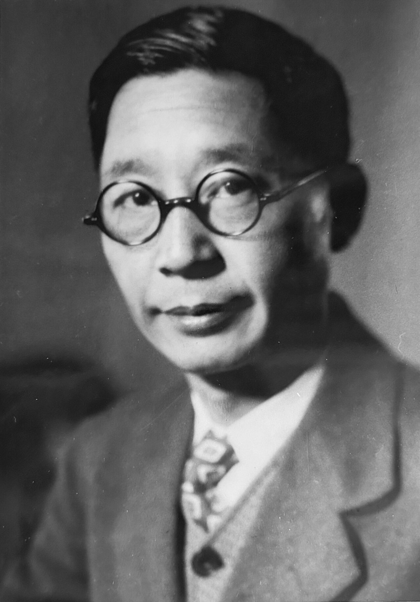

# 老舍

老舍（1899—1966），原名舒庆春，字舍予，北京人，满族。他写城市里的普通人，写他们如何在一张桌子旁谈生意、叙旧、吵架、和解。酒在他的作品里很少是主角，却常是检验处境的道具：谁有资格喝、谁被迫喝、喝完之后说了什么，比酒本身更能说明问题。

图：老舍。图片：Shelburne Studios，Public domain，via Wikimedia Commons（[原图页面](https://commons.wikimedia.org/wiki/File:Standard_compressed_lao-she.jpg)）。

## 人物小传

他生于 1899 年 2 月 3 日，在北京的胡同里长大。1924 年赴英国，在伦敦大学东方学院华语学系任教，1929 年离开，1930 年回国。1936 年夏写成《骆驼祥子》，同年 9 月起在《宇宙风》连载。1957 年发表三幕话剧《茶馆》，1958 年由北京人民艺术剧院首演。1966 年 8 月去世。

他的语言以北京口语为基础，干净、利落，幽默里带一点冷。写市井人物时，他不俯视也不美化，而是让每个人按自己的身份说话。这种写法让茶馆、酒馆这类公共空间有了声音，也让读者能从几句闲话里听出时代的分量。

## 与酒的关系

老舍不是以“酒徒”闻名的作家，可靠记载里也没有“每日必饮”的说法。友人回忆中有些片段，但不足以支持关于酒量或嗜酒的结论。本页不把这些轶事扩写成传记事实，而把重点放在他笔下的饮酒空间与饮酒关系。

在他那里，酒首先是一种社会行为。谈生意要酒，赔礼要酒，借酒装疯也会有人信；酒桌上有上下尊卑，也有临时的平等。写酒而不写醉，是老舍常用的办法：他让读者看见酒如何被人利用，而不把饮酒浪漫化。

## 酒在作品中的具体意象

《骆驼祥子》里有可直接核对的两处酒。祥子在小铺买“四两白干，三个大子儿的落花生”，端着酒碗回到屋里取暖；叙述说酒在桌上“发着辛辣的味儿”。这里的酒是体力劳动者的取暖物，也是贫穷生活里最便宜的麻醉。

另一处是虎妞劝酒。祥子说“我不喝酒！”，虎妞回他“连我还能喝四两呢”，并把酒盅灌下去。酒在这场关系里不是助兴，而是试探、逼迫与控制；祥子的拒绝，说明他想保住一点自主。

《茶馆》第一幕幕启写明：“这里卖茶，也卖简单的点心与菜饭。”茶馆不靠酒做生意，却与酒馆同属公共空间：三教九流在这里相遇，消息在这里交换，冲突也在这里爆发。酒在《茶馆》中常常缺席，这种缺席本身值得注意。

## 代表作品与文本证据

《骆驼祥子》（1936 年连载）写车夫祥子在北平的挣扎，酒是城市底层生活的一部分。《茶馆》（1957 年）用裕泰茶馆的三幕写清末、民国与抗战胜利后的半个世纪，空间固定而人物随时代更换。《四世同堂》写北平沦陷时期的小羊圈胡同，酒出现在家庭与街坊的往来中。《正红旗下》未完成，却保留了满族家庭的礼俗与吃喝细节。

引用时要注意版本。《茶馆》有不同演出本与整理本，个别字句存在差异；《骆驼祥子》早期连载本与后来的单行本也不完全一致。研究酒文字，应说明依据的版本，不把不同版本的字句混在一起。

## 时代与酒

清末民初的北京，小酒馆很发达。“大酒缸”一类店铺卖酒兼卖下酒菜，客人站着或坐着喝，价格低、时间长，是体力劳动者与街坊常去的地方。白酒、黄酒、露酒各有消费群体，[白酒](ref:baijiu)在北方城市尤其常见，冬天喝白干取暖是普通人的生活经验。

[酒馆与城市](ref:pub-and-city)的关系在老舍作品里很清楚：酒馆不是孤立的店铺，它和胡同、市场、衙门、戏园子连在一起。读他的小说，可以把酒馆当作观察城市结构的窗口，而不只是“喝酒的地方”。[酒馆的历史](ref:taverns)也提醒我们，公共饮酒空间的功能会随制度变化；[中国](ref:china)的清末民国背景，则是理解这些变化的坐标。

## 评价与争议

老舍之死是理解其作品时绕不开的争议。English Heritage 的传记页写得很谨慎：1966 年文化大革命开始后，他遭到红卫兵批斗，8 月 25 日遗体在北京太平湖被发现，“人们普遍认为他投湖自尽”。具体经过仍有不同叙述，引用时应保留这种谨慎，不把推测写成定论。

另一层局限在文本本身。《茶馆》三幕跨越半个世纪，人物众多，不围绕单一主人公展开，这种“图卷式”结构是它的成就，也是理解门槛；不同演出本的处理，又会改变观众对人物的判断。读剧本时，最好把文学文本与演出文本分开。

## 常见误读

第一，把《茶馆》当成“酒馆戏”。它写的是茶馆，酒只是同类公共空间的一个参照；茶馆卖茶，也卖简单饭食，不能直接等同于酒馆。

第二，把老舍本人的饮酒轶事当成作品主题。作品关心的是社会关系，不是作者的酒量。

第三，把市井写成“怀旧”。老舍笔下的人物有算计、有挣扎，不是温情滤镜。

第四，忽略版本差异。话剧在演出与整理中会有改动，小说也有连载本与单行本之分，引用时应注明来源。

## 怎样读他的酒文字

先看酒是谁买的、谁倒的、谁拒绝喝，再看喝酒的场所在城市里的位置，最后看喝完之后的后果。按这三步读，《骆驼祥子》里的白干就不只是“地方风味”，而是祥子贫困与受控的证据；《茶馆》里的茶与饭食，也不只是背景，而是公共空间如何被时代挤压的线索。

对照阅读：[认识一座城，从一间酒馆开始](ref:pub-and-city)、[白酒](ref:baijiu)。

## 延伸阅读

- [酒馆与城市](ref:pub-and-city)：酒馆如何嵌入城市生活。
- [酒馆的历史](ref:taverns)：公共饮酒空间的历史变化。
- [白酒](ref:baijiu)：北方城市常见的蒸馏酒。
- [中国](ref:china)：清末民国北京的城市背景。

**关键事实。**

| 项目 | 内容 |
| --- | --- |
| 一句话定位 | 中国现代小说家、剧作家，1899 至 1966 年在世；北京人，满族 |
| 生卒 | 1899–1966 |
| 身份 | 作家、剧作家 |
| 关联地区 | 中国 |

**来源与边界。** 本页关于「老舍」的关键事实，主要由以下来源交叉核对：人民文学出版社（生卒、创作与作品系年）、老舍著；人民文学出版社等通行本（人物、场景与三幕结构；本页只作概述，不复制台词）、Encyclopaedia Britannica（生卒、伦敦任教与代表作品）等 8 条来源。价格、批次与状态会变，涉及这些字段时以页面所列来源的最新版本为准。正文为项目自写，来源只作核验，不复制原文。
