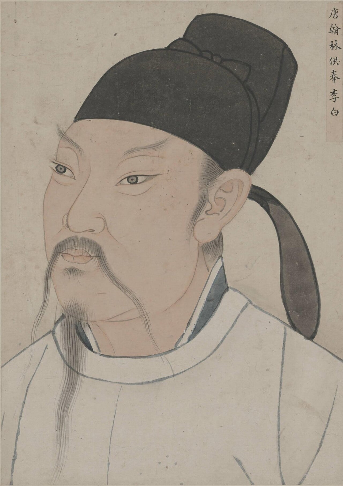

# 李白

李白（701—762），字太白，号青莲居士，盛唐最具代表性的诗人之一。他的名字几乎与“酒”绑定：后世画像、戏曲与通俗读物常把他写成醉中作诗的形象。但历史人物李白与文学形象“酒仙李白”并不是一回事。理解他的酒诗，需要同时看文本、看唐代的酒，也看后人怎样塑造他。

图：佚名《唐名臣像》中的李白像。图片：Unknown author，Public domain，via [原图页面](https://commons.wikimedia.org/wiki/File:%E5%94%90%E5%90%8D%E8%87%A3%E5%83%8F-14-%E5%94%90%E7%BF%B0%E6%9E%97%E4%BE%9B%E5%A5%89%E6%9D%8E%E7%99%BD.jpg)。

## 人物小传

李白生于 701 年，卒于 762 年。关于他的出生地与家世，历代记载并不完全一致，常见说法包括四川江油与西域碎叶，学界仍有讨论。他早年离家漫游，后曾在长安供奉翰林，又因政治失意离开，安史之乱期间因入永王幕府而获罪，晚年流放夜郎，途中遇赦。

他的诗歌以想象奇崛、语言奔放著称，乐府、歌行与绝句都有名篇。与杜甫并称“李杜”，是后世对唐诗高峰最常用的概括。他的行迹横跨今天的[中国](ref:china)四川、湖北、河南、山东、安徽、江西等地，这种长期流动也进入了他的诗。

## 诗与酒的关系

在李白诗中，酒首先是一种场景装置。宴饮、送别、独酌、登高、夜游，都可能出现酒；酒把人物、时间与地点连在一起。其次，酒是一种情绪媒介：它可以放大豪迈，也可以放大孤独；可以表示及时行乐，也可以表示对时间流逝的敏感。

第三，酒是一种社交语言。举杯、劝酒、留客、饯行，都是唐代士人交往的组成部分。诗里的酒未必都真的喝下，但“举杯”这个动作足以让读者进入一场具体的相聚或告别。

把这些层次分开，就不会把每一句“酒”都读成酗酒，也不会把每一首酒诗都读成同样的情绪。

## 《将进酒》里的酒

《将进酒》是李白最常被引用的酒诗之一。“君不见黄河之水天上来，奔流到海不复回”把时间写成不可逆的水；“人生得意须尽欢，莫使金樽空对月”则把饮酒写成对时间的回应。诗中的“金樽”“斗酒”是文学化的量词与器物，不必逐字换算成今天的容量。

这首诗的口气是劝饮，也是自我说服。它一边说“但愿长醉不复醒”，一边又让豪言与失意并置；读者若只截取“人生得意须尽欢”，会丢掉后半段的复杂情绪。引用时注明篇名与出处，比只发一句金句更负责。

## 唐代人喝的是什么酒

唐代主流的酒是谷物发酵酒，用曲把粮食中的淀粉糖化并发酵，再经过压榨或过滤。这类酒酒精度通常低于蒸馏酒，口感偏甜，保存时间有限，因此常以“新醅”“春酒”这样的词出现。[黄酒](ref:yellow-wine)的工艺谱系与这类谷物酒有相通之处，但不能把今天的黄酒直接等同于唐代的酒。

[葡萄酒](ref:wine)在唐代属于外来或稀见之物，多见于西域相关记载与少量诗文；“葡萄美酒夜光杯”出自凉州词，不等于长安街头随处可买。蒸馏酒在唐代是否已经普及，学界有不同意见，稳妥的说法是：唐代日常饮用的主体仍是发酵酒。

## 酒在诗中的几种功能

第一种是送别。饯行时举杯，酒让离别有一个可以停留的时刻；诗中的酒量、酒器与天气，往往比“舍不得”三个字更能传达情绪。

第二种是独酌。独饮把外部世界关小，只剩人与月亮、影子或一杯酒；这类诗里的酒不是热闹，而是自我对话的工具。

第三种是宴饮与社交。酒令、歌舞、座次与劝酒构成一场聚会的秩序；诗记录的不只是喝什么，还有谁在场、谁先醉、谁在写诗。

第四种是时间。酒让人暂时离开日常，也让“此刻”变得清晰；当诗人说“及时行乐”，背后往往是对短暂与无常的清醒。

## 常见误读

第一，把“斗酒诗百篇”当成精确酒量。斗是古代容量单位，不同朝代的量制不同，酒器的容量也不同于今天；这句话是文学夸张，不是体检报告。

第二，把“酒仙”当成历史定论。后世绘画、戏曲与酒业广告共同塑造了这个形象，它反映了文化想象，不等于李白每天的真实饮量。

第三，把所有酒诗都读成同一情绪。李白的酒诗有豪迈、有孤独、有应酬、有自嘲，脱离篇目谈“李白与酒”，容易变成标签。

第四，用今天的白酒去想象唐诗。唐代主流是低度谷物酒，把“金樽”直接对应今天的 52 度白酒，会错位。

## 怎样读李白的酒诗

先看篇目与写作背景，再看酒出现在诗的哪个位置：开头、转折还是结尾。酒若在结尾，往往是情绪的落点；酒若在开头，往往是把读者拉进场景。然后看酒器与量词：金樽、玉碗、斗、杯，既是实物，也是修辞。

最后看同时出现的其他意象：月、水、剑、马、歌、朋友。酒很少单独出现，它总与别的东西并置；并置关系才是诗意所在。若要做引用，标明版本与篇名，避免把不同版本的字句混在一起。

## 影响与后世形象

李白对后世的影响，一半在诗，一半在形象。诗提供了“奔放、想象、不受拘束”的语言资源；形象则被不断再创作：醉学士、酒中仙、仗剑远游的旅人。酒业、书画、戏曲与流行文化都从中取材。

这种形象有传播价值，也有遮蔽作用。它让“李白”容易辨认，却容易让人忘掉他的政治挫折、家庭生活与具体的写作环境。把人物放回历史，不是要拆掉传说，而是让传说有一个可核对的地面。

对照阅读：[一杯酒里的时间](ref:time-in-a-cup)、[葡萄酒](ref:wine)。

## 延伸阅读

- [一杯酒里的时间](ref:time-in-a-cup)：从《诗经》到唐诗，酒如何进入节令与写作。
- [月下独酌](ref:drinking-alone)：李白独酌诗中的月、影与酒。
- [问刘十九](ref:asking-liu)：白居易以酒邀客的短诗，可作同期对照。
- [黄酒](ref:yellow-wine)：谷物发酵酒的工艺谱系。
- [葡萄酒](ref:wine)：葡萄酒的定义与基本工艺。

**关键事实。**

| 项目 | 内容 |
| --- | --- |
| 一句话定位 | 盛唐诗人，701 至 762 年在世；酒在他的诗里既是宴饮与送别的场景，也是孤独、时间与抱负的隐喻 |
| 生卒 | 701–762 |
| 身份 | 诗人 |
| 关联地区 | 中国 |

**来源与边界。** 本页关于「李白」的关键事实，主要由以下来源交叉核对：Encyclopaedia Britannica（生卒年、行迹与文学地位）、中华书局整理本；中国哲学书电子化计划提供在线文本（李白诗作的通行文本来源；本页只引用短句，不复制全篇）、北魏贾思勰撰；中华书局整理本（提供制曲与酿酒记载，用于理解唐代以前的谷物酒背景；由原条目末尾参考资料迁移，未逐条复核访问日期）等 5 条来源。价格、批次与状态会变，涉及这些字段时以页面所列来源的最新版本为准。正文为项目自写，来源只作核验，不复制原文。
