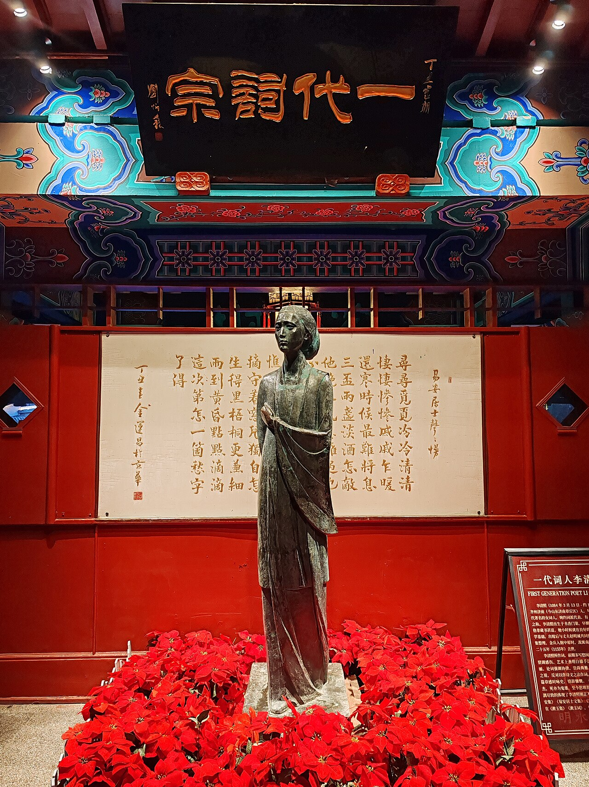

# 李清照

李清照（1084—约 1155），号易安居士，齐州章丘人，宋代最著名的女词人。她的词里酒出现得很频繁，但前后期差别明显：北宋时的酒多与出游、赏花、闲愁相连，南渡之后的酒则常与孤独、旧事和回不去的生活相连。同一只杯子，温度一直在下降。

图：李清照。图片：Vitsuha，CC0，via Wikimedia Commons（[原图页面](https://commons.wikimedia.org/wiki/File:%E6%9D%8E%E6%B8%85%E7%85%A7%E5%A1%91%E5%83%8F.jpg)）。

## 人物小传

李清照生于 1084 年，父亲李格非是礼部员外郎，属苏轼门下“后四学士”之列，母亲也出自书香门第。她自幼读书，兼工诗文，后来以词名世，词集名《漱玉词》。

1101 年，她与赵明诚结婚。赵明诚是太学生，后来成为金石学家，两人共同收藏青铜器、碑刻、书画，生活优裕而忙碌。1107 年赵挺之罢相去世，赵家失势，夫妇屏居青州约十年，建“归来堂”，把大部分精力放在整理藏品与校勘上。

1127 年靖康之变，北宋灭亡，他们仓皇南渡，藏品在辗转中大量散失。1129 年，赵明诚在赴任湖州途中病逝于建康，年四十九。此后李清照独自辗转江浙，晚年境遇孤苦。1134 年，她为《金石录》写下后序，追述夫妇收藏的经过与散失的详情，是了解她生平最重要的第一手文字。

## 生平节点

- 1084 年：生于齐州章丘。
- 1101 年：与赵明诚结婚。
- 1107 年：赵家失势，夫妇屏居青州，约十年。
- 1127 年：靖康之变，随宋室南渡。
- 1129 年：赵明诚病逝于建康。
- 1134 年：作《金石录后序》。
- 约 1155 年：去世；具体年份有 1151、1155、1156 等异说。

## 婚姻与南渡

李清照的婚姻常被写成一段完美的文人佳话，但材料显示的情况更复杂。青州十年是两人合作最紧密的时期：他们节衣缩食购藏碑帖，校勘题跋，赵明诚撰《金石录》，李清照参与整理。这段生活给了她后来反复追忆的物质基础，也给了她失去时的具体内容。

南渡改变了一切。1129 年赵明诚病逝，李清照带着残存的藏品继续逃难，又遭遇盗失与诬告。她在《金石录后序》里写自己如何在兵荒马乱中保护这些器物，语气克制，细节却极痛。此后她的词里频繁出现“旧时”“当年”“如今”，不是修辞习惯，而是生活真的断成了两截。

## 与酒的关系

李清照写酒，很少写豪饮，多写饮酒之后的身体与情绪：醉、醒、残酒、淡酒。酒是她标记时间的方式——春天喝什么、重阳喝什么、元宵还喝不喝，都对应着具体的处境。

## 代表作品中的酒

《如梦令》其一写“常记溪亭日暮，沉醉不知归路。兴尽晚回舟，误入藕花深处。争渡，争渡，惊起一滩鸥鹭”。这里的醉是轻快的，带来的是迷路与惊喜，不是愁苦。少女时代的酒，是有退路的。

《如梦令》其二写“昨夜雨疏风骤，浓睡不消残酒。试问卷帘人，却道海棠依旧。知否，知否？应是绿肥红瘦”。“残酒”是宿醉，酒醒之后第一件事是问花；她的判断比侍女准确，这是一种清醒的伤感，酒只是把夜拉长了。

《醉花阴》写重阳独处：“薄雾浓云愁永昼，瑞脑消金兽。佳节又重阳，玉枕纱厨，半夜凉初透。东篱把酒黄昏后，有暗香盈袖。莫道不销魂，帘卷西风，人比黄花瘦。”“把酒”是动作，“暗香”是菊，“人比黄花瘦”是结果。酒没有解决问题，只是陪她把这个下午过完。

《声声慢》写南渡后的秋天：“三杯两盏淡酒，怎敌他、晚来风急？”酒是淡的，量是少的，连风都挡不住。这里的“淡”既是口感，也是处境：不是没有酒，而是酒已经不起作用。

《永遇乐·落日熔金》写元宵：“来相召、香车宝马，谢他酒朋诗侣。”别人来邀，她推辞了。拒绝社交性的饮酒，比独酌更冷；酒在这里代表的是一个她已经不想进入的场合。

## 评价与争议

第一桩争议是再嫁。宋代王灼《碧鸡漫志》、胡仔《苕溪渔隐丛话》等书记载，李清照在赵明诚去世后再嫁张汝舟，因不堪虐待而讼离；李清照《投内翰綦公崇礼启》中也有“猥以桑榆之晚景，配兹驵侩之下材”一类自述。明清学者如俞正燮作《易安居士事辑》，力辩其无，认为这是宋人诬蔑。两种说法各有依据，本页采取“宋人记载存在、清人辩诬亦有其理”的写法，不把再嫁当成定论，也不把它当成不可能。

第二桩是她的词学批评。《词论》提出“词别是一家”，批评柳永“词语尘下”，也批评晏殊、欧阳修、苏轼的词“皆句读不葺之诗尔，又往往不协音律”。这是宋代词学中最锋利的判断之一，也招来反批评：有人说她以音律绳墨约束了词的抒情空间，也有人说她对自己的创作过于自信。无论立场如何，这段文字说明她不是被动地“写愁”，而是有明确理论主张的作者。

第三桩是作品归属。《漱玉词》在流传中混入他人之作，例如《生查子·元夕》（“去年元夜时，花市灯如昼”）常被误归李清照，实际多系欧阳修或朱淑真名下。引用时必须核对版本，不能因为风格相近就归给她。

## 常见误读

第一，把她词里的酒都读成闺怨。她前期词有明快的游赏，后期词才有明显的孤寂；《如梦令》其一的醉与《声声慢》的淡酒，不是同一种情绪。

第二，把“淡酒”当成低度酒的技术描述。它同时是情绪词，强调酒不足以御寒解愁；宋代的酒本来就比今天的蒸馏酒淡，但“淡”在这里首先是无力。

第三，把“沉醉”当成酒量记录。文学中的醉常是情绪状态与叙事装置，不是医学数据。

第四，只读《声声慢》就概括她的一生，会漏掉她整理金石、撰写《金石录后序》的工作，也会漏掉她词学理论的一面。

第五，把《生查子·元夕》当作李清照作品。这首词归属有争议，通行说法多归欧阳修，引用时应注明。

相关条目：[一杯酒里的时间](ref:time-in-a-cup)、[黄酒](ref:yellow-wine)、[中国酒史纲：从谷物发酵到国家名酒](ref:chinese-wine-history)。

## 另见

- [一杯酒里的时间](ref:time-in-a-cup)：酒如何进入节令与写作。
- [黄酒](ref:yellow-wine)：宋代谷物酒的工艺谱系。
- [中国酒史](ref:chinese-wine-history)：酒政与酿造技术的长期变化。
- [中国](ref:china)：李清照生活与南渡行迹的地理范围。

补充阅读：[安德烈·西蒙](ref:c-extra-1)。

**关键事实。**

| 项目 | 内容 |
| --- | --- |
| 一句话定位 | 宋代词人，1084 年出生，卒年通常记为 1155 年前后；她以“沉醉不知归路”“东篱把酒”“三杯两盏淡酒”写少女、闲居与南渡后的孤寂，酒的温度随人生境遇下降 |
| 生卒 | 1084–1155 |
| 身份 | 词人、金石收藏者 |
| 关联地区 | 中国 |
