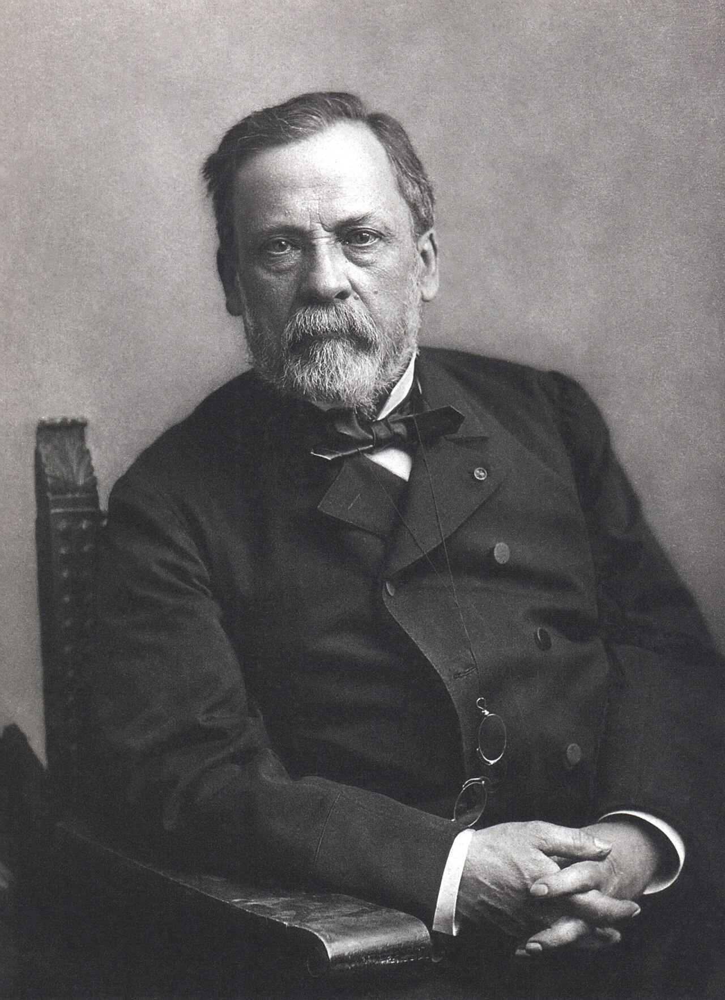

# 路易·巴斯德

路易·巴斯德（Louis Pasteur，1822—1895）是法国化学家与微生物学家。他的名字在今天常与“巴氏消毒”连在一起，但他的工作范围远不止食品加热：他研究分子不对称、发酵、自然发生说、蚕病、酿酒与疫苗。对酒类而言，他最重要的贡献是把“发酵”从一种神秘的化学变化，变成可以用微生物解释、也可以被干预的过程。

图：路易·巴斯德。图片：Paul Nadar，Public domain，via Wikimedia Commons（[原图页面](https://commons.wikimedia.org/wiki/File:Louis_Pasteur,_foto_av_Paul_Nadar,_Crisco_edit.jpg)）。

## 人物小传

巴斯德生于[法国](ref:france)汝拉地区的多勒，父亲是制革匠。他在贝桑松与巴黎求学，早年研究化学，因对酒石酸结晶的研究获得关注。此后他先后在斯特拉斯堡、里尔与巴黎任职，逐渐把研究转向发酵与微生物。

他的家庭生活并不轻松：与妻子育有五个孩子，只有两个活到成年。这段经历常被后人用来解释他对疾病与疫苗的投入，但更直接的动力来自他的实验与时代需求。19 世纪中期的法国，酿酒、制醋、养蚕与公共卫生都急需可操作的微生物知识。

1888 年，以他名字命名的巴斯德研究所在巴黎成立。这个机构后来成为微生物学、免疫学与公共卫生研究的重要中心。

## 发酵之争

在巴斯德之前，发酵常被解释为一种化学分解，或被认为是“自发产生”的结果。巴斯德通过实验证明，发酵与微生物的活动有关：把酒液或培养液与空气、尘埃中的微生物隔离，发酵与腐败的速度和结果都会改变。

这并不是说空气本身有害，而是说空气携带的微生物参与其中。巴斯德用加热、过滤与密封等方法排除微生物，再观察结果，从而把“自然发生”推向失败。这个结论对酒的意义很直接：如果酒变酸、变浑浊、出现异味与微生物有关，那么控制微生物就能控制酒的稳定性。

## 巴斯德与葡萄酒

19 世纪 60 年代，法国葡萄酒业面临酒变酸与变质的问题。巴斯德研究葡萄酒的发酵与储存，提出加热可以杀死导致变质的微生物，同时尽量不破坏酒本身。他还研究过酒石酸与酒石酸盐的结晶，这些结晶在酒桶与酒瓶中出现，既影响观感，也造成损耗。

这些工作并没有让葡萄酒从此“无菌”。加热会改变香气与口感，因此后来更常见的做法是二氧化硫、过滤、温控与卫生管理。但巴斯德提供了方向：把酒的问题当成微生物问题来研究，而不是只靠经验。

## 巴氏消毒与啤酒

巴氏消毒通常指把液体加热到一定温度并保持一段时间，以杀灭病原微生物、延缓腐败。它不等于把液体煮沸。温度、时间与对象决定效果；牛奶、果汁、啤酒与葡萄酒的处理条件并不相同。

啤酒是巴氏消毒最广泛的应用对象之一。加热可以稳定瓶装或罐装啤酒，延长货架期，但也可能改变香气。现代啤酒工业因此会在“稳定性”与“新鲜风味”之间取舍：有的产品选择加热杀菌，有的选择无菌过滤与冷链，有的二者结合。

对葡萄酒而言，巴氏消毒在多数精品酒中并不是常规工序；但在历史上，它确实为“酒会变质”提供了一个可操作的解决方案。

## 酒石酸与结晶

酒石酸是葡萄中天然存在的有机酸，在发酵与陈酿过程中可能形成酒石酸盐结晶，附着在桶壁、瓶底或软木塞上。结晶本身通常无害，却会被消费者误认为杂质或玻璃碎片。

巴斯德对酒石酸结晶的研究，起因于他对分子不对称的兴趣。他发现某些结晶具有旋光差异，进而提出分子结构与其光学性质之间的关系。这条线索后来成为立体化学的重要起点。

对酒的处理因此多了一层理解：沉淀不一定是缺陷，可能只是酸与盐在温度变化下的自然结果；是否需要处理，要看酒的类型、温度与饮用场景。

## 对酒业的影响

第一，卫生。巴斯德的工作让酿酒与制啤者更清楚地意识到，容器、管道、空气与原料都可能带入微生物；清洁不再是“看起来干净”，而是可被微生物学检验的流程。

第二，稳定。加热、过滤、二氧化硫与温控成为稳定酒的手段；选择哪一种，取决于产品定位与风味目标。

第三，科学化。发酵从“师傅的经验”变成可以测量、复现与解释的过程；温度曲线、酸度、糖度与微生物计数逐渐进入酒厂语言。

第四，公共健康。巴氏消毒在乳制品、果汁与啤酒中的普及，降低了食源性疾病的传播。酒只是其中一个应用场景。

## 常见误读

第一，巴氏消毒等于煮沸。实际是较低温度加热并保持一段时间，条件因液体而异；煮沸会显著改变风味与营养。

第二，巴斯德“发明”了葡萄酒。葡萄酒在巴斯德之前已经存在数千年；他研究的是变质、发酵与稳定，不是发明酒。

第三，巴斯德解决了所有酒的变质问题。微生物只是原因之一，氧化、光照、温度波动与包装密封同样会造成问题。

第四，巴氏消毒让酒变得完全安全。它降低病原微生物风险，但不能解决酒精本身的风险，也不能修复已经产生的异味。

第五，巴斯德只研究酒。他的疫苗、蚕病与自然发生研究同样重要；把视野缩到“消毒”会误读他的科学范围。

## 科学方法与今天

巴斯德的实验方法有一个清晰结构：提出可检验的假设，设计能排除干扰的实验，再用结果修正假设。他并不总是温文尔雅，争论中也有尖锐之处；但他的工作展示了“控制变量”如何把一个模糊问题变成可操作的答案。

今天的酒厂与实验室仍在用这套思路：先找出变化，再分离原因，最后选择干预手段。对普通饮者来说，这意味着一件事：酒的风味变化可以被解释，也可以被记录；不必把每一次变质都归因于“运气”。

## 延伸阅读

- [啤酒](ref:beer)：定义、类型与酿造的基础知识。
- [葡萄酒](ref:wine)：葡萄酒的定义与基本工艺。
- [一杯酒，为什么有地方的味道？](ref:place-and-process)：产地、工艺与风味之间的关系。
- [第一次喝葡萄酒怎么选](ref:first-wine)：从产区、品种到价格的入门步骤。

相关条目：[啤酒](ref:beer)、[葡萄酒](ref:wine)、[一杯酒，为什么有地方的味道？](ref:place-and-process)。
