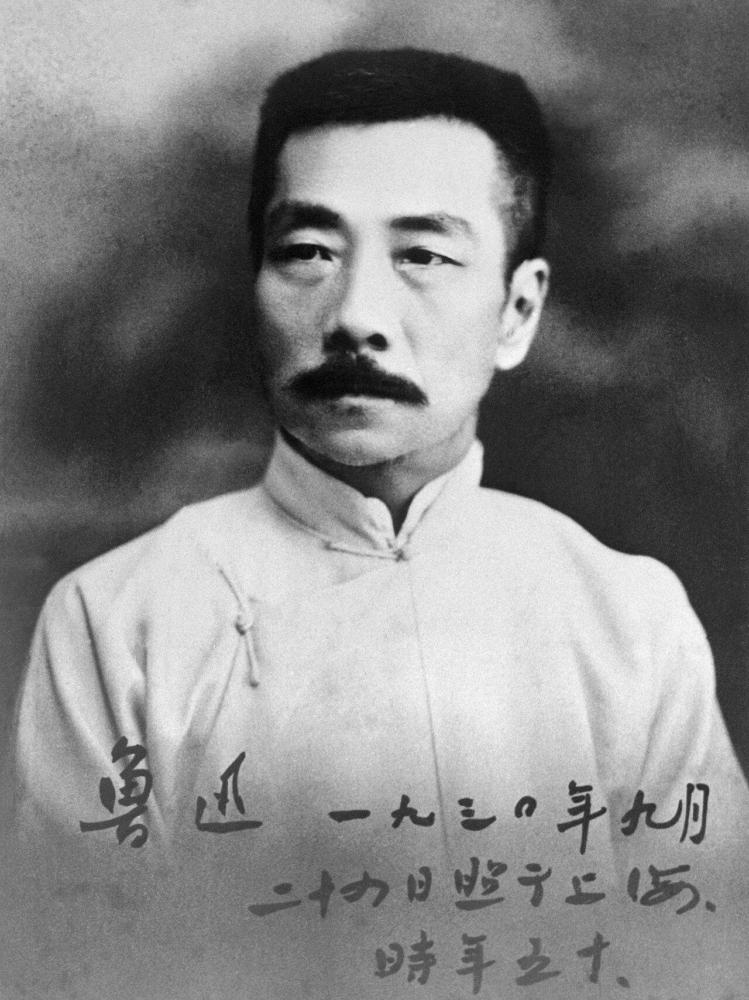

# 鲁迅

鲁迅（1881—1936），原名周树人，字豫才，浙江绍兴人。酒在他的作品里有三个互不重叠的位置：故乡绍兴的日常饮品、文人之间的社交媒介，以及文学史与政治史的分析对象。把这三层混成“鲁迅爱喝酒”的轶事，最有价值的部分反而会消失。

图：鲁迅。图片：Unknown author Unknown author，Public domain，via Wikimedia Commons（[原图页面](https://commons.wikimedia.org/wiki/File:LuXun1930.jpg)）。

## 他写作的年代与位置

绍兴自明清以来是黄酒的核心产区，酒坊、酒行、水路与酒馆构成小城生活的一部分。鲁迅出生在一个正在败落的士大夫家庭：1893 年，祖父周福清因科场行贿案入狱，家道随之中落。这段经历让他对“柜台内外”的等级格外敏感——谁站着喝，谁坐着喝，谁穿长衫，谁穿短衣，都不是无关紧要的布景。

1912 年民国成立后，他在教育部任职；1918 年发表《狂人日记》，成为新文化运动的重要作家；1927 年定居上海，1936 年病逝。他的写作身份是作家、翻译家与批评家，不是酒业从业者，因此他提供的不是酿造数据，而是酒在社会关系中的位置。

## 生平节点

- 1881 年 9 月 25 日生于浙江绍兴。
- 1898 年赴南京求学，先入江南水师学堂，后转矿路学堂。
- 1902 年赴日本留学，1904 年入仙台医学专门学校，1906 年前后弃医从文。
- 1912 年随教育部迁往北京，任佥事；1918 年发表《狂人日记》。
- 1919 年 4 月，《孔乙己》刊于《新青年》第六卷第四号。
- 1926 年赴厦门大学任教，1927 年到广州中山大学，同年 10 月定居上海。
- 1930 年参与发起中国左翼作家联盟。
- 1936 年 10 月 19 日病逝于上海。

## 与酒的三重关系

第一层是故乡。绍兴黄酒是他熟悉的日常饮品，小说里的温酒、酒碗、茴香豆，都是地方生活的细节，不需要额外解释。

第二层是社交。日记中大量记录会客、饮馔与买书，酒是文人交往的常规媒介。这一层提供的是生活史材料，不能直接换算成酒量或嗜好。

第三层是思想。1927 年的演讲把魏晋文人的饮酒放回政治压力与门阀制度中，酒成了理解一个时代文学风格的入口。这一层最容易被忽略，却最能说明他为什么值得在酒文化站点里单独立页。

## 《孔乙己》：柜台内外的阶层刻度

小说开篇就写空间的规矩：“鲁镇的酒店的格局，是和别处不同的：都是当街一个曲尺形的大柜台，柜里面预备着热水，可以随时温酒。”温酒不是装饰，而是黄酒的饮用方式；柜台也不是道具，而是把顾客分成两类的界线。

接着是价格：“做工的人，傍午傍晚散了工，每每花四文铜钱，买一碗酒……靠柜外站着，热热的喝了休息。”四文一碗，两碗八文，一碟茴香豆一文，孔乙己“温两碗酒，要一碟茴香豆”后“排出九文大钱”，数目正好对得上。这个细节说明鲁迅写酒写得很实：价钱、分量、温度都可核验。

最关键的一句是“孔乙己是站着喝酒而穿长衫的唯一的人”。站着喝是短衣帮的位置，长衫是读书人的身份，他卡在两者之间，所以既被嘲笑，又被记住。酒的阶层功能在这里比“喝了多少”重要得多。小说结尾只说“大约孔乙己的确死了”，酒馆的笑声照旧，一个人的消失没有改变任何规矩。

## 《在酒楼上》：一壶绍酒里的失意

1924 年的《在酒楼上》收入《彷徨》。“我”回到故乡S城，走进旧识的酒楼一石居，开口点的是：“一斤绍酒。——菜？十个油豆腐，辣酱要多！”随后又添了茴香豆、冻肉、油豆腐与青鱼干。这段点菜单几乎就是一份绍兴日常饮食的记录。

酒在这里的作用不是助兴，而是让两个失意的人重新开口。吕纬甫讲自己的辗转与妥协，“我”听着，窗外是废园与雪。整篇小说没有豪饮场面，只有慢慢喝、慢慢说；绍酒的温度与故乡的记忆绑在一起，喝下去的是地方，也是时间。

## 《魏晋风度及文章与药及酒之关系》：把饮酒放回政治

1927 年 7 月 23 日与 26 日，鲁迅在广州的夏期学术演讲会上分两次讲这个题目。他从曹操禁酒讲起，讲到孔融反对禁酒，再讲到何晏服五石散、竹林七贤的放诞，最后落到陶渊明。

他有一句很能说明方法的话：“曹操是个办事人，所以不得不这样做；孔融是旁观的人，所以容易说些自由话。”这句话把饮酒从“风度”还原为位置：掌权者与旁观者的处境不同，说出来的话也就不同。他还提醒听众，陶潜“总不能超于尘世，而且，于朝政还是留心”，所谓飘逸是被后人加工出来的形象。

这篇演讲的价值在于示范了一种读法：看到名士喝酒，不要急着羡慕他们的洒脱，先问他们处在什么政治结构里，饮酒是享受、是自保，还是表演。

## 日记与宴席：可核验的日常

《鲁迅日记》从 1912 年 5 月记到 1936 年 10 月，逐日记录读书、写作、会客、买书与饮馔。体例极简，往往一行一条，既没有心情描写，也没有酒量统计。

正确的用法是把它当账簿，而不是当自白：它能证明“与友人饮”是常态，能提供时间、地点与人名，但不能证明酗酒，也不能据此重建一个人的饮酒史。把日记里的每一个“饮”字都当成证据，是史料误用。

## 评价与争议

1928 年的“革命文学”论争中，创造社与太阳社的刊物集中攻击鲁迅，杜荃（郭沫若）的文章直接称他为“封建余孽”“二重反革命”。鲁迅后来把这些攻击文字收入《三闲集》，让批评与回应并置。这是一条有文本、有出处的批评，不是后世的客套评价。

另一层争议来自方法：他把魏晋饮酒解释为政治压力下的反应，带有 1927 年自身处境的投射；学界对他“借古讽今”的分寸有不同判断。此外还有史料局限——小说与演讲都不涉及酿造工艺、酒税或酒业经营，不能当作酒业史的直接材料。

## 常见误读

第一，把孔乙己当成鲁迅的自画像。人物有虚构与概括，不能与作者画等号。

第二，把“温两碗酒”读成豪饮。黄酒度数低，温饮、慢饮是常规方式，用今天烈酒的经验去读会错位。

第三，把日记里的“饮”当成酗酒证据。日记记的是社交，不是酒量。

第四，把魏晋名士的饮酒浪漫化。鲁迅的演讲恰恰在拆解这种浪漫化。

第五，把今天绍兴的咸亨酒店店面当成小说现场。旅游空间经过重建与包装，不能反推 1919 年的文本细节。

相关条目：[黄酒](ref:yellow-wine)、[黄酒史：米、曲、水与绍兴](ref:yellow-wine-history)、[酒馆史：从酒肆、客栈到酒吧](ref:taverns)。

## 另见

- [黄酒](ref:yellow-wine)：绍兴酒所属的谷物发酵酒类型。
- [绍兴黄酒的历史](ref:yellow-wine-history)：酒坊、水路与地方经济。
- [酒馆的历史](ref:taverns)：酒馆作为公共空间的社会功能。
- [中国](ref:china)：民国时期江南城镇的区域背景。

补充阅读：[安德烈·西蒙](ref:c-extra-1)。
