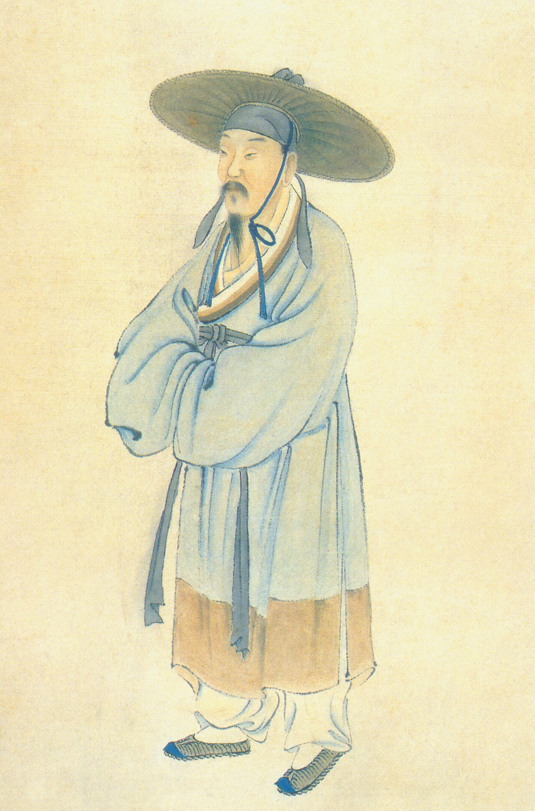

# 陆游

陆游（1125—1210），字务观，号放翁，越州山阴（今浙江绍兴）人。他是南宋存诗最多的诗人之一，酒几乎贯穿一生：年轻时在蜀道与军中饮酒，中年乡居时喝农家腊酒，晚年追忆旧事时又举起黄縢酒。酒在他的诗里不是单一情调，而是不同生活阶段的标记。

图：陆游。图片：Unknown Unknown ,清人 繪，Public domain，via Wikimedia Commons（[原图页面](https://commons.wikimedia.org/wiki/File:%E9%99%B8%E6%B8%B8_%E8%82%96%E5%83%8F.jpg)）。

## 生平与行迹

陆游生于 1125 年，成长于北宋灭亡、宋室南渡的变局中。1153 年，他参加两浙转运司锁厅试，名列第一；次年礼部试，因秦桧之孙秦埙名次受影响，被黜落。1163 年孝宗即位，赐他进士出身，任镇江通判。1172 年入蜀，在四川宣抚使王炎幕府任职，亲历前线；1178 年离蜀东归；1180 年出任严州知州；此后几度起落，晚年退居山阴；1210 年去世。

他一生主张抗金，政治上属于主战派，因此屡遭排挤。不列颠百科全书说他有四次被贬的经历。仕途的不顺与家国的忧患，共同构成了他酒诗的底色。

## 酒诗的三重场景

陆游的酒诗大致分布在三个场景。第一是军旅与行旅：酒是出发前的壮行，也是路上的疲惫。第二是乡居：酒是腊月家酿、春社待客、邻里往来。第三是旧情：酒是记忆的开关，一提到某个酒名，某个人和某个园子就回来了。

《剑门道中遇微雨》属于第一类，《游山西村》属于第二类，《钗头凤》属于第三类。三首诗的酒名、语气、场合都不同，合起来才能看出陆游写酒的宽度。

## 《游山西村》与农家腊酒

1167 年，陆游罢官闲居山阴三山别业，写下《游山西村》。开头四句是：“莫笑农家腊酒浑，丰年留客足鸡豚。山重水复疑无路，柳暗花明又一村。”腊酒是腊月酿制的农家酒，“浑”指未过滤干净，酒液带渣；这不是劣质，而是家酿的常态。“足鸡豚”说明年成好，待客有鸡有猪。

这首诗里的酒不属于文人雅集，而属于乡村的互惠：丰年留客，客人喝酒，主人不觉得亏。酒是收成的一部分，也是人情的一部分。后两句从景物转成人生经验，“山重水复”与“柳暗花明”之所以流传，正因为它先写路，再写心境。

## 《钗头凤》与黄縢酒

《钗头凤》开头说：“红酥手，黄縢酒，满城春色宫墙柳。”黄縢酒是黄封酒，宋代官酿常用黄纸或黄绢封坛，因此“黄縢”指封口方式，不是某个品牌。红酥手通常解作红润的手，也有学者解作一种酥油点心；无论取哪一说，它都与黄縢酒一起构成沈园重逢的感官记忆。

这首词的本事来自后人的笔记，如陈鹄《西塘集耆旧续闻》、周密《齐东野语》，不是陆游同时代的自述。词可以有生活依据，也有文学加工；把它当成严格的传记材料，会忽略宋词代言、用典与声律的传统。

## 《剑门道中遇微雨》与酒痕

1172 年，陆游从南郑前线转赴成都，途经剑门，写下：“衣上征尘杂酒痕，远游无处不销魂。此身合是诗人未？细雨骑驴入剑门。”衣服上的尘土与酒痕混在一起，是长途行旅的证据；“此身合是诗人未”是一句自嘲：他本想做战士，结果却成了骑驴入蜀的诗人。

这首诗把酒放在“军旅—行旅—诗人身份”的交界处。酒痕不是宴饮的荣耀，而是奔波留下的痕迹；正因如此，它比任何“壮怀激烈”的直说都更能说明陆游的处境。

## 《剑南诗稿》的规模与酒业史料

《剑南诗稿》共八十五卷，存诗九千三百多首。酒名在其中反复出现：腊酒、村酒、官酒、黄縢酒，还有酒旗、酒家、醉归、独酌。把这些诗集中起来读，可以看到南宋两浙乡镇的酒业日常：哪里有酒旗，什么人可以卖酒，节令时喝什么，待客用什么。

《宋史·食货志》记宋代酒有官榷、买扑等制度，酒税是地方财政的重要来源。陆游诗里的“官酒”与“村酒”之分，正好与这些制度对照：官酒进入榷场与税务，村酒留在乡邻与节庆。诗不能代替制度史，但可以提供制度落在地面上的样子。

## 评价与争议

陆游的爱国诗最受推崇，但他也因写得太多而受到批评。《四库全书总目》评《剑南诗稿》说“游诗清新刻露，而出以圆润，实能自辟一宗”，接着又指出“其诗多至万首，或失于粗率”。这是有出处的局限：数量带来了题材的重复与表达的滑易，部分作品不够精炼。

另一层争议在《钗头凤》。沈园故事流传很广，但最早见于陆游身后的笔记，细节未必可靠；词中的“东风恶”“错、错、错”也可能有政治寄托。把它完全读成爱情自传，反而窄化了作品。

## 常见误读

第一，把“腊酒浑”当成酒质低劣。腊酒是腊月酿制的农家酒，浑浊是过滤程度所致。第二，把《钗头凤》完全当作陆游自传。词有文学加工，沈园本事也来自后人记载，需与诗词分开看。第三，只用爱国诗概括陆游。他的乡居、饮食、酒诗同样重要。第四，把宋代的酒都当成今天的黄酒。工艺上有渊源，但不能直接等同。第五，把“黄縢酒”当成某个品牌。它指黄封的酒，可能来自官酿，也可能只是以黄纸封坛。

陆游酒诗里的腊酒、黄縢酒是具体酒名与场景，不是泛指所有酒；把诗中的酒一律解成绍兴黄酒，会忽略地域、年份与诗人当下的处境。

## 年表

- 1125 年：出生。
- 1153 年：锁厅试第一。
- 1154 年：礼部试被黜落。
- 1163 年：赐进士出身，任镇江通判。
- 1172 年：入蜀，任职于四川宣抚使幕。
- 1178 年：离蜀东归。
- 1180 年：出任严州知州。
- 1210 年：去世。

相关条目：[一杯酒里的时间](ref:time-in-a-cup)、[黄酒](ref:yellow-wine)、[中国酒史纲：从谷物发酵到国家名酒](ref:chinese-wine-history)。

## 另见

- [一杯酒里的时间](ref:time-in-a-cup)：酒如何进入节令与写作。
- [黄酒](ref:yellow-wine)：谷物发酵酒的工艺谱系。
- [中国酒史](ref:chinese-wine-history)：宋代酒业与酒政的变化。
- [中国](ref:china)：陆游行迹与山阴乡居的地理范围。

补充阅读：[安德烈·西蒙](ref:c-extra-1)。

**关键事实。**

| 项目 | 内容 |
| --- | --- |
| 一句话定位 | 南宋诗人，1125—1210；存诗近万首，酒诗贯穿军旅、乡居与旧情，《游山西村》《钗头凤》《剑门道中遇微雨》留下了具体的酒名与场景 |
| 生卒 | 1125–1210 |
| 身份 | 诗人 |
| 关联地区 | 中国 |
