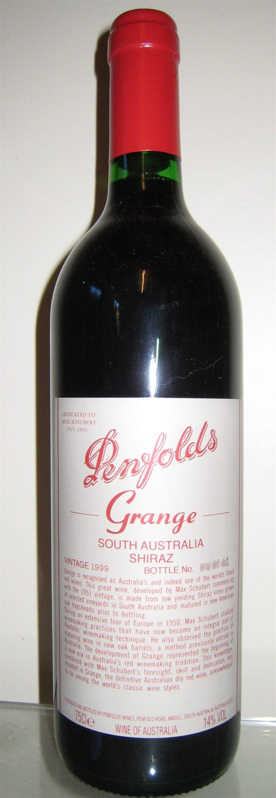

# 马克斯·舒伯特

马克斯·舒伯特（Max Schubert，1915—1994）是澳大利亚酿酒师，奔富（Penfolds）首任首席酿酒师，也是葛兰许（Grange）的创造者。他 1931 年以信差身份进入奔富，1948 年 33 岁时升任首席酿酒师；1950 年赴欧洲考察，在波尔多看到能陈年数十年的红酒，回国后于 1951 年酿出第一瓶实验性葛兰许。1957 年，董事会认为这款酒太粗犷、太贵、没有市场，命令他停产；他却把 1957、1958、1959 三个年份秘密藏在马吉尔的地下酒窖里。1960 年，董事会重新认可葛兰许，这款酒从此走上神坛，成为澳大利亚精品红酒的代名词。

图：一瓶 1999 年奔富葛兰许，酒标上写着献给麦克斯·舒伯特。图片：CocktailSteward，Public domain，via Wikimedia Commons（[原图页面](https://commons.wikimedia.org/wiki/File:PenfoldsGrange.jpg)）。

> **先给结论**
> **一句话：** 这页判断马克斯·舒伯特为什么被记住，以及该看哪些作品。
>
> - **适合谁：** 想了解马克斯·舒伯特做过什么、为什么在酒史里被记住的人。
> - **不适合谁：** 只想看传记轶事、不关心其历史位置的人。
> - **先看这两点：**
>   - 如果去阿德莱德，奔富马吉尔庄园是理解葛兰许的起点。
>   - 舒伯特 1915 年 2 月 9 日生于南澳大利亚安加斯顿（Angaston），是德国移民路德宗家庭的后代。

## 从努里乌特帕到马吉尔

舒伯特 1915 年 2 月 9 日生于南澳大利亚安加斯顿（Angaston），是德国移民路德宗家庭的后代。他在努里乌特帕（Nuriootpa）上小学，1933 至 1935 年在南澳大利亚矿业与工业学校学习；父亲希望他学一门手艺，但他更想进酒厂。1931 年，他听说奔富在招人，便去马吉尔（Magill）厂区找工作，先从信差、洗瓶、贴标做起，后来进入实验室与酒窖。这条路很典型：在没有酿酒学校的年代，澳大利亚的酒农与酒厂工人靠学徒制、田间经验与夜校积累知识。

1948 年，33 岁的舒伯特成为奔富首任“首席酿酒师”。此前奔富的产品以加强酒、甜酒与大众餐酒为主，澳大利亚人喝得更多的是波特、雪利与廉价起泡酒，干型红酒并不是主流。舒伯特接手后，开始系统记录发酵、陈酿与橡木桶实验；他后来常说，酿酒师要有“肥沃的想象力”，因为酒在桶里、瓶里会怎么变化，靠的不是公式，而是对果实、微生物与时间的判断。

## 1950 年的波尔多之旅

1950 年，奔富派舒伯特去欧洲学习加强酒（尤其是西班牙雪利与葡萄牙波特）的做法。他顺路去了波尔多，看到酒庄把赤霞珠、品丽珠、梅洛混酿，装进新橡木桶，陈年后再装瓶；他也看到那些酒在酒窖里放了几十年，仍然有结构、有香气。这次旅行改变了他的方向：他想做一款“能在瓶里活至少二十年”的澳大利亚干型红酒，而不是只做马上能喝的餐酒。

当时的澳大利亚红酒市场并不支持这种野心。消费者习惯甜、柔、易饮的酒；酒厂担心新橡木桶与长时间陈酿会压住果味、增加成本；零售端也没有耐心等十年。舒伯特的做法，是用设拉子（Shiraz）而不是赤霞珠作为主体：澳大利亚的设拉子成熟度高、颜色深、单宁足，能和橡木桶、长时间陈酿抗衡。他借鉴波尔多的“混酿”与“新桶”思路，但把品种换成了澳洲最擅长的设拉子；这不是“照搬波尔多”，而是“用波尔多的方法做澳洲的酒”。

## 1951：第一瓶实验性葛兰许

1951 年，舒伯特用马吉尔庄园（Magill Estate）与莫菲特谷（Morphett Vale）的设拉子，酿出第一瓶实验性葛兰许。酒名来自“Grange Cottage”——奔富创始人克里斯托弗与玛丽·彭福尔德在澳大利亚的第一处住所。他没有用“Château”或“Domaine”这类欧洲称谓，而是用一个澳洲地名，既向创始人致敬，也暗示这款酒的本土身份。

工艺上，葛兰许有几个关键选择。第一，多用设拉子，少量加入赤霞珠，增加结构与酸度；第二，使用新美国橡木桶，给酒带来香草、椰子、雪松与甜香料的气息；第三，橡木桶陈酿 18 至 20 个月，让单宁与果味融合；第四，多产区调配，不追求单一葡萄园，而是把巴罗萨、库纳瓦拉、克莱尔谷等地的果实按风格组合。这套做法在 1950 年代很贵：新美国桶、长时间陈酿、低产量，都意味着资金占用与风险。舒伯特赌的是“时间会证明”。

## 1957：被叫停的三年

1957 年，舒伯特带着葛兰许去悉尼，向奔富高层、酒界人士与董事会朋友展示。结果几乎一边倒：酒太厚、太涩、太“野”，有人形容它是“野生浆果的大杂烩”。董事会随后下令停止生产葛兰许。这个决定在今天看来不可思议，但在当时很合理：澳大利亚市场没有为这种酒准备好价格带与消费者，酒厂也没有足够的现金流去等二十年。

舒伯特没有公开抗命，继续在马吉尔的地下酒窖里酿 1957、1958、1959 三个年份，并把酒藏在酒窖深处；公司史把这段称为“秘密的三年”。这里要避免浪漫化：他不是一个人在战斗，杰弗里·彭福尔德·海兰（Jeffrey Penfold Hyland）等人在董事会内部为他提供了空间；酒窖工人、桶匠与实验室人员也知道部分情况。所谓“秘密”，更像是“不公开讨论”，而不是“完全无人知情”。

1960 年，董事会重新品鉴了陈放几年的早期葛兰许，发现酒并没有坏，反而发展出雪松、皮革、烟草与深色果香；于是决定恢复生产，1960 年成为正式恢复的年份。这个故事后来被反复讲述，因为它同时包含了“远见”“叛逆”“体制内的保护者”与“时间价值”四个元素。但它也容易被简化成“天才被庸才打压”的童话：董事会的顾虑有现实基础，舒伯特的坚持也有现实成本，双方都不是漫画角色。

## 1960 年之后：葛兰许与 Bin 体系

恢复生产后，葛兰许逐渐获得国际认可。1970 年代，它在澳洲酒展上屡获金奖；1990 年份在 1995 年被《葡萄酒观察家》评为“年度葡萄酒”，把葛兰许推上全球拍卖市场。酒标上的“Hermitage”在 1990 年份之后被去掉：Hermitage 是法国北罗讷的产区名，澳大利亚长期把它当作设拉子的同义词，但欧洲共同体认为第三国葡萄酒不能使用法国地理名称，奔富因此从 1990 年份起只标“Grange”。这不是配方改变，而是标签合规。

舒伯特在奔富建立的不只是葛兰许。他主持的酿酒体系还包括 Bin 389、Bin 28、Bin 128 等酒款，这些“Bin”编号来自酒窖里存放酒的隔间，后来变成消费者识别风格的符号。Bin 389 常被称为“小葛兰许”，因为它用了葛兰许用过的桶，再把赤霞珠与设拉子调配；Bin 28 是巴罗萨设拉子；Bin 128 是库纳瓦拉设拉子。它们不是葛兰许的复制品，而是同一套“多产区、橡木桶、可陈年”的思路在不同价格带上的表达。

1962 年，舒伯特还做过一款 Bin 60A，设拉子与赤霞珠混酿，被一些澳洲酒评家视为该国历史上最好的红酒之一。这款酒没有成为常规产品，但说明他在 1960 年代仍在实验，不满足于把葛兰许做成唯一的明星。

## 退休、荣誉与争议

1975 年，舒伯特从首席酿酒师岗位退休，由唐·迪特（Don Ditter）接任；但他仍是奔富的顾问，并在马吉尔保留办公室，直到 1994 年去世。1975 年葛兰许的品鉴资料明确写道：“这一年马克斯·舒伯特从首席酿酒师职位退休，但他仍是奔富的顾问，并在马吉尔保留办公室，直到 1994 年去世。”他 1994 年 3 月 6 日去世，享年 79 岁；澳大利亚传记词典记录的死因是肺气肿。

荣誉方面，他被授予澳大利亚勋章（AM），并被《悉尼先驱晨报》列入“100 位最具影响力的澳大利亚人”。这些荣誉大多在葛兰许成名之后到来；舒伯特本人更在意的是“酒能不能活得比人久”。他曾说，酿酒师应该有一块“肥沃的想象力”，因为酒在瓶里的变化，靠的是对时间的信任。

争议主要有三。第一，“葛兰许是不是澳大利亚第一款精品酒？”不是。1950 年代已有其他酒厂在做陈年红酒，葛兰许的特殊性在于“设拉子主体、新美国桶、多产区调配、长时间陈酿”这套组合，以及它最终获得的国际地位。第二，“秘密续酿”是否被过度浪漫化？公司史与行业报道都承认这段事实，但具体细节（例如他是否把停产信收进抽屉、是否完全没有告诉团队）有不同版本，阅读时应保留余地。第三，葛兰许的天价与配额制度是否让澳大利亚酒“金融化”？这是今天的问题，不是舒伯特时代的问题；他创造的是一个风格，后来的市场把它变成了资产。

## 去阿德莱德看什么、怎么喝

如果去阿德莱德，奔富马吉尔庄园是理解葛兰许的起点。它距市中心约 8 公里，是少见的城市葡萄园；厂区有葛兰许小屋（Grange Cottage）、地下酒窖、品鉴室与餐厅。参观时重点看三件事：第一，马吉尔庄园的设拉子葡萄园，理解城市边缘的风土；第二，地下酒窖与橡木桶，理解“长时间陈酿”的空间条件；第三，酒窖里的 Bin 编号与旧酒标，理解葛兰许如何从实验品变成品牌。

喝葛兰许，不必从最贵的年份开始。较年轻的葛兰许（10–20 年）常有黑莓、黑醋栗、甘草、雪松、烟草与美国橡木的香草气息；单宁厚，需要醒酒 2–3 小时，或继续陈年。较老的葛兰许（30 年以上）会出现皮革、松露、干花、泥土与酱油般的复杂香气，单宁变柔，但酸度仍在。配餐上，适合牛排、羊排、烤肉、野味与硬质奶酪；温度 16–18°C。若喝 Bin 389，可以把它当成“更早可饮的葛兰许近亲”，但不要期待同样的深度。

## 与本站其他页面的关系

舒伯特的故事连接四条线。第一是[澳大利亚](ref:australia)的葡萄酒史：从加强酒与大众餐酒，到 1950 至 1970 年代的精品红酒革命。第二是[巴罗萨](ref:barossa)的设拉子：老藤、深色果香、高成熟度与多产区调配。第三是[奔富玛吉尔庄园](ref:magill)的城市葡萄园与葛兰许小屋。第四是[葡萄酒](ref:wine)的工艺与陈年：新美国橡木桶、18 至 20 个月陈酿、[设拉子](ref:syrah)的单宁与酸度。

如果想继续看“一个人如何改变一个国家的酒”，可以对照罗伯特·蒙大维与加州酒；如果想看“旧世界技术如何被新世界改造”，可以读波尔多与葛兰许的对比；如果想看“酒庄如何把实验品变成品牌”，可以关注 Bin 389 与 Grange 的关系。舒伯特不是“澳大利亚酒的发明者”，他是把澳大利亚设拉子送进世界精品酒语言的人。

## 延伸阅读

- [澳大利亚](ref:australia)：从加强酒到精品红酒的产业史。
- [巴罗萨](ref:barossa)：老藤设拉子与葛兰许的果实来源之一。
- [奔富玛吉尔庄园](ref:magill)：葛兰许小屋、地下酒窖与参观信息。
- [葡萄酒](ref:wine)：橡木桶、陈酿、单宁与陈年潜力。
- [设拉子](ref:syrah)：葛兰许的主体品种与澳洲风格。
