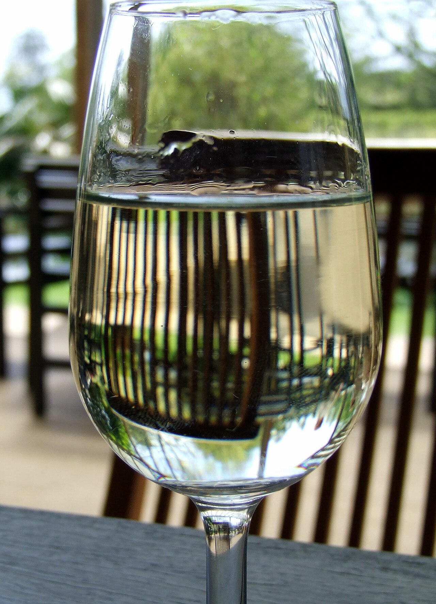

# 梅纳德·阿梅林

梅纳德·阿梅林（Maynard Amerine，1911–1998）是美国酿酒学家、加州大学戴维斯分校教授。他的名字常与两个工具连在一起：一个是“Winkler 热量区划”，用来判断某个地方适合种什么葡萄；另一个是“感官评价”，用来把“好喝”拆成可以训练、可以重复的描述。前者影响种在哪里，后者影响怎么判断，两者共同塑造了禁酒令之后加州葡萄酒的技术底座。

图：白葡萄酒品鉴杯；用于说明感官评价方法，不是梅纳德·阿梅林本人。图片：Tim Parkinson，CC BY 2.0，via Wikimedia Commons（[原图页面](https://commons.wikimedia.org/wiki/File:White_wine_tasting_glass.jpg)）。

## 从植物生理到酿酒学

阿梅林 1911 年 10 月 30 日生于加州圣何塞，在莫德斯托附近的农场长大。他在加州大学伯克利分校读植物生理学，1935 年博士毕业前，被戴维斯分校新成立的葡萄栽培与酿酒学系聘为第一批研究人员。彼时美国刚走出禁酒令，加州酒业的技术资料、品种试验与酿造规范都处于断裂状态。

他面对的第一个问题是“种什么”。禁酒令期间，许多酒庄为了生存改做甜酒、宗教用酒或浓缩葡萄汁，留下的是高产、抗病但风味平庸的品种。阿梅林与同事 Albert J. Winkler 在加州各地布置试验园，比较不同品种在不同气候下的表现，再用化学分析与感官判断筛选。他们要回答的不是“哪个品种最有名”，而是“在某个具体地方，哪个品种能稳定做出好酒”。

## Winkler 热量区划

1944 年，阿梅林与 Winkler 发表了一套基于“生长季热量总和”的产区分类：以 50°F（10°C）为基准，累计生长季每日平均温度超出基准的部分，得到“生长度日”（growing-degree days），再据此划分五个气候区。这个指标后来被称为 Winkler Index，成为加州乃至国际葡萄种植规划的基础工具之一。

它的价值在于把“气候”从模糊的感受变成可比较的数字。酒农可以用气象站数据判断某地适合早熟还是晚熟品种，酒庄可以用它解释为什么同一品种在沿海谷地与内陆山谷表现不同。它也有局限：只算热量，不算昼夜温差、土壤、水分、光照与风；同一热量区内的微气候可能差异很大。阿梅林自己在写作中多次提醒，区划是起点，不是结论。

## 感官评价的标准化

阿梅林更长远的影响在“品尝”这件事上。1950 至 1960 年代，他与统计学家 Edward B. Roessler、食品科学家 Rose Marie Pangborn 等人合作，建立了一套训练品评员、设计盲测、处理评分数据的方法。1976 年，他与 Roessler 出版《Wines——Their Sensory Evaluation》，把外观、香气、口感、余味、缺陷与统计显著性放在同一套框架里。

这套方法的核心不是“找到天才舌头”，而是“减少噪声”：统一杯型、温度、光线与上酒顺序；用对照样与重复测试；区分“偏好”与“质量”；用统计判断差异是否真实。它让酒厂在没有明星品鉴师的情况下，也能做产品比较与质量控制。今天酒庄的品评表、培训课程与比赛评分，很多都能追溯到这类工作。

## 著作与教学

阿梅林一生写了 16 本书、约 400 篇文章，覆盖葡萄栽培、葡萄酒分析、感官评价、酒类文献与加州酒史。1965 年，他与 Vernon L. Singleton 合写《Wine: An Introduction for Americans》，把专业知识写成普通读者能用的入门；这本书在 1970 年代被广泛用作教材与参考。

他在戴维斯分校任系主任的时间是 1957 至 1962 年，1974 年退休后仍以荣休教授身份写作、旅行与咨询。他的藏书与论文后来进入戴维斯分校图书馆特藏，形成“Maynard A. Amerine Room and Wine Collection”；加州大学还设立了以他命名的教授席位，由 Ernest Gallo 捐资。这些机构记忆说明，他的影响不只在课堂，也在资料保存与人才培养。

## 评价与争议

正面评价把他称为“美国葡萄酒之父”之一，理由是他把禁酒令后断裂的酿酒知识重新接上，并用科学方法训练了一整代酒农与酿酒师。这个说法有事实基础：Winkler Index、感官评价教材、戴维斯分校的课程与推广体系，确实改变了加州酒业。

批评主要有三点。第一，他的感官评价以“训练有素的品评组”为中心，能判断质量差异，却不等于能预测普通消费者的偏好；这套方法后来被市场研究补足，而不是被替代。第二，他的研究以加州为核心，对旧世界产区的处理常是“借鉴与对照”，不是同等深度的历史研究。第三，“美国葡萄酒之父”是一个方便的称号，会掩盖 Winkler、Olmo、Ough、Singleton 等合作者与推广人员的贡献。

## 常见误读

第一，把 Winkler Index 当成阿梅林一个人的发明。它是他与 Winkler 合作的成果，且建立在更早的气候与物候观察上。

第二，把感官评价当成“给酒打分”。阿梅林的方法更关心实验设计、品评员训练与统计推断，而不是制造一个永久不变的分数。

第三，把“科学化”当成“去感性”。他并不否认风味记忆与个人偏好，而是要求把偏好与质量判断分开记录。

第四，把戴维斯分校的成果当成实验室里的孤立研究。阿梅林长期与酒庄、酒农和行业协会合作，很多结论是在试验园与生产线上验证的。

相关条目：[纳帕谷](ref:napa)。

## 另见

- [美国](ref:usa)：阿梅林工作的国家，也是禁酒令后酒业重建的制度背景。
- [纳帕谷](ref:napa)：加州高端葡萄酒的核心产区，受益于他的品种与气候研究。
- [葡萄酒](ref:wine)：他研究与教学的中心对象。
- [霞多丽](ref:chardonnay)：加州重要白品种，也是品种试验与感官评价的常见样本。
- [风土与工艺](ref:place-process)：理解“产地—品种—工艺”关系的框架。

对照阅读：[美国](ref:usa)、[葡萄酒](ref:wine)。

**关键事实。**

| 项目 | 内容 |
| --- | --- |
| 一句话定位 | 美国酿酒学家与加州大学戴维斯分校教授（1911–1998），与 Winkler 建立热量总和产区分类，推动葡萄酒感官评价的标准化，著有《Wines——Their Sensory Evaluation》等 |
| 生卒 | 1911–1998 |
| 身份 | 酿酒学家、教授、葡萄酒作家 |
| 关联地区 | 美国、纳帕谷 |

**来源与边界。** 本页关于「梅纳德·阿梅林」的关键事实，主要由以下来源交叉核对：UC Davis Department of Viticulture and Enology（1911 年 10 月 30 日出生、1998 年 3 月 11 日去世、1935 年入职、1957–1962 年任系主任与 1974 年退休）、University of California Academic Senate / Online Archive of California（Winkler 热量区划、感官评价研究、16 本书与数百篇文章）、UC Davis（交叉核对 Winkler Index 的用途与 Amerine 对公众葡萄酒教育的影响）等 5 条来源。价格、批次与状态会变，涉及这些字段时以页面所列来源的最新版本为准。正文为项目自写，来源只作核验，不复制原文。
