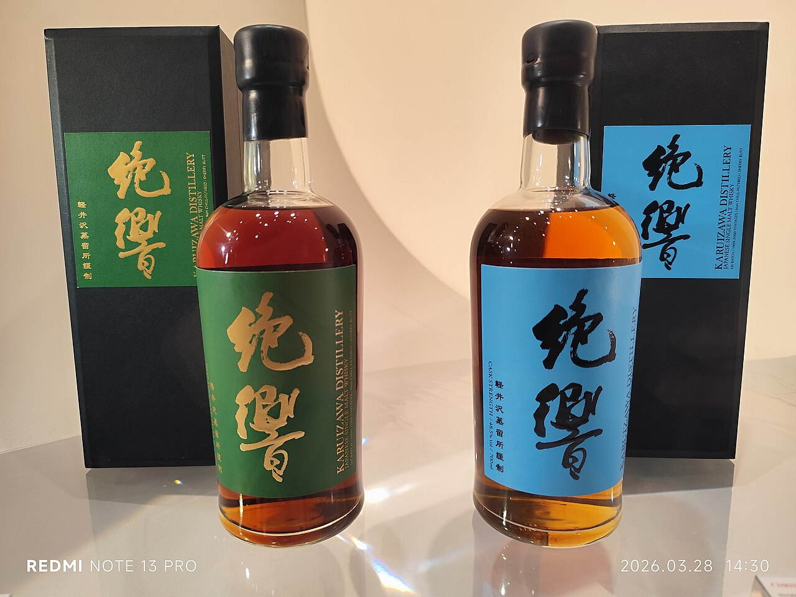

# 迈克尔·布罗德本特

迈克尔·布罗德本特（Michael Broadbent，1927–2020）是英国葡萄酒评论家、拍卖师与作家。他的职业生涯有两个支点：一是 1966 年在佳士得重启葡萄酒拍卖，把“老年份名酒”变成可公开竞价的资产类别；二是从 1952 年开始，把每一款喝过的酒记进红皮笔记本，最终汇成数万条品鉴记录。前者改变了市场，后者改变了人们谈论年份的方式。

图：香港佳士得 2026 年 3 月拍卖预展现场的酒瓶陈列；这是拍卖预展场景，不是迈克尔·布罗德本特本人，也不代表他经手的具体拍品。图片：Homm BoUretak BAORP，CC0，via Wikimedia Commons（[原图页面](https://commons.wikimedia.org/wiki/File:HK_CH_%E9%87%91%E9%90%98_Admiralty_The_Henderson_%E4%BD%B3%E5%A3%AB%E5%BE%B7%E6%8C%87%E8%B3%A3%E8%A1%8C_Christie%27s_Auction_%E9%A0%90%E5%B1%95_preview_exhibition_wine_bottles_March_2026_N13P_10.jpg)）。

## 从建筑学徒到酒商

布罗德本特 1927 年 5 月 2 日生于英国约克郡西区。他年轻时到伦敦学建筑，二战后的国民服役打断了学业；用他自己的话说，二十五岁时“需要一次彻底的改变”。他母亲在《泰晤士报》上看到 Laytons 酒商招聘学徒的广告，他由此进入酒业，先扫地、搬箱、送货，再站柜台。

在 Laytons 与 Harveys of Bristol 的几年里，他学会了酒业的基本功：识别标签、核对年份、处理客户订单、判断酒的状态。1952 年，他开始把每次品鉴写进一本红色小册子；这个习惯持续了半个多世纪，后来成为他写作的底稿。他不是从“理论”进入酒，而是从仓库、订单与酒杯进入酒。

## 重启佳士得葡萄酒拍卖

1966 年，布罗德本特加入佳士得，负责建立葡萄酒拍卖部门。佳士得在 18 世纪就有葡萄酒拍卖记录，但现代意义上的专业葡萄酒拍卖已经中断；他做的事情是把这条线接回来：编目录、定估价、组织预展、主持拍卖。

1967 年 7 月，他第一次站上拍卖台。1969 年，他把佳士得的葡萄酒拍卖带到美国，随后又在欧洲、亚洲主持专场。拍卖行的视角让他看到普通品鉴写作看不到的东西：同一款酒在不同年份、不同来源、不同保存条件下的价格差异；酒瓶的标签、封套、酒庄直供记录如何影响可信度；以及“稀有”如何被市场定价。

他后来成为佳士得的资深顾问，但并没有把写作交给拍卖目录。他继续做品鉴记录，继续给报刊写专栏。1968 年，他出版《葡萄酒品鉴口袋指南》（Pocket Guide to Wine Tasting），把品鉴拆成外观、香气、口感与余味四个可观察的维度，并讨论光线、杯型、上酒顺序等变量。这本书被译成多种语言，成为 1970 至 1980 年代英语世界最常用的品鉴手册之一。

## 红皮笔记本与《佳酿》

布罗德本特的写作方法很“笨”：每喝一款酒，记下酒名、年份、场合、颜色、香气、口感、余味与判断；不依赖记忆，也不事后补写。他的红皮笔记本从 1952 年记到晚年，数量以百计。1980 年，他把这些笔记整理成《The Great Vintage Wine Book》；1991 年修订；2002 年又以《Vintage Wine》为名扩充，收录 1680 至 2001 年间超过一万款酒的记录。

这套记录的价值在于“可追溯”。读者可以看到他对同一款酒在不同年份的判断，也可以看到他的语言如何变化：早期更简短，后期更克制。他不太使用后来流行的“水果炸弹”式形容词，而更愿意写“中等深色、正在成熟、颜色柔和、香气温暖而略带泥土感”这类结构描述。对研究者来说，这种写法保留了判断的依据；对普通读者来说，它可能不够“诱人”，但更难被营销话术带走。

## 品鉴方法与行业影响

他的品鉴方法可以概括为“控制变量”：尽量在白天、北向自然光下看颜色；用同一类杯子；先闻再尝；按酒精度与结构从上到下排顺序；把价格放在判断之外，再放回判断之内。他提醒读者，光线会影响色调，室温会影响香气，酒杯会影响入口的第一印象。这些细节今天看来是常识，但在 1960 年代的专业写作里并不常见。

他对英国酒业的影响不止于书。作为拍卖师，他让伦敦在 20 世纪后半叶重新成为老年份名酒的交易中心；作为作家，他把“年份”从酒庄的营销词变成可比较的历史信息；作为编辑与顾问，他参与建立了拍卖目录的著录规范，比如如何标注酒瓶状态、如何描述来源、如何处理无法核验的年份。

## 评价与争议

正面评价通常把他视为“现代葡萄酒拍卖的奠基人”和“品鉴笔记的集大成者”。这两个说法都有事实支撑：佳士得的葡萄酒部门、伦敦的拍卖市场、以及大量可查的年份记录，确实与他有关。

批评主要集中在三点。第一，拍卖行的立场会影响“价值”判断：一款酒的拍卖价格、稀缺性与收藏价值，可能被误当成质量本身。布罗德本特本人并不否认市场与品味的区别，但他的写作常被收藏市场借用。第二，他的记录以波尔多、勃艮第、香槟与少数旧世界产区为中心，对新世界、日常酒与女性酿酒者的覆盖不足；这既是时代局限，也是个人趣味的局限。第三，他的品鉴语言偏克制，容易被后来更夸张的“感官描述”取代；但克制也意味着更少的营销色彩。

## 常见误读

第一，把他说成“佳士得葡萄酒拍卖的创始人”。更准确的说法是：他在 1966 年重建了现代意义上的专业部门，接续了佳士得 18 世纪的拍卖传统。

第二，把《Vintage Wine》当成“所有年份的权威结论”。它是一份个人品鉴档案，不是气象学或农学数据库；同一款酒在不同瓶型、运输与保存条件下会有差异。

第三，把“红皮笔记本”当成浪漫轶事。它其实是一套工作方法：固定字段、即时记录、可回溯，和今天实验记录的逻辑相同。

第四，把拍卖价格直接当成品质排名。价格由稀缺性、来源、品相与市场情绪共同决定，不完全等于口感。

相关条目：[英国](ref:uk)、[葡萄酒](ref:wine)、[世界酒史纲：从发酵饮料到全球产业](ref:world-wine)。

## 另见

- [英国](ref:uk)：布罗德本特职业生涯所在地，也是伦敦拍卖市场的中心。
- [葡萄酒](ref:wine)：他写作与拍卖的核心对象。
- [世界葡萄酒史](ref:world-wine)：把拍卖市场放进 20 世纪酒业全球化的脉络。
- [勃艮第](ref:burgundy)：他记录最细、也最受拍卖市场关注的产区之一。
- [世界葡萄酒地图](ref:atlas)：理解他笔下的产区、年份与地块分类。
