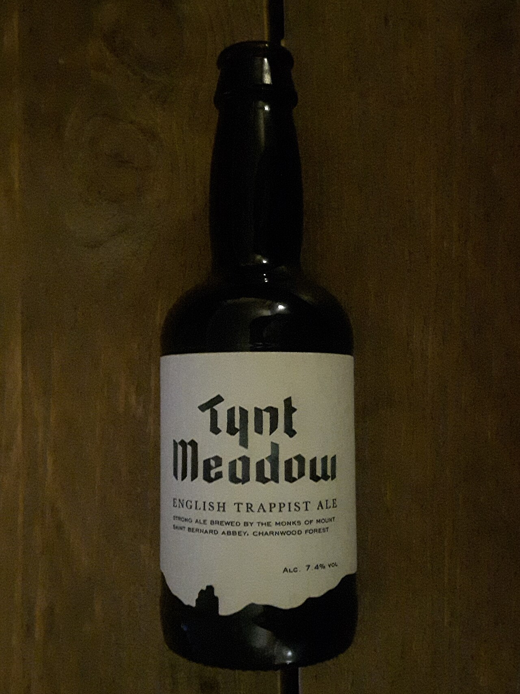

# 迈克尔·杰克逊（啤酒作家）

迈克尔·杰克逊（Michael Jackson，1942—2007）是英国记者、啤酒作家与威士忌作家。1977 年，他出版《世界啤酒指南》（The World Guide to Beer），第一次用“风格—历史—感官—配餐”的框架，把世界各地的啤酒写成一套可读、可比较的知识体系。此后他又写比利时啤酒、英式艾尔、修道院啤酒与威士忌，主持电视系列《啤酒猎人》（The Beer Hunter），被美国精酿运动、比利时酒厂与日本啤酒界共同视为“让啤酒进入严肃讨论的人”。

图：特拉普斯特艾尔 Tynt Meadow；迈克尔·杰克逊长期书写的啤酒传统之一。图片：FakirNL，CC BY-SA 4.0，via Wikimedia Commons（[原图页面](https://commons.wikimedia.org/wiki/File:Tynt_Meadow_Trappist_Ale_(no_flash).jpg)）。

## 从记者到“啤酒猎人”

杰克逊 1942 年 3 月 27 日生于英国约克郡韦瑟比，在利兹附近长大。他先在当地报纸做记者，后来进入伦敦的新闻与电视行业，写酒、写食物、写旅行。1970 年代的英国啤酒世界仍被“散装艾尔”与少数大厂垄断，啤酒写作大多是酒厂公关稿或地方指南；杰克逊想做的，是把啤酒当成文化现象来写，而不是当成商品目录。

1977 年，《世界啤酒指南》出版。这本书的结构在今天看来很普通，在当时却是新的：先讲啤酒的基本工艺（麦芽、酒花、酵母、水），再按国家与地区分章，最后把每一种酒放进风格、历史与饮用场景。书里没有“最好喝的酒”排行榜，而是告诉读者“这款酒为什么是这个味道”。它被译成多种语言，成为美国、比利时、日本酒厂的共同参考书。

1980 年代，他继续写《大啤酒书》《比利时啤酒》《英格兰啤酒》等；1989 年出版《麦芽威士忌伴侣》（Malt Whisky Companion），把威士忌也纳入同一套感官描述方法。1990 年代，他主持电视系列《啤酒猎人》，走访比利时、德国、捷克、英国与美国的酒厂，把“啤酒也可以像葡萄酒一样讲究”的画面带进普通家庭。2007 年 8 月 30 日，他在伦敦去世，享年 65 岁；此前多年受帕金森病影响。

## 他改变了什么

第一，他把“风格”变成公共语言。今天我们说“英式艾尔”“比利时双料”“修道院啤酒”“皮尔森”“世涛”，很多分类与描述都能追溯到杰克逊的写作。他不是这些风格的发明者，酒厂与酿酒师才是；他的贡献是把分散的地方知识整理成可比较的框架，让消费者、酿酒师与评委能坐在同一张桌子上讨论。

第二，他让比利时啤酒进入世界视野。1970 至 1980 年代，比利时的修道院啤酒、兰比克、白啤与烈性艾尔在国际市场上并不显眼；杰克逊的书与电视节目把这些酒放进历史、宗教、地方饮食与发酵科学的脉络，直接影响了美国精酿酿酒师。今天美国修道院风格、赛松与兰比克的复兴，都能看到他的影子。

第三，他改变了啤酒写作的语调。他不写“泡沫细腻、口感醇厚”这类空话，而是用具体的香气、温度、杯型、配餐与产地故事，让读者能按图索骥。他也写威士忌，尤其强调“闻香—加水—再闻—入口”的方法，把品鉴从神秘化拉回可练习的感官训练。

第四，他为后来的啤酒教育留下档案。牛津布鲁克斯大学收藏了他的笔记、手稿、藏书与通信，形成“迈克尔·杰克逊收藏”；美国酿酒师协会、比利时啤酒协会与日本精酿界也以奖项、讲座与再版书延续他的工作。今天精酿啤酒的“风格指南”与“盲品评分表”，在方法上都受他影响。

## 怎么读他的书

如果你只有时间读一本，先读《世界啤酒指南》的国家章节，再读《比利时啤酒》。前者建立“风格—产地—工艺”的地图，后者展示“一个国家的啤酒如何与宗教、饮食、政治纠缠”。读的时候注意三件事：第一，他写的是“当时的酒”，很多酒厂、配方与品牌已经变化；第二，他的分类不是法律定义，而是便于沟通的描述，遇到边界模糊的风格（例如赛松、农场啤酒），不要用标签去吵架；第三，他的感官描述有强烈的个人偏好，英式艾尔与比利时酸啤的比重明显高于商业拉格，这不是价值判断，而是写作选择。

喝啤酒时，可以按他的方法练：先看颜色与泡沫，再闻麦芽、酒花、酵母与发酵副产物，入口后注意甜度、苦度、酸度、酒体与余味，最后再考虑配餐。英式艾尔适合烤肉、炸鱼与奶酪；比利时双料适合炖肉、巧克力与硬质奶酪；兰比克适合海鲜、沙拉与水果甜点；皮尔森适合清淡的鱼类、鸡肉与油炸食物。威士忌则从低度、温和的酒款开始，加几滴水再闻，避免用重烟熏或高酒精度把味蕾麻掉。

## 争议与常见误读

第一，他不是“流行歌手迈克尔·杰克逊”。同名同姓常造成误会；他的网站专门写过“我不是那个迈克尔·杰克逊”。第二，他不是“啤酒风格的发明者”。风格是酒厂、地区与消费者长期互动的结果；他把风格整理成语言，但不应把“命名者”当成“创造者”。

第三，他不是“只写英国啤酒”。他的书覆盖比利时、德国、捷克、美国、日本与中国；他对比利时啤酒的推广尤其关键。第四，他的分类不是“法律标准”。欧盟、美国、日本各有自己的法规与地理标志；读他的书要区分“描述性风格”与“法定类别”。

第五，他的写作有时代局限。1970 至 1990 年代的酒厂信息不如今日透明，部分历史叙述已被新考古与档案修正；他笔下的“传统”有时是当时的市场叙事，而非数百年的连续事实。第六，他的品味偏英式与比利时，读者不必把他的喜好当成唯一标准；用他的方法，而不是复制他的结论。

## 与本站其他页面的关系

杰克逊的故事连接三条线。第一是[啤酒](ref:beer)的风格与工艺：麦芽、酒花、酵母、水，以及英式、比利时、德式、美式与捷克的分野。第二是[修道院啤酒](ref:trappist)与比利时传统：特拉普斯特、兰比克、白啤与烈性艾尔。第三是[威士忌](ref:whisky)的写作与品鉴：从麦芽威士忌到日本、美国与爱尔兰烈酒。

如果想继续看“啤酒如何进入精酿时代”，可以读美国精酿运动、加里·雷根（Gary Regan）的调酒写作，或比利时酒厂的现代化；如果你想看“威士忌如何被系统化描述”，可以对照《麦芽威士忌伴侣》与今天的威士忌风格指南。杰克逊不是孤立的作家，他是 20 世纪后期啤酒与威士忌知识全球化的枢纽。

## 延伸阅读

- [啤酒](ref:beer)：风格、原料、发酵与品鉴的基本框架。
- [修道院啤酒](ref:trappist)：特拉普斯特、修道院风格与比利时传统。
- [威士忌](ref:whisky)：麦芽、壶式蒸馏、橡木桶与风格。
- [英国](ref:uk)：英式艾尔、散装啤酒与 1970 年代啤酒写作的背景。
- [加里·雷根](ref:gary)：调酒写作与酒吧文化，与杰克逊同时代的酒类知识推广者。
