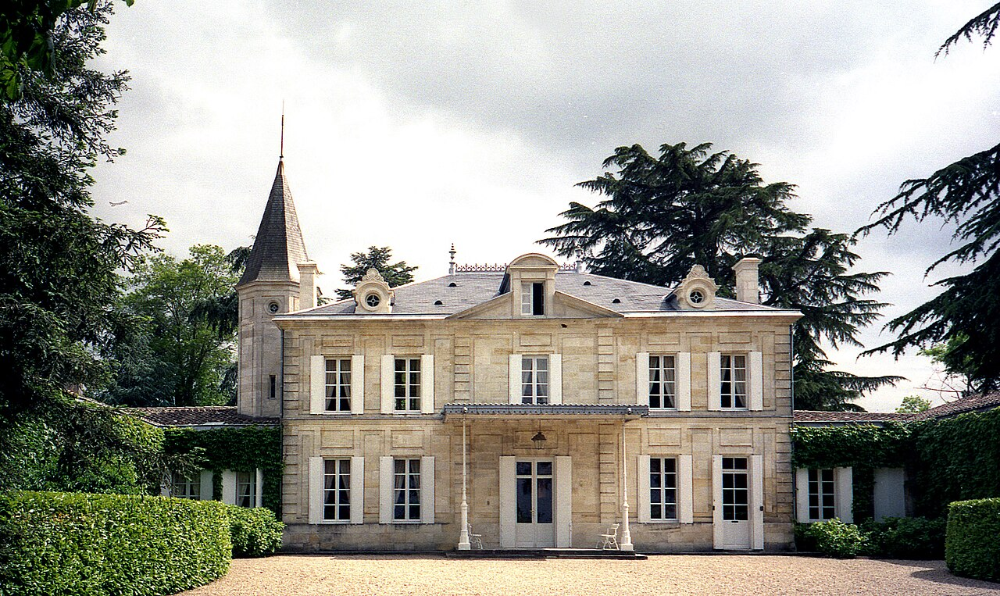

# 米歇尔·罗兰

米歇尔·罗兰（Michel Rolland，1947—2026）是波尔多最知名的酿酒顾问之一，也是 1990 年代“飞行酿酒师”讨论的中心人物。他的工作方式，是把葡萄成熟度、发酵与浸渍、橡木桶陈酿连成一套可以复制的流程，为不同酒庄提供从采收判断到最终调配的建议。支持者说他提高了酒的稳定性，批评者说他让不同地方的红酒尝起来越来越像。

图：米歇尔·罗兰的地域文化背景配图。图片：Benjamin Zingg, Switzerland，CC BY-SA 2.5，via Wikimedia Commons（[原图页面](https://commons.wikimedia.org/wiki/File:Ch%C3%A2teau_Cheval-Blanc.jpg)）。这张照片不是米歇尔·罗兰的肖像，也不代表其生活年代的具体场景。

## 生平与教育

1947 年 12 月 24 日，罗兰出生在利布尔讷（Libourne），在波美侯（Pomerol）的家族酒庄 Château Le Bon Pasteur 长大。他在波尔多酿酒学院（Institut d'Œnologie de Bordeaux）学习，1972 年毕业；1970 年与同班同学 Dany 结婚。1973 年，夫妻二人在利布尔讷创立 Laboratoire Rolland，最初做葡萄酒分析，后来发展为顾问机构。1978 年，他与兄弟 Jean-Daniel 接管家族酒庄；1986 年，他又与 Dany 买下弗龙萨克（Fronsac）的 Château Fontenil。

2013 年，他把波尔多家族酒庄的多数股权卖给香港的高银集团（Goldin Group），但仍继续监督生产；2020 年，他把 Rolland & Associés 的多数股权转让给长期合作伙伴 Jean-Philippe Fort、Mikaël Laizet 与 Julien Viaud。2026 年 3 月 20 日，他因心脏病去世，享年 78 岁。

## 实验室与顾问业务

Laboratoire Rolland 设在波美侯，最初的功能是分析：酸度、糖度、酒精度、发酵状态，都是酒庄日常需要的数字。罗兰把分析结果与现场品尝结合，逐渐把“实验室”变成“顾问事务所”。到 2020 年代，他的顾问网络覆盖 14 个国家、150 多家酒庄；在事业高峰期，他被认为是世界上被最多酒庄需要的酿酒顾问。

顾问的工作不是替酒庄酿酒，而是参与关键判断：什么时候采、如何选果、发酵温度多高、浸渍多久、用多少新桶、最后怎么调。酒庄团队执行日常操作，顾问提供方向与复核。理解这一点，才能分清“顾问风格”与“代酿”的区别。

## 技术主张：成熟度、浸渍、橡木与微氧

罗兰的起点是成熟度。他主张等到葡萄达到酚类成熟再采，用分析数据与田间品尝共同判断；在他看来，过早采收带来的生青单宁，是许多波尔多酒在过去显得干涩的原因。采收之后，他重视选果与破皮，发酵阶段控制温度与萃取强度，必要时延长浸渍，以获得更饱满的果味和更柔和的单宁。

陈酿阶段，他使用[橡木桶](ref:oak-ageing)，强调桶的产地、烘烤度与新桶比例。微氧（micro-oxygenation）是常与他联系在一起的技术：在发酵后向酒中缓慢、定量地引入氧气，模拟桶中缓慢氧化的效果，影响单宁聚合与颜色稳定。这项技术通常归功于 Patrick Ducournau 1991 年在马迪朗（Madiran）的开发，罗兰做的是在 1990 年代推广与规模化应用，而不是发明。

他真正的强项常被同行描述为调配。Wine Spectator 的讣告引述 Paul Hobbs 的话，说罗兰能从清晨一直工作到午餐，不起身地反复试调，这种能力比任何单项技术都更难复制。[发酵](ref:fermentation)与[红葡萄酒](ref:red-wine)的结构判断，最终都要落到调配桌上。

## 客户网络与“飞行酿酒师”

1987 年，罗兰在波尔多以外的第一个客户是加州 Simi 酒庄，当时的酿酒师是 Zelma Long，Paul Hobbs 是她的助手。1988 年，他随 Paul Hobbs 到阿根廷，与 Nicolás Catena 等人接触，开始在南美工作。此后，他的客户名单包括波尔多的 Château Pontet-Canet、Château Figeac、Château La Conseillante，美国的 Harlan、Staglin、Screaming Eagle、St. Supéry，意大利的 Ornellaia、Monteverro，智利的 Casa Lapostolle，西班牙的 Marqués de Cáceres，以及阿根廷、南非、印度、克罗地亚、亚美尼亚等地的酒庄。

“飞行酿酒师”这个词常被认为因他而流行：一个人带着一套技术语言，在不同半球之间飞行，把波尔多的方法带到纳帕、门多萨、托斯卡纳。支持者看到的是技术扩散，批评者看到的是地方差异被抹平。

## 代表酒庄与产品

罗兰自己的酒庄包括波美侯的 Château Le Bon Pasteur、弗龙萨克的 Château Fontenil、圣埃美隆的 Château Rolland-Maillet 与拉朗德-波美侯的 Château Bertineau Saint-Vincent。阿根廷方面，他参与 Clos de los Siete，并在 Uco 谷拥有 Val de Flores 与 Bodega Rolland。这些酒庄既是他的实验场，也是他顾问方法的展示窗。

他常被媒体与圣埃美隆、波美侯的“车库酒”（garagiste）风格联系在一起：低产量、高萃取、新桶比例高、价格迅速上升的小型酒庄。但“车库酒”不是他发起的运动，更具代表性的发起者是 Château Valandraud 的 Jean-Luc Thunevin。罗兰是这一风格的顾问代表之一，不是唯一的作者。

## 评价与争议

支持者的理由很具体：他提高了酒庄的卫生与稳定性，帮助酒庄在坏年份减少损失，也让波尔多在 1970 年代的低谷之后重新获得国际关注。Wine Spectator 的讣告说，他在巅峰期也许是世界上被最多酒庄需要的顾问，尤其以调配能力著称。

批评同样具体。Wine Spectator 写道，反对者认为他的风格“用力过猛、趋于同质化，削弱了风土”；2010 年之后，Château La Gaffelière 与 Château Pavie-Macquin 等酒庄结束与他的合作，转向更克制、更新鲜的风格。2004 年，Jonathan Nossiter 的纪录片《Mondovino》把他塑造成全球化风格的象征，这场争论由此进入公众视野。把“帕克化”“国际化风格”全部归给他，并不准确；但他确实是这套讨论中最容易被指认的名字。

## 常见误读

第一，把微氧当成他发明。它是行业与团队共同发展的技术，他做的是推广与规模化应用。第二，把顾问等同于“代酿”。顾问做判断与建议，日常操作仍由酒庄团队执行。第三，把所有“浓郁风格”的酒都算在他头上。顾问提供建议，最终决定在酒庄，而且他的客户风格并不统一。第四，把纪录片里的形象当成全部。影像会放大冲突，真实工作包含大量常规分析与沟通。第五，把“车库酒”当成他发起的运动。它是圣埃美隆、波美侯一批小酒庄的共同现象，不能归功于一个人。第六，以为他的方法只是“加重”。他同样强调成熟度、选果与平衡，过度萃取并不是他公开主张的目标。

## 年表

- 1947 年：12 月 24 日出生于利布尔讷。
- 1970 年：与 Dany 结婚。
- 1972 年：毕业于波尔多酿酒学院。
- 1973 年：在利布尔讷创立 Laboratoire Rolland。
- 1978 年：与兄弟接管 Château Le Bon Pasteur。
- 1986 年：买下 Château Fontenil。
- 1987 年：第一个波尔多以外的客户，加州 Simi。
- 1988 年：开始在南美工作。
- 2004 年：纪录片《Mondovino》上映。
- 2013 年：出售波尔多家族酒庄多数股权。
- 2020 年：出售 Rolland & Associés 多数股权。
- 2026 年：3 月 20 日去世。

## 另见

- [红葡萄酒](ref:red-wine)：他主要工作的酒类。
- [波尔多](ref:bordeaux)：他的出身地与顾问业务的起点。
- [发酵](ref:fermentation)：他反复调整的环节。
- [橡木桶陈酿](ref:oak-ageing)：结构与口感调整的另一端。

对照阅读：[红葡萄酒](ref:red-wine)、[发酵](ref:fermentation)。
