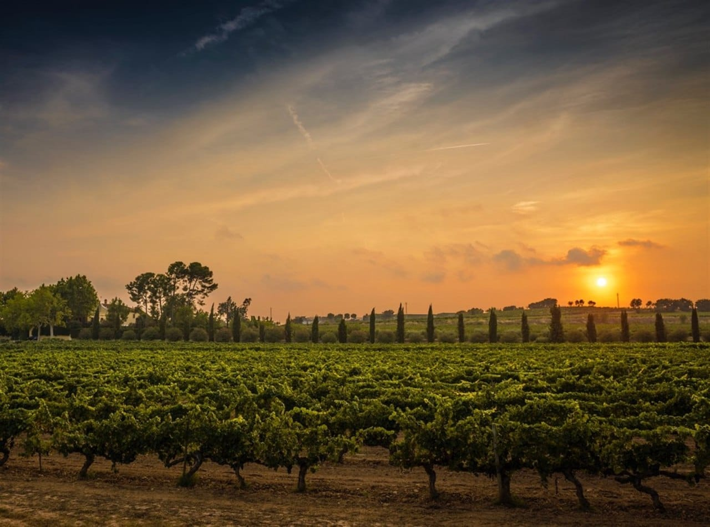

# 米格尔·托雷斯

米格尔·A·托雷斯（Miguel A. Torres，1941— ）是西班牙酿酒师、家族企业主席与葡萄酒推广者。他所在的 Familia Torres 是佩内德斯（Penedès）最知名的酿酒家族之一；他 1962 年加入家族企业，1970 年酿出马斯拉普拉纳（Mas La Plana），1979 年让这款赤霞珠在巴黎的“葡萄酒奥林匹克”上击败多款法国名庄。此后，他把家族业务扩展到智利与加州，又在晚年把气候行动变成酒庄的核心议题。要理解现代西班牙酒如何从“国内佐餐酒”变成“国际比较对象”，他是一个绕不开的人物。

图：佩内德斯的托雷斯家族葡萄园。图片：Bodega torres，CC0，via Wikimedia Commons（[原图页面](https://commons.wikimedia.org/wiki/File:Familia_torres_bodega_vinedo.jpg)）。

> **先给结论**
> **一句话：** 这页判断米格尔·托雷斯为什么被记住，以及该看哪些作品。
>
> - **适合谁：** 想了解米格尔·托雷斯做过什么、为什么在酒史里被记住的人。
> - **不适合谁：** 只想看传记轶事、不关心其历史位置的人。
> - **先看这两点：**
>   - 如果去佩内德斯，第一站可以是维拉弗兰卡-德尔佩内德斯的家族酒庄，看 1870 年的老厂区、现代品鉴室与酒窖；第二站是马斯拉普拉纳葡萄园。
>   - 托雷斯家族的酿酒记录可以追溯到 1559 年，但真正以出口为导向的酒厂是 1870 年由海梅·托雷斯·文德雷尔（Jaime Torres Vendrell）与米格尔。

## 佩内德斯的第四代

托雷斯家族的酿酒记录可以追溯到 1559 年，但真正以出口为导向的酒厂是 1870 年由海梅·托雷斯·文德雷尔（Jaime Torres Vendrell）与米格尔·托雷斯·文德雷尔（Miguel Torres Vendrell）兄弟在维拉弗兰卡-德尔佩内德斯（Vilafranca del Penedès）建立的。第二代胡安·托雷斯·卡萨尔斯（Juan Torres Casals）在 1928 年开始用佩内德斯的白葡萄酒蒸馏品牌酒；第三代米格尔·托雷斯·卡尔博（Miguel Torres Carbó）则在 1939 年西班牙内战轰炸摧毁酒厂后重建设施，并决定从散装酒转向瓶装酒。这一步很关键：瓶装意味着品牌、标签、出口与质量控制，也意味着托雷斯不再只是当地葡萄的收购商。

米格尔·A·托雷斯 1941 年出生，是米格尔·托雷斯·卡尔博的儿子。他在法国第戎学习酿酒，1962 年加入家族企业。官方家族页把这一年记为加入年份，而公司年表在“1963”节点又写着“米格尔·A·托雷斯加入公司”；两处存在一年差异，阅读时不必把它当成两个事件。父亲 1991 年去世后，他接任主席。更准确地说，他是家族企业的第四代管理者，不是“白手起家的创始人”。

## 1970 年的马斯拉普拉纳

马斯拉普拉纳是佩内德斯的一块地，托雷斯家在 1966 年在那里种下赤霞珠。米格尔没有按照当时西班牙的惯例，把赤霞珠混进多品种的“顶级红酒”，而是想用单一品种、单一地块做一款能和陈年波尔多比较的酒。1970 年是第一个年份，最初以“Gran Coronas”黑标名义出售，后来才独立为马斯拉普拉纳。他的父亲曾怀疑：“西班牙的赤霞珠，装进勃艮第瓶，能是好酒吗？”这句话很能说明当时的市场偏见：西班牙酒被认为应该便宜、柔和、适合日常，而不是拿来和法国名庄比结构。

1979 年，父子把 1970 年份送到巴黎，参加 Gault & Millau 主办的“葡萄酒奥林匹克”（Olympiades du Vin）。比赛结果把马斯拉普拉纳排在多款波尔多与勃艮第名庄之前，佩内德斯一夜之间进入国际葡萄酒地图。这里必须分清：这不是 1976 年的“巴黎审判”（Judgment of Paris），那场是加州酒对法国酒；1979 年的“葡萄酒奥林匹克”是另一场比赛，主角是西班牙的赤霞珠。两件事常被中文资料混为一谈，实际上时间、组织者与参赛酒都不同。

马斯拉普拉纳之后，托雷斯又用法国品种做出了米尔曼达（Milmanda）霞多丽，并在 1980 年代开始回收加泰罗尼亚的古老品种，后来酿成格朗斯穆拉列斯（Grans Muralles）。这条线索说明，他的“国际化”不是简单复制法国，而是把法国品种、本地风土与加泰罗尼亚的老品种放在同一张酒单上。

## 把西班牙酒带到智利与加州

1979 年，托雷斯在智利库里科（Curicó）建立 Miguel Torres Chile。智利当时政治与经济环境并不轻松，但气候干燥、病虫害少、土地成本低，适合做出口型葡萄酒。托雷斯把佩内德斯的酿造经验、温控发酵与法国橡木带到库里科，又保留了智利老葡萄园里的 País、Carignan 等品种，后来这些“遗产品种”反而成了智利精品酒的新卖点。今天，Miguel Torres Chile 的产品销往 100 多个国家，曼索·德·韦拉斯科（Manso de Velasco）等酒款在国际评比中常有高分。

1982 年，托雷斯家族又在加州索诺马（Sonoma）买地，由米格尔的妹妹马里马尔·托雷斯（Marimar Torres）主持，建立 Marimar Estate。与智利不同，加州项目更接近“家族成员的个人事业”：马里马尔在 1975 年搬到旧金山负责美国市场，1982 年买下索诺马的土地，1986 年种下霞多丽与黑皮诺，1992 年建成酒庄。托雷斯家的跨国网络，因此不是单中心扩张，而是“佩内德斯—智利—加州”三点连线，各自面向不同市场。

在西班牙国内，第五代又在普里奥拉托（Priorat）、塞格雷河岸（Costers del Segre）、杜埃罗河岸（Ribera del Duero）、里奥哈（Rioja）、卢埃达（Rueda）与下海湾（Rías Baixas）开辟项目。2012 年，米格尔·托雷斯·马扎塞克（Miguel Torres Maczassek）出任总经理，米雷娅·托雷斯·马扎塞克（Mireia Torres Maczassek）负责知识与创新。米格尔·A·托雷斯仍是主席，但日常经营已经交给第五代。这个交接说明，托雷斯家族的成功不是一个人的长寿，而是把“第四代的人脉与判断”转成“第五代的制度与团队”。

## 气候：Torres & Earth 与 IWCA

2008 年，托雷斯启动 Torres & Earth 计划，目标是减少每瓶酒的碳足迹，并通过可再生能源、能源效率、电动交通、再生农业等方式适应气候变化。官方历史页把这一计划与“气候变化对葡萄的影响”直接挂钩：气温升高、成熟期提前、干旱与极端天气，都会改变酸度、糖度与品种表现。托雷斯提出的目标包括到 2040 年建成零排放酒庄；这不是一句公关口号，而是需要把葡萄园、酿造、包装、运输与能源一起算账。

2019 年，米格尔与杰克逊家族酒庄（Jackson Family Wines）的凯蒂·杰克逊（Katie Jackson）共同发起 International Wineries for Climate Action（IWCA）。这个联盟要求成员按科学标准核算排放、设定减排目标，并公开进展。它的意义在于把“单个酒庄的环保项目”变成“行业可比、可核查的承诺”。托雷斯在 2002 年被 Decanter 评为“年度人物”，但他晚年更愿意被记住的身份，可能是“把气候问题带进酒业董事会的人”。

## 去佩内德斯看什么、怎么喝

如果去佩内德斯，第一站可以是维拉弗兰卡-德尔佩内德斯的家族酒庄，看 1870 年的老厂区、现代品鉴室与酒窖；第二站是马斯拉普拉纳葡萄园，理解那块地的砾石、排水与地中海光照如何影响赤霞珠；第三站可以看卡瓦（Cava）生产线，托雷斯的起泡酒是另一条独立的产品线，不要把它和马斯拉普拉纳混为一谈。

喝托雷斯的酒，可以从三款入手。马斯拉普拉纳赤霞珠：黑醋栗、雪松、香料，单宁结构明显，适合牛排、羊排、野味与硬质奶酪，饮用温度 16–18°C，开瓶后醒酒 45–90 分钟。米尔曼达霞多丽：柑橘、白花、榛子与奶油感，适合烤鱼、海鲜、白肉与蘑菇，温度 10–12°C。格朗斯穆拉列斯：更偏向地中海香草、黑果与矿物感，适合炖肉与烤肉。若在餐厅点酒，注意西班牙酒的酒标常把酒庄名、产区名与陈酿等级写在一起，不要只看“Torres”就以为是同一款。

## 争议与常见误读

第一，马斯拉普拉纳不是 1976 年“巴黎审判”的赢家。它赢的是 1979 年 Gault & Millau 的“葡萄酒奥林匹克”，参赛的是 1970 年份。第二，米格尔不是“西班牙酒的唯一国际化推手”。里奥哈的 Marqués de Riscal、Vega Sicilia、Ribera del Duero 的酒庄，以及 1980 年代西班牙加入欧共体后的市场开放，都在推动同一件事；托雷斯的独特之处，是把家族资本、法国技术、智利与加州项目、气候议题整合成一个可持续的国际网络。

第三，托雷斯不是“智利酒庄的殖民者”。智利项目有本地团队、本地葡萄与本地法规，后来还大量使用 País、Carignan 等智利老品种；把它说成“西班牙资本掠夺智利风土”，既不符合事实，也忽略了智利合作者与酿酒师的贡献。第四，家族企业不等于“一个人说了算”。米格尔是主席，但第五代 2012 年已经接管日常经营；把 2012 年之后的决策都归到他个人，会高估他的日常控制力。

第五，年份与头衔也有小误差。他生于 1941 年，具体日期官方页未统一给出；加入公司有 1962 与 1963 两种官方写法；主席任期从 1991 年开始，但“所有者”与“主席”不是同一个概念。把这些边界看清楚，才能既承认他的影响力，也不把托雷斯家族半个世纪的团队工作压成一个人的传记。

## 与本站其他页面的关系

托雷斯的故事连接四条线。第一是[西班牙](ref:spain)的产区与市场：佩内德斯、卡瓦、里奥哈、杜埃罗河岸与下海湾共同构成现代西班牙酒的地理。第二是[智利](ref:chile)的出口型葡萄酒：库里科、曼索·德·韦拉斯科与 País/Carignan 老品种。第三是[纳帕谷](ref:napa)与索诺马的跨大西洋网络：Marimar Estate 与加州市场。第四是[葡萄酒](ref:wine)的品种语言：[赤霞珠](ref:cabernet)如何从波尔多传入西班牙，又在佩内德斯长出另一种结构。

如果想继续看“家族酒庄如何国际化”，可以对照罗伯特·蒙大维与作品一号；如果想看“旧世界如何面对新世界”，可以读 1976 年巴黎审判与 1979 年葡萄酒奥林匹克；如果想看“气候如何改变酒”，可以关注 Torres & Earth、IWCA 与再生农业。托雷斯不是孤立的英雄，他是 20 世纪后期葡萄酒全球化网络里最会连接的人之一。

## 延伸阅读

- [西班牙](ref:spain)：佩内德斯、里奥哈、杜埃罗河岸与西班牙酒的分区。
- [智利](ref:chile)：库里科、中央山谷与智利出口型葡萄酒的历史。
- [纳帕谷](ref:napa)：加州精品葡萄酒、索诺马与跨大西洋酒业网络。
- [葡萄酒](ref:wine)：品种、发酵、橡木桶与陈酿的基本框架。
- [赤霞珠](ref:cabernet)：马斯拉普拉纳的品种基础与全球传播。
