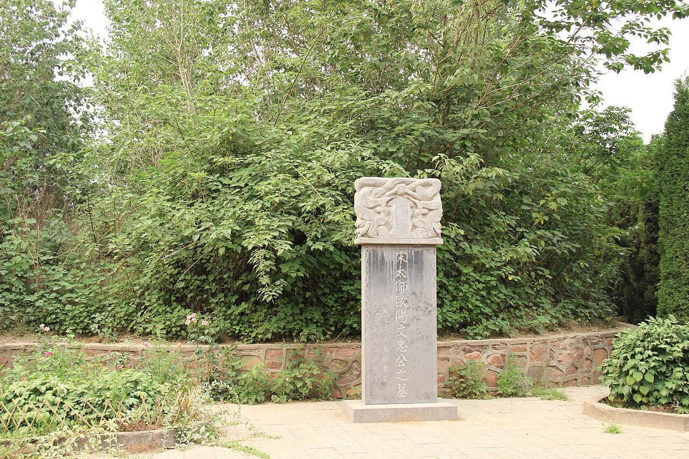

# 欧阳修

欧阳修（1007—1072），字永叔，号醉翁，晚年又号六一居士，吉州永丰人。北宋诗文革新运动的领袖，也是《新唐书》《新五代史》的主修者之一。他的酒名句“醉翁之意不在酒”几乎人人会说，但原文的重点其实在“山水之乐”。更值得注意的是，他并不是一个酒量很大的人；《醉翁亭记》自己就说“饮少辄醉”。

图：欧阳修。摄影：Tomb of Ouyang Xiu - 10318310225。署名：Gary Todd，CC0，来自 Wikimedia Commons（[来源](https://commons.wikimedia.org/w/index.php?curid=114245921)）。

## 人物小传

欧阳修生于 1007 年，卒于 1072 年。他幼年丧父，由母亲教养成人；母亲以荻画地教他写字的故事，后来成为宋代家教的一段典故。1030 年进士及第，历任馆阁校勘、谏官、滁州太守、扬州与颍州知州等职，官至参知政事。

庆历年间，他因支持范仲淹新政被贬，1045 年到滁州任上，次年写下《醉翁亭记》。1054 年奉命参与修《新唐书》；1057 年主持礼部贡举，苏轼、苏辙、曾巩等人在这一科中受到赏识。晚年他多次请求致仕，1071 年退居颍州，1072 年在颍州去世。

他在散文、诗、词、史学与金石学上都有建树，苏轼、曾巩、王安石等都曾受其提携或影响。政治上他并非始终得意，滁州与颍州的岁月，恰好是他在地方官身份中安放个人性情的一段时间。

## 与酒的关系

欧阳修的酒首先是地方官生活的一部分。在滁州，他与民同乐，游琅琊山，饮酒于醉翁亭；《醉翁亭记》把宴饮、山泉、野肴、投壶、下棋与众人喧笑写成一幅风俗画，最后落到“太守醉也”。这场宴饮不是豪奢的官宴，而是地方官与宾客、百姓共享山水的场合。

其次，酒是他晚年自我描述的一个部件。《六一居士传》说自己藏书一万卷、金石遗文一千卷、琴一张、棋一局、酒一壶，加上一位老翁，合为“六一”。酒在这里与书、金石、琴、棋并列，是文化生活的一部分，而不是豪饮的证明。

第三，酒也是他词作里的抒情道具。《浪淘沙·把酒祝东风》以“把酒祝东风，且共从容”开篇，把举杯的动作写成对春光与聚散的挽留；《采桑子》写颍州西湖，以“轻舟短棹西湖好”起句，酒与湖光、闲适的晚年心境连在一起。酒在他的笔下，更多是场景与情绪的媒介，而非酒量记录。

## 代表作品中的酒

《醉翁亭记》的核心句是“醉翁之意不在酒，在乎山水之间也。山水之乐，得之心而寓之酒也。”前一句常被单独引用，后一句才把逻辑补全：酒只是承载山水之乐的媒介。文中又说“饮少辄醉，而年又最高，故自号曰醉翁也”，把“醉翁”之名与酒量小、年纪长联系在一起，带一点自嘲。

《六一居士传》以数字排列生活物件，语气自嘲而平和。酒被放在最后，与“老翁”一起构成晚年的自我形象：不再追求功业，只求在五物之间老去。这里的“六一”是五物加一人，不是六种酒，也不是六个酒器。

《丰乐亭记》与《醉翁亭记》写于相近的滁州岁月，前者记泉与亭，后者记山与宴；两篇都把地方官的治绩、山水与百姓生活连在一起。酒在《丰乐亭记》中不是主角，但“与民同乐”的态度与《醉翁亭记》一脉相承。

## 滁州与颍州

滁州是欧阳修被贬后的第一处重要地方。它在今安徽滁州，琅琊山、酿泉与醉翁亭构成他笔下最具体的山水坐标。醉翁亭并非他亲手所建，而是琅琊山僧智仙所建，他为其命名并作记；这个细节常被忽略，却说明“醉翁”之名来自他的自号，而不是亭子先有名字。

颍州是今安徽阜阳，城西有颍州西湖。欧阳修对颍州西湖感情很深，写有《采桑子》组词，反复吟咏湖上轻舟、绿水与闲适生活。晚年他退居颍州，并在这里去世。滁州与颍州因此构成两个阶段：前者是被贬后的地方治理与山水之乐，后者是致仕后的退居与回忆。

把两地混为一谈，会看不清他人生后半段的走向。滁州的关键词是“贬谪中的与民同乐”，颍州的关键词是“致仕后的安顿”。酒在这两个阶段都不是主角，却是他把山水、友情与时间串起来的线索。

## 北宋士大夫的饮酒文化

北宋士大夫的饮酒，不只是私人嗜好，也是一套社会与财政制度中的行为。宋代实行榷酒制度，酒的生产与销售在某些时期由官府控制或征税，酒课成为地方财政的一部分；地方官因此与酒务、酒税有行政上的接触。欧阳修写酒，背后有这套制度背景。

在社交层面，士大夫的雅集、饯别、节令宴饮都离不开酒。投壶、弈棋、酒令与诗酒唱和，是《醉翁亭记》里那种宴饮的具体内容；乡饮酒礼则把饮酒放进长幼尊卑的礼仪秩序。酒既是放松的媒介，也是人情与身份的载体。

宋代日常饮用多为谷物发酵酒，酒精度通常低于今天的白酒，饮用时还常加热。蒸馏酒在宋代已有踪迹，但并未成为主流。因此，把宋代的酒直接等同于今天的黄酒，或把“醉”都理解成烈酒造成的酩酊，都不准确。欧阳修笔下的“醉”，更多是一种姿态与修辞。

## 时间线

- 1007 年：出生。
- 1030 年：进士及第。
- 1045 年：贬知滁州。
- 1046 年：作《醉翁亭记》。
- 1054 年：奉命修《新唐书》。
- 1057 年：主持礼部贡举。
- 1071 年：退居颍州。
- 1072 年：在颍州去世。

## 引语与出处

“醉翁之意不在酒，在乎山水之间也”出自《醉翁亭记》。引用时应连同下一句“山水之乐，得之心而寓之酒也”一起读，才不至于把“不在酒”误解为否定酒。“饮少辄醉，而年又最高，故自号曰醉翁也”同样出自《醉翁亭记》，可用来说明“醉翁”之名的由来。

《六一居士传》中的“六一”是藏书、金石、琴、棋、酒加一老翁，不是六个酒器。原文以“吾家藏书一万卷，集录三代以来金石遗文一千卷，有琴一张，有棋一局，而常置酒一壶”逐项排列，最后以“以吾一翁，老于此五物之间”收束。引用这些短句时，应说明它们属于公共领域文本，并注明篇名。

## 常见误读

第一，把“醉翁之意不在酒”当成一句劝人少喝酒的话；原文是写山水之乐借酒表达。
第二，把“六一居士”理解为六种酒；它指五物加一人。
第三，把欧阳修当成日日宴饮的官员；滁州宴饮有与民同乐的政治意涵，也有地方风俗背景，且他自称“饮少辄醉”。
第四，把宋代的酒直接等同于今天的黄酒；工艺有渊源，但酒种、酒精度与饮用方式不能画等号。
第五，以为醉翁亭是欧阳修所建；亭为琅琊山僧智仙所建，他命名并作记。
第六，把滁州与颍州当成同一段经历；滁州是被贬后的治理时期，颍州是晚年退居与去世之地。

## 延伸阅读

- [一杯酒里的时间](ref:time-in-a-cup)：酒如何进入节令与写作。
- [中国酒史](ref:chinese-wine-history)：宋代酒业、酒课与酒政。
- [黄酒](ref:yellow-wine)：谷物发酵酒的工艺谱系。
- [中国](ref:china)：欧阳修仕履与滁州、颍州的地理范围。

补充阅读：[安德烈·西蒙](ref:c-extra-1)。

相关条目：[一杯酒里的时间](ref:time-in-a-cup)、[中国酒史纲：从谷物发酵到国家名酒](ref:chinese-wine-history)、[黄酒](ref:yellow-wine)。
