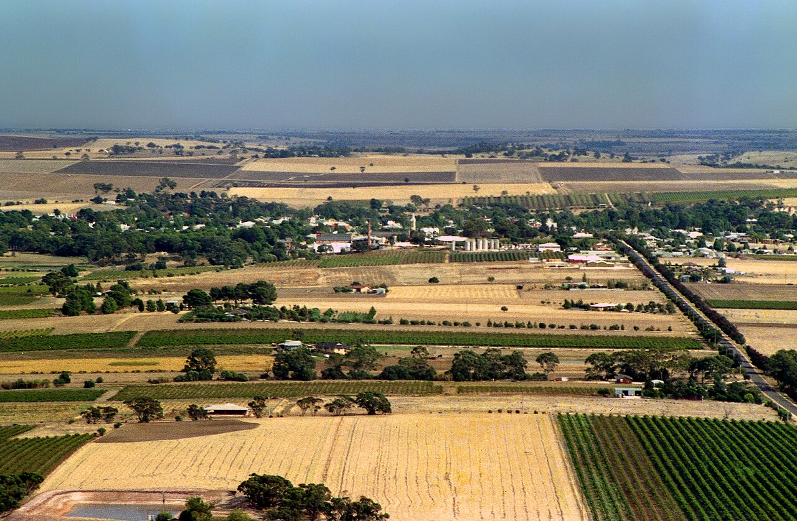

# 彼得·莱曼

彼得·莱曼（Peter Lehmann，1930–2013）是巴罗萨谷最具象征意义的酿酒师之一。他的名声不只来自酒质，也来自一个具体选择：当大型酒厂停止收购小农葡萄、政府又以补贴鼓励拔藤时，他站出来承诺按公平价格收果。这个承诺后来变成一家酒庄，也变成整个产区得以保住老藤与种植家庭的原因之一。

图：1987 年的巴罗萨谷葡萄园；产区场景，不是彼得·莱曼本人，也不是其酒庄。图片：Phillip Capper，CC BY 2.0，via Wikimedia Commons（[原图页面](https://commons.wikimedia.org/wiki/File:Vineyards_in_Barossa_Valley,_South_Australia,_1987.jpg)）。

## 人物小传

莱曼 1930 年 8 月 18 日出生在巴罗萨谷的安加斯顿，父亲是当地路德宗牧师。少年时父亲去世，他 17 岁离开学校，进入雅伦巴（Yalumba）酒厂当学徒。与许多只在大厂里升迁的酿酒师不同，他长期与种植者直接打交道，熟悉每一块地、每一家农户的收成与脾气；这层关系后来在危机中救了他，也救了产区。

## 从雅伦巴到索尔特拉姆

1947 年进入雅伦巴后，莱曼在鲁迪·克罗恩伯格等前辈手下学习酿造。1960 年，他转到索尔特拉姆（Saltram）任首席酿酒师，在那里工作了约二十年。这段经历让他同时掌握大厂的产量逻辑与小产区的风土差异：他知道酒标背后的商业压力，也知道一桶好酒为什么不能只看指标。

## 1979：为种植者开一条出路

1970 年代后期，巴罗萨葡萄严重过剩，索尔特拉姆等大买家要求减少收购，政府则推行“拔藤计划”。莱曼此前已向种植者承诺收果，不愿食言，于是以一个带有赌注意味的名字——Masterson Barossa Vineyards——另组公司收葡萄、找设备、找销路。1979 年公司起步，1982 年改名为 Peter Lehmann Wines。它最初不是一家“名庄”，而是一条让老藤不被拔掉的退路。

## 代表酒款与风格

莱曼的风格偏向“让果实说话”：西拉强调成熟黑果、香料与结构，伊甸谷雷司令强调酸度与柑橘，赤霞珠则保留骨架而不是用重桶覆盖。1987 年，他决定做一款特别西拉，以 Stonewell 地区命名；1989 年的 Stonewell Shiraz 获得澳大利亚重要的 Jimmy Watson 奖杯。1996 年首酿的 Eight Songs Shiraz 则以更柔顺、天鹅绒般的质感，展示他对巴罗萨西拉的另一种理解。

## 制度性影响

莱曼留下的不只是酒款，还有一套“酒庄—种植者”关系。他的酒庄在高峰期从约 140 家种植者收果，其中许多是家族小农；长期合同与握手承诺让老藤得以保留。1992 年，原投资方退出，公司通过公开募股让种植者与员工有机会认购股份，这种“把产区关系写进股权”的做法，在澳大利亚酒业并不常见。今天巴罗萨以老藤西拉为傲，背后有一部分要归功于这种稳定的收购网络。2003 年酒庄出售给瑞士 Hess 集团，2016 年又归入 Casella Family Brands，品牌继续以他的名字与“巴罗萨”为核心。

## 评价与争议

正面评价把他称为“巴罗萨男爵”，认为他在产区最困难的时刻承担了市场风险。批评则集中在两点：一是“救世主”叙事容易把复杂的产业危机简化成一个人的善举，忽略政府补贴、银行信贷与全球市场周期；二是酒庄几度易主后，品牌规模扩大，早期“小农守护者”的形象与资本化经营之间存在张力。莱曼本人 2002 年退休，2009 年获国际葡萄酒挑战赛终身成就奖，2013 年 6 月 28 日在阿德莱德去世。他的葬礼与追思会由产区种植者、酒厂工人与竞争对手共同参加，这种跨阵营的到场，比任何奖章都更能说明他在巴罗萨的位置。关于 Masterson 的成立年份，Wine Spectator 以 1979 年为节点，酒庄官方叙述则把 1980 年首酿视为起点；两种说法并不冲突，前者是公司注册，后者是第一瓶酒。

## 常见误读

第一，把他当成“白手起家的外来投资者”。他出生在产区、在本地酒厂成长，首先是一个行业内部人。第二，把 Masterson 当成单纯的商业投机。它确实是一场赌，但赌注是种植者能否继续留在土地上。第三，把 Stonewell 当成单一葡萄园。它更像一个地区级选果项目，每年从多块老藤地块中挑选。第四，把“巴罗萨男爵”当成正式爵位，它只是行业绰号。

对照阅读：[巴罗萨](ref:barossa)、[西拉](ref:shiraz)。

## 延伸阅读

Wine Spectator 的讣告提供了生卒、任职与易主的骨架，酒庄官方博客则补充了 Stonewell、Eight Songs 与种植者关系；The Wandering Palate 的追忆文章更关注“救产区”的行业意义。三者的立场不同：讣告偏事实，官方博客偏品牌，追忆偏评价。把三者对读，可以避免把莱曼写成单一的“英雄”，也避免把酒庄易主后的商业成功直接归功于创始人。此外，莱曼获颁 Order of Australia，具体级别在不同资料中有 AM 与 AO 两种写法；本页不强行判定，只保留“获澳大利亚勋章”这一可核对事实。

相关条目：[巴罗萨葡萄酒路线](ref:barossa-trail)。

## 另见

- [巴罗萨](ref:barossa)：莱曼一生工作与辩护的产区。
- [巴罗萨葡萄酒路线](ref:barossa-trail)：从酒庄、老藤与小镇理解这个产区的旅行入口。
- [西拉](ref:shiraz)：Stonewell 与 Eight Songs 的品种基础。
- [红葡萄酒](ref:red-wine)：理解莱曼风格的类型框架。
- [澳大利亚](ref:australia)：把莱曼放进澳大利亚葡萄酒出口与产区复兴的长线。

**关键事实。**

| 项目 | 内容 |
| --- | --- |
| 一句话定位 | 澳大利亚巴罗萨谷酿酒师（1930–2013），1979 年以 Masterson Barossa Vineyards 起步，在葡萄过剩、种植者面临拔藤的关口承诺收购果实，1982 年公司改名 Peter Lehmann Wines；以 Stonewell Shiraz 等酒款塑造了巴罗萨的现代面貌 |
| 生卒 | 1930–2013 |
| 身份 | 酿酒师、酒庄创办人 |
| 关联地区 | 澳大利亚、巴罗萨 |

**来源与边界。** 本页关于「彼得·莱曼」的关键事实，主要由以下来源交叉核对：Peter Lehmann Wines（酒庄位于巴罗萨谷、四十余年历史与创始人地位；1987 年首酿 Stonewell、1989 年 Jimmy Watson 奖、1996 年 Eight Songs 与种植者关系）、Wine Spectator、The Wandering Palate（种植者救援、约 140 家种植者、Order of Australia 与 2009 年国际葡萄酒挑战赛终身成就奖）等 5 条来源。价格、批次与状态会变，涉及这些字段时以页面所列来源的最新版本为准。正文为项目自写，来源只作核验，不复制原文。

**并读。** 把「彼得·莱曼」与「巴罗萨」、「巴罗萨葡萄酒路线」、「西拉」放在一起读时，先确认它们是同一层级还是上下游关系：先确认时代与作品，再比较经历、风格与史料边界。本页负责给出人物的基本坐标，对照条目补上具体案例与差异；读完再回到本页，才能分清哪些差别属于人物本身，哪些只是产地、批次或品牌选择。

**适用边界。** 对「彼得·莱曼」而言，生卒年与作品系年存在异说；文学或艺术形象不能直接当作历史生活记录。
