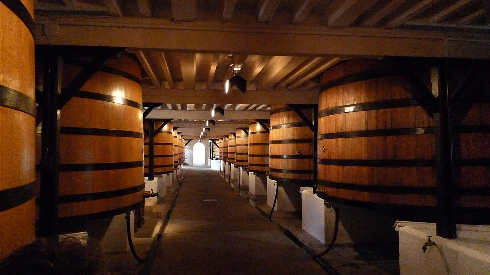

# 菲利普·德·罗斯柴尔德男爵

菲利普·德·罗斯柴尔德男爵（Baron Philippe de Rothschild，1902—1988）是法国酒庄经营者、企业家与葡萄酒推广者。1922 年，他二十岁出头便接管木桐酒庄（Château Mouton Rothschild），此后把一座波亚克二级庄改造成世界最有辨识度的葡萄酒品牌之一：1924 年推动酒庄原瓶灌装，1945 年起每年邀请艺术家设计酒标，1930 年推出木桐嘉棣，1973 年促成木桐升格为一级庄，1979 年又与罗伯特·蒙大维共同创办作品一号。

图：木桐酒庄的大酒窖。图片：MPW57，Public domain，via Wikimedia Commons（[原图页面](https://commons.wikimedia.org/wiki/File:Chateau_Mouton_Gaerkeller.jpg)）。

## 一个“不守规矩”的继承人

菲利普男爵生于 1902 年 4 月 13 日，属于罗斯柴尔德家族法国分支。木桐在 1855 年分级中位列二级庄，葡萄园位于波亚克北端，紧邻拉菲。1922 年他接手酒庄时，波尔多仍以“酒商买散酒、酒庄管种植”为主，酒庄的名字常被酒商遮盖。他判断，如果不能把“木桐”两个字直接卖到消费者手里，酒庄永远只是原料供应者。

1924 年，他做了一个在当时颇激进的举动：把酒在酒庄内装瓶，酒标上写明“Château Mouton Rothschild”。这就是“原瓶灌装”（mise en bouteille au château）的核心。它不只是包装变化，而是把种植、酿造、陈酿、装瓶与品牌控制放在同一个主体手里。1926 年，他建成大酒窖（Grand Chai），为后来的年份酒与酒庄参观打下空间基础。

1930 年，他推出木桐嘉棣（Mouton Cadet），用非一级庄的葡萄做一款面向日常消费的波尔多酒。这个产品常被误读为“木桐的副牌”；它其实是一个独立品牌，目标是让更多人喝到“木桐”的名字，同时为酒庄提供稳定现金流。1933 年，他买下阿尔马亚克酒庄（Château d'Armailhacq），1956 年把它改名为“木桐菲利普男爵夫人”（Mouton Baronne Philippe），1989 年又恢复“阿尔马亚克”之名。1970 年，他再购入克拉米伦酒庄（Château Clerc Milon）。这些收购让木桐不再只是一座酒庄，而是一个小型酒业集团。

## 艺术家酒标与 1973 年升格

1945 年，二战结束。菲利普男爵亲自设计了那一年的酒标：白色底上一个大写的“V”，周围是橄榄枝与葡萄，象征胜利。此后，他每年邀请一位艺术家为木桐设计酒标，合作者包括让·科克托、马克·夏加尔、巴勃罗·毕加索、萨尔瓦多·达利、安迪·沃霍尔、弗朗西斯·培根等。这个传统把葡萄酒、艺术与收藏市场绑在一起，也让木桐成为“可以挂在墙上的酒”。

需要说明的是，艺术家酒标不是“每一瓶都是原作”。酒标是印刷品，原作可能挂在酒庄的葡萄酒艺术博物馆里；不同年份、不同印刷批次也会有差异。1962 年，菲利普男爵在木桐建立葡萄酒艺术博物馆（Musée du Vin dans l'Art），收藏与葡萄酒有关的绘画、雕塑、器物与手稿。参观时要把“酒标艺术”和“博物馆藏品”分开看：前者是每年的商业设计，后者是长期收藏。

1973 年，木桐从二级庄升为一级庄。这是 1855 年分级以来唯一一次官方升格。菲利普男爵为此游说了二十多年，反复证明木桐的酒质、价格与国际声誉已经达到一级庄水平。升格不是“酒一夜之间变好”，而是制度终于承认了长期表现。它也带来一个副作用：木桐成为“唯一一个不再遵守 1855 年名单”的一级庄，这个话题至今仍被酒圈反复讨论。

1979 年，菲利普男爵与[罗伯特·蒙大维](ref:mondavi)在木桐会面，决定共同做一款酒。这就是作品一号（Opus One）：纳帕谷葡萄、波尔多式调配、共享酒标，1991 年在奥克维尔建成专属酒庄。对菲利普男爵而言，这是木桐品牌第一次把“法国之外”的葡萄园纳入自己的叙事；对蒙大维而言，这是加州酒进入波尔多语言的关键一步。

## 木桐这座酒庄怎么看

如果去波亚克，木桐的参观重点不是“打卡一级庄”，而是看三个层次。第一，葡萄园：木桐的砾石台地与拉菲相邻，但微气候、地块与排水不同，赤霞珠的比例与成熟度也有差异。第二，大酒窖与酒标墙：大酒窖展示橡木桶与年份管理，酒标墙把 1945 年以来的艺术家酒标排成一条视觉史。第三，葡萄酒艺术博物馆：看酒器、绘画与手稿如何被组织成“酒与艺术”的叙事，而不是把每件藏品都当成酒标原作。

喝木桐，不要只用“贵不贵”判断。典型年份的木桐有黑醋栗、雪松、铅笔芯、烟草与紫罗兰的层次，单宁强但不粗糙，陈年后会出现皮革与菌菇的气息。新酒年份则更强调果味与橡木。配餐上，赤霞珠主导的波亚克适合牛排、羊排、硬质奶酪与野味；不要让辛辣、过甜的菜压过酒的结构。

木桐嘉棣则是另一种产品逻辑：它不追求一级庄的陈年潜力，而是稳定、易饮、适合日常餐桌。把它当“便宜的木桐”会失望；把它当“波尔多日常酒”的入门样本，反而能理解菲利普男爵为什么要做品牌分层。

## 争议与常见误读

第一，木桐不是“从来就是一级庄”。它在 1855 年是二级庄，1973 年才升格；把今天的地位倒推回十九世纪，会误解整个分级制度。第二，1973 年升格不是“菲利普男爵买通评委”。升格经过法国农业部与相关机构程序，背后是几十年的酒质与市场表现，用“贿赂”解释过于简单。

第三，艺术家酒标不是“每年都由画家本人亲手画在瓶子上”。绝大多数是印刷酒标，原作另存；有些年份使用档案作品或限量版，收藏时要看年份、印刷与来源。第四，木桐嘉棣不是“木桐副牌”。它是独立品牌，葡萄来源与酿造目标都不同；木桐的副牌是“小木桐”（Le Petit Mouton），1993 年才推出。

第五，菲利普男爵不是“作品一号的唯一创始人”。作品一号是木桐与蒙大维各占一半的合资企业，双方团队共同决定酒款；把功劳全归一方，会看不到跨大西洋合作的实际结构。第六，他也不是“只会做营销的贵族”。原瓶灌装、酒窖建设、葡萄园管理、年份筛选与博物馆收藏都需要长期投入；营销是结果，不是全部。

## 与本站其他页面的关系

木桐的故事连接三条线。第一条是[波尔多](ref:bordeaux)的分级与酒庄制度：1855 年名单、二级庄、1973 年升格、原瓶灌装与酒商体系的变化。第二条是[波亚克](ref:pauillac)的产区风土：砾石台地、赤霞珠、拉菲与木桐的相邻关系。第三条是[葡萄酒](ref:wine)的品牌与艺术：艺术家酒标、博物馆、收藏市场与酒庄旅游。

如果想继续看“酒庄如何把品牌做成资产”，可以对照罗伯特·蒙大维的品种标注与酒庄体验；如果想看“分级制度如何影响价格”，可以读 1855 年分级与 1973 年升格；如果想看“跨国合资如何运作”，可以读作品一号的 1978 年协议与 1991 年酒庄落成。木桐不是孤立的城堡，它是波尔多制度、艺术市场与全球葡萄酒贸易的交汇点。

## 延伸阅读

- [木桐酒庄](ref:mouton)：波亚克、一级庄、艺术家酒标与参观信息。
- [葡萄酒](ref:wine)：波尔多调配、橡木桶陈酿与年份差异的基本框架。
- [波尔多](ref:bordeaux)：1855 年分级、左岸与右岸、酒商体系。
- [波亚克](ref:pauillac)：砾石台地、赤霞珠与拉菲、木桐、拉图的地理关系。
- [罗伯特·蒙大维](ref:mondavi)：作品一号的另一半，以及加州酒进入波尔多语言的过程。
