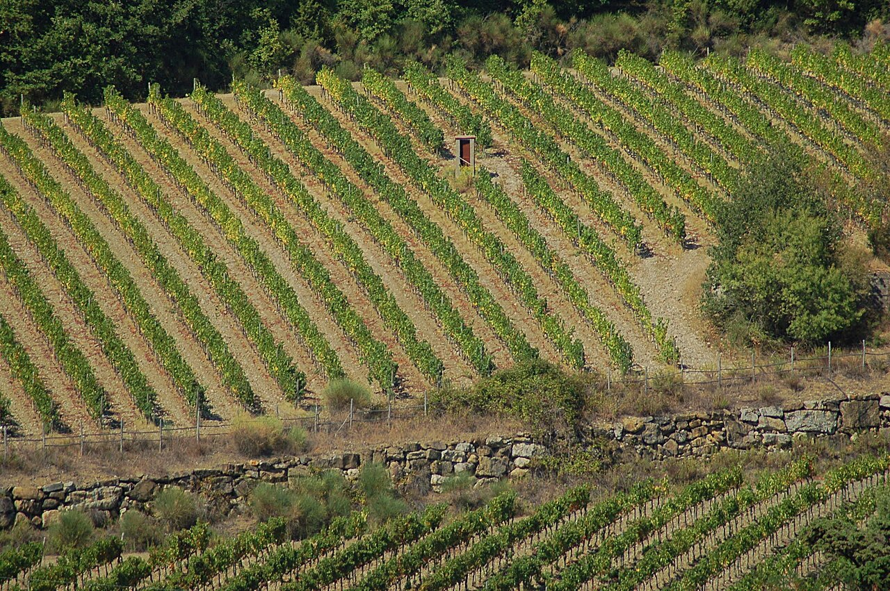

# 皮耶罗·安东尼

皮耶罗·安东尼（Piero Antinori，1938 年生）是意大利托斯卡纳酒业家族 Marchesi Antinori 的第 26 代掌门人。他的名字与 Tignanello 紧紧绑在一起：这款 1971 年上市的托斯卡纳红酒，用桑娇维塞混合赤霞珠，在小橡木桶中陈酿，并且不再添加白葡萄。它既是对奇安蒂旧规则的突破，也是意大利酒业在 1970 年代重新寻找国际位置的一个标志。

图：基安蒂经典产区葡萄园；安蒂诺里家族核心产区场景，不是皮耶罗·安东尼肖像。图片：Tom Chance，CC BY-SA 2.0，via Wikimedia Commons（[原图页面](https://commons.wikimedia.org/wiki/File:Vineyards_in_the_Chianti_Classico_valleys.jpg)）。

## 家族与接手

安东尼家族与佛罗伦萨的关系可追溯到 13 世纪。1385 年，家族成员在佛罗伦萨葡萄酒商协会注册，标志着这个家族正式进入酒业；此后家族在托斯卡纳经营农场、酒庄与贸易，传至皮耶罗已是第 26 代。1938 年，皮耶罗生于佛罗伦萨；他接受的不是单纯的农学教育，而是家族企业、商业与酒业的综合训练。

1966 年，皮耶罗接手家族企业。那正是意大利酒业的转折点：战后 sharecropping（分成佃农）制度结束，农民进城，地主与租户的旧关系瓦解；许多酒庄为了产量继续种高产克隆，奇安蒂的声誉被廉价、稀释的酒拖累。皮耶罗的选择是“向外看”：他到法国、美国学习酒庄管理与酿造，回来后推动品种、设备与营销的更新。

## Tignanello 的突破

Tignanello 的葡萄来自 Tenuta Tignanello 的单一园，海拔约 350 至 400 米，土壤以石灰岩与凝灰岩为主。1970 年，这块园第一次单独酿造；1971 年，酒被命名为 Tignanello，并以“托斯卡纳餐酒”（vino da tavola）而非 Chianti Classico 出售。1975 年，配方彻底去除白葡萄；1982 年起，配比固定为桑娇维塞为主，加入赤霞珠与品丽珠。

这款酒的“突破”有三层。第一，它把桑娇维塞放进小橡木桶（barrique）陈酿，改变了奇安蒂传统的大桶风格。第二，它混合非传统品种赤霞珠，打破了“奇安蒂必须是本地品种”的规则。第三，它放弃了白葡萄，而当时的 Chianti 法规仍要求少量白葡萄参与。因为不符合法规，它只能降级为普通餐酒；这正是后来“Super Tuscan”一词的背景。

## Solaia 与酒庄网络

1978 年，安东尼推出 Solaia，同样来自 Tignanello 庄园的优质地块，以赤霞珠为主，混合桑娇维塞与品丽珠。它与 Tignanello 形成一对：前者更偏国际风格与力量，后者更偏桑娇维塞的香气与结构。两款酒后来都成为意大利高端酒的参考，也被视为“超级托斯卡纳”的代表。

皮耶罗还把家族业务扩展到托斯卡纳以外：Umbria 的 Castello della Sala、Bolgheri 的 Guado al Tasso、Montalcino 的 Pian delle Vigne，以及智利、美国、匈牙利等地的合作酒庄。品牌组合包括 Chianti Classico、Brunello、Bolgheri、Cervaro della Sala 等。这个网络让 Antinori 从“佛罗伦萨家族酒庄”变成跨国酒业集团，但也带来新的问题：如何在不同产区保持各自的风格，而不只是贴同一个家族名字。

## 制度与家族传承

Tignanello 的意义不只在酒本身，还在它迫使意大利制度作出回应。1990 年代，意大利建立 IGT（Indicazione Geografica Tipica）体系，为那些不符合 DOC/DOCG 传统规则、但质量与产区明确的酒提供合法身份。Tignanello 这类“降级餐酒”因此有了更清晰的制度位置；托斯卡纳酒庄也开始更自由地使用国际品种与小橡木桶。

皮耶罗的三个女儿 Albiera、Allegra、Alessia 逐步进入公司管理层；他本人转为荣誉主席。家族企业采用信托与长期持股结构，避免股权被短期出售。这种安排让 Antinori 在意大利酒业中保持罕见的连续性，但也意味着决策权集中在家族内部，外部经理人的空间有限。

## 评价与争议

正面评价把皮耶罗视为“意大利葡萄酒文艺复兴”的推动者：他让托斯卡纳酒从廉价、混乱的形象中走出来，进入国际高端市场；Tignanello 与 Solaia 证明意大利可以做出与法国、加州竞争的红酒；他的家族网络与营销能力也让意大利酒在全球分销体系中获得更好的位置。

批评主要有三点。第一，“Super Tuscan”本身是一个市场标签，它把“脱离传统规则”包装成“更高级”，却不一定比传统奇安蒂更好；一些酒评人认为它推动了过度使用新橡木桶与高比例国际品种。第二，Tignanello 的成功带来模仿潮，许多酒庄用赤霞珠与 barrique 复制“国际风格”，导致托斯卡纳的本地品种特色被稀释。第三，家族企业的跨国扩张可能带来品牌稀释：同一家族名字下的酒，质量与风格差异很大，消费者需要看具体酒款，而不是只看“Antinori”。

## 常见误读

第一，把 Tignanello 说成“第一款 Super Tuscan”。更准确的说法是：它是这一类酒中最具代表性的早期作品之一，但“Super Tuscan”一词后来才流行，且同期还有其他酒庄的类似实践。

第二，把 Tignanello 说成“奇安蒂”。它 1971 年上市时是托斯卡纳餐酒，不是 Chianti Classico；后来才有 IGT 等分类。

第三，把皮耶罗当成“单打独斗的天才”。Tignanello 是家族、葡萄园团队、酿酒师与营销网络共同的结果；他的角色更接近战略决策者。

第四，把“家族 26 代”当成质量保证。传承说明连续性，不说明每一代、每一款酒都达到同一水平。

相关条目：[意大利](ref:italy)。

## 另见

- [托斯卡纳](ref:tuscany)：安东尼家族与 Tignanello 的核心产区。
- [意大利](ref:italy)：Super Tuscan 与 IGT 制度出现的国家背景。
- [桑娇维塞](ref:sangiovese)：Tignanello 的主要品种。
- [红葡萄酒](ref:red-wine)：理解 Tignanello 与 Solaia 的结构。
- [风土与工艺](ref:place-process)：把他的品种、地块与橡木桶选择放进更广的框架。

对照阅读：[托斯卡纳](ref:tuscany)、[桑娇维塞](ref:sangiovese)。

**关键事实。**

| 项目 | 内容 |
| --- | --- |
| 一句话定位 | 意大利托斯卡纳酒业家族 Marchesi Antinori 的第 26 代掌门人（1938 年生），1971 年推出 Tignanello，以桑娇维塞、赤霞珠与小橡木桶改写托斯卡纳红酒的表达 |
| 生卒 | 1938–? |
| 身份 | 酒庄经营者、葡萄酒生产者、家族企业掌门人 |
| 关联地区 | 意大利、托斯卡纳 |

**来源与边界。** 本页关于「皮耶罗·安东尼」的关键事实，主要由以下来源交叉核对：Marchesi Antinori（1970 年首次单一园酿造、1971 年命名为 Tignanello、1975 年去除白葡萄、1982 年固定配比与不产年份；家族 26 代、酒庄网络与 Piero Antinori 的荣誉主席身份）、Comitato Grandi Cru d'Italia（1385 年家族在佛罗伦萨葡萄酒商协会注册、1966 年 Piero 接手、Tignanello 与 Solaia 的基本脉络）、Oxford University Press（Tignanello、Super Tuscan 与托斯卡纳 IGT 体系的背景；未复制词条）等 5 条来源。价格、批次与状态会变，涉及这些字段时以页面所列来源的最新版本为准。正文为项目自写，来源只作核验，不复制原文。

**并读。** 把「皮耶罗·安东尼」与「托斯卡纳」、「意大利」、「桑娇维塞」放在一起读时，先确认它们是同一层级还是上下游关系：先确认时代与作品，再比较经历、风格与史料边界。本页负责给出人物的基本坐标，对照条目补上具体案例与差异；读完再回到本页，才能分清哪些差别属于人物本身，哪些只是产地、批次或品牌选择。
