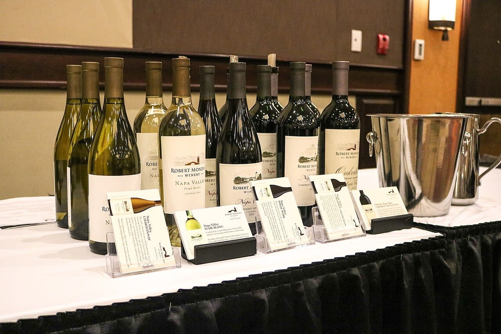

# 罗伯特·蒙大维

罗伯特·蒙大维（Robert Mondavi，1913—2008）是美国酿酒师、酒庄经营者与葡萄酒推广者。他 1966 年在纳帕谷奥克维尔创立以自己命名的酒庄，把品种标注、法国橡木、冷发酵与酒庄旅游带进加州；1979 年又与菲利普·德·罗斯柴尔德男爵共同创办作品一号（Opus One）。在很多人眼里，他就是“加州酒从农产品变成世界级精品”的那个人。

图：罗伯特·蒙大维酒庄品鉴台上的酒瓶。图片：U.S. Embassy and Consulates in Canada，Public domain，via Wikimedia Commons（[原图页面](https://commons.wikimedia.org/wiki/File:Robert_Mondavi_Winery_(40781401945).jpg)）。

> **先给结论**
> **一句话：** 这页判断罗伯特·蒙大维为什么被记住，以及该看哪些作品。
>
> - **适合谁：** 想了解罗伯特·蒙大维做过什么、为什么在酒史里被记住的人。
> - **不适合谁：** 只想看传记轶事、不关心其历史位置的人。
> - **先看这两点：**
>   - 蒙大维的父母从意大利马尔凯大区的萨索费拉托移民美国，先在明尼苏达做葡萄运输，后迁到加州洛迪。
>   - 蒙大维酒庄从第一天起就不是单纯的发酵车间。

## 从洛迪到奥克维尔

蒙大维的父母从意大利马尔凯大区的萨索费拉托移民美国，先在明尼苏达做葡萄运输，后迁到加州洛迪。父亲切萨雷（Cesare Mondavi）做水果与葡萄批发，家里并不富裕，但很早就接触到“把葡萄卖给东岸家庭酿酒”的生意。罗伯特 1913 年生于明尼苏达弗吉尼亚城，在洛迪长大，1936 年从斯坦福大学经济系毕业。

1943 年，父亲买下圣海伦娜的查尔斯·克鲁格酒庄（Charles Krug），罗伯特与弟弟彼得一起进入家族生意。他在那里学会了酿酒、销售与酒庄管理，也形成了“质量优先于产量”的判断。1965 年，兄弟俩因经营方向发生激烈争执，罗伯特离开家族酒庄。第二年，他在奥克维尔买地，建起[罗伯特·蒙大维酒庄](ref:winery)。这件事在当时的纳帕谷并不被看好：禁酒令之后，纳帕谷长期以量取胜，很少有人相信一个加州小酒庄能和法国名庄相比。

## 1966 年那家酒庄

蒙大维酒庄从第一天起就不是单纯的发酵车间。他选择奥克维尔的 To Kalon 葡萄园作为核心，认定这片冲积扇的排水、日照与昼夜温差能做出结构感强的赤霞珠。酒庄建筑由建筑师设计，带拱廊、庭院与品鉴空间；在 1966 年，这种“把酒庄做成目的地”的想法在加州还很新。

技术上有几件事值得记住。第一，他坚持在酒标上写品种名，而不是只写“加州红葡萄酒”或“勃艮第型”。这让消费者第一次能按赤霞珠、霞多丽、长相思去理解加州酒，也让[美国](ref:usa)酒进入以品种为语言的新世界体系。第二，他引入不锈钢罐与温控发酵，追求更干净的果香；又用法国小橡木桶陈酿，增加结构与香料层次。第三，1968 年他把当时不受欢迎的长相思做成干型、经橡木桶陈酿的酒，命名为“Fumé Blanc”，用新名字绕开市场对长相思的偏见。

这些做法后来被很多酒庄模仿，但蒙大维的贡献不只是技术。他到处演讲、组织盲品、邀请餐厅与媒体到纳帕谷，把“酒配餐”的生活方式卖给美国中产。他参与修复纳帕谷歌剧院，推动文化中心与艺术学校，让酒庄不只是卖酒的地方。2001 年，加州大学戴维斯分校的葡萄酒与食品科学研究所以他的名字命名，成为他晚年最看重的公共遗产之一。

## 作品一号与“两个传统”

1978 年，蒙大维在木桐酒庄与[菲利普·德·罗斯柴尔德男爵](ref:philippe)见面，两人用一小时决定了合作：只做一款酒，用纳帕谷葡萄，由法国与美国酿酒师共同酿造。1979 年首个年份问世，1991 年专属酒庄落成。酒名“Opus One”借古典音乐里“作品第一号”的意思，既指两人的第一件合作，也指“一件完整的作品”。

作品一号的意义常被简化成“加州酒征服波尔多”。更准确地说，它是两种制度的嫁接：木桐带来波尔多的调配、陈酿与品牌叙事，蒙大维带来纳帕谷的果味成熟度、葡萄园管理与美国市场。它证明加州酒可以在波尔多的语言里被讨论，也证明法国名庄愿意把“新世界”当作平等伙伴。但它不是蒙大维一个人的作品，也不是“加州全面超过波尔多”的证据；它只是一款特定的合作酒，成功来自双方团队、年份与市场时机。

## 去酒庄看什么

如果去奥克维尔的酒庄，重点不是打卡建筑，而是看三件事。第一，To Kalon 葡萄园的位置：同一片冲积扇上，不同地块的土壤与排水差异会直接反映在赤霞珠的成熟度与酸度上。第二，酒庄的发酵与陈酿空间：不锈钢罐、橡木桶与品鉴室的布局，能看出 1960 年代“把酒庄开放给公众”的思路。第三，品鉴单上的 Fumé Blanc 与 Reserve Cabernet：前者是蒙大维用命名策略改造市场的样本，后者是 To Kalon 结构感的直接表达。

喝蒙大维的酒，不必把它当成“加州第一名庄”。它的价值在于稳定、清晰、易识别：长相思的柑橘与草本的平衡，赤霞珠的黑醋栗、雪松与香草，都是加州品种语言的教科书式表达。配餐上，Fumé Blanc 适合海鲜、白肉与软质奶酪；Reserve Cabernet 适合牛排、羊排与硬质奶酪。若要体会作品一号，重点看它在醒酒后的香气层次与单宁质地，而不是只看酒标。

## 争议与常见误读

第一，蒙大维不是“加州酒的唯一创始人”。纳帕谷在 1960 年代已有蒙特莱那、鹿跃、英格努克等酒庄，加州大学戴维斯分校的酿酒研究、酒农的田间实验与 1976 年巴黎审判都在推动同一件事。蒙大维的独特之处，是把技术、市场、媒体与生活方式整合成一个可复制的酒庄模式。

第二，他不是“只会做营销的人”。品种标注、温控发酵、法国橡木与葡萄园选择都需要长期投入；他的酒在盲品中也有稳定表现。反过来，也不能把他神化成“一个人改变了加州酒”——没有团队、家族资本与纳帕谷的风土，单靠营销不可能持续五十年。

第三，作品一号不是“木桐的加州分庄”。它是一个独立的合资企业，双方各占一半，酒款、葡萄来源与酿造团队都与木桐不同。第四，蒙大维家族后来经历股权出售与人事变动，酒庄今天的拥有者与 1966 年的家族结构并不相同；参观时不要把品牌叙事等同于家族仍然控股。

第五，关于他的生卒年与姓名拼写也有小错：他生于 1913 年 6 月 18 日，卒于 2008 年 5 月 16 日；中文常写“蒙大维”，也有“蒙达维”的译法，指同一人。把这些边界看清楚，才能既承认他的影响力，也不把加州酒的复杂历史压成一个人的传记。

## 与本站其他页面的关系

蒙大维的故事连接三条线。第一条是[葡萄酒](ref:wine)的品种与工艺：品种标注、温控发酵与橡木桶陈酿，都是现代葡萄酒语言的一部分。第二条是[纳帕谷](ref:napa)的产区史：从禁酒令后的量产区，到 1970 年代的质量革命，再到作品一号的国际合作。第三条是跨大西洋的酒业网络：木桐、作品一号与加州市场共同构成 20 世纪后期葡萄酒全球化的样本。

如果想继续看“酒庄如何把风土变成品牌”，可以对照木桐酒庄的艺术家酒标与一级庄升格；如果想看“盲品如何改变市场”，可以读 1976 年巴黎审判；如果想看“西班牙、智利与加州如何互相借力”，可以关注托雷斯家族与作品一号的跨国投资。蒙大维不是孤立的英雄，他是这张网络里最会连接的人之一。

## 延伸阅读

- [罗伯特·蒙大维酒庄](ref:winery)：奥克维尔、To Kalon 与酒庄参观信息。
- [葡萄酒](ref:wine)：品种、发酵、橡木桶与陈酿的基本框架。
- [纳帕谷](ref:napa)：加州精品葡萄酒产区的历史与分区。
- [美国](ref:usa)：禁酒令、加州酒业与 1976 年巴黎审判的背景。
- [菲利普·德·罗斯柴尔德男爵](ref:philippe)：木桐酒庄、艺术家酒标与作品一号的另一半。

**关键事实。**

| 项目 | 内容 |
| --- | --- |
| 一句话定位 | 美国酿酒师与酒庄经营者，1913 至 2008 年在世；1966 年在纳帕谷奥克维尔创立罗伯特·蒙大维酒庄，推动品种标注、法国橡木与酒庄旅游，1979 年与菲利普·德·罗斯柴尔德男爵共同创办作品一号，被视为加州精品葡萄酒走向世界的关键人物 |
| 生卒 | 1913–2008 |
| 身份 | 酿酒师、酒庄经营者、葡萄酒推广者 |
| 关联地区 | 美国、纳帕谷 |
