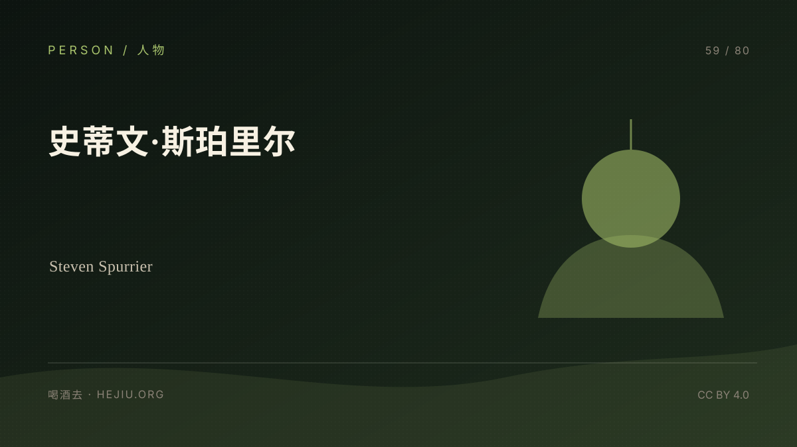

# 史蒂文·斯珀里尔

史蒂文·斯珀里尔（Steven Spurrier，1941—2021）是英国葡萄酒商人、教育者与作家。他长期在巴黎经营酒铺与葡萄酒学校，因 1976 年组织“巴黎审判”盲品而被广泛记住；此后又在 Decanter 参与评奖与写作，成为连接旧世界传统与新世界酒业的重要人物。

图：史蒂文·斯珀里尔栏目示意图。项目自产或类别插图，用于酒吧与酒类语境，不是该对象的实拍。

## 人物小传

斯珀里尔 1941 年生于英国。据其档案与自述，他 1964 年正式进入葡萄酒行业，先以学徒身份学习酒商业务；1971 年移居法国，买下巴黎玛德莱娜教堂附近的酒铺 Les Caves de la Madeleine。1973 年，他在酒铺旁创办 Académie du Vin，这被视为法国较早的双语葡萄酒学校之一。

他的职业身份并不单一：酒商、教师、品鉴者、专栏作者，晚年还成为葡萄种植者与酿酒者。2009 年，他把位于英国多塞特郡的农场改造成 Bride Valley 葡萄园，2014 年首次推出自己的酒。2021 年 3 月 9 日，他在 Bride Valley 的家中去世，享年 79 岁。这个生卒年需要与部分二手资料区分：他并非 2020 年或 2022 年去世，也不应把“巴黎审判”的组织者误写成另一个人。

斯珀里尔并不是学院里的酿酒学家。他的知识主要来自酒铺、品鉴与旅行：在巴黎，他为顾客选酒，也带客户走访产区；学校则把这种“跟着酒商学酒”的经验变成课程。这样的路径使他更重视杯中表现与市场反馈，而不是只看产地等级。也正因为如此，他后来既能向法国人介绍加州酒，也能向英语读者解释法国产区的细节。

## 巴黎审判

1976 年，斯珀里尔与 Académie du Vin 负责人帕特里夏·加拉格尔（Patricia Gastaud-Gallagher）共同策划了一场盲品，名义上是借美国建国两百周年之际比较加州与法国酒。参赛酒共 20 款，加州与法国各 10 款；评委多为法国葡萄酒界的专业人士，样品去标签、按编号呈上。白葡萄酒组的第一名是 1973 年蒙特莱那酒庄霞多丽，红葡萄酒组的第一名是 1973 年鹿跃酒庄 S.L.V. 赤霞珠。

这场活动后来被称为[巴黎审判](ref:judgment)。它的初衷更接近一次让巴黎认识[加州](ref:usa)酒的推广活动，而不是要推翻法国酒的等级；但结果经《时代》周刊记者乔治·塔伯报道后，迅速被解读为“新世界击败旧世界”的象征。斯珀里尔本人多次强调，单次盲品不能证明两个产区的整体高下，它改变的是人们愿不愿意承认：好酒可以在传统等级之外出现。

## 从酒商到写作者

巴黎审判之后，斯珀里尔继续经营酒铺、主持品鉴并拓展业务。1979 年，他曾携家人移居纽约，尝试复制巴黎的葡萄酒学校，但未成功，随后回到英国。1982 年，他受邀设计并主持佳士得（Christie's）的葡萄酒课程；1989 年至 2014 年，他担任新加坡航空的葡萄酒顾问，这段经历让他更频繁地往返于各大产区。

1993 年，他开始为 Decanter 撰稿，后来成为该刊的顾问编辑，并在 2004 年参与创办 Decanter World Wine Awards，担任评审主席；2017 年，他获评 Decanter 年度人物。需要说明的是，“顾问编辑”不是主编，也不等于替杂志做最终内容裁决。他的写作与评奖工作，把品鉴语言、产区知识与市场判断连接起来，影响了许多读者和从业者。

## 对葡萄酒世界的影响

第一，他把“盲品”变成公共讨论的方法。此前，产地等级、酒庄名声与价格往往先于杯中表现；巴黎审判之后，媒体、酒商与教育机构更愿意用去标签的比较来讨论质量。第二，他让[美国](ref:usa)酒，尤其是纳帕谷酒，进入国际酒单与拍卖叙事，但它并不是加州酒被认可的唯一原因，加州大学戴维斯分校的酿酒研究、酒农的田间实验与市场推广同样重要。

第三，他通过学校、课程与评奖建立了一套跨国的葡萄酒教育网络。Académie du Vin 培养的不只是消费者，也包括后来进入酒评、侍酒与贸易的人。第四，他晚年的出版项目 Académie du Vin Library 重新出版经典葡萄酒写作，让旧文本进入新一代读者的视野。Decanter World Wine Awards 以产区和价格带分组评审，为新兴产区提供了相对稳定的曝光渠道；这套模式后来也被批评为奖项过多、商业化过重。把这些影响放在一起看，斯珀里尔更像“把不同世界接起来的人”，而不是某一项技术的发明者。

## 争议与常见误读

第一，巴黎审判不是他一个人的作品。加拉格尔负责具体筹备与联络，评委、酒庄与媒体共同构成了事件；把全部功劳归于斯珀里尔，会遮蔽合作者的工作。第二，20 款酒的排序不等于产区级的全面胜负。样品数量、年份、运输与储存、上酒顺序都会影响结果，后续复赛也并非每次都能复现同样的排序。

第三，媒体与影视把事件戏剧化。纪录片、畅销书与电影《瓶击》（Bottle Shock）强化了“弱者逆袭”的叙事，但影片对人物与细节做了艺术加工，不能当作史料。第四，斯珀里尔并非“反法派”。他长期销售与推广[法国](ref:france)酒，熟悉旧世界产区；巴黎审判挑战的是僵化的等级想象，而不是法国酒本身。

第五，常见误读还包括把他的头衔写成“Decanter 主编”，或把“巴黎审判”说成他发明了盲品。盲品在酒业早有实践，他的贡献在于把一次比较组织成可传播的公共事件。第六，对斯珀里尔的评价常在两极之间摆动：一端把他视为打破欧洲中心主义的英雄，另一端把一场商业盲品说成被过度神化的营销。较稳妥的看法是，他确实改变了公众讨论质量的方式，但这种改变是渐进的，不能归功于一个人或一次事件。理解这些边界，才能既看到他的影响，也看到事件的局限。

## 延伸阅读

- [1976 年巴黎审判](ref:judgment)：事件经过、评委构成与后续争议。
- [葡萄酒](ref:wine)：葡萄酒的定义、工艺与分类。
- [法国](ref:france)：旧世界产区与等级制度的背景。
- [美国](ref:usa)：加州酒产业与禁酒令后的重建。
- [英国](ref:uk)：英国葡萄酒市场、出版与贸易传统。

**关键事实。**

| 项目 | 内容 |
| --- | --- |
| 一句话定位 | 英国葡萄酒商人、教育者与作家，1941 至 2021 年在世；1973 年在巴黎创办 Académie du Vin，1976 年与帕特里夏·加拉格尔组织“巴黎审判”盲品，后任 Decanter 顾问编辑，长期影响加州酒与旧世界等级秩序的国际认知 |
| 生卒 | 1941–2021 |
| 身份 | 葡萄酒商人、葡萄酒教育者、葡萄酒作家 |
| 关联地区 | 英国 |
