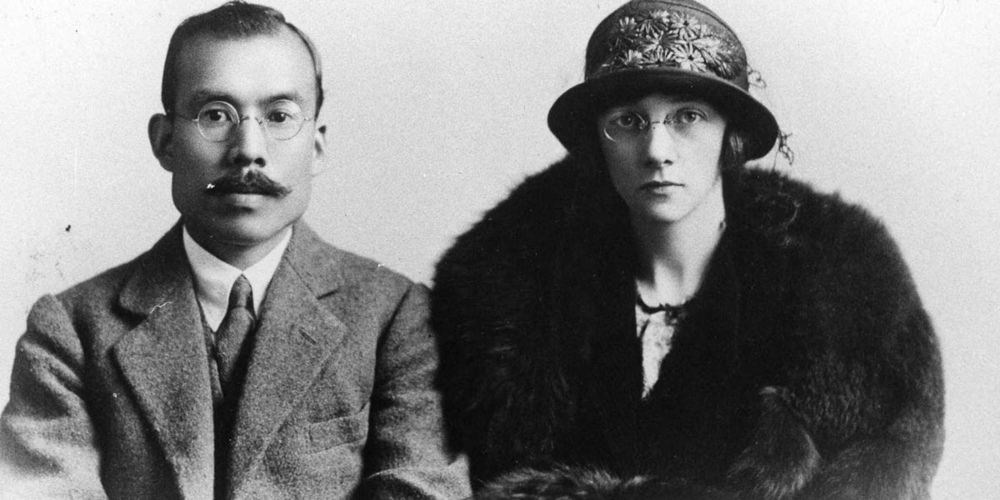

# 竹鹤政孝

竹鹤政孝（1894—1979）是日本威士忌产业的关键人物。他出身广岛县竹原市的清酒酿造家庭，年轻时赴苏格兰学习威士忌蒸馏与调配，回国后参与日本第一座麦芽威士忌蒸馏所的建设，后来在北海道余市建立自己的酒厂。今天被视为“日本威士忌之父”的叙事，很大程度上围绕他展开。

图：竹鹤政孝。图片：Unknown photographer，Public domain，via Wikimedia Commons（[原图页面](https://commons.wikimedia.org/wiki/File:Masataka_and_Rita_Taketsuru.jpg)）。

## 早年与转向

竹鹤 1894 年生于广岛县竹原町，是清酒酿造家庭的第三个儿子。家中以酿酒为业，他从小看着酒窖与发酵房长大，对“做酒”并不陌生。后来他进入大阪高等工业学校（今大阪大学）学习酿造，毕业后于 1916 年进入摄津酒造，起初负责利口酒与仿制洋酒的制造。

当时的日本威士忌市场充斥着用中性酒精加糖、加香精调成的“仿制威士忌”。摄津酒造意识到，随着真正苏格兰威士忌的输入，这类产品难以长期竞争，于是计划生产正宗威士忌。竹鹤因化学与酿造背景被选中，1918 年受公司派遣独自前往苏格兰。值得一提的是，他对威士忌的兴趣并非来自家业，而是来自对西方蒸馏酒的好奇；清酒酿造给了他微生物与发酵的底子，但连续蒸馏、木桶陈年与调配仍是全新的知识体系。这一步改变了他的人生，也为[日本](ref:japan)威士忌产业埋下了技术起点。

## 苏格兰两年

1918 年 7 月，竹鹤从神户出发，途经美国旧金山等地，于同年 12 月抵达苏格兰。他在格拉斯哥大学与皇家工学院（今斯特拉斯克莱德大学）以旁听生身份学习化学，并大量阅读威士忌制造文献。课堂之外，他意识到仅靠书本不够，便于 1919 年 4 月前往斯佩塞，争取到朗摩（Longmorn）蒸馏所的学习机会，完整接触发芽、糖化、发酵、蒸馏与陈年的流程。

随后，他还在爱丁堡附近学习科菲连续蒸馏器的谷物威士忌制造。由于现场不允许记笔记，他把观察写在小纸片上，晚上再凭记忆整理，后来形成著名的“竹鹤笔记”。1920 年 1 月，他与苏格兰人丽塔（Jessie Roberta Cowan）结婚；同年 11 月，两人一起回到日本。这里要避免一个常见简化：他并非“1919 年才去苏格兰”，而是 1918 年出发、1918 年 12 月抵达，1919 至 1920 年在[苏格兰](ref:scotland)学习，1920 年回国。

## 山崎与分歧

回到日本后，摄津酒造因战后经济环境放弃了威士忌计划，竹鹤一度以教书为生。1923 年 6 月，他加入寿屋（今三得利），参与山崎蒸馏所的建设。山崎位于京都郊外，1923 年动工，1924 年 11 月完成日本第一座麦芽威士忌蒸馏所，竹鹤担任工厂负责人，把在苏格兰学到的设备、流程与管理经验带入现场。

分歧也在这里出现。竹鹤倾向于把酒厂建在气候与风土更接近苏格兰的北海道，鸟井信治郎则看中山崎靠近京都、大阪的水源、交通与市场。风味上，竹鹤受苏格兰重泥煤、厚重风格影响较深；鸟井更在意日本消费者的细腻口味。1929 年上市的白札（Shirofuda）市场表现不佳，常被用来解释两种路线的张力。1934 年 3 月，竹鹤在合约期满后离开寿屋，转赴北海道。需要谨慎的是，“分歧”是产业史与后人叙述的概括，不宜写成两人公开决裂或互相攻击。

## 余市与日果

1934 年 7 月 2 日，竹鹤在北海道余市设立大日本果汁株式会社，以苹果汁等业务支撑现金流，同年 10 月完成余市蒸馏所的建设。余市靠近日本海，气候凉爽、湿度与水质接近苏格兰，正符合他对“北方酒厂”的想象。1940 年，公司推出第一瓶日果威士忌；1943 年，竹鹤出任社长。1952 年，公司更名为日果威士忌（Nikka Whisky）。

余市之后，日果在宫城峡等地扩建蒸馏所，形成多蒸馏所、多风格的调配体系。竹鹤坚持直火加热的壶式蒸馏器、适度泥煤与长时间木桶陈年，这些选择让日果的[威士忌](ref:whisky)带有明确的苏格兰谱系，同时逐步形成日本自己的表达。把日果简单说成“复制苏格兰”并不准确：设备与流程可以学习，原料、气候、水质与市场口味却必须重新适应。

## 方法与遗产

竹鹤留下的第一份遗产是“可复制的知识”。“竹鹤笔记”记录了蒸馏器结构、操作要点、员工管理与酒税制度，让原本口传心授的苏格兰经验变成可带回日本的技术文本。第二份遗产是“酒厂选址”的观念：威士忌不是在任何地方都能做出同样风格，气候、水源与空气微生物会影响陈年。第三份遗产是“产品分层”：从面向大众的调配威士忌到单一麦芽，日果逐步建立了不同价格与风味的产品线。

在[日本威士忌](ref:japanese-whisky)的国际声誉中，竹鹤常被塑造成孤独的先行者。这个形象有事实基础，但也遮蔽了合作者：丽塔在语言与生活上的支持、摄津酒造与寿屋提供的资源、余市当地工人与后继调配师的工作，都是产业形成的一部分。竹鹤的[蒸馏](ref:distillation)方法并非一成不变，后继者也在设备、原料与陈年策略上不断调整。今天余市蒸馏所仍保留部分旧建筑与直火蒸馏设备；2014 至 2015 年，NHK 晨间剧《阿政》以他和丽塔为原型播出，使这段产业史进入大众文化。但影视叙事会强化“个人奋斗”，读者仍应回到厂史与档案核对年份。

对照阅读：[威士忌](ref:whisky)、[苏格兰](ref:scotland)。

## 延伸阅读

- [威士忌](ref:whisky)：威士忌的定义、原料与主要类型。
- [日本威士忌](ref:japanese-whisky)：日本威士忌的产业史与风格。
- [苏格兰](ref:scotland)：苏格兰威士忌产区与法规背景。
- [日本](ref:japan)：日本酒类消费与生产的地理背景。
- [蒸馏](ref:distillation)：壶式与连续蒸馏的基本原理。

**关键事实。**

| 项目 | 内容 |
| --- | --- |
| 一句话定位 | 日本威士忌先驱，1894 至 1979 年在世；1918 年赴苏格兰学习蒸馏与调配，回国后参与山崎酒厂建设，1934 年在北海道余市创立大日本果汁（日果前身），与鸟井信治郎在选址与风味路线上分道扬镳 |
| 生卒 | 1894–1979 |
| 身份 | 威士忌酿造者、企业家 |
| 关联地区 | 日本 |

**来源与边界。** 本页关于「竹鹤政孝」的关键事实，主要由以下来源交叉核对：Nikka Whisky Distilling Co., Ltd.（1934 年 7 月 2 日设立大日本果汁、同年 10 月余市蒸馏所完工、1940 年首瓶日果威士忌上市、1943 年出任社长与 1979 年去世）、Suntory Holdings Limited（1923 年山崎蒸馏所动工、1929 年白札上市及市场失利、1937 年角瓶上市，作为理解鸟井信治郎风味路线的背景）、Nikka Whisky Europe（1918 年从神户出发、12 月抵达苏格兰，以及赴苏格兰的公司背景）。价格、批次与状态会变，涉及这些字段时以页面所列来源的最新版本为准。正文为项目自写，来源只作核验，不复制原文。
