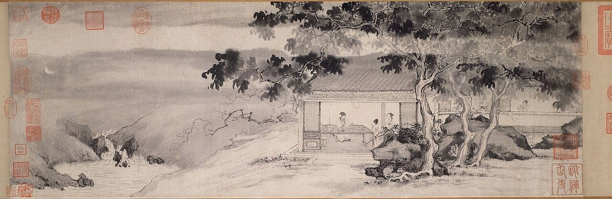

# 唐寅

唐寅（1470—1524），字伯虎，一字子畏，号六如居士、桃花庵主，苏州吴县人。他是明代吴门最有名的才子型画家之一，也是“桃花仙人”这一文学形象的作者。后世给他加了很多风流故事，可靠史料却相对有限；要谈他与酒的关系，最稳妥的入口是正史、诗与画。

图：唐寅《夜饮图》，庭院与夜雾中的文人饮酒场景。图片：Tang Yin，Public domain，via [原图页面](https://commons.wikimedia.org/wiki/File:Tang_Yin_-_Drinking_at_Night_-_1955.761_-_Art_Institute_of_Chicago.jpg)。

> **先给结论**
> **一句话：** 这页判断唐寅为什么被记住，以及该看哪些作品。
>
> - **适合谁：** 想了解唐寅做过什么、为什么在酒史里被记住的人。
> - **不适合谁：** 只想看传记轶事、不关心其历史位置的人。
> - **先看这两点：**
>   - “江南第一才子”“唐伯虎点秋香”这些说法，大多来自晚明的通俗小说、弹词与戏曲，而不是科举档案或墓志。
>   - - 1470 年生于苏州吴县，父亲唐广德经营酒食生意。

## 一个被传说覆盖的人

“江南第一才子”“唐伯虎点秋香”这些说法，大多来自晚明的通俗小说、弹词与戏曲，而不是科举档案或墓志。真实的唐寅一生并不轻松：少年成名，中年被科场案断了仕途，晚年靠卖画维持生计。传说把他写成一个无忧无虑的风流人物，恰好抹掉了他最要紧的那段经历。

要分辨传说与史料，可以看三个坐标：一是《明史·文苑传》的记载，二是《六如居士集》中的诗文，三是传世书画上的题诗。三者互相印证的部分，才是可以放心引用的部分。

## 生平节点

- 1470 年生于苏州吴县，父亲唐广德经营酒食生意。
- 少年时“性颖利，与里狂生张灵纵酒，不事诸生业”，后经祝允明规劝，闭户读书一年。
- 1498 年（弘治十一年）应天府乡试第一，人称“唐解元”。
- 1499 年赴京会试，因江阴举人徐经贿赂程敏政家僮获取试题一案牵连，下狱，被黜为吏；他耻于就任，回到苏州。
- 约 1505 年后筑室桃花坞，以卖画为生。
- 1514 年（正德九年）应宁王朱宸濠之聘赴南昌，察觉其有异志，“佯狂使酒，露其丑秽”，被放还。
- 1524 年去世，年五十四。

## 科场案之后：酒作为立场

科场案是唐寅一生的转折。他原本可以走科举入仕的正路，案发后被剥夺功名、贬为小吏，这条路彻底断了。此后他回到苏州，卖画、饮酒、赏花、写诗，构成一套自我安顿的生活方式。

酒在这套生活里不是宴饮记录，而是立场声明。《明史》写他“筑室桃花坞，与客日般饮其中”，又写他面对宁王的征聘“佯狂使酒”。同一个动作，在不同情境下有不同功能：平日是与客共饮的自在，危急时是拒绝合作的伪装。把这两处记载放在一起看，才能理解“酒”在他身上为什么既是享受，也是策略。

## 《桃花庵歌》：花、酒与循环的时间

《桃花庵歌》是理解唐寅酒意象的核心文本，全诗见[《桃花庵歌》](ref:peach-blossom-song)。开头把地点、人物与生计连在一起：“桃花仙人种桃树，又摘桃花换酒钱。”种桃、卖花、换酒，形成一个自给自足的小世界，酒是这个世界里的流通物，不是奢侈品。

接着是时间：“酒醒只在花前坐，酒醉还来花下眠。半醒半醉日复日，花落花开年复年。”日子在花开花落中循环，醒与醉不再是两个对立的状态，而是同一种生活的两半。

最关键的是选择：“但愿老死花酒间，不愿鞠躬车马前。”这句把“花酒”与“车马”对举，前者是自由，后者是权贵门下的屈身。读到这里就知道，诗里的享乐不是消费主义的赞美，而是拒绝进入官场秩序的宣言。

需要提醒的是异文。此诗在不同选本中字句有出入，例如“车尘马足贵者趣，酒盏花枝贫者缘”一句，有的版本作“显者事”“隐士缘”。引用时应注明所据版本，不能把某一版本当作唯一原文。

## 《把酒对月歌》：与李白对饮

另一首常被引用的作品是《把酒对月歌》。诗从李白的月亮写起，一路写到自己的处境：“李白能诗复能酒，我今百杯复千首。”这不是在夸酒量，而是在给自己找一个可以并列的前辈：李白能诗能酒，我也能诗能酒。

诗的后半段把姿态说得很清楚：不登天子船，不上长安眠，只愿在姑苏城外的一间茅屋里，与满树花月相伴。酒在这里是“不入长安”的选择，与《桃花庵歌》的“不愿鞠躬车马前”是同一个意思的两种说法。

把两首诗对读，可以看到唐寅酒诗的固定结构：先写一个理想化的前人（桃花仙人、李白），再写自己的现实处境，最后用一个空间选择（花下、茅屋）把立场落定。

## 画上的酒与题画诗

唐寅是画家，酒也进入他的画面与题跋。文人画常以雅集、饮酒、赏花为题，酒是道具，也是社交场合的润滑剂。他的《事茗图》写茶事，《秋风纨扇图》写被弃的佳人，题材不同，但都延续了“以物寄意”的做法。

《题秋风纨扇图》的题诗是：“秋来纨扇合收藏，何事佳人重感伤。请把世情详细看，大都谁不逐炎凉。”诗里没有酒，却和酒诗共享一种冷眼：看透世情之后，选择退到自己的小天地里。这种态度，正是[酒与绘画](ref:wine-and-painting)传统中反复出现的主体姿态。

## 明代的酒与苏州酒事

明代苏州是经济与文化中心，酒馆、园林、书画市场都很发达。文人日常喝的以谷物发酵酒为主，[黄酒](ref:yellow-wine)一类低度酒是常见选择；蒸馏酒已经存在并逐渐普及，但雅集场合仍以低度酒为主。把唐寅笔下的“酒”直接等同于今天的高度白酒，会错位。

苏州的酒事还与书画市场相连。唐寅卖画为生，酒钱、画价、朋友往来构成他的经济生活；酒馆是交易与交际的场所，也是他诗中出现频率很高的空间。理解这一点，比统计他“喝了多少”更有意义。

## 评价与争议

《明史》对他的评价带着惋惜：“寅诗文初尚才情，晚年颓然自放，谓后人知我不在此，论者伤之。”这是正史作者的态度：承认才华，也批评他晚年的放任。同一条材料还指出，“吴中自枝山辈以放诞不羁为世所指目，而文才轻艳，倾动流辈，传说者增益而附丽之，往往出名教外。”这句话很关键：早在明代，时人就已看到“传说者增益而附丽”，也就是后世故事的加工机制。

另一层争议来自作品归属与真伪。唐寅名声太大，市场上托名之作极多，书画鉴定与诗文辨伪一直是研究难点；把一首题作“唐寅”的诗直接当作他的作品，需要版本与著录的支持。

## 常见误读

第一，把“唐伯虎点秋香”当史实。这是冯梦龙《警世通言·唐解元一笑姻缘》与后世戏曲的加工；常见考证认为秋香原型是成化年间南京名妓林奴儿，年长于唐寅。

第二，把“江南第一才子”当科举功名。它是后世封号，唐寅的实际功名是应天府乡试第一名（解元）。

第三，把《桃花庵歌》读成纯粹的享乐宣言。诗里的“花酒”是对官场秩序的拒绝，不是对消费的赞美。

第四，把唐寅只当成画美人、画春宫的画家。他的山水、人物、花鸟都有传世作品，题材远不止一种。

第五，用今天的酒想象明代的酒。明代主流仍是低度发酵酒，[酒与诗](ref:wine-and-poetry)里的“酒”要放回当时的酿造条件。

## 另见

- [酒与绘画](ref:wine-and-painting)：文人画中的饮酒与雅集。
- [酒与诗](ref:wine-and-poetry)：酒在中国诗歌中的常见功能。
- [黄酒](ref:yellow-wine)：谷物发酵酒的工艺谱系。
- [中国](ref:china)：明代苏州所在的区域背景。
- [《桃花庵歌》](ref:peach-blossom-song)：本页所引诗句的出处页。

**关键事实。**

| 项目 | 内容 |
| --- | --- |
| 一句话定位 | 明代画家与诗人，1470 至 1524 年在世，苏州吴县人；科场案后绝意仕进，以卖画为生 |
| 生卒 | 1470–1524 |
| 身份 | 画家、诗人 |
| 关联地区 | 中国 |

**来源与边界。** 本页关于「唐寅」的关键事实，主要由以下来源交叉核对：清张廷玉等撰；中华书局点校本（生卒、科场案、宁王征聘与“佯狂使酒”等记载；本页只引用短句）、明唐寅撰；通行整理本（《桃花庵歌》《把酒对月歌》《言志》等诗题与字句；本页只引用短句，不复制全篇）、Wikimedia Foundation（比对异文；未复制全篇）等 8 条来源。价格、批次与状态会变，涉及这些字段时以页面所列来源的最新版本为准。正文为项目自写，来源只作核验，不复制原文。
