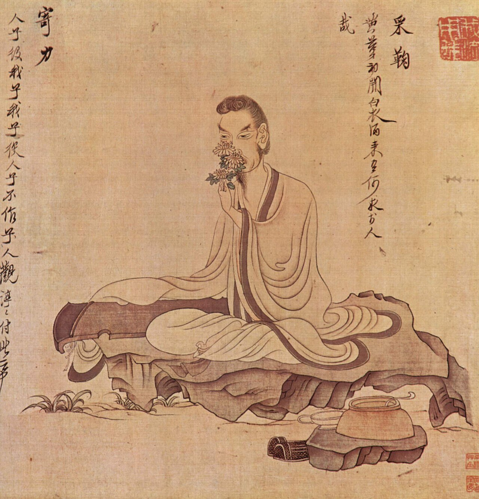

# 陶渊明

陶渊明（365—427），一名潜，字元亮，浔阳柴桑人，世称靖节先生。他把辞官、耕种、饮酒、写诗写成了同一套生活选择。后人常记得“采菊东篱下”，却容易忽略他在《归去来兮辞》序里的一句实话：他去做彭泽令，理由之一是“公田之利，足以为酒”。

图：陶渊明。图片：Chen Hongshou，Public domain，via Wikimedia Commons（[原图页面](https://commons.wikimedia.org/wiki/File:Ch%27en_Hung-shou_002.jpg)）。

## 人物小传

陶渊明出身于没落的士族家庭，曾祖陶侃是东晋名臣，但到他的时代，家道已经中落。他早年曾任州祭酒、镇军参军、建威参军等职，仕途断断续续。405 年，他出任彭泽令，在官八十余日，因不愿束带迎接郡里派来的督邮，自免去职，作《归去来兮辞》。

此后他归居田园，躬耕自足，与邻人往来，饮酒赋诗。晚年生活困顿，有时甚至需要友人接济。427 年去世，友人私谥“靖节”。萧统编《文选》收录其作品，并为其集作序，对后世影响很大。

## 生平节点

- 365 年：出生。
- 约 393 年：起为江州祭酒，不久自解归。
- 405 年：任彭泽令，在官八十余日，十一月作《归去来兮辞》。
- 420 年：刘裕代晋，东晋灭亡；此后他的诗中多有朝代更替的感慨。
- 427 年：去世。

## 归隐与酒

陶渊明的酒首先是生活事实。《五柳先生传》自述“性嗜酒，家贫不能常得。亲旧知其如此，或置酒而招之。造饮辄尽，期在必醉”。这段自述把饮酒与经济条件绑在一起：想喝，却未必喝得起；有人请，就喝到尽兴。

其次，酒是归田生活的组成部分。《移居》写邻人往来：“过门更相呼，有酒斟酌之。”《读山海经》写“欢言酌春酒，摘我园中蔬”。酒在这里不是社交场上的应酬，而是劳作之余、邻里之间的日常。

第三，酒还带政治意味。辞官之后喝自己的酒、种自己的田，是一种拒绝被纳入官场秩序的姿态。但也不能把他说成彻底的隐士：他写过《咏荆轲》，也写“刑天舞干戚，猛志固常在”，对世事并非无动于衷。

还有一个反证：《九日闲居》序说“秋菊盈园，而持醪靡由”，重阳无酒可饮；《止酒》更以“平生不止酒，止酒情无喜”写戒酒的难受。可见他并非时时都有酒，也并非只会写醉。

## 代表作品中的酒

《饮酒》二十首的序是最直接的说明：“余闲居寡欢，兼比夜已长，偶有名酒，无夕不饮。顾影独尽，忽焉复醉。既醉之后，辄题数句自娱。”这段话给出了一套完整的写作场景：独居、长夜、有酒、醉后题诗。酒是触发写作的条件，而不是写作的主题。

《饮酒·其五》写“采菊东篱下，悠然见南山”，全诗没有正面写醉态，却以“此中有真意，欲辨已忘言”收束。酒的作用是让人暂时离开名教与得失的计算，进入一种难以言说的状态。

《饮酒·其七》的意象更具体：“秋菊有佳色，裛露掇其英。泛此忘忧物，远我遗世情。”把菊花瓣泛在酒里，酒因此被称作“忘忧物”。这是陶诗中最接近“酒的用途说明”的句子：酒的功能是忘忧，是暂时离开世俗之情。

《五柳先生传》则提供了最直接的自述：“性嗜酒，家贫不能常得。”这句常被当作陶渊明爱酒的证据，其实同时也说明他的贫困。把两句连起来读，才不会只剩下一个“酒徒”标签。

## 公田种秫：一个县令的酒业条件

《归去来兮辞》序说得很清楚：“彭泽去家百里，公田之利，足以为酒。故便求之。”他求官的理由之一，是公田的收益够他酿酒。这句话把文人的饮酒史与地方财政制度接上了。

《晋书·陶潜传》还记下一件更具体的事：他在彭泽令任上，命公田全部种秫谷，说“令吾常醉于酒足矣”；妻子坚持要种粳米，最后折中为二顷五十亩种秫、五十亩种粳。秫是黏性的谷物，适合酿酒；粳是日常口粮。一个县令能决定公田种什么，这说明酒在他的生活里不只是买来的商品，也与土地、租税和职务权力有关。

东晋的酒以谷物发酵酒为主，酒度不高，保存期短，饮用时常用樽、壶、觞。浊酒与清酒的区别在过滤程度。把今天的白酒想象成陶渊明喝的酒，会错得很远；把“醉”理解成烈酒造成的酩酊，也会误读他的诗。

## 评价与争议

萧统在《陶渊明集序》里已经点出关键：“有疑陶渊明诗篇篇有酒，吾观其意不在酒，亦寄酒为迹者也。”这句话既是对“酒徒”读法的纠正，也说明梁代读者已经注意到诗中酒的比重。

争议在于评价的高低。钟嵘《诗品》把陶潜列在中品，评他“文体省净，殆无长语”，又说“世叹其质直”；这与后世“古今隐逸诗人之宗”的推崇并不一致。到了宋代，苏轼说陶诗“质而实绮，癯而实腴”，评价才明显升高。

现代读者也容易把他“静穆化”。鲁迅在《题未定草》里说，陶潜正因为并非“浑身是静穆”，所以他伟大。这句话提醒我们：陶渊明的酒里有安然，也有不甘；有“悠然见南山”，也有“猛志固常在”。

## 常见误读

陶渊明常被读成纯粹的隐士。他归田后仍关心世事，诗中有对朝代更替与人生无常的感慨。

“性嗜酒”常被当作酒量证明，但原文紧接着说“家贫不能常得”，重点在贫困与嗜好的矛盾。

田园诗也常被当成旅游文学。他写的是自己耕种、饮酒、与邻人往来的日常。

用今天的白酒想象东晋的酒，会错得很远：当时主流仍是谷物发酵酒，酒度较低、保存期短。

至于辞官，恐怕不只是清高。“公田之利，足以为酒”说明他求官时也有很实际的打算，辞官则是多种原因叠加的结果。

## 引语与出处

“采菊东篱下，悠然见南山”出自《饮酒·其五》；“性嗜酒，家贫不能常得”出自《五柳先生传》；“公田之利，足以为酒”出自《归去来兮辞》序；“泛此忘忧物，远我遗世情”出自《饮酒·其七》；“秋菊盈园，而持醪靡由”出自《九日闲居》序。引用时应注明篇名，并区分序文与正文。

相关条目：[中国酒史纲：从谷物发酵到国家名酒](ref:chinese-wine-history)、[一杯酒里的时间](ref:time-in-a-cup)、[黄酒](ref:yellow-wine)。

## 另见

- [中国酒史](ref:chinese-wine-history)：谷物酒与酒政的长期变化。
- [一杯酒里的时间](ref:time-in-a-cup)：酒如何进入节令与写作。
- [黄酒](ref:yellow-wine)：谷物发酵酒的工艺谱系。
- [中国](ref:china)：陶渊明生活与归田的地理范围。

补充阅读：[安德烈·西蒙](ref:c-extra-1)。
