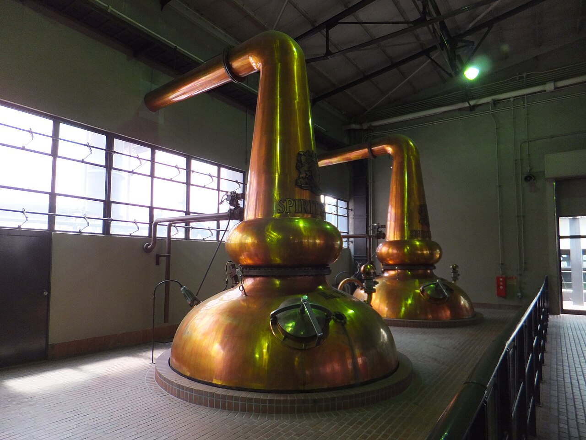

# 鸟井信治郎

鸟井信治郎（1879—1962）是日本企业家，三得利（Suntory）的创办人。他 1899 年在大阪开出“鸟井商店”，从进口葡萄酒与洋酒起步；1907 年推出适合日本人口味的赤玉波特酒；1923 年在京都郊外的山崎建成日本第一座麦芽威士忌蒸馏所，并聘请刚从苏格兰学成归来的竹鹤政孝；1929 年推出日本第一款商业麦芽威士忌“白札”（Suntory Whisky Shirofuda）。他常挂在嘴边的一句话是“やってみなはれ”（试试看），后来几乎成了三得利的企业格言。

图：山崎蒸馏所的铜制壶式蒸馏器。图片：Toukou Sousui 淙穂鶫箜，CC BY 2.0，via Wikimedia Commons（[原图页面](https://commons.wikimedia.org/wiki/File:Yamazaki_Distillery_%E5%B1%B1%E5%B4%8E%E8%92%B8%E7%95%99%E6%89%8017.jpg)）。

> **先给结论**
> **一句话：** 这页判断鸟井信治郎为什么被记住，以及该看哪些作品。
>
> - **适合谁：** 想了解鸟井信治郎做过什么、为什么在酒史里被记住的人。
> - **不适合谁：** 只想看传记轶事、不关心其历史位置的人。
> - **先看这两点：**
>   - 如果去山崎，重点看三件事。
>   - 鸟井信治郎 1879 年生于大阪。

## 从大阪酒商到“日本威士忌之父”

鸟井信治郎 1879 年生于大阪。明治时期的日本，清酒与烧酎是主流，葡萄酒、波特酒与威士忌属于进口洋酒，价格高、受众窄。鸟井少年时在酒类批发店当学徒，1899 年自立门户，开“鸟井商店”，卖进口葡萄酒与利口酒。他很快发现，直接照搬欧洲口味卖不动：日本人喜欢甜、顺、易入口的酒。

1907 年，他推出赤玉波特酒（Akadama Port Wine）。这款酒用葡萄牙风格的甜型葡萄酒做基底，调得更甜、更顺，价格也压到普通家庭能接受的水平。赤玉的成功不只是配方，而是渠道：鸟井把酒铺进杂货店、餐馆与车站，让洋酒第一次成为“日常可以买到的商品”。赤玉至今仍是三得利的重要产品，也是日本洋酒大众化的起点。

1921 年，鸟井商店改组为“寿屋”（Kotobukiya），开始做真正的烈酒生产。1923 年，他在京都府乙训郡大山崎町（今山崎）建起山崎蒸馏所。选择这里，是因为山崎位于桂川、宇治川与木津川交汇处，水质柔软，气候湿润，适合麦芽糖化、发酵与橡木桶陈酿。这也是日本第一座真正意义上的麦芽威士忌蒸馏所。

## 竹鹤政孝与“白札”

山崎建厂时，鸟井聘请了竹鹤政孝。竹鹤 1918 年独自前往苏格兰，在格拉斯哥大学学化学，并在多家蒸馏厂实习，1920 年与苏格兰妻子丽塔结婚。1923 年回国后，他加入鸟井的团队，负责蒸馏所的技术设计、酵母选择与蒸馏工艺。1929 年，三得利推出“白札”（Shirofuda），这是日本第一款商业化的麦芽威士忌。

白札的市场表现并不理想。当时的日本消费者不习惯泥煤、烟熏与强烈的麦芽味，觉得它“像药”或“太冲”。鸟井与竹鹤在方向上也出现分歧：鸟井希望做更柔和、更适合日本人口味的产品，竹鹤则坚持更接近苏格兰的风格。1934 年，竹鹤离开寿屋，在北海道余市创立自己的蒸馏所，后来发展为日果（Nikka）。这段分道扬镳常被写成“日本威士忌的两条路线”：山崎走向柔和、精致与市场导向，余市走向直火蒸馏、泥煤与苏格兰传统。

1937 年，三得利推出“角瓶”（Kakubin）。方瓶、白标、口感更圆润，价格适中，迅速成为日本餐馆与家庭餐桌上的常见威士忌。角瓶的成功证明鸟井的判断：日本威士忌不能只模仿苏格兰，必须找到本地消费者愿意每天喝的味道。今天山崎、白州、响等高端产品，与角瓶共享同一条“先让日本人喝起来”的商业逻辑。

## 他改变了什么

鸟井信治郎的贡献可以分三层。第一，渠道与大众化：赤玉波特酒把洋酒从进口奢侈品变成日常商品，角瓶把威士忌从“洋人喝的酒”变成日本餐馆的常备酒。第二，产业基础设施：山崎蒸馏所不只是工厂，而是日本第一套完整的麦芽威士忌生产体系，包括糖化、发酵、蒸馏、橡木桶陈酿与品控。第三，人才与组织：他愿意把技术交给竹鹤这样的专家，也愿意在失败的白札之后继续投资；1962 年他去世后，女婿佐治敬三接掌，把三得利扩展成饮料、啤酒、食品与文化的综合集团。

1961 年，三得利美术馆在东京开馆，收藏日本与西方的陶瓷、绘画与工艺品。这件事看似与酒无关，却延续了鸟井的思路：品牌不只是产品，还要进入生活方式。1963 年，三得利进入啤酒业务；此后又做乌龙茶、矿泉水与健康饮料。今天的“三得利”早已不是一家酒厂，但它的起点仍是鸟井商店那间卖进口洋酒的小铺。

## 山崎蒸馏所怎么看

如果去山崎，重点看三件事。第一，地形与水源：蒸馏所建在三条河交汇的湿润谷地，山崎的水与气候直接影响糖化、发酵与桶陈。第二，设备：糖化槽、发酵槽、壶式蒸馏器与橡木桶仓库的布局，能看出“麦芽威士忌”从原料到原酒的完整路径；山崎使用多种形状的蒸馏器，这是它风味层次的技术来源之一。第三，品鉴：山崎、白州、响的风格差异，分别对应不同蒸馏所、不同桶型与调配比例；不要只用“年份越高越好”判断。

喝日本威士忌，可以先从角瓶或山崎入门款建立基准：前者柔和、带香草与蜂蜜，适合加冰或调酒；后者更多柑橘、白花、水楢桶的檀香与椰子。配餐上，日本威士忌适合寿司、烧鸟、天妇罗与清淡的怀石料理；泥煤味较重的余市则更适合烤肉、烟熏鱼与重口味奶酪。若喝高年份山崎或响，建议纯饮或加一滴水，不要用重口味菜肴压过香气。

## 争议与常见误读

第一，鸟井信治郎不是“日本威士忌的唯一创始人”。日本在 1920 年代已有其他蒸馏实验，竹鹤政孝、岩井喜一郎等人也参与早期技术引进；鸟井的独特之处，是把技术、渠道、品牌与大众市场组合成可持续的产业。第二，山崎不是“日本第一瓶威士忌”。白札是第一款商业麦芽威士忌，但在此之前已有实验性产品与进口威士忌；“第一”需要限定为“第一座麦芽蒸馏所”与“第一款商业麦芽威士忌”。

第三，竹鹤政孝不是三得利的“共同创办人”。他 1923 至 1934 年在寿屋任职，负责技术，后来离开创立日果；把三得利与日果混为一谈，会看不清两家公司的竞争与路线差异。第四，白札不是“失败的产品所以没有价值”。它市场表现不佳，但建立了日本威士忌的技术标准与品牌认知，为角瓶与后来的山崎、响铺路。

第五，山崎蒸馏所不在大阪市区，而在京都府大山崎町；把“大阪酒商”与“山崎蒸馏所”直接画等号，会忽略京都府的水源与地形。第六，鸟井的“试试看”不是盲目冒险。他在赤玉、角瓶上都做过口味测试与渠道实验，也愿意在白札失败后调整方向；冒险背后是反复试错与市场观察。

## 与本站其他页面的关系

鸟井的故事连接三条线。第一是[日本威士忌](ref:japanese-whisky)的产业史：从进口洋酒、赤玉波特酒，到山崎蒸馏所、白札、角瓶，再到今天的高端威士忌。第二是[山崎蒸馏所](ref:yamazaki)的工艺与参观：水源、蒸馏器、桶陈与品鉴。第三是[竹鹤政孝](ref:taketsuru)与日果的对照：同一位技术专家，在三得利与余市走出两条不同的路线。

如果想继续看“日本威士忌如何被世界接受”，可以对照山崎、白州、响在国际比赛中的表现；如果想看“酒类品牌如何进入生活方式”，可以看三得利美术馆、乌龙茶与啤酒业务；如果想看“地方酒商如何变成全球集团”，可以读三得利 120 年史。鸟井不是孤立的创业者，他是明治、大正、昭和三代日本酒业转型的缩影。

## 延伸阅读

- [山崎蒸馏所](ref:yamazaki)：京都山崎、麦芽威士忌工艺与参观信息。
- [日本威士忌](ref:japanese-whisky)：山崎、白州、余市、宫城峡等蒸馏所与风格。
- [日本](ref:japan)：清酒、烧酎、威士忌与洋酒市场的背景。
- [竹鹤政孝](ref:taketsuru)：从苏格兰到余市，另一条日本威士忌路线。

相关条目：[日本](ref:japan)。
