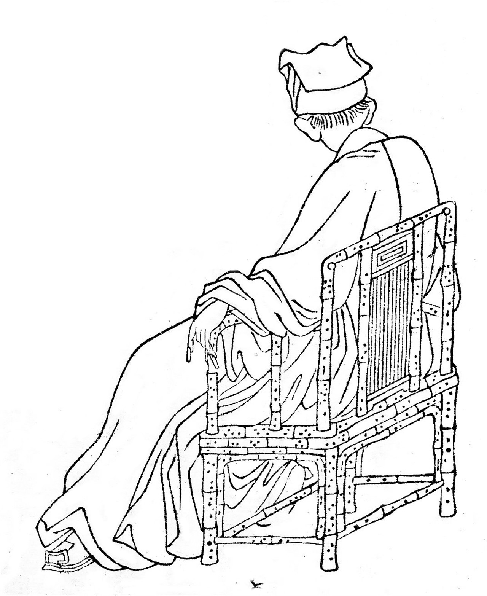

# 王维

王维（701—761），字摩诘，祖籍太原祁县，家在河东蒲州（今山西永济）。他是唐代少数在诗、画、音乐三方面都被后世承认的人，也是一位把酒写进具体场景、而不是写进醉态的诗人。读他的酒诗，先要看见时间、天气和地点，酒才出现。

图：王维。图片：Wikimedia Commons contributor，Public domain，via Wikimedia Commons（[原图页面](https://commons.wikimedia.org/wiki/File:Wang_Wei.jpg)）。

## 生平与仕履

王维生于 701 年。721 年，他考中进士，步入仕途；此后曾因事贬官济州，734 年又被召回长安，在御史台任职。天宝年间，他一度出使边塞，山水与边地经验都进入诗中。756 年安禄山攻陷长安，王维被俘，押往洛阳，被迫接受叛军给的官职。758 年两京收复，他因被囚时所作的诗和弟弟王缙的营救获得宽免，后来官至尚书右丞，世称“王右丞”。晚年他退居蓝田辋川，761 年去世。

这段经历让他对“场合”特别敏感：什么话能说、什么话不能说，往往由时局决定。酒在他的诗里，也常是这种场合的一部分。

## 酒在诗中的位置

王维写酒，极少写酩酊大醉。酒多出现在三种时刻：送人远行、与友人对酌、在山水间暂时放下官职。它不负责制造热闹，而负责给一个场景定调。

《送别》开头就是“下马饮君酒，问君何所之”。诗人先递酒，再问去向，动作顺序本身就是挽留。《少年行》则完全不同：“新丰美酒斗十千，咸阳游侠多少年。相逢意气为君饮，系马高楼垂柳边。”这里的酒是少年意气，是城市生活的高音。《酌酒与裴迪》又转为低沉：“酌酒与君君自宽，人情翻覆似波澜。”同一作者，酒可以是豪迈，也可以是宽解。

## 《送元二使安西》逐句

这首诗只有四句：“渭城朝雨浥轻尘，客舍青青柳色新。劝君更尽一杯酒，西出阳关无故人。”前两句写清晨、微雨、客舍和柳色，都是送别的背景；第三句才把酒递到朋友手里；第四句说明这杯酒为什么必须喝。

“更尽”是再饮尽一杯，语气是请求，不是命令。“阳关”是汉代设在河西的关隘，唐代仍是西行要道；“无故人”不是夸张，而是对边地人际环境的实写。后来这首诗被谱入音乐，以《渭城曲》《阳关曲》为名传唱，琴歌《阳关三叠》又把四句反复咏唱成三段。酒诗因此不只停留在纸上，也进入了送别的仪式。

## 其他酒诗：从英雄到晚年

《少年行》里的“新丰美酒斗十千”用了曹植《名都篇》“美酒斗十千”的典故，把长安少年的消费能力与豪气一起写出来。新丰在唐代以酒闻名，这一句既是写实，也是文学传统。

《送别》写友人失意归山：“下马饮君酒，问君何所之。君言不得意，归卧南山陲。但去莫复问，白云无尽时。”酒是告别时的第一个动作，也是诗人不再追问的界限。《辋川闲居赠裴秀才迪》说“复值接舆醉，狂歌五柳前”，把醉写成隐士的姿态，借楚狂接舆和陶渊明“五柳”两个典故，表明自己愿意退出官场。

## 辋川别业与日常生活

辋川在蓝田县，王维在那里经营别业，与裴迪唱和，写成《辋川集》二十首。这些诗多写山水，酒不是主角，但酒所代表的生活节奏很清楚：休沐时访友，雨后看山，傍晚听泉，客人来了就留饮。与李白“举杯邀明月”的孤独不同，王维的酒更接近有人在场的安静。

也别把辋川想成与世隔绝的桃花源。王维仍有官职、有田产、有仆役，别业是一种可以退回去的生活方式，不是彻底的隐居。酒在这种生活里，是待客与自处的媒介。

## 版本、音乐与《阳关三叠》

《送元二使安西》在流传中有题作《渭城曲》《阳关曲》的，后世琴歌《阳关三叠》把原诗拆成三段反复歌唱。“三叠”指的是音乐上的叠唱，不是王维写了三首诗。今天读到的四句是诗，听到的琴歌是后世的再创作，两者要分开。

## 评价与争议

王维在安史之乱中接受伪职，是后世评价他时绕不开的一件事。《旧唐书》本传记下了这段经历，也记下了他因《凝碧池》诗和弟弟营救而获宽免。有人据此批评他未能死节，也有人认为在当时的处境下，他保住了性命并留下了明确的政治表态。

绘画方面，董其昌在 17 世纪把王维奉为南宗山水之祖，但不列颠百科全书的条目也指出，王维的画只能依据当时记载和后世的传摹本去重建，今天没有一件可以确证的真迹。这意味着“诗中有画”的通行印象，有很大一部分来自苏轼的评语和后世的想象，而不是可以直接核对的画作。

## 常见误读

第一，把“一杯酒”当成精确容量。它是诗中的动作单位，不必换算成今天的毫升。第二，把阳关当成唐代才有的地名。阳关在汉代已经设置，唐代仍在使用。第三，把《阳关三叠》当成王维的原作。原诗是四句绝句，琴歌是后世的音乐再创作。第四，把王维当成只写山水的诗人。他的送别、边塞、应制诗同样重要。第五，“诗中有画，画中有诗”不是王维的自评，而是苏轼在《书摩诘蓝田烟雨图》中的评语。

## 年表

- 701 年：出生。
- 721 年：进士及第。
- 734 年：被召回长安，在御史台任职。
- 756 年：长安陷落，被押往洛阳，接受叛军官职。
- 758 年：两京收复后获宽免。
- 761 年：去世。

相关条目：[黄酒](ref:yellow-wine)。

## 另见

- [一杯酒里的时间](ref:time-in-a-cup)：酒如何进入节令与写作。
- [黄酒](ref:yellow-wine)：唐代谷物酒的工艺谱系。
- [葡萄酒](ref:wine)：唐代葡萄酒的来源与记载。
- [中国](ref:china)：王维行迹与辋川别业的地理范围。

补充阅读：[安德烈·西蒙](ref:c-extra-1)。

对照阅读：[一杯酒里的时间](ref:time-in-a-cup)、[葡萄酒](ref:wine)。

**关键事实。**

| 项目 | 内容 |
| --- | --- |
| 一句话定位 | 唐代诗人与画家，701—761；《送元二使安西》以一杯酒写送别，后世谱为《阳关三叠》 |
| 生卒 | 701–761 |
| 身份 | 诗人、画家 |
| 关联地区 | 中国 |

**来源与边界。** 本页关于「王维」的关键事实，主要由以下来源交叉核对：唐王维撰；中华书局点校本（诗题与通行字句；本页只引用短句，不复制全篇）、后晋刘昫等撰；中华书局点校本（生卒、仕履与安史之乱中的遭遇；由原条目末尾参考资料迁移，未逐条复核访问日期）、Wikimedia Foundation（比对异文；未复制全篇）等 7 条来源。价格、批次与状态会变，涉及这些字段时以页面所列来源的最新版本为准。正文为项目自写，来源只作核验，不复制原文。
