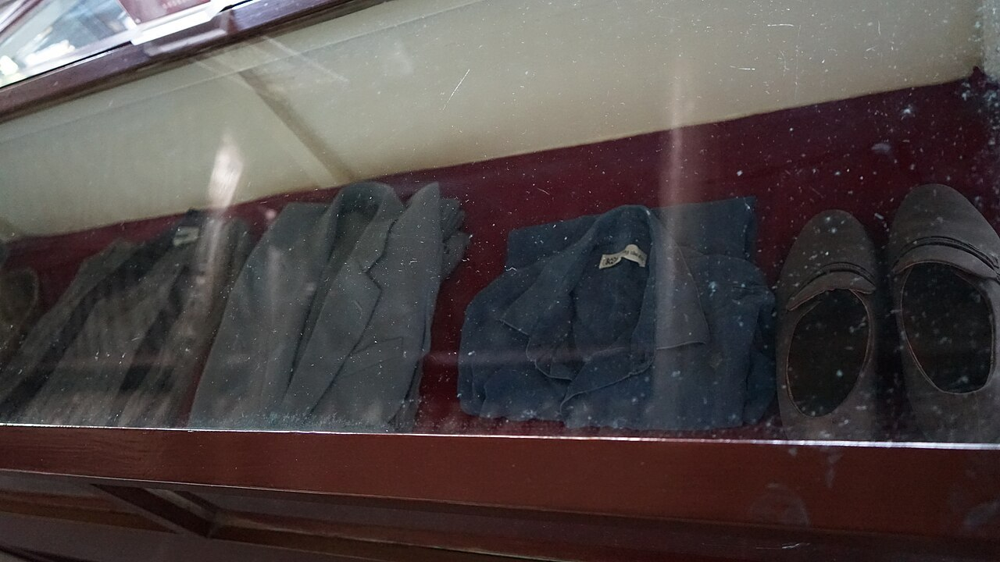

# 汪曾祺

汪曾祺（1920—1997），江苏高邮人。他是中国当代最会写“吃”的作家之一，也是把日常生活写得有滋有味的人。酒在他的散文里很少被单独讨论，它总是和菜、和人、和地方一起出现：一盘咸鸭蛋、一碗炒米、一碟豆腐干，配一点酒，日子就成立了。

图：汪曾祺。摄影：Wang Zengqi relics 4。署名：Huangchenhai，CC BY-SA 4.0，来自 Wikimedia Commons（[来源](https://commons.wikimedia.org/w/index.php?curid=58249647)）。

## 人物小传

他于 1920 年 3 月 5 日（农历正月十五）出生在高邮一个旧式家庭。1939 年入西南联合大学中国文学系，师从沈从文，也听闻一多、朱自清等人的课。1940 年代，他在昆明、上海等地教书、写作。1949 年以后定居北京，长期做编辑。

1958 年，他被错划为右派，下放到张家口沙岭子农业科学研究所劳动。1962 年 1 月调回北京，任北京京剧团（今北京京剧院）专职编剧；1964 年参与改编沪剧《芦荡火种》，后来成为现代京剧《沙家浜》。1980 年发表《受戒》，1981 年发表《大淖记事》，成为新时期文学的名篇。1997 年 5 月 16 日在北京去世。

## 生平节点

- 1920 年 3 月 5 日：生于江苏高邮。
- 1939 年：入西南联合大学中国文学系，师从沈从文。
- 1958 年：被错划为右派，下放张家口沙岭子农科所。
- 1962 年：调任北京京剧团编剧。
- 1964 年：参与改编《芦荡火种》，后定名《沙家浜》。
- 1980 年：发表《受戒》。
- 1981 年：发表《大淖记事》。
- 1997 年 5 月 16 日：在北京去世。

## 酒在散文中的位置

汪曾祺写酒，重点不在酒本身，而在“下酒的菜”和“喝酒的人”。他常写小馆子、家里的小桌、朋友带来的土产；酒是让一顿饭变得完整的东西，而不是用来比拼年份与价格的物件。

这种写法有一种平等感：高邮的鸭蛋、昆明的菌子、北京的豆汁，都可以配酒；有钱人的宴席与普通人家的晚饭，都可以写得有趣。酒在这里是社会生活的黏合剂，不是身份标签。

他本人好酒，友人回忆中常有记录；但“喝多少、喝什么”没有系统统计。把散文里的酒量当成作者的真实酒量，是把文学当档案。

## 代表文本

《昆明的雨》写 1940 年代在昆明的生活。文中回忆他与朱德熙在莲花池边的小酒店避雨：买了一碟猪头肉、半市斤酒，边喝边等雨停；院子里有一棵木香花，被雨淋得湿透。四十年后，他把这段情味写成一首诗：“莲花池外少行人，野店苔痕一寸深。浊酒一杯天过午，木香花湿雨沉沉。”

这四句是他写酒最集中的地方。“浊酒”是文人的旧词，不是对酒质的精确描述；1980 年代昆明小酒店里卖的，多半是本地白酒或米酒，度数不低，价格便宜。“一杯天过午”写的是时间被雨和酒拖慢，不是酒量。酒在这里的功能是留人：雨不停，酒未尽，话就可以继续说下去。

《故乡的食物》写高邮的咸鸭蛋、炒米、焦屑。文中说“高邮咸蛋的特点是质细而油多”，把食物与童年、风俗、地方性格连在一起。酒常作为餐桌的背景出现：有客来，添一只杯子；菜上桌，倒一点酒。它不抢戏，却让场景完整。

《端午的鸭蛋》写“筷子头一扎下去，吱——红油就冒出来了”。这种句子靠的是声音与动作，不靠形容词；同样的写法也用于酒：他不说酒有多好，只说这酒配这菜合不合适、这桌人喝得开不开心。

《五味》从酸、甜、苦、辣、咸写起，开篇就说“山西人真能吃醋”。这类文章的妙处在于“不评价高低”，只把味道写清楚。酒也一样：没有名酒排行榜，只有具体的搭配与场合。

## 餐桌上的酒与菜

汪曾祺的饮食地理大致有三处。高邮是童年与故乡：咸鸭蛋、炒米、焦屑、茨菇、野菜，口味偏咸鲜，酒多为本地米酒或普通白酒。昆明是青年时代：菌子、猪头肉、小酒店、便宜的散装酒，酒与雨、与朋友、与穷日子连在一起。北京是后半生：豆汁、贴饼子、家常菜，酒多为普通人喝得起的白酒。

这三处合起来，构成一种“酒不脱离菜”的写法。他很少单独描写酒的香气或年份，而是写酒在桌上的位置：谁倒的、配什么、说到什么话。用今天的话说，他关心的是“场景”，不是“评分”。

20 世纪后期，中国城市的[白酒](ref:baijiu)消费逐渐日常化，宴席、家宴、朋友聚会都常见白酒；黄酒、啤酒与地方酒也在不同地区流行。汪曾祺笔下的酒，多为普通人喝得起的酒，而不是收藏级名酒。[酒与诗](ref:wine-and-poetry)的传统在他这里变成了“酒与文”：不押韵，不豪迈，只把一桌饭菜写清楚。

## 评价与争议

汪曾祺的声誉很高，中国现代文学馆的文章提到他有“中国最后一个纯粹的文人”之誉；他的语言被许多后辈写作者当作范本。但评价并不一致。中国社会科学院文学研究所的一篇文章《散文的流弊》就提出批评：认为汪曾祺师承沈从文，却“已见精神的退缩”，沈从文文本中固有的“蛮野之力”传到他这里“少之又少”；文章还把他的散文概括为“反崇高、反英雄、反宏大气象”的格局。这是一种从精神强度与文学抱负出发的批评，与“最后一个纯粹的文人”的誉辞形成张力。

另一种争议来自版本。汪曾祺的散文在多家出版社有不同选本，篇目与字句偶有差异；《五味》既是一篇文章的篇名，也常被用作选集的书名，读者引用时若不注明版本，容易把不同选本的内容混在一起。这不是作者的问题，却是研究他的饮食书写时必须处理的技术问题。

就酒而言，还有一个局限：他写酒多从食客角度出发，几乎不涉及酿造、酒价与行业变化。想从汪曾祺散文里了解 20 世纪中国酒业，只能得到生活史的侧影，得不到产业史的数据。

## 常见误读

汪曾祺常被当成“美食博主”的前身。他的饮食散文有文学结构与人情观察，不只是菜谱。

散文里的饮酒也不能当成他的全部生活。写作会选择、会省略，不能当完整传记。

只读《受戒》而不读散文，会错过他语言趣味的重要部分。

“好吃”并不等于“贵”。他写的多是便宜、家常的食物，价值在做法与人。

《昆明的雨》里的“浊酒”也不是劣质酒。那是文人用语，指的是未过滤或粗滤的普通酒，不是假酒，也不是对品质的贬评。

相关条目：[中国](ref:china)、[白酒](ref:baijiu)、[酒与诗：从《诗经》到宋词的饮酒书写](ref:wine-and-poetry)。

## 另见

- [白酒](ref:baijiu)：中国蒸馏酒的主要类型。
- [酒与诗](ref:wine-and-poetry)：酒在中国文人与文学中的传统。
- [中国](ref:china)：高邮、昆明、北京等地的生活背景。
