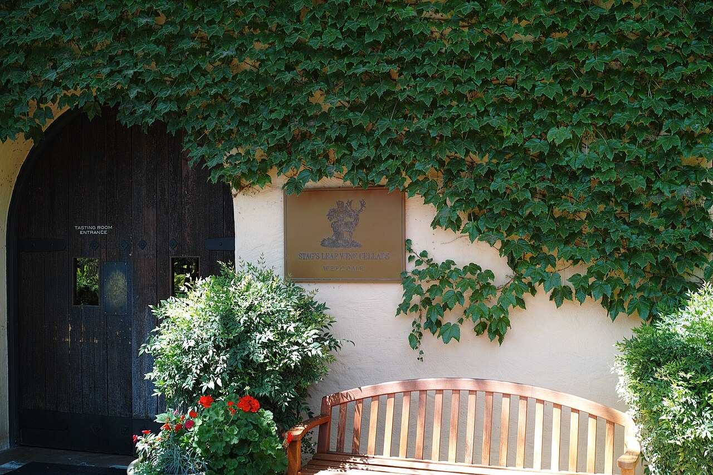

# 沃伦·维尼亚斯基

沃伦·维尼亚斯基（Warren Winiarski，1928–2024）是美国纳帕谷酿酒师、鹿跃酒庄（Stag's Leap Wine Cellars）创始人。1976 年，他 1973 年的 Cabernet Sauvignon 在“巴黎审判”盲品中击败波尔多名庄，成为加州酒进入国际视野的标志性事件。但把这件事只讲成“美国逆袭法国”会漏掉更重要的部分：他先花了六年找地、学酒、试葡萄，才做出那瓶参赛酒。

图：鹿跃酒庄品鉴室；酒庄场景，不是沃伦·维尼亚斯基肖像。图片：Jun Seita，CC BY 2.0，via Wikimedia Commons（[原图页面](https://commons.wikimedia.org/wiki/File:Stag%27s_Leap_Wine_Cellars_tasting_room.jpg)）。

## 从芝加哥到纳帕

维尼亚斯基 1928 年 10 月 22 日生于芝加哥一个波兰移民社区。他的父亲在家自酿蜂蜜酒与葡萄酒，他的名字在波兰语里与“酿酒人”有关；不过他并没有因此早早入行。年轻时他接受的是人文教育，后来在芝加哥大学与圣约翰学院学习，做过教师，也写过政治学方面的文字。1964 年，他带着家人搬到纳帕谷，决定把“酒”从兴趣变成职业。

他先到 Souverain Cellars 给 Lee Stewart 当学徒。用他自己的话说，那是一个“两个人的作坊”：白天洗罐、搬桶、看发酵，晚上读酿酒书。1966 年，Robert Mondavi 建成纳帕谷禁酒令后第一座新酒厂，维尼亚斯基成为其首位酿酒师，工作两年。1968 年，他到科罗拉多 Ivancie Cellars 做酒，把加州葡萄运到丹佛发酵；这段经历让他看到，酒的质量不只取决于品种，也取决于运输与处理。

## 找到 Stags Leap

1969 年，维尼亚斯基到纳帕谷东侧、Stag's Leap Palisade 下的 Nathan Fay 葡萄园，喝到 Fay 1968 年自酿的 Cabernet。他后来回忆：“我喝到的那一刻就知道，这就是我想做的 Cabernet。”Fay 的葡萄园不卖，但旁边那片 prune 果园要卖。1970 年，维尼亚斯基夫妇卖掉 Howell Mountain 的地，与合伙人买下这片果园，改种 Cabernet Sauvignon 与 Merlot，命名为 Stag's Leap Vineyard（后来的 S.L.V.）。

1972 年，他们又在附近买下酒厂用地；1973 年，Stag's Leap Wine Cellars 正式开门。第一批 1973 年 Cabernet 来自 S.L.V. 的年轻葡萄藤。维尼亚斯基想要的结构是“铁拳裹天鹅绒”：有足够的骨架与陈年能力，但入口不能粗硬；他反复调整采收时间、浸皮长度与橡木桶比例，让酒在年轻时能喝，陈年后还能展开。

## 1976 年巴黎审判

1976 年 5 月 24 日，巴黎的 InterContinental 酒店举行了一场盲品：九位法国评委，比较加州与法国的红、白葡萄酒。红葡萄酒组里，维尼亚斯基的 1973 Stag's Leap Wine Cellars Cabernet 获得最高分，排在 Mouton Rothschild 1970、Haut-Brion 1970 等波尔多名庄之前。结果公布后，记者与酒商都感到震动；加州酒从此被放进“可以与法国竞争”的讨论里。

这场胜利的意义与局限都要说清。意义在于，它证明加州可以做出结构完整、适合陈年的 Cabernet，而不是只能做“新世界风格”的果味酒；它也把纳帕谷的 Stags Leap 区推到了国际地图上。局限在于，它只是一次盲品，样本、评委、年份与品鉴条件都有限；它不能证明“加州整体优于法国”，也不能替代长期的产区比较。维尼亚斯基本人后来也多次强调，巴黎审判是一个“历史时刻”，不是质量科学的终局。

## 产区制度与土地保护

1989 年，维尼亚斯基主持纳帕谷酒商协会（Napa Valley Vintners）的委员会，推动加州参议院第 771 号法案，即“联合标注法”（Conjunctive Labeling Law）。法案要求，1990 年 1 月 1 日后装瓶、且标注纳帕谷内部某个 AVA 的酒，也必须在标签上同时标出“Napa Valley”。这条规则看似只是标签细节，实际是把子产区与纳帕谷的品牌绑在一起：子产区获得辨识度，纳帕谷获得整体信誉。

他还长期参与纳帕谷农业土地保护。2007 年，他出售 Stag's Leap Wine Cellars，但仍保留 Arcadia Vineyards，继续种 Chardonnay、Cabernet 与 Merlot。2024 年 6 月 7 日，他在纳帕谷去世，距离他计划中的第 60 次采收只差一个季节。

## 评价与争议

正面评价把他视为“让加州酒进入世界级讨论的酿酒师”之一，并强调他对土地、产区制度与慈善的长期投入。加州名人堂、史密森尼学会的收藏与 UC Davis 的纪念，都是这种评价的制度化表现。

批评主要有三点。第一，巴黎审判被过度简化成“美国打败法国”，掩盖了法国评委、媒体与酒商在事件传播中的角色，也掩盖了法国酒在后续年份的持续优势。第二，Stag's Leap 与 Stags' Leap 两个名称长期混淆：前者是维尼亚斯基的酒庄，后者是另一家历史酒庄；消费者容易把两者当成同一家。第三，“铁拳裹天鹅绒”的风格被后来的纳帕酒大量模仿，但模仿者常只学到“力量”，没学到“收束”，导致酒精与单宁失衡。

## 常见误读

第一，把 1973 年参赛酒当成“酒庄成立多年后的作品”。酒庄 1973 年才开门，参赛酒来自年轻葡萄藤，不是长期陈酿的老酒。

第二，把巴黎审判当成“科学实验”。它是一次商业与媒体事件，盲品设计有控制，但样本与评委有限。

第三，把维尼亚斯基只当成“酿酒师”。他同样重要的是找地、组织合伙、推动标签法案与土地保护。

第四，把“Stag's Leap”与“Stags' Leap”混为一谈。两个名称、两个酒庄、两段历史，买酒与查资料时都要看清。

相关条目：[纳帕谷](ref:napa)、[赤霞珠](ref:cabernet)、[红葡萄酒](ref:red-wine)。

1976 年巴黎审判的结果只代表当届评审与那一组酒，不是加州酒全面胜过法国的证明；它改变了市场对加州酒的想象，却没有给出产区排名的普遍结论，后续年份仍需逐款比较。

1976 年巴黎审判只代表当届评审与那一组酒，不是加州全面胜出的证明；后续年份仍要逐款比较。

## 另见

- [纳帕谷](ref:napa)：维尼亚斯基找地、建庄与推动产区制度的地方。
- [赤霞珠](ref:cabernet)：1973 年参赛酒与 S.L.V. 的核心品种。
- [红葡萄酒](ref:red-wine)：理解“铁拳裹天鹅绒”的结构。
- [1976 年巴黎审判](ref:paris-1976)：把他的酒与更广的加州酒史连在一起。
- [美国](ref:usa)：加州酒业在 20 世纪后半叶崛起的国家背景。

**关键事实。**

| 项目 | 内容 |
| --- | --- |
| 一句话定位 | 美国纳帕谷酿酒师（1928–2024），1973 年创立鹿跃酒庄；其 1973 年 Cabernet Sauvignon 在 1976 年巴黎审判红葡萄酒组中获第一名，推动加州酒进入国际视野 |
| 生卒 | 1928–2024 |
| 身份 | 酿酒师、葡萄种植者、酒庄创始人 |
| 关联地区 | 美国、纳帕谷 |

**来源与边界。** 本页关于「沃伦·维尼亚斯基」的关键事实，主要由以下来源交叉核对：Warren Winiarski、UC Davis College of Agricultural and Environmental Sciences（1928 年芝加哥出生、2024 年 6 月 7 日去世、1976 年巴黎审判、2007 年出售酒庄、Arcadia Vineyards 与加州名人堂）、Stag's Leap Wine Cellars（酒庄历史、S.L.V. 葡萄园与 Cask 23 的基本信息）等 5 条来源。价格、批次与状态会变，涉及这些字段时以页面所列来源的最新版本为准。正文为项目自写，来源只作核验，不复制原文。
