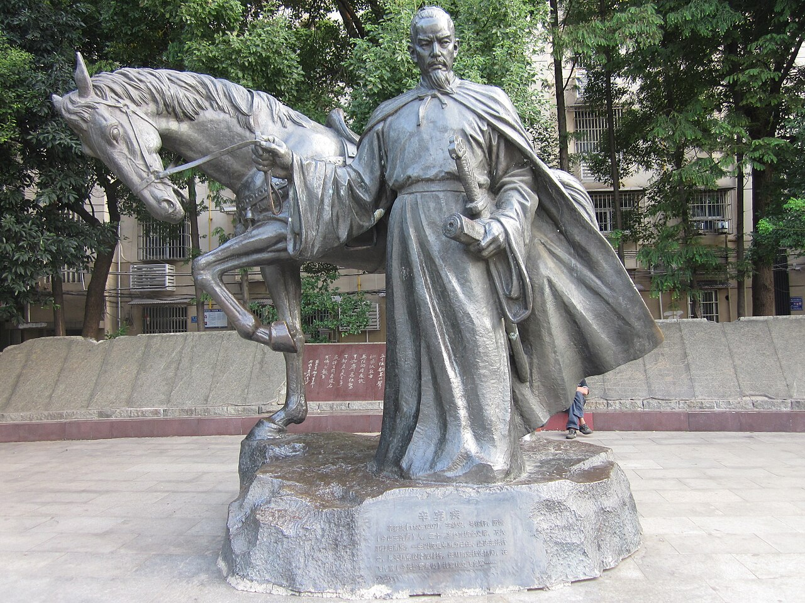

# 辛弃疾

辛弃疾（1140—1207），字幼安，号稼轩，济南历城人。他二十出头在北方加入抗金义军，南归后长期做地方官，四十余岁起两度闲居，前后近二十年。酒在他的词里不是点缀：它常常是记忆的开关、动作的起点，也是他把无法实现的志业暂时放下的地方。存词六百二十余首，收于《稼轩长短句》。

图：辛弃疾。图片：Lei Yixin / Nie Shihua / Xiao Xiaoqiu，CC BY 3.0，via Wikimedia Commons（[原图页面](https://commons.wikimedia.org/wiki/File:The_statue_of_Xin_Qiji.JPG)）。

## 人物小传

辛弃疾生于 1140 年，出生时山东已在金朝统治之下。祖父辛赞曾在金朝任职，但常带他登高望远，指画山河，这段经历后来被他写进《美芹十论》的自序。1161 年，金主完颜亮南侵，北方义军蜂起，辛弃疾聚众二千，加入耿京的队伍，任掌书记。

1162 年，他奉耿京之命南下建康，向宋高宗呈表。北返途中得知耿京被张安国所杀，他率骑兵突入金营，缚张安国押送建康，献俘于市，此事见于《宋史》本传，洪迈《稼轩记》记为五十骑。

南归之后，他历任江阴签判、滁州知州、江西提点刑狱、湖北转运副使、湖南安抚使等职。1175 年，他平定江西茶商军赖文政之乱；1180 年在长沙创建飞虎军，购地筑营、招兵买马，成为地方武力的一支。1181 年遭弹劾落职，退居上饶带湖，自号稼轩；1194 年再度罢官，移居铅山瓢泉。1203 年韩侂胄筹备北伐，他被起用为浙东安抚使，1204 年改知镇江府，不久又被劾罢。1207 年卒于铅山，年六十八，后谥忠敏。

他另有《美芹十论》《九议》等政论，论宋金形势、练兵与财政，可见其用世之心并不限于填词。把他只看作“豪放词人”，会漏掉这一半。

## 生平节点

- 1140 年：生于济南历城，时山东已属金。
- 1161 年：聚众二千，加入耿京义军，任掌书记。
- 1162 年：奉表南归；北返后擒张安国，献俘建康。
- 1175 年：任江西提点刑狱，平定茶商军。
- 1180 年：任湖南安抚使，创建飞虎军。
- 1181 年：被劾落职，闲居上饶带湖。
- 1194 年：再罢，居铅山瓢泉。
- 1203 年：起为浙东安抚使；1204 年知镇江府。
- 1207 年：卒于铅山，谥忠敏。

## 与酒的关系：三种用法

第一种是记忆的开关。《破阵子·为陈同甫赋壮词以寄之》开头“醉里挑灯看剑，梦回吹角连营”，醉后还要看剑，说明酒没有让他忘记军旅，反而把军营的声音重新放了出来。酒在这里不是消愁，而是把人送回一个已经失去的现场。

第二种是向时间发问。《太常引·建康中秋夜为吕叔潜赋》写“把酒问姮娥：被白发、欺人奈何”，举杯的对象是月亮，问题却是白发。1174 年的中秋，他四十岁不到，问的已是衰老与功业。

第三种是自我解嘲，甚至与酒谈判。《西江月·遣兴》写醉后推松，把醉态写成动作；《沁园春·将止酒，戒酒杯使勿近》干脆把酒杯当作可以训诫、可以讲条件的对象。酒在这里既是敌人，也是唯一还肯听他说完的对象。

## 代表作品

- 《破阵子·为陈同甫赋壮词以寄之》：约作于 1188 年闲居带湖期间，陈亮来访之后。
- 《太常引·建康中秋夜为吕叔潜赋》：1174 年中秋，在建康。
- 《西江月·遣兴》：带湖闲居时期，具体年份不详。
- 《沁园春·将止酒，戒酒杯使勿近》：晚年闲居瓢泉期间。
- 《青玉案·元夕》：写临安灯市，全篇不出现酒。
- 《美芹十论》《九议》：政论，非词，但可见其军事与财政主张。

## 文本证据：酒如何入词

《破阵子》全篇十句，前九句一气贯下：挑灯看剑、吹角连营、分炙、奏乐、点兵、战马、弓弦、了却君王事、赢得身后名，都是同一个方向上的加速；最后一句“可怜白发生”突然刹车，把前面的一切打回现实。酒是进入这场回忆的门，白发是出门时看见的东西。

值得注意的是“八百里分麾下炙”。“八百里”不是路程，而是牛的代称，典出《世说新语》所载王恺的良牛“八百里驳”；这一句写的是把烤牛肉分给部下，不是军队行军八百里。把典故作实解，整句就散了。

《西江月·遣兴》下片写“昨夜松边醉倒，问松我醉何如。只疑松动要来扶，以手推松曰去”。四句里有问、有疑、有推、有喝令，几乎是一段小戏剧；末句把散文的句法直接搬进词里，是辛弃疾常用的手法，也是他被批评“掉书袋”之外的另一面——口语、动作、现场感。

《青玉案·元夕》全篇写灯、写人、写寻找：“众里寻他千百度，蓦然回首，那人却在，灯火阑珊处。”这里没有酒，说明辛弃疾的“豪放”并不等于“篇篇有酒”；把酒当成理解他的唯一钥匙，反而窄化了他的题材。

## 评价与争议

南宋刘克庄在《跋刘叔安感秋八词》里给了一个很准的评价：辛弃疾与陆游“一扫纤艳，不事斧凿”，但“时时掉书袋，要是一癖”。这句批评指出他用典过密、有时以学问压过情境，是传统词学中对稼轩最具体的保留。

另一类争议来自“豪放”这个标签本身。辛弃疾确有《破阵子》《水龙吟》这样的雄健之作，但婉约、田园、谐谑之作同样大量存在；把“豪放”当成他的全部，会把他写成一种腔调，而不是一个会变化的人。晚清陈廷焯《白雨斋词话》强调稼轩词“沉郁”，正是对“只豪放”说法的修正。

还有史料层面的问题。擒张安国一事，《宋史》与洪迈《稼轩记》在人数、经过上并不完全一致；引用时宜说明依据哪一种记载，不要把细节当成毫无争议的定论。

## 常见误读

第一，把“醉里挑灯看剑”当作军营生活的实录。它写于闲居期间，是回忆与想象，不是当天的日记。

第二，把“八百里”当成距离。它指牛，典故出自《世说新语》。

第三，把“醉里且贪欢笑，要愁那得工夫”读成彻底旷达。下片紧接着写松边醉倒、推松曰去，越是用力驱赶，越见其不能驱赶。

第四，用今天的白酒想象宋代的酒。宋代主流仍是谷物发酵酒，酒精度较低，[黄酒](ref:yellow-wine)的工艺谱系比蒸馏酒更接近当时的日常。

第五，把辛弃疾的饮酒写成单纯的嗜好。他的酒总与具体处境相连：军营、中秋、闲居、戒酒，场合一变，酒的意味就变。

相关条目：[一杯酒里的时间](ref:time-in-a-cup)、[中国酒史纲：从谷物发酵到国家名酒](ref:chinese-wine-history)、[中国](ref:china)。

## 另见

- [一杯酒里的时间](ref:time-in-a-cup)：酒如何进入节令与写作。
- [黄酒](ref:yellow-wine)：宋代谷物酒的工艺谱系。
- [中国酒史](ref:chinese-wine-history)：宋代酒业与酒政的变化。
- [中国](ref:china)：辛弃疾南归后的仕履与闲居地理范围。
