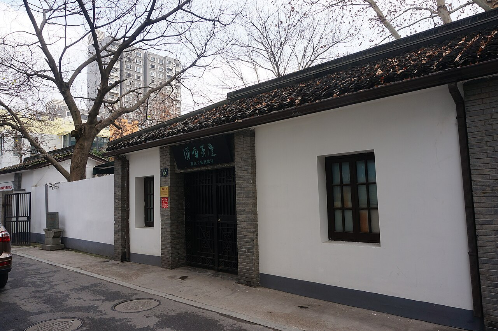

# 郁达夫

郁达夫（1896—1945），原名郁文，浙江富阳人。他是中国现代文学中最坦率的自我书写者之一，也是创造社的发起人。他的旧体诗写得很好，酒在其中经常出现；最著名的一句“曾因酒醉鞭名马，生怕情多累美人”，几乎成了他的自我画像。但郁达夫与酒的关系不止于诗句：1942 年流亡苏门答腊后，他曾以酒厂老板的身份掩护一批中国文化人。

图：郁达夫。摄影：Former Residence of Yu Dafu in Hangzhou 01 2020-01。署名：猫猫的日记本，CC BY-SA 4.0，来自 Wikimedia Commons（[来源](https://commons.wikimedia.org/w/index.php?curid=88154498)）。

## 人物小传

他于 1896 年 12 月 7 日出生在富阳一个破落的读书人家。1913 年赴日本留学，先学医，后改读经济学，1922 年毕业于东京帝国大学经济学部。1921 年，他与郭沫若、成仿吾、张资平、田汉等在东京成立创造社；同年出版小说集《沉沦》，以大胆的自我暴露震动文坛，被认为是中国现代文学最早的小说集之一。

1920 年代，他在上海、杭州等地写作、教书、编辑，出版《春风沉醉的晚上》《薄奠》等作品。1930 年参与发起中国左翼作家联盟。1932 年发表《迟桂花》。1933 年移居杭州，1936 年建成“风雨茅庐”。1938 年赴新加坡，主编《星洲日报》副刊《晨星》，参与抗日文化活动。1942 年新加坡沦陷后撤往苏门答腊，1945 年 9 月被日本宪兵杀害。

## 生平节点

- 1896 年 12 月 7 日：生于浙江富阳。
- 1913 年：赴日本留学。
- 1921 年：参与成立创造社，出版《沉沦》。
- 1930 年：参与发起中国左翼作家联盟。
- 1936 年：发表散文《饮食男女在福州》。
- 1938 年：赴新加坡，主编《星洲日报》副刊。
- 1942 年：化名赵廉，落脚苏门答腊巴爷公务，经营赵豫记酒厂。
- 1945 年 9 月：被日本宪兵杀害。

## 酒在作品中的位置

郁达夫写酒，常把它放在“放纵”与“自伤”之间。他笔下的饮酒不是为了风雅，而是为了把压抑的情绪推到一个临界点；酒醒之后的空虚，往往比酒醉时的热闹更值得注意。这种写法在五四以后的自我叙事中很有代表性：个人情感被放到前台，酒成为情绪的放大器。

他的旧体诗是理解这种写法的关键。旧体诗不是“副业”，而是他表达情绪最直接的形式之一；格律是旧的，情绪是现代的。酒在这类诗里承担的不是典故，而是当下：一次夜饮、一场送别、一段无法收拾的感情。

同时要避免把文学形象等同于生活记录。他确实饮酒，友人回忆也常提到；但“酒量多大”“每天喝多少”没有可靠统计。把诗句当成酗酒证据，是把修辞当病历。

## 代表文本

《钓台题壁》是最常被引用的例子：“不是樽前爱惜身，佯狂难免假成真。曾因酒醉鞭名马，生怕情多累美人。”四句把酒、佯狂、情感与自嘲放在一起：看似潇洒，其实是在解释自己的失控。第一句先否认自己爱惜身体，第二句承认“佯狂”装久了会变成真的，第三句给出一个极端例子，第四句又转回对他人的歉疚。

“曾因酒醉鞭名马”不必坐实为真事。它更像一个高度压缩的自我形象：酒后失态、才华与任性并存。读者若只记住这一句的豪气，会漏掉下一句的“生怕情多累美人”——那是对他人的歉疚，也是对自己的警告。诗的语言在这四句里完成了从辩解到自嘲的转折，酒是转折的支点。

他的散文与游记里也常出现酒馆、夜饮与旅途中的独酌。这些段落把酒放回具体空间：小城、江边、旅馆、朋友的家。酒不是抽象符号，而是民国文人流动生活的一部分。写福州饮食的《饮食男女在福州》属于这类文字：它关心的是地方口味、市井与小馆，而不是名酒的年份与价格。

## 南洋：赵豫记酒厂

1942 年 2 月新加坡沦陷，郁达夫与胡愈之、王任叔等文化人撤离，几经辗转，于 4 月中旬抵达苏门答腊的巴爷公务（Payakumbuh）。他化名赵廉，蓄起短髭，对外称是经商的福建人。

为维持这批流亡者的生计，众人合伙开办了一家酒厂，号“赵豫记”。郁达夫以赵廉的身份出面做老板，张楚琨任经理，胡愈之当会计。酒厂用汽油桶装酒，卖给日本兵；当地印尼原住民多为穆斯林，不饮酒，因此客户主要是占领军与部分华人。这个安排一举两得：既是生计，也是身份的掩护。郁达夫借此与日本宪兵周旋，据友人回忆，他曾为不少被押的华侨说情。

这段经历说明，他与酒业的关系并不只是文人雅趣。酒厂是战时流亡者的经济组织，也是地下身份的屏障；酒在这里是商品、是掩护、是换取生存空间的筹码。1945 年 8 月日本投降后，郁达夫仍在当地，9 月被日本宪兵杀害。

## 评价与争议

郁达夫生前身后都充满争议。学者梁锡华曾以“忠奸飘忽”评论其为人与选择，这一批评在中国新闻网的回顾文章中被特别提到；它代表了一种看重气节与政治立场的评价方式。另一种评价来自夏志清《中国现代小说史》：夏志清肯定郁达夫的才情，同时指出其小说常以自怜为基调，情绪暴露多于艺术节制。两种批评角度不同，但都提醒读者：把郁达夫简化成“颓废才子”或“抗日烈士”都不完整。

就酒而言，还有一个文本层面的局限：他写酒多写饮酒的场景与情绪，很少写酒的种类、价格、产地与酿造。读者若想从郁达夫作品中了解民国酒业，只能得到零散的印象，不能得到系统的行业记录。这也是文学家写酒的共同限度。

## 常见误读

“曾因酒醉鞭名马”常被当作确凿的自述。它是诗，不是口供。

郁达夫的饮酒也常被浪漫化。他写酒常带自伤与歉疚，不是单纯的豪放。

只读小说、不读旧体诗，会漏掉他情绪最直接的出口，也会误判他的酒意象。

南洋那段经历常被叫作“赵廉酒厂”。厂号是“赵豫记”，“赵廉”是他的化名，两者不能混用。

它更不是文人雅集。赵豫记是流亡者的合伙生意，有经理、会计与销售对象，首先要解决的是吃饭与掩护。

相关条目：[酒与诗：从《诗经》到宋词的饮酒书写](ref:wine-and-poetry)、[黄酒](ref:yellow-wine)、[中国](ref:china)。

## 另见

- [酒与诗](ref:wine-and-poetry)：旧体诗中的酒意象。
- [黄酒](ref:yellow-wine)：民国江南常见发酵酒。
- [中国](ref:china)：民国文人流动与城市生活的背景。

补充阅读：[安德烈·西蒙](ref:c-extra-1)、[安德烈·切列斯切夫](ref:c-extra-2)。
