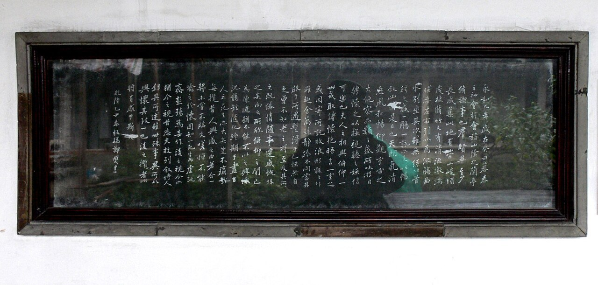

# 郑板桥

郑板桥（1693—1766），名燮，字克柔，号板桥，江苏兴化人。他是清代“扬州八怪”中最广为人知的一位，画兰、竹、石，写“六分半书”，也写诗、写家书。他的酒事不在豪饮，而在卖画、待客与题画时那一套清楚的价钱与分寸。

图：郑板桥。摄影：Zheng Banqiao Lanting。署名：Gisling，CC BY 3.0，来自 Wikimedia Commons（[来源](https://commons.wikimedia.org/w/index.php?curid=5321435)）。

## 人物小传

他生于 1693 年。康熙年间中秀才，雍正十年（1732）中举人，乾隆元年（1736）中进士。乾隆七年（1742）出任山东范县知县，乾隆十一年（1746）调任潍县知县；乾隆十八年（1753）因赈灾与得罪地方豪绅而被罢官。离开官场后，他回到扬州卖画为生，1766 年去世。

他的作品在后世流传很广，真伪问题也复杂。读他的诗文，最好以整理本与可靠的题画记录为依据，不把民间故事当成史料。乾隆二十四年（1759），他张贴《板桥润格》，把书画价格明码标出；这份文本是理解他晚年生活的关键。

## 与酒的关系

郑板桥笔下的酒，常与三件事连在一起：待客、题画、卖画。酒是文人交往的媒介，也是他谋生的一部分。罢官之后，他的生活依靠书画市场，酒出现在题赠、雅集与家书里，既是人情，也是日常开销。

他并不以“酒徒”自居。与唐寅那种“花酒”立场不同，郑板桥的酒更接近生活细节：朋友来了，拿酒；画卖出去了，换钱；心里不痛快，写几句。酒没有被浪漫化成逃避，而是嵌在生计与交往里。这一点，只有把他的题画诗与《润格》放在一起看，才看得清楚。

## 酒在题画诗中的文本证据

《初返扬州画竹第一幅》的题画诗写道：“二十年前载酒瓶，春风依醉竹西亭；而今再种扬州竹，依旧淮南一片青。”这里的“载酒瓶”不是宴饮排场，而是旧日扬州生活的记忆；酒与竹、与春风并置，构成他回到扬州后的时间感。

另一首题画竹诗更直接：“年年画竹买清风，买得清风价便松，高雅要多钱要少，大都付与酒家翁。”诗把“画竹—卖画—得钱—付酒家”写成一条链，语气带自嘲。它说明酒在他的生活里不是超脱的象征，而是卖画收入的一个去处。

这两首诗都短，却比“爱喝酒”三个字更有信息量：酒与竹、酒与钱、酒与旧地连在一起，构成一个书画家兼卖画者的日常经济。

## 《板桥润格》：卖画、酒钱与生计

《板桥润格》把书画价格写得明明白白：“大幅六两，中幅四两，小幅二两。书条、对联一两。扇子、斗方五钱。”后面还说，送礼物、食物不如送白银，因为所送未必合他心意。它在中国书画史上常被引用，因为它是文人公开标价卖画的早期文本之一。

润格里没有直接写“酒”，但它解释了酒钱从哪里来。一个不再做官的文人，靠笔下的兰竹换生活费；卖出画，才有酒、有饭、有纸墨。把“卖画”与“饮酒”放在一起看，郑板桥的经济生活就清楚了，而不是只剩“清高”两个字。

润格的年份也有讲究。故宫博物院的人物页把它系于乾隆二十四年（1759），此时他已罢官六年、在扬州卖画。这个时间点说明，润格不是少年意气，而是晚年谋生的制度安排。

## 时代与酒

清代扬州的盐商、画商与文人构成了一个活跃的书画市场。文人可以不做官而靠卖画生活，这在前代并不普遍。酒馆、园林、雅集是这个市场的社交场所；[黄酒](ref:yellow-wine)与地方酒是常见饮品，蒸馏酒也在流行，但文人笔下常写的是低度、可以慢慢喝的酒。

[酒与绘画](ref:wine-and-painting)的关系，在扬州八怪身上体现为“画被买走、酒被喝掉”的日常循环。艺术史常强调风格与笔墨，经济史则提醒我们：画家也要付房租、买纸、买酒。[中国](ref:china)的清代江南文化市场，是理解这种循环的背景。

## 评价与争议

“难得糊涂”是郑板桥最著名的题字，但围绕它的故事需要分开看。潍坊市博物馆所藏刻石的释文是：“聪明难，糊涂难，由聪明而转入糊涂更难；放一着，退一步，当下心安，非图后来福报也。”落款为“乾隆辛未秋九月十有九日”，即 1751 年。另有一些通俗读物把时间写成 1752 年、说他 59 岁，系年并不一致。

更需要注意的是“云峰山遇糊涂老人”的故事。它流传很广，情节完整，却属于后起的传说，不能当作题字的现场记录。把传说当史实，会让一件书法作品变成道德寓言，反而看不清它的文本与年份。

另一层局限是作品真伪。郑板桥名气大，后世仿作、代笔与拼配题跋不少；“扬州八怪”也不是一个正式团体，而是后人对一批风格相近画家的合称，成员名单有不同说法。引用他的诗句时，应说明依据的整理本或博物馆藏品。

## 常见误读

第一，把“狗肉换画”的民间故事当史实。这类轶事流传广，但缺少可靠文献支持，不能当作他的生活记录。

第二，把“扬州八怪”当成一个正式画派。它更像后人的合称，成员与边界并不固定。

第三，把郑板桥写成不食人间烟火的清高文人。《润格》恰恰说明他明确标价、认真经营。

第四，把题画诗里的酒当成饮酒日记。题画文字有应酬与修辞的成分，不能逐句当实录。

## 怎样读他的酒文字

先读题画诗，找出酒与画、钱、地点的关系；再读《润格》，看他的收入结构；最后对照年谱，确认写作时间。三步之后，“酒”就不再是孤立的爱好，而是理解一个清代文人如何靠书画市场生活的线索。

对照阅读：[酒与画：宴饮图像的四种看法](ref:wine-and-painting)、[中国](ref:china)。

## 延伸阅读

- [酒与绘画](ref:wine-and-painting)：文人画、题画与饮酒的关系。
- [黄酒](ref:yellow-wine)：清代常见谷物发酵酒的基本工艺。
- [中国](ref:china)：清代扬州与江南文化市场的背景。

**关键事实。**

| 项目 | 内容 |
| --- | --- |
| 一句话定位 | 清代书画家与诗人，1693 至 1766 年在世；曾任范县、潍县知县，罢官后在扬州卖画，为“扬州八怪”之一 |
| 生卒 | 1693–1766 |
| 身份 | 书画家、诗人、知县 |
| 关联地区 | 中国 |

**来源与边界。** 本页关于「郑板桥」的关键事实，主要由以下来源交叉核对：清郑燮撰；通行整理本（诗、词、家书与题画文字；本页只引用短句，不复制全篇）、民国赵尔巽等撰；中华书局点校本（生卒、仕履与罢官事）、Wikimedia Foundation（比对异文；未复制全篇）等 8 条来源。价格、批次与状态会变，涉及这些字段时以页面所列来源的最新版本为准。正文为项目自写，来源只作核验，不复制原文。
