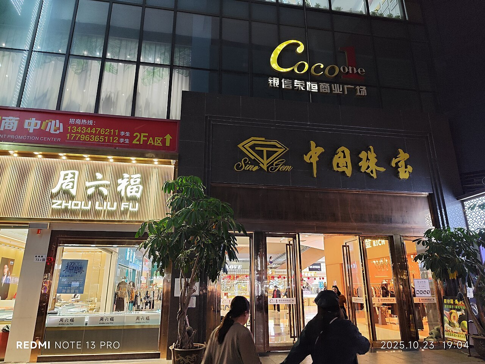

# 周恒刚

周恒刚（1918—2004），辽宁旅大（今大连）人，白酒技术专家。他最重要的工作，不是发明某一种酒，而是把各地酒厂的经验整理成可以复制、可以教学、可以争论的工艺文件。1955 年与 1962 年的烟台试点、1964 至 1966 年的茅台试点，以及此后数十次技术攻关，使他被称为“为中国白酒立法的人”。这个说法有夸张成分，却抓住了他的核心角色：他是中国白酒从作坊经验走向工业标准的关键组织者之一。

图：周恒刚。摄影：SZ 深圳 Shenzhen 龍崗 Longgang 松柏路 Songbai Road 橫崗街道 Henggang Streets 銀信榮恒商業廣場 YinXin Rong Heng Shopping Mall CoCo One shop China Jewellery n Zhou Liu Fu October 2025 N13P 09。署名：HSeqao MLSGA，CC0，来自 Wikimedia Commons（[来源](https://commons.wikimedia.org/w/index.php?curid=177355500)）。

## 人物小传

周恒刚 1918 年生于辽宁旅大。1937 年至 1942 年，他就读于哈尔滨工业大学应用化学科。毕业后，他在私人酒厂当技师；1949 年 4 月参加工作，在东北烟酒系统任技师与工程师。1953 年，他调到轻工业部酒处，从此进入全国白酒技术管理的视野。

此后：1955 年主持烟台试点，1962 年主持第二次烟台试点，1964 年至 1966 年组织茅台试点，1970 年代又主持、参与数十次白酒试点。1979 年第三届评酒会，他主持评委感官能力考核。2004 年 6 月 16 日，他因病去世，享年 86 岁。

## 生平节点

- 1918 年：生于辽宁旅大。
- 1937 年至 1942 年：就读于哈尔滨工业大学应用化学科。
- 1949 年：参加工作，在东北烟酒专卖局任技师。
- 1953 年：调任轻工业部酒处。
- 1955 年：主持烟台试点。
- 1962 年：主持第二次烟台试点，总结十六字操作法。
- 1964 年 10 月至 1966 年 4 月：组织茅台试点。
- 1979 年：主持第三届评酒会的评委考核与评比方法改革。
- 2004 年 6 月 16 日：逝世，享年 86 岁。

## 与酒业的实际关系

1955 年的烟台试点，是新中国成立后白酒行业第一次大规模、跨省区的技术协作。地方工业部组织全国 13 个省市的酿酒技术人员到烟台，周恒刚是主持者之一。试点把操作拆成原料、制曲、发酵、蒸馏、贮存等环节，记录温度、水分、酸度与出酒率，最后形成“烟台操作法”。

1962 年，他主持第二次烟台试点，把操作法修订为十六个字：“麸曲酒母、合理配料、低温入窖、定温蒸烧。”这十六个字后来被行业称为“白酒生产大法”，在全国推广，使一般原料的出酒率平均提高 3% 至 5%。

1964 年 10 月至 1966 年 4 月，他组织茅台试点。试点研究酱香型白酒的曲种、酿造工艺、微生物特性与香味成分，也发现了己酸乙酯与己酸菌。这里必须分清：己酸乙酯是浓香型白酒的主体香气之一，不是酱香型；茅台试点的重要性，在于把“香味来自微生物代谢”这条思路带进了白酒研究。

在浓香型白酒方面，他后来推动窖泥微生物与人工培养窖泥的研究，试图解释“老窖出好酒”的原因，并寻找缩短窖池老熟时间的办法。

## 代表作品或制度

周恒刚的“作品”首先是方法。烟台操作法的十六字要义、茅台试点的微生物与香味研究、1979 年评酒会的感官考核与分香型评比，都是可以反复使用的制度性成果。

他也留下了大量文本。据《光明日报》统计，他著书 16 册、约 1680 万字，发表论文 400 篇，培训技术人员 2800 名。

## 技术方法

周恒刚的方法可以概括为“化验、微生物、工艺倒插笔”：先从成品酒里检出香味成分，再回到微生物与制曲环节找来源，最后用工艺参数把来源固定下来。这个顺序与传统的“师傅带徒弟”相反，却适合解决跨厂、跨地区的共性问题。他也强调“下不怕一线，上不怕试验”：住进酒厂，跟着班组记录温度、翻曲、入窖、蒸馏；试验不是一次成功，而是几十次、上百次地重复。中国酒业协会的资料写到，他在黄山头为验证窖泥功能菌做了 51 次试验。

## 影响

第一，他奠定了白酒“试点”的组织范式：把专家、工厂、地方技术人员集中到一处，在限定时间内解决具体问题，再把结论写成可推广的操作法。

第二，他推动了麸曲白酒的技术路线。麸曲法降低了用曲量、缩短了发酵周期、提高了出酒率，在粮食紧张的年代具有现实意义；它也带来了风味上的取舍，不能简单说成“更先进”。

第三，他参与了白酒香型体系与评酒制度的建立。1979 年第三届评酒会开始分香型、分糖化剂、分酒度评比，并引入评委感官能力考核，这使“香型”从经验描述变成可操作的分类工具。

第四，他培养了一支技术队伍。2800 余名受训人员散布在各地产区，成为后来白酒工艺、品评与质量管理的中坚。

## 评价与争议

《光明日报》在讣闻中称他为“为中国白酒立法的人”，并写到“烟台操作法”被誉为中国白酒生产大法。这个评价带有纪念色彩，但并非空穴来风：烟台试点确实把一套地方经验变成了全国性技术文件。

争议主要在三处。第一，茅台试点的归属：周恒刚是组织者之一，但试点同时有方心芳、秦含章等多人参与；把整项成果归给一个人，会遮蔽其他研究者的工作。第二，己酸乙酯的结论常被误传：它证明的是浓香型白酒的主体香气，不是酱香型。第三，烟台操作法的适用范围：它主要针对麸曲白酒，不是所有白酒的通用配方；把它当成“万能用曲法”，会忽略大曲酱香、清香等工艺的差异。

## 常见误读

第一，周恒刚发明了茅台。他没有发明茅台；他组织试点，研究茅台的曲种、工艺、微生物与香味成分。

第二，茅台试点证明己酸乙酯是酱香型的主体香。不是。己酸乙酯是浓香型白酒的主体香气之一；茅台试点的重要发现还包括己酸菌与微生物代谢的思路。

第三，烟台操作法适用于所有白酒。它主要针对麸曲白酒，核心是麸曲酒母、合理配料、低温入窖、定温蒸烧；大曲酱香、清香等工艺另有自己的规程。

第四，周恒刚只做技术、不写东西。他著书 16 册、约 1680 万字，发表论文 400 多篇，还培训了 2800 多名技术人员。

第五，人工老窖是他发明的。窖泥人工培养是多批研究人员共同推进的课题，周恒刚是重要的组织者之一。

相关条目：[白酒](ref:baijiu)、[浓香型白酒](ref:strong)。

## 另见

- [白酒](ref:baijiu)：定义、香型与基本工艺。
- [浓香型白酒](ref:strong)：己酸乙酯与窖池的关系。
- [发酵窖池](ref:pit)：窖泥微生物与老窖。
- [泸州老窖](ref:luzhou)：浓香型白酒与窖池传统。
- [汾酒](ref:fenjiu)：清香型白酒与试点背景。
- [GB/T 10781.1—2021](ref:strong-standard)：浓香型白酒国家标准。
