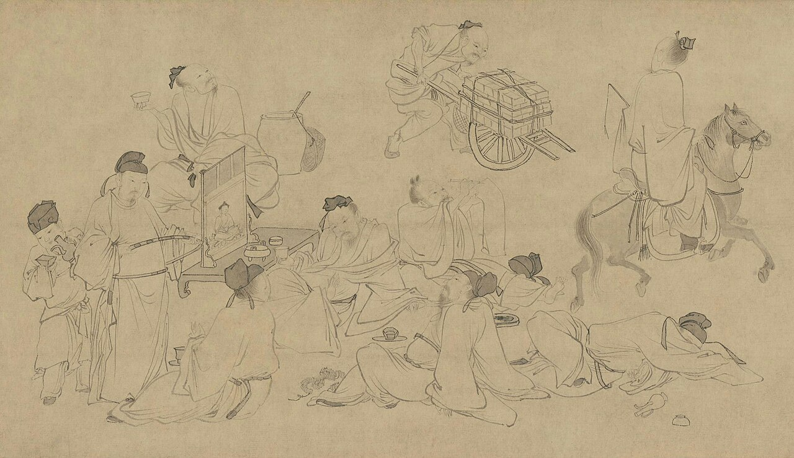

# 饮中八仙歌：杜甫写的不是酒量排行榜，是一组盛唐群像

《饮中八仙歌》常被当成一张“唐代酒鬼名单”：八个人，八种醉态，谁喝得多，谁醉得有趣。这样读当然热闹，却把杜甫写丢了一半。八个人不是按酒量排座次，而是按身份、性格和职业排列：有亲王，有宰相，有诗人，有书法家，有布衣。酒是让他们暂时离开原位的东西；杜甫写的，是原位与失态之间的那一点缝隙。

图：传为明杜堇《古贤诗意卷》局部，绘杜甫《饮中八仙歌》中的酒客；此图是后人诗意画，不是唐代宴席现场。图片：Du Jin，Public domain，via Wikimedia Commons（[原图页面](https://commons.wikimedia.org/wiki/File:%E6%9D%9C%E5%A0%87%E7%94%BB%E5%8F%A4%E8%B4%A4%E8%AF%97%E6%84%8F%E5%8D%B7%E5%B1%80%E9%83%A8_%E9%A5%AE%E4%B8%AD%E5%85%AB%E4%BB%99.jpg)）。

> **先给结论**
> **一句话：** 这页判断饮中八仙歌：杜甫写的不是酒量排行榜，是一组盛唐群像为什么值得读，以及怎么放回诗酒语境。
>
> - **适合谁：** 想把饮中八仙歌：杜甫写的不是酒量排行榜，是一组盛唐群像放回诗酒语境里读、而不只是背名句的人。
> - **不适合谁：** 只背考点或只看一句名句、不想了解语境的人。
> - **先看这两点：**
>   - “饮中八仙”不是杜甫发明的小组名，而是后人对诗中八位酒客的概括。
>   - 知章骑马似乘船，眼花落井水底眠。

## 题解与文本

“饮中八仙”不是杜甫发明的小组名，而是后人对诗中八位酒客的概括。八人分别是贺知章、汝阳王李琎、左相李适之、崔宗之、苏晋、李白、张旭、焦遂。诗用“歌”体，每段两三句，像人物速写，不是律诗那样整齐对仗。这种形式本身就说明：杜甫要写的是群像，不是一个人的传记。

八个人的身份跨度很大。贺知章是太子宾客、秘书监，李琎是汝阳王，李适之是宰相，崔宗之是名门之后，苏晋信佛，李白是布衣诗人，张旭是书法家，焦遂是普通士人。杜甫把他们放在同一首诗里，不是因为他们都能喝，而是因为他们都在酒里露出了某个不被官职覆盖的自己。

## 正文

> 知章骑马似乘船，眼花落井水底眠。
> 汝阳三斗始朝天，道逢麴车口流涎，恨不移封向酒泉。
> 左相日兴费万钱，饮如长鲸吸百川，衔杯乐圣称避贤。
> 宗之潇洒美少年，举觞白眼望青天，皎如玉树临风前。
> 苏晋长斋绣佛前，醉中往往爱逃禅。
> 李白斗酒诗百篇，长安市上酒家眠。
> 天子呼来不上船，自称臣是酒中仙。
> 张旭三杯草圣传，脱帽露顶王公前，挥毫落纸如云烟。
> 焦遂五斗方卓然，高谈雄辩惊四筵。

以上为通行本文字。“衔杯乐圣称避贤”一作“称世贤”；“李白斗酒诗百篇”一作“一斗诗百篇”；“高谈雄辩”一作“高谈雄辨”。

## 八个人，八种醉

贺知章是第一位。他骑马像乘船，眼花落到井里，索性在水底睡。这两句写的是老人的醉态，也写他的官职：太子宾客、秘书监，本是东宫与秘阁里的清贵之臣。骑马似乘船，是把陆路走成水路；落井水底眠，是把意外写成一场安眠。杜甫没有写他为什么醉，只写他醉后的身体，像一幅漫画。

第二位是汝阳王李琎。他喝三斗才去朝见天子，路上遇到装酒曲的车，口水直流，恨不得把封地移到酒泉。这三句写的是亲王的口腹之欲，也写他的特权：别人喝酒误事，他喝酒还能“朝天”；别人流涎是馋，他流涎是可爱。酒泉是地名，也是双关：那里有酒，像泉水。

第三位是左相李适之。他每天花万钱喝酒，饮如长鲸吸百川，举杯“乐圣”而自称“避贤”。李适之在玄宗朝曾任宰相，后来被李林甫排挤罢相。这四句表面写豪饮，内里藏着政治：一个被罢相的官员，用“避贤”自嘲，用“乐圣”把自己放进酒里。长鲸吸百川的气魄，和“避贤”的退让，是同一个人的两面。

第四位是崔宗之。他潇洒美少年，举觞白眼望青天，皎如玉树临风前。“白眼”用阮籍的典故：青眼对朋友，白眼对俗人。崔宗之举杯翻白眼，不是傲慢，而是一种姿态：在酒桌上，他可以暂时不按社交礼数看人。玉树临风是外貌，也是风度的隐喻。

第五位是苏晋。他长期斋戒，在绣佛前修行，醉中却往往“逃禅”。这四句最短，也最妙：一个信佛的人，喝醉就离开禅修。不是他不虔诚，而是酒后的他暂时不想做那个“苏晋”。杜甫没有批评，也没有赞美，只把这个矛盾摆出来。

第六位是李白。斗酒诗百篇，长安市上酒家眠；天子呼来不上船，自称臣是酒中仙。这四句是全诗最著名的部分，也是李白形象的核心：诗、酒、抗命、自称仙。需要说明，“斗酒诗百篇”是文学夸张，不是精确产量；“天子呼来不上船”是一个故事性的场景，不能当作李白每天的政治态度。它写的是李白在酒里的自我想象：我不是你的臣，我是酒中的仙。

第七位是张旭。三杯之后被称为“草圣”，脱帽露顶在王公面前，挥毫落纸如云烟。这四句写艺术家的醉：酒不是让他糊涂，而是让他去掉拘束。脱帽露顶是失礼，也是进入创作状态的动作。张旭的草书本来以狂放著称，杜甫把“醉”和“书”写成同一件事。

第八位是焦遂。五斗之后才“卓然”，高谈雄辩惊四筵。他是一个没有官职的布衣，却在酒桌上获得存在感。前七位都有身份、才华或名气，焦遂只有一张嘴；但酒给了他说话的资格。把他放在最后，是一个很讲究的收束：八仙不全是贵人，酒桌也不全是官场。

## 酒桌上的盛唐群像

这首诗的深层结构，是从宫廷到市井的下降。贺知章、李琎、李适之代表朝廷；崔宗之、苏晋代表名门与宗教；李白、张旭代表艺术；焦遂代表布衣。八个人像八级台阶，把“饮中八仙”从王府拉到长安市上。酒是唯一能把他们放在同一张桌子上的东西。

酒也是“去角色化”的媒介。贺知章不再是秘书监，汝阳王不再是亲王，左相不再是宰相，苏晋不再是居士，李白不再是待诏，张旭不再是官员面前的书法家。酒后的他们，露出另一种身体：骑马像坐船的身体，流涎的身体，长鲸吸川的身体，白眼望天的身体，逃禅的身体，不上船的身体，脱帽露顶的身体，高谈雄辩的身体。杜甫写的就是这些身体。

但杜甫没有把“去角色化”写成纯粹的解放。八个人里，有人是主动喝，有人是被政治逼着喝，有人是借酒装疯，有人是酒后失态。杜甫的笔调在欣赏与保留之间：他喜欢这些人的真，也知道这种真是有代价的。左相的“避贤”不是快乐，李白的“不上船”不是日常，焦遂的“惊四筵”也可能只是一夜。酒桌是盛唐的一个切面，不是盛唐的全部。

从物质史看，唐代的酒主要是谷物酒，酒度不高，三斗、五斗、万钱都是文学与身价的修辞，不是可以照搬的饮用量。酒器、酒曲、酒肆的细节，和今天差别很大。把“八仙”当成酒量英雄，会用现代酒精经验去改写唐人的社交。更合适的读法是：酒是唐人展示性格、身份与政治态度的一种场合。[黄酒](ref:yellow-wine)的工艺谱系可以帮助理解唐代谷物酒，但不能直接等同。

## 杜甫的写法：颂歌还是讽刺？

这首诗的题目有“歌”，语气也有赞美的成分：潇洒、皎如玉树、草圣、卓然，都是好词。但它不是单纯的颂歌。杜甫写贺知章落井，写汝阳王流涎，写左相“避贤”，写苏晋“逃禅”，写李白“不上船”，写张旭“脱帽露顶”，写焦遂“惊四筵”。这些行为在礼法标准下都不算体面，杜甫却用轻快的节奏写出来，让读者先笑，再想。

这种写法接近“滑稽”传统：用夸张的动作写人物的性格，让可笑与可爱同时存在。杜甫不是要审判他们，也不是要美化他们。他把八个人放在酒里，让他们自己露出破绽；读者笑完之后，会看到破绽背后的身份压力。贺知章的落井，是一个老臣的放松；李适之的“避贤”，是一个罢相者的自嘲；李白的“不上船”，是一个天才对权力的撒娇。笑和疼是同一件事。

所以，这首诗既不是“唐代酒文化赞歌”，也不是“杜甫讽刺酒徒”。它更像一组人物素描，带着杜甫特有的观察力：他能看见一个人的官职，也能看见官职下面那个会流涎、会落井、会翻白眼的人。酒只是让后者暂时走到前台。

## 常见误读

第一，把八仙当成酒量排行榜。诗中“三斗”“五斗”“万钱”是修辞，不是计量；八人也不是按酒量排序，而是按身份与类型排列。第二，把“酒中仙”当成李白的正式称号。它是李白在诗里的自称，是文学形象，不是唐代官方的封号。第三，把“天子呼来不上船”当成李白真实的政治行为。它是一个故事性的场景，表达的是李白对权力的态度，不是每天都发生的抗旨。第四，把苏晋“逃禅”当成对佛教的否定。他仍然是长斋绣佛的人，醉后离开禅修，是人性的矛盾，不是信仰的破产。第五，把这首诗当成纯粹的颂歌。杜甫的赞美里带着保留，笑里有疼。

还有一个细节值得注意：八个人里，只有焦遂没有显赫身份。把他放在最后，说明“饮中八仙”不是贵族俱乐部；酒桌的平等，是这首诗的隐含主张。但这种平等是短暂的，酒醒之后，焦遂仍然是布衣，左相仍然是罢相。杜甫没有说破，只把顺序排给你看。

## 相关条目

- [杜甫](ref:du-fu)：人物页，补充他的安史之乱经历、秦州与成都时期。
- [李白《将进酒》](ref:li-bai)：另一首把饮酒写成自我扩张的诗，可与“酒中仙”对读。
- [曹操《短歌行》](ref:cao-cao)：汉末宴饮诗里“酒”与政治抱负的关系。
- [黄酒](ref:yellow-wine)：理解唐代谷物酒工艺谱系的入口。
- [一杯酒里的时间](ref:time-in-a-cup)：饮中八仙歌：杜甫写的不是酒量排行榜，是一组盛唐群像所处的节令、宴集与写作背景。

相关条目：[杜甫](ref:du-fu)、[将进酒：李白的劝饮与时间](ref:li-bai)。
