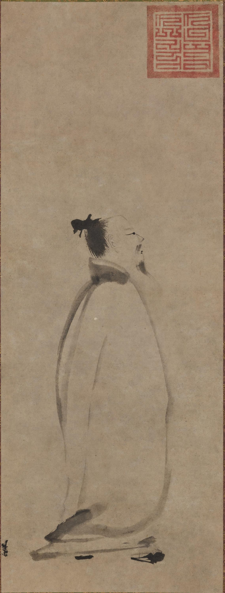

# 把酒问月：李白问的不是月亮，是人与时间的关系

《把酒问月》有一个很具体的开场：题下小注说“故人贾淳令予问之”。不是李白突然对月发问，而是朋友让他问。这个细节很重要：它把一首看起来极其宏大的诗，放回了一次朋友间的请托。李白端起杯子，先问月亮什么时候开始存在，再问人为什么追不上月亮，最后问到自己和古人、今人之间的关系。酒不是答案，酒是提问时手里必须有的东西。

图：传为南宋梁楷《李白行吟图》；此图不是《把酒问月》诗稿，也不是李白对月饮酒的现场记录。图片：Liang Kai，Public domain，via Wikimedia Commons（[原图页面](https://commons.wikimedia.org/wiki/File:Liang_Kai_-_Li_Bai_Strolling.jpg)）。

> **先给结论**
> **一句话：** 这页判断把酒问月：李白问的不是月亮，是人与时间的关系为什么值得读，以及怎么放回诗酒语境。
>
> - **适合谁：** 想把把酒问月：李白问的不是月亮，是人与时间的关系放回诗酒语境里读、而不只是背名句的人。
> - **不适合谁：** 只背考点或只看一句名句、不想了解语境的人。
> - **先看这两点：**
>   - “把酒”是端起酒杯，“问月”是对月发问。
>   - 开头两句是一个突然的停顿。

## 题解与文本

“把酒”是端起酒杯，“问月”是对月发问。诗题本身就是一个动作，不是一个静态的题目。李白没有用“咏月”“对月”这类常见的题目，而是用“问”，把月亮当成一个可以对话的对象。题下小注“故人贾淳令予问之”又给这个动作加了一层社交背景：这是一次被朋友点名的写作，不是孤独的独白。

全诗十六句，四句一转。前四句问月亮的来历与人的追逐；中间四句写月的光辉与升落；再四句写神话中的白兔、嫦娥；最后四句把古人、今人和眼前这杯酒收在一起。结构很像一次呼吸：先向外问，再向下看，再向神话里走，最后回到手里。

## 正文

> 青天有月来几时？我今停杯一问之。
> 人攀明月不可得，月行却与人相随。
> 皎如飞镜临丹阙，绿烟灭尽清辉发。
> 但见宵从海上来，宁知晓向云间没。
> 白兔捣药秋复春，嫦娥孤栖与谁邻？
> 今人不见古时月，今月曾经照古人。
> 古人今人若流水，共看明月皆如此。
> 唯愿当歌对酒时，月光长照金樽里。

以上为通行本文字。“皎如飞镜临丹阙”以下有的版本断句不同，“唯愿”一作“惟愿”。

## 逐段读

开头两句是一个突然的停顿。“停杯一问之”的“停”字很关键：酒本来要喝，杯子已经举起，但问题先来了。青天有月来几时？这不是天文学问题，而是一个孩子式的追问：月亮什么时候开始有的？李白知道没有人能回答，但他还是要问。问的动作本身，就是诗的开始。

第三、四句写人与月亮的关系。人攀明月不可得，月亮却跟着人走。人想上去，上不去；月亮不想跟，却总在。这种“不可得”与“相随”的并置，已经埋下了后面的主题：人追不上永恒，但永恒一直照着你。第五、六句写月的光辉：像飞镜照到红色的宫阙，绿烟散尽，清辉发出。第七、八句写月的行踪：只看见它晚上从海上来，谁知道它早上从云间消失。月亮有它的路线，人只能看到一段。

第九、十句转入神话。白兔捣药，秋复春；嫦娥孤栖，与谁邻？这两句把月亮上的传说拉进来，但不是为了讲故事，而是为了写“孤独”和“重复”。白兔的工作是重复的，嫦娥的居住是孤独的。月亮越永恒，上面的居民越像被永恒困住。

第十一、十二句是全诗最著名的转折。今人不见古时月，今月曾经照古人。今人看不到古时候的月亮，但今天这个月亮曾经照过古人。这两句把时间的方向翻转了：从“人看月”变成“月看人”。月亮是一个跨越世代的见证者，人只是它照过的一批又一批。

第十三、十四句把这种见证普遍化。古人今人若流水，共看明月皆如此。古人和今人像流水一样过去，但大家看到的月亮都是同一个。这里没有简单的悲观，也没有简单的安慰：人确实会过去，但“共看”这件事把不同时代的人连在一起。

最后两句收回到酒。唯愿当歌对酒时，月光长照金樽里。李白不要求月亮告诉他答案，也不要求长生；他只希望在对酒当歌的时候，月光能照进眼前的杯子。宇宙尺度的问题，最后落在一个具体的、可以举起来的金樽里。这不是逃避，而是一种尺度转换：既然人留不住月亮，那就让月亮在这一刻照进酒里。

## 月亮、时间与酒

这首诗的核心不是月亮，而是“参照系”。月亮在诗里是一个恒常的参照：它见过古人，也见过今人；它从海上来，从云间没；它上面的白兔和嫦娥，重复着各自的日子。人一旦把月亮当作参照，就会发现自己的一生很短。但李白没有停在“人生短促”的感慨上，他继续问：既然短促，那这一刻该怎么过？

酒就是他对这个问题的回答方式。酒不能延长生命，也不能让月亮停下来；酒能让“此刻”变得有重量。当歌对酒，月光长照金樽，这三件事同时发生：歌是人的声音，酒是人的动作，月是天的光。它们在一个杯子里短暂地重合。李白要的不是永恒，而是这一刻的饱满。

这也是李白饮酒诗的一个共同特点：酒不是消愁的工具，而是把抽象问题拉回身体的中介。在《月下独酌》里，酒把月亮和影子变成三个人的聚会；在《将进酒》里，酒把时间的不可逆变成一场宴席；在《把酒问月》里，酒把宇宙的尺度收进一个金樽。三首诗的功能不同，但都在做同一件事：用一杯酒，给无法回答的问题一个可以承受的形式。

从物质史看，唐代的酒主要是谷物酒，酒度不高，酒器也以金樽、玉碗、斗卮这类器形为常见。金樽不一定真是纯金，诗里的“金”常常是修饰，表示贵重与光亮。把“金樽”直接理解成现代贵金属酒杯，会丢掉它的修辞功能。酒的种类与[黄酒](ref:yellow-wine)的工艺谱系相近，但唐人的饮酒方式、酒度与今天并不相同。

## 李白的天宝语境

关于这首诗的写作时间，常见说法是在天宝年间（742—756），李白离开长安之后。题下小注提到的贾淳，生平不详，但“故人”二字说明两人有旧交。这首诗不像《将进酒》那样有明显的宴席现场，也不像《月下独酌》那样有花间、独酌的具体场景；它更像一次中秋或月夜的即兴问答，具体地点与年份都难以确指。

天宝年间是李白政治抱负受挫的时期。他曾经供奉翰林，随后被赐金放还，重新回到漫游的生活。这个背景不必过度套到每一句诗上，但它能解释诗里的两种语气：一边是“青天有月来几时”的追问，一边是“唯愿当歌对酒时”的收回。前者是李白对宇宙的好奇，后者是李白对现实的妥协。两者之间，是一个不肯完全死心、也不肯完全放弃的人。

月亮在中国诗里常与思乡、怀人、团圆相连。这首诗也有这层意思，但它没有停留在“我想家”或“我想朋友”。它把月亮变成一个跨越时间的见证者，让个人的思念变成人类共同的处境。这也是它后来常被中秋节引用的原因：它写的不是某一家的团圆，而是所有看月亮的人。

## 常见误读

第一，把“今人不见古时月”读成彻底的虚无。下一句“今月曾经照古人”马上把连接建起来了：人见不到古月，但今月见过古人。第二，把“古人今人若流水”读成人生没有意义。流水是一个过程，不是虚无；它强调的是流动，不是消失。第三，把“月光长照金樽里”读成及时行乐。李白要的是这一刻的饱满，不是对明天的放弃。第四，把“白兔捣药”“嫦娥孤栖”当成儿童故事。它们在诗里是“重复”和“孤独”的意象，不是情节。第五，把“金樽”当成实指。诗里的金是对光的响应，不一定是一只纯金杯子。

还有一个容易忽略的细节：题下小注说“故人贾淳令予问之”。这意味着这首诗有一个具体的请托者。把这一点放回去，诗就不是李白一个人在月下自言自语，而是一次朋友间的写作任务。李白接受了这个任务，却把它写成了一个关于人类时间的问题。这种从私人请托到普遍命题的跳跃，正是他的能力。

## 相关条目

- [李白](ref:li-bai)：人物页，补充他的天宝经历、漫游与饮酒诗的整体背景。
- [月下独酌](ref:drinking-alone)：另一首把月亮、影子和酒组成一场聚会的诗。
- [苏轼《水调歌头》](ref:su-shi)：宋代中秋词里“把酒问青天”的另一种写法。
- [黄酒](ref:yellow-wine)：理解唐代谷物酒工艺谱系的入口。
- [一杯酒里的时间](ref:time-in-a-cup)：把酒问月：李白问的不是月亮，是人与时间的关系所处的节令、宴集与写作背景。

相关条目：[李白](ref:li-bai)、[月下独酌：李白的一壶酒与三个影子](ref:drinking-alone)。
