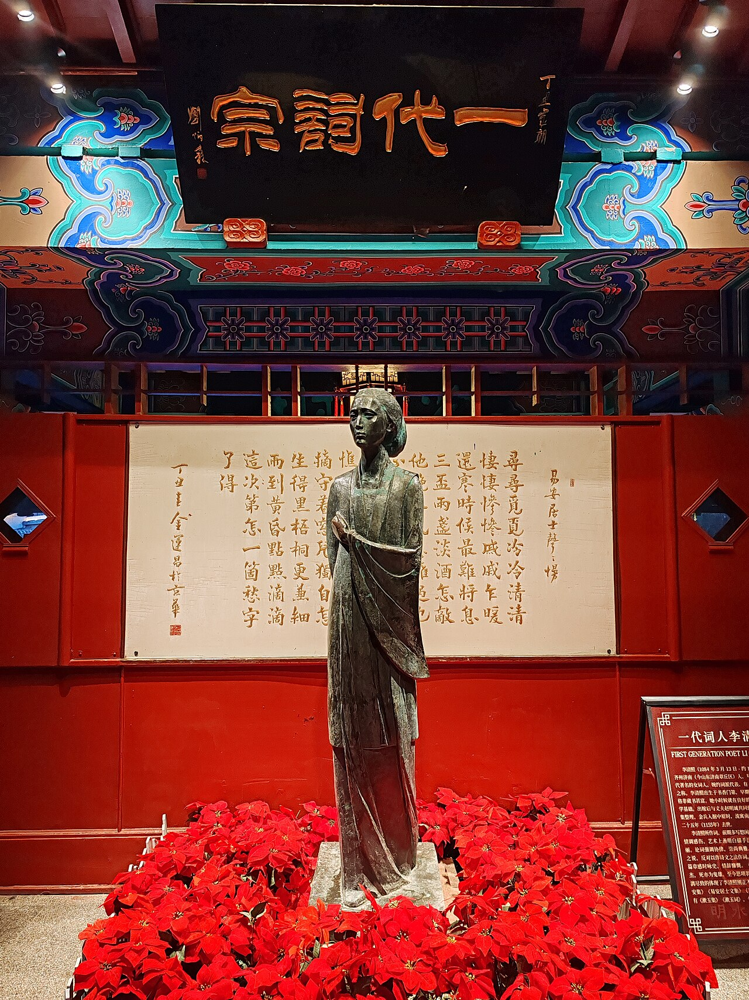

# 如梦令·常记溪亭日暮：一首三十三字的小电影

《如梦令·常记溪亭日暮》只有三十三字，却像一部小电影：傍晚、溪亭、醉意、归舟、藕花、争渡、鸥鹭，一个镜头接一个镜头。它没有写“我很难过”或“我很快乐”，只写动作和声音；读完之后，那个傍晚却留在脑子里。李清照的厉害之处，不是把景写得多美，而是把一次记忆写成了可以反复播放的片段。

图：李清照塑像；此像为后人所作，不是宋代画像，也不是《如梦令》手稿。图片：Vitsuha，CC0，via Wikimedia Commons（[原图页面](https://commons.wikimedia.org/wiki/File:%E6%9D%8E%E6%B8%85%E7%85%A7%E5%A1%91%E5%83%8F.jpg)）。

## 题解与文本

“如梦令”是词牌名，原名《忆仙姿》，相传出自后唐庄宗，因词中有“如梦，如梦”句而改名。这个词牌很短，适合写一瞬间的情景。李清照用这个短调写了一次出游，不是写一生的感慨；但正因为短，每一个字都不能浪费。

“常记”二字说明这是回忆，不是现场。她不是在溪亭日暮的当下写词，而是后来常常想起那个傍晚。“常记”把时间拉开了：写词的人已经不在那个傍晚，她是在记忆里重新走了一遍。这个框架很重要，它让整首词带上一层“明知回不去”的温柔。

## 正文

> 常记溪亭日暮，沉醉不知归路。
> 兴尽晚回舟，误入藕花深处。
> 争渡，争渡，惊起一滩鸥鹭。

以上为通行本文字。“争渡”一作“怎渡”；“常记”一作“尝记”；“沉醉”一作“沈醉”。

## 逐段读

第一句点时间、地点。“溪亭”是临水的亭台，“日暮”是黄昏。没有写天气，没有写同行的人，只写一个地点和一个时辰。第二句写状态：“沉醉不知归路”。这里的“沉醉”可以指酒，也可以指景：她可能喝了酒，也可能被暮色与荷花迷住。李清照没有说破，读者也不需要立刻选一个答案。重要的是“不知归路”：她不是忘了路，而是不想回去。

第三句写转折。“兴尽晚回舟”，玩到尽兴了，才在晚上划船回去。“晚”字说明天色已暗，也为后面的“误入”做准备。第四句“误入藕花深处”，是整首词最漂亮的意外。她不是故意闯进荷花丛，而是迷路；不是迷路得着急，而是迷路得进入了一个更深处。藕花深处是一个封闭、幽静、香气浓的空间，和来时的路不同。

最后两句写声音。“争渡，争渡”，可以是“抢着划船渡过去”，也可以是“怎么渡”的反复问。两种读法都通：前者是动作，后者是心情。无论哪一种，结果都是“惊起一滩鸥鹭”。船桨和水声惊动了满滩的水鸟，鸟飞起来，画面从水面抬到天空。整首词在声音和起飞中结束，没有一句议论。

## 溪亭、藕花与少女时代

这首词常被系于李清照的早期，即她到汴京之后、出嫁之前。那个时期的李清照生活优裕，父亲李格非藏书丰富，她有条件出游、饮酒、写词。词里的溪亭、藕花、鸥鹭，不一定是某个具体园林，也可能是济南一带的水乡景物。具体地点有不同说法，但“少女时代的游兴”这层气息是清楚的。

不过，不能把这首词直接当成李清照的日记。词中的“我”是一个文学声音，它可能来自真实经验，也可能经过选择和加工。李清照写的是“常记”，不是“今日”；她站在后来的时间里回望，把一次出游提炼成三十三字。这个“后来”可能是几年后，也可能是更久。她越是用轻快的笔写，读者越能感到那段时间已经过去了。

藕花深处也有象征意味。荷花在宋代文学里常与夏天、女性、清纯相连；藕花深处是一个比日常世界更幽深的地方。误入其中，不是灾难，而是一次小小的越界。她可以在这里迷路，可以在这里争渡，可以在这里惊起鸟群。这个空间不属于家，也不属于官场，它属于一个可以暂时不守规矩的傍晚。

## “沉醉”是酒还是景？

“沉醉”是全词最容易被二选一的词。有人说是酒：李清照好酒，词里常写酒；有人说是景：她被溪亭日暮迷住了，不必真喝。两种解释都有道理，而且不必互相排除。酒可以让她放松，景可以让她忘路；酒和景一起，才构成“不知归路”的状态。

从宋代女性的生活看，出游饮酒并不是不可能。李清照的词里，酒出现得很频繁：《醉花阴》有“东篱把酒”，《声声慢》有“三杯两盏淡酒”，《如梦令·昨夜雨疏风骤》有“浓睡不消残酒”。她写酒，不总是写愁，也写日常。把《如梦令》的“沉醉”完全说成酒，会显得拘泥；完全说成景，又会丢掉宋词里酒与闲情的联系。

更好的读法是：酒是可能的媒介，景是直接的对象。她可能喝了酒，也可能没喝；但“沉醉”描写的是一种被环境和情绪一起带走的状态。读者不必替她做体检，只需要接受这个词的模糊。模糊不是缺点，而是小令的容量。

## 常见误读

第一，把“争渡”只读成“抢着划船”。它也可以是“怎渡”，是迷路时的自言自语。第二，把“误入藕花深处”读成危险的困境。它是一个美丽的意外，不是事故。第三，把“惊起一滩鸥鹭”读成破坏风景。鸟飞起来，是画面的一部分，是动静结合。第四，把这首词当成李清照一生的缩影。它只是早期的一次出游，不能代表她后期的身世之感。第五，把“沉醉”一定解释成酒。酒是可能的，景也是可能的，不要把模糊的词语硬做成单一结论。

还有一个形式上的误读：把这首词当成一首“写景诗”。它当然有景，但它的核心是叙事：常记、日暮、沉醉、归舟、误入、争渡、惊起，七个动作连成一条线。景是动作发生的场所，不是目的。李清照不是在描写一个静止的荷塘，而是在记录一次移动中的迷路。

## 相关条目

- [李清照](ref:li-qingzhao)：人物页，补充她的家世、婚姻、南渡与词风变化。
- [《醉花阴》](ref:zui-hua-yin)：另一首写酒、花与思念的词。
- [《声声慢》](ref:sheng-sheng-man)：南渡之后的李清照，如何把酒写进愁。
- [黄酒](ref:yellow-wine)：如梦令·常记溪亭日暮：一首三十三字的小电影的谷物、曲种与宋代酒谱入口。
- [一杯酒里的时间](ref:time-in-a-cup)：如梦令·常记溪亭日暮：一首三十三字的小电影所处的节令、宴集与写作背景。

对照阅读：[李清照](ref:li-qingzhao)、[声声慢：三杯两盏淡酒，怎敌他晚来风急](ref:sheng-sheng-man)。

相关条目：[醉花阴：李清照重阳把酒的一天](ref:zui-hua-yin)。
