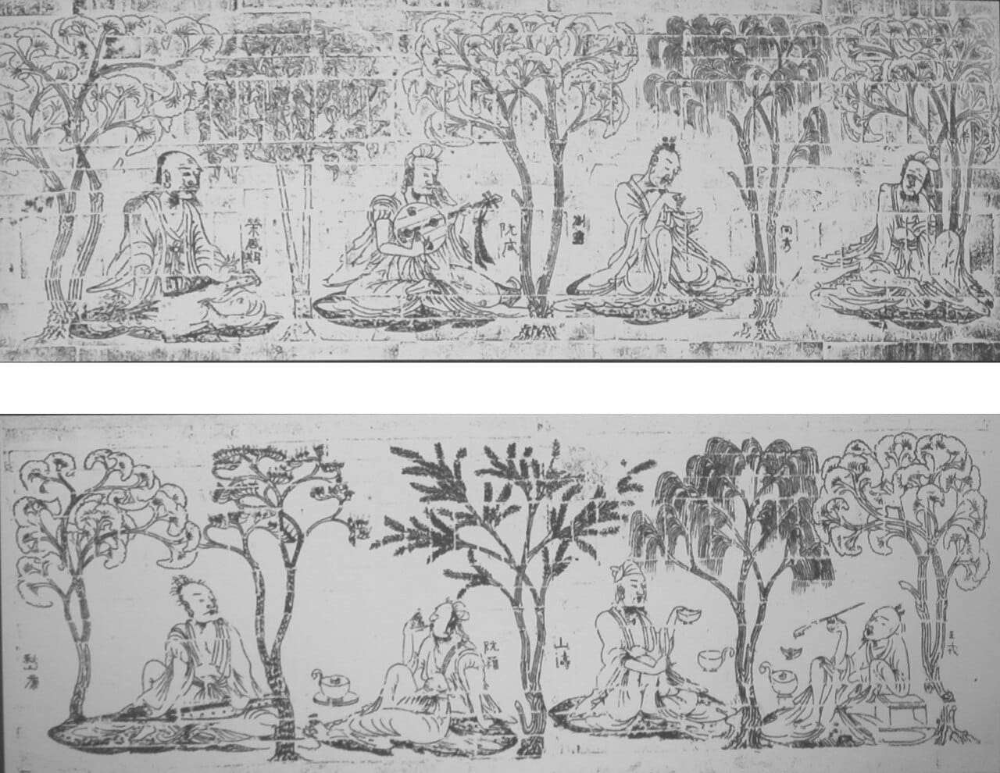

# 酒德颂：刘伶把饮酒写成一篇政治寓言

《酒德颂》很短，短到可以一口气读完；它也很难读，因为刘伶写的不是一场宴席，而是一个人如何把自己从礼法、名位和别人的目光里拔出来。题名里的“德”不是酒量，也不是酒品，而是一种以醉为名的生活立场。把它只当作“酒鬼自辩”，会漏掉魏晋士人藏在酒杯后面的政治恐惧。

图：传为《竹林七贤图》的绘画；竹林七贤是刘伶所属的士人群体，此图不是刘伶肖像，也不是《酒德颂》手稿。图片：Unknown author Unknown author，Public domain，via Wikimedia Commons（[原图页面](https://commons.wikimedia.org/wiki/File:Seven_Sages_of_the_Bamboo_Grove.jpg)）。

> **先给结论**
> **一句话：** 这页判断酒德颂：刘伶把饮酒写成一篇政治寓言为什么值得读，以及怎么放回诗酒语境。
>
> - **适合谁：** 想把酒德颂：刘伶把饮酒写成一篇政治寓言放回诗酒语境里读、而不只是背名句的人。
> - **不适合谁：** 只背考点或只看一句名句、不想了解语境的人。
> - **先看这两点：**
>   - “颂”是文体名，通常用于称颂人物或德行。
>   - 有大人先生，以天地为一朝，以万期为须臾，日月为扃牖，八荒为庭除。

## 题解与文本

“颂”是文体名，通常用于称颂人物或德行。刘伶却把这个庄重的文体拿来写一个“大人先生”：他不按世俗的时间生活，不按世俗的居所居住，也不按世俗的礼法行事。题目与内容之间因此有一层反讽——被称颂的“德”，恰恰是礼法之士最不愿意承认的东西。

《酒德颂》的文本不长，版本差异主要集中在虚词和个别字句。常见异文有“有大人先生”与“有大人先生者”、“八荒为庭除”与“八荒为庭衢”、“幕天席地”与“暮天席地”。这些差异不会改变主旨，但会改变语气：有的更接近散文，有的更像赋体铺陈。读的时候不必执着于找到一个“唯一原文”，更不要把某一本的虚词当成刘伶的原话。

## 正文

> 有大人先生，以天地为一朝，以万期为须臾，日月为扃牖，八荒为庭除。行无辙迹，居无室庐，幕天席地，纵意所如。止则操卮执觚，动则挈榼提壶，唯酒是务，焉知其余？
>
> 有贵介公子，搢绅处士，闻吾风声，议其所以。乃奋袂攘襟，怒目切齿，陈说礼法，是非锋起。先生于是方捧甖承槽、衔杯漱醪；奋髯踑踞，枕麴藉糟；无思无虑，其乐陶陶。兀然而醉，豁尔而醒；静听不闻雷霆之声，熟视不睹泰山之形，不觉寒暑之切肌，利欲之感情。俯观万物，扰扰焉，如江汉之载浮萍；二豪侍侧焉，如蜾蠃之与螟蛉。

以上为通行本文字。个别版本在“先生”“庭衢”“暮天”等字句上不同，详见下文。

## 逐段读

开头写“大人先生”的尺度。天地只是一朝，万年只是须臾，日月是门窗，八荒是庭院。这不是夸张的风景描写，而是把日常的时间单位和空间单位全部拆掉。一个人若这样看世界，世俗的升迁、得失、毁誉就很难再让他紧张。接着写他的行动：没有车辙，没有房屋，以天为幕、以地为席，想往哪里去就往哪里去。这里的“无”不是贫穷，而是主动卸下。

第二段写他的日常。停下来就拿着卮、觚，走起来就提着榼、壶；所有心思都放在酒上，别的事一概不问。这段常被当成“酒鬼画像”，但要注意它的对仗：静止与行动、酒器与酒器、室内与路上。刘伶写的是一种随时可以喝、随处可以喝的生活节奏，酒器成了他与世界接触的接口。

第三段突然转入冲突。贵介公子和搢绅处士听到他的风声，开始议论他；他们捋起袖子、瞪眼咬牙，搬出礼法，是非像锋刃一样立起来。这是全篇的政治核心：不是刘伶主动挑衅，而是礼法之士先把他当成问题。接下来写先生的对策：他正捧着酒瓮、衔着杯子，奋髯箕踞，枕着酒糟，无思无虑，其乐陶陶。这里没有辩论，没有反驳，只有一种不进入对方语言的态度。

最后写醉与醒。兀然而醉，豁尔而醒；听不见雷霆，看不见泰山，不觉得寒暑切肤，也不被利欲触动。俯看万物，像江汉水面上的浮萍；那两个气势汹汹的“二豪”站在旁边，像蜾蠃与螟蛉。蜾蠃、螟蛉的典故出自《诗经》，古人误以为蜾蠃养螟蛉为子，后来用来比喻认错对象或把小事当大事。刘伶用它，把礼法之士的义正词严缩成一只小虫的忙碌。

## 酒德的政治锋芒

《酒德颂》的“酒德”至少有三层。第一层是“不与人争”的姿态：面对礼法之士的围攻，大人先生不辩解，只继续喝。这不是懦弱，而是一种拒绝：你可以用礼法审判我，我不接受你的法庭。第二层是“重排价值”的能力：把天地、万年、日月、八荒重新命名，等于把世俗社会赖以运作的尺度抽掉。第三层是“身体的自保”：醉后的感官迟钝，既是逃避，也是让自己在政治高压下不被恐惧击穿。

这也解释了为什么文章要用“颂”这种庄严文体。刘伶不是不知道礼法的分量，他恰恰知道，才用戏仿的方式把它拆开。贵介公子、搢绅处士不是漫画式的坏人，他们代表当时真正有力量的社会秩序；大人先生的“胜利”也不是辩论赢了，而是他从一开始就不在同一个赛场里。

酒在这里还有一层物质史的含义。魏晋时期的酒主要是谷物酒，酒度不高，饮法与今天白酒不同。刘伶写“衔杯漱醪”“枕麴藉糟”，说的是酒醪、酒糟一类的东西，不能直接想象成透明的蒸馏酒。把《酒德颂》读成“高度酒把人喝废了”，是用今天的酒精度去解释古人的精神选择。[黄酒](ref:yellow-wine)的工艺谱系与魏晋谷物酒相近，可以帮助理解当时的酒体，但两者仍不是同一种产品。

## 魏晋语境与竹林七贤

刘伶是“竹林七贤”之一，字伯伦，西晋沛国人。关于他的生平，可靠记载并不多，《晋书·刘伶传》把他写成一个沉默寡言、不以家产为意、纵酒放达的人。他留下的作品也很少，《酒德颂》几乎是他最著名的一篇。把这篇放回竹林七贤的语境，才能理解“醉”为什么值得写。

竹林七贤活动在曹魏末年至西晋初年，正是司马氏逐步掌握权力、名教被用作政治工具的时期。七贤的饮酒、清谈、放诞，不只是生活方式，也是在权力夹缝里保存自己的一种策略。阮籍以醉避婚、以醉避祸；嵇康因为不肯合作而被杀；刘伶则把醉写成一篇自足的颂。三人的选择不同，但面对的是同一个问题：在一个不容许说“不”的体制里，一个人还能怎样说“不”。

《酒德颂》没有直接骂司马氏，也没有点名任何政治人物。它的锋芒藏在结构里：礼法之士越是愤怒，大人先生越是安静；礼法越是完整，醉后的世界越是辽阔。这种写法比直接抗议更安全，也更刻薄。它让读者自己得出结论：如果礼法只能靠瞪眼咬牙来维持，那它大概并没有它自称的那么有力量。

## 常见误读

第一，把《酒德颂》当成劝酒文。它没有劝任何人喝，也没有赞美酒量；它写的是一个人如何用酒把自己从世俗评价里移开。第二，把大人先生等同于刘伶本人。文章有自传成分，但“大人先生”是一个建构出来的形象，不能每一句都当作刘伶的生活实录。第三，把“无思无虑”当成没有思想。它更像一种主动的停摆：在无法改变外部秩序时，先把内部的焦虑关掉。第四，把魏晋饮酒浪漫化。竹林七贤的醉里有政治风险，也有身体代价；阮籍、刘伶的放达，不是可以随便模仿的生活模板。第五，用今天的酒器、酒度和酒桌文化去套原文。卮、觚、榼、壶是古代酒器，酒醪与蒸馏酒也不是一回事。

还有一层容易忽略：这篇文字对“礼法”的批判，不等于对所有规范的反感。它反对的是把礼法当成攻击异己的武器，而不是反对人与人之间的基本秩序。大人先生没有伤害任何人，也没有要求别人跟他一起醉；他只是拒绝被别人的“是非”定义。这个分寸，正是《酒德颂》比一般骂世文章更耐读的地方。

## 相关条目

- [陶渊明《饮酒·其五》](ref:tao-yuanming)：另一种把酒放进田园与自我解释的写法。
- [曹操《短歌行》](ref:cao-cao)：汉末宴饮诗里“酒”与政治抱负的关系。
- [李白《将进酒》](ref:li-bai)：唐代劝酒歌如何把失意写成豪言。
- [黄酒](ref:yellow-wine)：理解魏晋谷物酒工艺谱系的入口。
- [一杯酒里的时间](ref:time-in-a-cup)：酒德颂：刘伶把饮酒写成一篇政治寓言所处的节令、宴集与写作背景。

相关条目：[饮酒·其五：陶渊明在东篱下看见的南山](ref:tao-yuanming)、[短歌行：曹操把酒写成了求贤的忧思](ref:cao-cao)。
