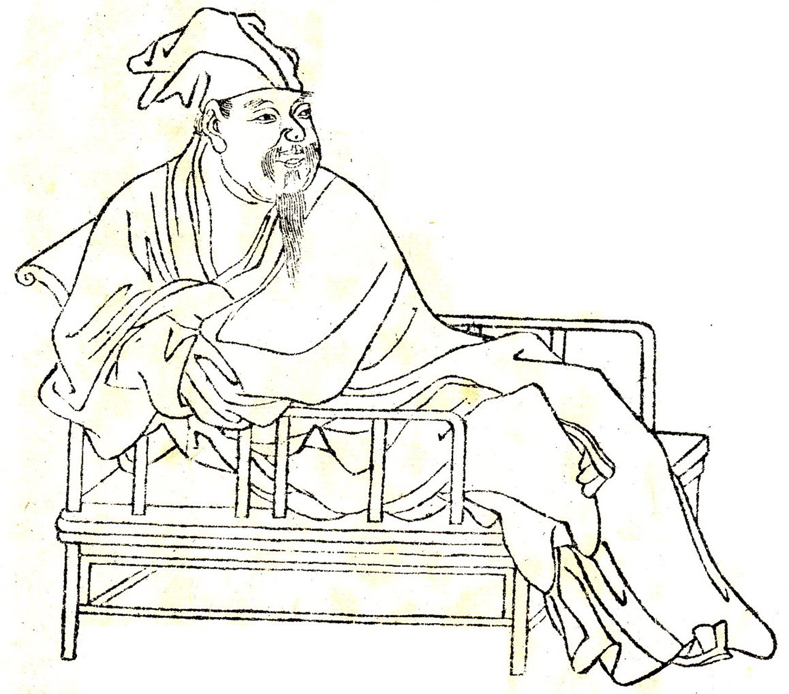

# 醉翁亭记：欧阳修写的不是酒，是一套地方治理的心情

《醉翁亭记》太有名，有名到“醉翁之意不在酒”已经变成一句日常成语。人们用它形容别有用心，却很少回到原文：欧阳修说的“意”究竟在哪里？这篇文章从山写到泉，从亭写到人，从朝暮四时写到滁人的游、太守的宴，最后才用一句“太守谓谁”把作者自己放进去。酒贯穿全篇，但酒不是主题；它更像一把钥匙，打开的是贬谪之后如何与一地人相处的问题。

图：欧阳修画像；此图不是醉翁亭实景，也不是《醉翁亭记》手稿。图片：Wikimedia Commons contributor，Public domain，via Wikimedia Commons（[原图页面](https://commons.wikimedia.org/wiki/File:Ouyang_Xiu.jpg)）。

## 题解与文本

庆历六年（1046），欧阳修因支持范仲淹的庆历新政而被贬，出任滁州知州。滁州在当时不算富庶大郡，却有琅琊山、酿泉这样的山水。琅琊寺僧人智仙在酿泉边建了一座亭子，欧阳修给它取名“醉翁亭”，并写下这篇记。题目里的“醉翁”是欧阳修的自号：他酒量不大，饮少辄醉，年龄又比周围人长，于是自嘲为“翁”。

“记”是宋代散文常见文体，可以写景物、人物、器物，也可以借题发挥。欧阳修没有把文章写成单纯的山水导览，而是用“记”的形式装进地方治理的观察。这一点很重要：如果只读山水，会把它看成一篇优美的游记；如果读到最后“太守之乐其乐”，才会发现文章的重心在人，不在景。

## 正文

> 环滁皆山也。其西南诸峰，林壑尤美，望之蔚然而深秀者，琅琊也。山行六七里，渐闻水声潺潺而泻出于两峰之间者，酿泉也。峰回路转，有亭翼然临于泉上者，醉翁亭也。作亭者谁？山之僧智仙也。名之者谁？太守自谓也。太守与客来饮于此，饮少辄醉，而年又最高，故自号曰醉翁也。醉翁之意不在酒，在乎山水之间也。山水之乐，得之心而寓之酒也。
>
> 若夫日出而林霏开，云归而岩穴暝，晦明变化者，山间之朝暮也。野芳发而幽香，佳木秀而繁阴，风霜高洁，水落而石出者，山间之四时也。朝而往，暮而归，四时之景不同，而乐亦无穷也。
>
> 至于负者歌于途，行者休于树，前者呼，后者应，伛偻提携，往来而不绝者，滁人游也。临溪而渔，溪深而鱼肥，酿泉为酒，泉香而酒洌，山肴野蔌，杂然而前陈者，太守宴也。宴酣之乐，非丝非竹，射者中，弈者胜，觥筹交错，起坐而喧哗者，众宾欢也。苍颜白发，颓然乎其间者，太守醉也。
>
> 已而夕阳在山，人影散乱，太守归而宾客从也。树林阴翳，鸣声上下，游人去而禽鸟乐也。然而禽鸟知山林之乐，而不知人之乐；人知从太守游而乐，而不知太守之乐其乐也。醉能同其乐，醒能述以文者，太守也。太守谓谁？庐陵欧阳修也。

以上为通行本文字。“山之僧智仙也”一作“山之僧曰智仙也”，“水落而石出”一作“水清而石出”。

## 逐段读

第一段从大景写到小景。先“环滁皆山也”五个字，把滁州放进群山；再聚焦西南诸峰，点出琅琊；再沿山路走六七里，听见水声，看到酿泉；最后峰回路转，亭子像鸟翼一样落在泉上。镜头一路推进，从州到山，从山到泉，从泉到亭。接着用两个问答交代亭的来历：谁建的？山僧智仙。谁命名的？太守自己。最后落到“醉翁之意不在酒，在乎山水之间也”。这句话不是拒绝酒，而是把酒放回山水与人的关系里。

第二段写时间。日出林霏开，云归岩穴暝，这是朝暮；野芳、佳木、风霜、水落石出，这是四时。欧阳修没有逐季铺陈，而是用四组短句把山间的变化压缩成节奏。朝往暮归，四时之景不同，乐亦无穷。这里的“乐”不是游客打卡的快乐，而是一个地方官在公务之外，能反复进入同一片山水而不厌倦。

第三段写人。负者歌于途，行者休于树，前者呼，后者应，老人小孩往来不绝，这是滁人游。临溪而渔，酿泉为酒，山肴野蔌，这是太守宴。宴酣之乐，非丝非竹，投壶中、下棋胜、觥筹交错，这是众宾欢。最后“苍颜白发，颓然乎其间者，太守醉也”，把镜头从众人收回到自己。注意，太守的醉不是倒在桌上，而是颓然坐在欢乐的人群中间；他是那个让场面成立的人，也是那个在场面里稍微退后一步的人。

第四段写散场。夕阳在山，人影散乱，太守归而宾客从；树林阴翳，鸣声上下，游人去而禽鸟乐。人走了，鸟开始快乐，这是很轻的一笔，却把“乐”的层次拉开了。接着文章说：禽鸟知山林之乐，不知人之乐；人知从太守游而乐，不知太守之乐其乐。最后点明：醉能同其乐，醒能述以文者，太守也。太守是谁？庐陵欧阳修。这个结尾把作者从“太守”这个官职里请出来，放回一个具体的人。

## 亭、滁州与地方治理

要理解这篇文章，不能只看亭，还要看滁州。欧阳修到滁州时，刚从庆历新政的失败里出来。新政被指为“朋党”，支持者纷纷外放；滁州是他政治生涯的一个低谷。按常理，他可以在文章里写失意、写委屈、写怀才不遇。但他写的是“滁人游”“太守宴”“众宾欢”，写的是一个地方官如何让治下的百姓有闲暇、有乐子、有秩序地出游。

这背后是欧阳修一贯的“宽简”政治。宽不是放任，简不是省事；它指的是少一点扰民，少一点苛细的条文，让百姓能过自己的日子。滁州当时并不富裕，但文章里的滁人能够扶老携幼上山，能够在溪边钓鱼，能够在亭前野餐。这些画面不一定按现代旅游想象去理解，却传达出一种治理效果：地方官没有把百姓逼得没有喘息，所以山水之乐才有可能成为公共的乐。

亭子的建筑细节也能佐证这一点。据滁州地方资料，醉翁亭原建于庆历六年，是智仙为欧阳修所建；亭子四面通透，歇山式顶，飞檐翘角，后来逐步形成“八亭九院”的建筑群。苏轼在绍圣二年（1095）应滁州知州王诏之请，重书《醉翁亭记》并刻碑，形成“欧文苏字”的组合。亭子不是孤立的景点，它是一套地方记忆的容器：文、字、碑、亭、泉、山，层层叠在一起。

## “醉翁之意”到底在哪里

“醉翁之意不在酒，在乎山水之间也”常被解释为“别有用心”，但在原文里，它首先是一句自我说明。欧阳修酒量小，饮少辄醉，所以“醉”不是酒量，而是姿态；他把山水之乐放在酒的前面，又把“得之心而寓之酒”放在后面。酒是载体，不是目的。山水也不是目的，山水是让人重新获得松弛感的场所。

再往后看，“太守之乐其乐”才是文章的真正落点。太守的快乐，不是自己喝得高兴，而是看到滁人游、宾客欢、禽鸟乐。这个“其乐”很绕：太守以别人的快乐为快乐。用今天的话说，这是一种公共治理者的视角：一个地方的好的状态，不是官衙里安静无事，而是百姓可以安心地在山里玩一天。文章没有直接说“政通人和”，而是用一幅游春图把它写出来。

酒在这幅图里承担的是社交功能。酿泉为酒，泉香而酒洌；觥筹交错，起坐而喧哗。酒把陌生人变成同席的人，把官方宴会变成可以嬉笑的场合。但它没有盖过山水，也没有盖过人。欧阳修写醉，写的是“颓然乎其间”，不是酩酊大醉；写宴，写的是“非丝非竹”，不是奢华排场。这种节制，是《醉翁亭记》与一般宴饮文字的区别。

## 常见误读

第一，把“醉翁之意不在酒”当成成语本义来读。原文是欧阳修解释自己为什么叫醉翁，不是教人说话绕弯子。第二，把文章当成纯山水游记。山水只是入口，真正写的是滁人、太守、宾客与禽鸟之间的“乐”。第三，把“与民同乐”当成政治宣传。它更像一种地方治理的理想状态：百姓有余暇，官员不扰民。第四，把“醉”当成饮酒过量。欧阳修明说“饮少辄醉”，醉在这里是自嘲，也是姿态。第五，忽略结尾。没有“太守谓谁？庐陵欧阳修也”，文章就只是风景；有了这一句，作者才从官职回到人名。

还有一个版本层面的误读：把“水落而石出”改成“水清而石出”，会把秋冬的枯水季节读成清澄的泉水。两种写法都通，但“水落”更符合四时的变化，也更能和前面的“风霜高洁”对应。读古文遇到异文，最好先看上下文，不要只看哪一个字更漂亮。

## 相关条目

- [欧阳修](ref:ouyang-xiu)：人物页，补充他的庆历新政、贬谪与古文运动背景。
- [苏轼《水调歌头》](ref:su-shi)：另一位宋代文人在中秋把酒问月的写法。
- [李白《将进酒》](ref:li-bai)：唐代劝酒歌里的失意与豪言，可与宋代宴饮文对读。
- [黄酒](ref:yellow-wine)：理解“酿泉为酒”的谷物酒工艺背景。
- [一杯酒里的时间](ref:time-in-a-cup)：醉翁亭记：欧阳修写的不是酒，是一套地方治理的心情所处的节令、宴集与写作背景。

相关条目：[欧阳修](ref:ouyang-xiu)、[水调歌头：苏轼中秋把酒问月](ref:su-shi)、[将进酒：李白的劝饮与时间](ref:li-bai)。
