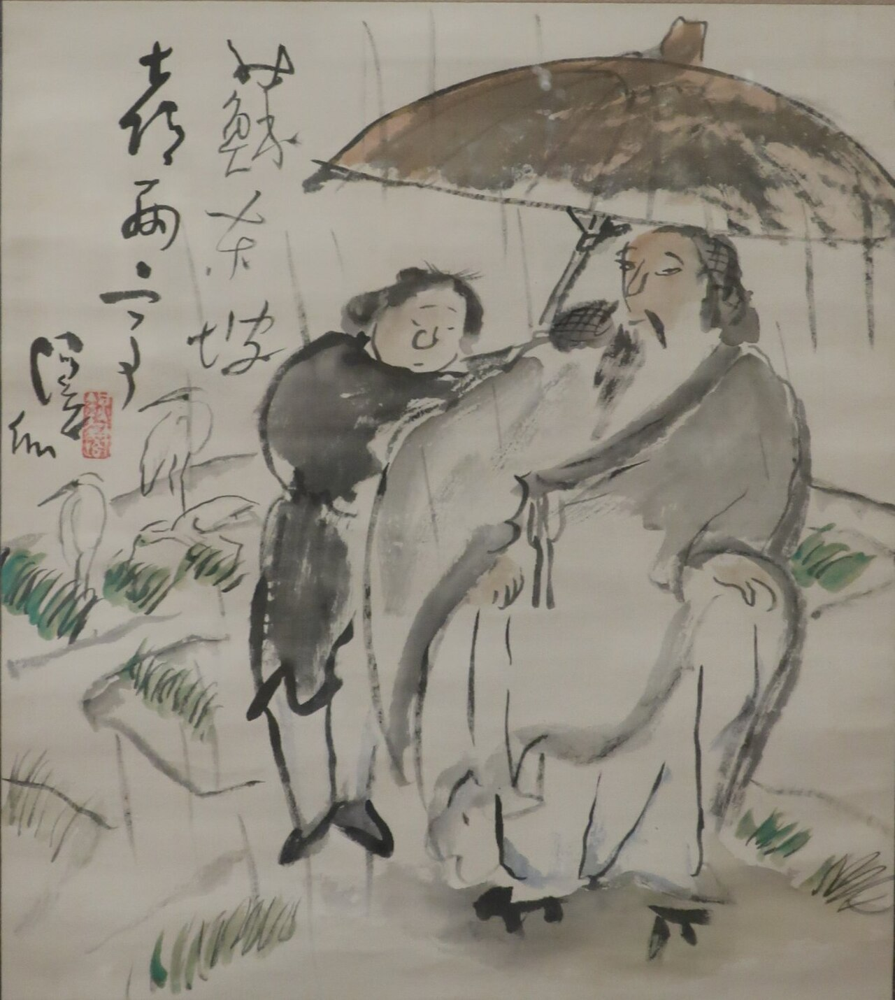

# 临江仙·夜饮东坡：一扇敲不开的门，一条听得见的江

这首词有一个很小的戏剧现场：苏轼在东坡喝了一夜，醉而复醒，醒而复醉，回到临皋时已经三更；家童睡得鼾声如雷，敲门没人应；他只好拄着拐杖，站在江边听水声。全词就从这扇敲不开的门开始。门没有开，人没有进去，但江声进来了。苏轼后来的所有感慨，都建立在这个“进不去”的瞬间。

图：日本画家富田溪仙绘苏轼像；此图不是苏轼在东坡夜饮的实景，也不是《临江仙》手稿。图片：Tomita Keisen，Public domain，via Wikimedia Commons（[原图页面](https://commons.wikimedia.org/wiki/File:%27Su_Dongpo%27_by_Tomita_Keisen,_Honolulu_Museum_of_Art_13215.1.JPG)）。

> **先给结论**
> **一句话：** 这页判断临江仙·夜饮东坡：一扇敲不开的门，一条听得见的江为什么值得读，以及怎么放回诗酒语境。
>
> - **适合谁：** 想把临江仙·夜饮东坡：一扇敲不开的门，一条听得见的江放回诗酒语境里读、而不只是背名句的人。
> - **不适合谁：** 只背考点或只看一句名句、不想了解语境的人。
> - **先看这两点：**
>   - “临江仙”是词牌名，原为唐教坊曲，后来成为常用词牌。
>   - 夜饮东坡醒复醉，归来仿佛三更。

## 题解与文本

“临江仙”是词牌名，原为唐教坊曲，后来成为常用词牌。这首词的题目在不同版本里写作“夜饮东坡醒复醉”或“夜归临皋”。“东坡”是苏轼在黄州垦辟的游息之地，在黄州城东；“临皋”是他在江边的寓所。两个地名把整首词的空间固定住了：喝酒的地方在东边，回家的地方在江边，中间是一段醉后的夜路。

“夜饮东坡醒复醉”一句，既是叙事，也是状态。醒复醉不是“喝了一夜”的概括，而是反复：醒了又喝，喝了又醒。它不是线性的，而是循环的。正因为循环，时间感才模糊，“归来仿佛三更”的“仿佛”才有了着落：他不是看钟，而是凭感觉。

## 正文

> 夜饮东坡醒复醉，归来仿佛三更。家童鼻息已雷鸣。敲门都不应，倚杖听江声。
>
> 长恨此身非我有，何时忘却营营？夜阑风静縠纹平。小舟从此逝，江海寄余生。

以上为通行本文字。“归来仿佛三更”一作“归来仿佛已三更”；“倚杖听江声”一作“倚帐听江声”；“寄余生”一作“寄馀生”。

## 逐段读

上片是动作。夜饮东坡，醒复醉，归来仿佛三更。三个短句，把地点、状态、时间交代完。接着镜头转到门口：家童鼻息已雷鸣。这是一个很生活化的细节，也是一个很残酷的细节：屋里的人睡得正香，外面的人进不去。敲门都不应，五个字，没有情绪，只有事实。然后“倚杖听江声”，把身体从门口移到江边。拐杖说明他站了很久，也说明他不再敲了。

下片是心事。长恨此身非我有，何时忘却营营？这两句从具体的门口跳到抽象的自我。此身非我有，不是说自己不存在，而是说这个身体不由自己支配：它被官职、责任、别人的期待、甚至被贬谪的命运推着走。营营是忙碌、周旋、钻营的意思；他问的不是“我什么时候能升官”，而是“我什么时候能不再为这些事忙碌”。

接着“夜阑风静縠纹平”，又把抽象拉回景物。夜将尽，风停了，水面像细纱一样平。这个“平”字很重要：它不是心情平静，而是江面平静；正因为江面平，他才看得见远处，也才想得到“小舟”。最后“小舟从此逝，江海寄余生”，是一句愿望，不是一个行动计划。小舟从这里消失，把余生寄放在江海。它不是“我明天就坐船走”，而是“如果有一艘船，我想这样”。

## 门、江声与自我

这首词的核心意象是“门”和“江”。门是界限：里面有家童，有睡眠，有日常；外面有醉汉，有夜路，有进不去的人。江是通道：它没有门，声音从远处来，水面一直延伸。苏轼被门挡住，却听见了江。这个转折很关键：当社会的门不开时，自然的江还在。

“此身非我有”是全词最重的一句。它常被解释为道家式的“忘我”，但在黄州的语境里，它首先是一个政治感受。苏轼因为“乌台诗案”被贬黄州，身份从朝廷官员变成团练副使、本州安置，行动与言论都受限制。他的身体还在，但这个身体要听命于贬谪制度，不由自己安排。所以“非我有”不是玄学，而是很具体的失权感。

“营营”则把这种失权感指向日常。人为什么要营营？为了升迁、为了不被排挤、为了家人的生活、为了名声。苏轼不是不知道这些，他只是累了。他想“忘却营营”，但“何时”二字说明他知道自己忘不掉。整首词没有给出答案，只给出一个愿望。这个愿望越是轻，前面的“长恨”就越重。

“小舟从此逝”也常被误读为苏轼真的想隐居。它当然有隐居的意味，但更像一个文学出口：门进不去，船可以走；路被堵住，江可以通。小舟不是交通工具，是一个“如果”的载体。它把“此身非我有”的困境，暂时放进一幅江海图里。词结束在“寄余生”三个字上，余生还没有发生，所以它仍然是愿望。

酒在这首词里也有位置，但不是主角。夜饮是起因，醉是状态，醒复醉是节奏；真正推动词的是“敲门都不应”。酒让苏轼走到门口，门让他停下来，江声让他转向上片下片之间的内心。没有酒，他可能不会在三更回家；没有门，他可能不会听见江声。酒是引子，门是转折，江是出口。

## 黄州语境

苏轼于元丰三年（1080）被贬黄州，元丰七年（1084）离开，前后约五年。黄州时期是他文学创作的高峰之一，《赤壁赋》《念奴娇·赤壁怀古》《定风波》等都写于此。他在城东开垦荒地，自号“东坡居士”，又筑雪堂；临皋亭则是他在江边的住处。这些地点不是背景板，它们决定了词里的空间感：东坡是劳动的、朋友的、酒的地方；临皋是家的、江的、夜的地方。

黄州时期的苏轼，政治上被边缘化，生活上也不宽裕。他不是在西湖边做官，而是在贬所里种地、建房、与当地人来往。这种生活让他的词有了更多日常细节：家童的鼾声、敲门的不应、江面的波纹。这些细节不是文人想象，而是他真的经历过。也正因为真的经历过，词里的“此身非我有”才不显得空。

需要说明，这首词的具体写作年份有不同说法，常见系于元丰五年（1082）左右。词中的“夜饮东坡”不一定是一次特定的宴会，也可能是多次夜饮经验的提炼。读词不必把它当成日记，但也不能把它完全抽象化；黄州的地名、临皋的江声，都是实有的。

## 常见误读

第一，把“小舟从此逝”当成苏轼真的乘船走了。词写的是愿望，不是行程；他第二天还在黄州。第二，把“此身非我有”当成纯粹的哲学命题。它首先是贬谪制度下的失权感，然后才是道家的“忘我”。第三，把“营营”当成对所有人的批评。它更像自嘲：苏轼知道自己也在营营，只是累了。第四，把“倚杖听江声”当成悠闲。拐杖、夜深、进不了门，这些细节都不悠闲；听江声是被迫的停留。第五，把这首词和《念奴娇·赤壁怀古》当成同一时期的同一种情绪。《念奴娇》是历史与自我的对话，《临江仙》是门与江的对话，两者不能互相替代。

还有一个版本细节：“倚杖”一作“倚帐”。如果是“倚帐”，画面更像在屋里靠帐听江；如果是“倚杖”，画面更像在门外拄杖站着。两者都通，但“倚杖”与“敲门都不应”的动作更连贯：敲了门，没人应，只好拄杖站在江边。读异文时，要看它和前后动作是否接得上。

## 相关条目

- [苏轼《水调歌头》](ref:shuidiao)：另一首把酒问月、把思念放进宇宙尺度的词。
- [苏轼《念奴娇·赤壁怀古》](ref:niannujiao)：黄州时期的历史与自我对话。
- [李白《月下独酌》](ref:drinking-alone)：另一首把孤独写成一场聚会的诗。
- [黄酒](ref:yellow-wine)：临江仙·夜饮东坡：一扇敲不开的门，一条听得见的江的谷物、曲种与宋代酒谱入口。
- [一杯酒里的时间](ref:time-in-a-cup)：临江仙·夜饮东坡：一扇敲不开的门，一条听得见的江所处的节令、宴集与写作背景。

相关条目：[水调歌头：苏轼中秋把酒问月](ref:shuidiao)、[念奴娇·赤壁怀古：苏轼在黄州把酒酹江月](ref:niannujiao)、[月下独酌：李白的一壶酒与三个影子](ref:drinking-alone)。
