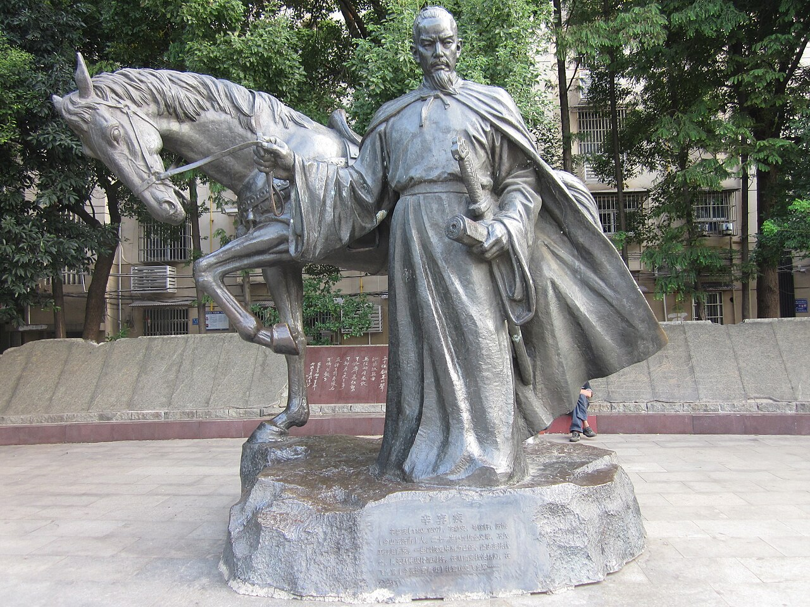

# 西江月·遣兴：醉里推松，是笑话也是脾气

《西江月·遣兴》读起来像一则笑话：一个人喝醉了，倒在松树边，问松树“我醉得怎么样”，又疑心松树要来扶他，于是一把推开，说“去”。整首词只有五十字，动作却完整：笑、愁、读书、醉倒、问松、推松。辛弃疾把一场醉写成了一出小戏。但笑完之后会发现，这个“去”字推开的不是松树，而是他推不开的现实。

图：辛弃疾塑像；此像为现代纪念性雕塑，不是宋代画像，也不是《西江月》手稿。图片：Lei Yixin / Nie Shihua / Xiao Xiaoqiu，CC BY 3.0，via Wikimedia Commons（[原图页面](https://commons.wikimedia.org/wiki/File:The_statue_of_Xin_Qiji.JPG)）。

> **先给结论**
> **一句话：** 这页判断西江月·遣兴：醉里推松，是笑话也是脾气为什么值得读，以及怎么放回诗酒语境。
>
> - **适合谁：** 想把西江月·遣兴：醉里推松，是笑话也是脾气放回诗酒语境里读、而不只是背名句的人。
> - **不适合谁：** 只背考点或只看一句名句、不想了解语境的人。
> - **先看这两点：**
>   - “西江月”是词牌名，原为唐教坊曲，调名取自李白《苏台览古》“只今唯有西江月，曾照吴王宫里人”。
>   - 醉里且贪欢笑，要愁那得工夫。

## 题解与文本

“西江月”是词牌名，原为唐教坊曲，调名取自李白《苏台览古》“只今唯有西江月，曾照吴王宫里人”。“遣兴”是题目，意思是排遣兴致、抒发一时感触。这个题目很轻，像是随手写来；但辛弃疾的“遣兴”往往不轻，他越是用小令、俚语、笑话写，里面越可能藏着火气。

这首词的语言接近口语。“要愁那得工夫”“问松我醉何如”“以手推松曰去”，都不像传统词的语言，更像一个人在酒后的自言自语。辛弃疾不是不会雅，而是故意用俗。俗语让醉态更真，也让后面的愤激更突然：你先笑，笑到一半，发现他在骂。

## 正文

> 醉里且贪欢笑，要愁那得工夫。近来始觉古人书，信著全无是处。
>
> 昨夜松边醉倒，问松我醉何如。只疑松动要来扶，以手推松曰去。

以上为通行本文字。“信著全无是处”一作“信着全无是处”；“以手推松曰去”一作“以手推松曰‘去’”。

## 逐段读

上片第一句“醉里且贪欢笑”，一个“且”字很关键。且是“姑且”“暂且”，不是“尽情”。他不是真的没有愁，而是暂时把愁放下；他不是天生爱笑，而是用笑来挡愁。第二句“要愁那得工夫”接得更妙：不是没有愁，是忙得没工夫愁。忙什么？忙着喝酒，忙着笑，忙着把日子过下去。这种“忙”是自嘲，也是抵抗。

第三、四句突然转到读书。“近来始觉古人书，信著全无是处。”这不是反智，也不是否定一切知识。它化用《孟子·尽心下》“尽信书，则不如无书”的意思：如果完全相信古书上的话，倒不如没有书。辛弃疾不是在骂书，而是在骂那些把古书当成教条、用来压制异见的人。他一生主张北伐，却长期被主和派排挤；他读的古书讲忠义、讲恢复，现实却讲和议、讲苟安。书没有错，错的是书被谁用、怎么用。

下片是动作。昨夜松边醉倒，问松我醉何如。他把松树当成人，问它自己醉得怎么样。这是一个很可爱的动作，也是一个很孤独的动作：身边没有人可问，只好问树。接着“只疑松动要来扶，以手推松曰去”。他疑心松枝摇动是要来扶他，于是用手一推，说“去”。这一推，把松树推开了，也把“扶”推开了。他不想要人扶，不想承认自己需要扶。

“去”字是全词的词眼。它可以是对松树说的，也可以是对自己说的，对现实说的。辛弃疾推开的是一棵树，但他想推开的可能是主和派、是朝廷的苟安、是那些“古人书”的教条、是那个不得不闲居的自己。一个“去”字，既是醉话，也是脾气。

## 醉里的笑与骂

这首词的情感是双层的。表层是笑：醉里贪欢笑、问松、推松，都是喜剧动作。里层是骂：古人书全无是处，是对当时官方意识形态的愤激；推松曰去，是对“扶”的拒绝，也是对“被安排”的反抗。辛弃疾把骂藏在笑里，把火气藏在醉里，因为直接骂会惹祸，醉话可以装糊涂。

这种写法在南宋词里并不少见。辛弃疾的许多“遣兴”“漫兴”之作，表面写闲居、写山水、写酒，内里都有不平。他的豪放词常被拿来和苏东坡比，但两人不同：苏轼的旷达更多是对命运的消化，辛弃疾的旷达常常是对现实的硬撑。苏轼说“一蓑烟雨任平生”，辛弃疾说“以手推松曰去”；一个把风雨接住，一个把扶他的手推开。

酒在这首词里是“许可证”。醉了，才可以贪欢笑；醉了，才可以问松；醉了，才可以推松。酒让一个被罢黜的官员暂时可以不做“辛弃疾”，做一个在松树边胡说的人。但酒也是“遮羞布”：他的笑是勉强的，他的推是防卫的，他的醉话里句句是真。酒没有解决问题，只是让他把问题说成笑话。

从物质史看，宋代酒以谷物酒为主，酒度不高，饮法与今天不同。辛弃疾的“醉”不必按现代白酒的强度去理解；他喝的可能是黄酒一类的谷物酒，也可能是地方酿的米酒。酒器、酒肆、酒令的细节，和今天差别很大。把“醉里”读成“喝了很多高度酒”，会错过词里的清醒。[黄酒](ref:yellow-wine)的工艺谱系可以帮助理解宋代谷物酒，但不能直接等同。

## 松树、古书与晚年辛弃疾

辛弃疾写这首词时，通常被认为处于闲居状态。他一生力主抗金，曾组建飞虎军、上《美芹十论》《九议》，但南宋朝廷主和，他多次被罢官，长期闲居江西上饶、铅山一带。带湖、瓢泉、稼轩，都是他闲居时期的居所与别号。一个曾经带兵的人，被放在山林里，只能写词、喝酒、种地，这种落差是这首词的背景。

“松”在这个背景里不是随便选的树。松树在传统文化里象征坚贞、长寿、不改其节；辛弃疾号稼轩，晚年住在松林之间，松是他日常见到的景物。把松当人，是醉眼；推松说去，是脾气。松树不会真的来扶他，但他需要一个对象来拒绝。这个对象可以是松，也可以是朝廷，也可以是他自己。

“古人书”也不是泛泛而谈。辛弃疾读的书，包括经史、兵书、前代诗词；他一生以恢复为志，古书里的忠义、战略、兴亡，都是他的精神资源。但当这些书被主和派用来论证“不可战”时，书就变成了枷锁。所以他说“信著全无是处”，不是恨知识，而是恨知识被滥用。这个“全无是处”是气话，不能当作他的学术立场。

## 常见误读

第一，把这首词当成单纯的醉酒笑话。它有喜剧动作，但笑下面有愤激；“去”字不是玩笑的收尾，而是脾气的出口。第二，把“古人书全无是处”当成辛弃疾反智。他化用孟子，骂的是教条化的古书，不是一切学问。第三，把“推松”当成可爱的醉态。它当然可爱，但也可怜：一个需要扶的人，偏要把扶他的手推开。第四，把辛弃疾的闲居当成自愿归隐。他闲居是因为被排挤，不是因为看破红尘；他的山水词里常有不服。第五，把这首词和苏轼的旷达等同。苏轼的旷达更多是消化，辛弃疾的旷达更多是硬撑，两人的“醉”不一样。

还有一个形式上的细节：这首词用《西江月》的词牌，上下片各三句，节奏短促，适合写动作。辛弃疾没有用长调慢词来铺陈，而是用最短的篇幅写一个最快的动作——“推”。形式与内容在这里是合一的：越短，越有力；越口语，越像真的。

## 相关条目

- [辛弃疾](ref:xin-qiji)：人物页，补充他的抗金经历、飞虎军、罢官与闲居。
- [《破阵子·为陈同甫赋壮词以寄之》](ref:po-zhen-zi)：另一首写梦、写战场、写壮志难酬的词。
- [苏轼《念奴娇·赤壁怀古》](ref:niannujiao)：宋代豪放词里历史与自我的对话。
- [黄酒](ref:yellow-wine)：西江月·遣兴：醉里推松，是笑话也是脾气的谷物、曲种与宋代酒谱入口。
- [一杯酒里的时间](ref:time-in-a-cup)：西江月·遣兴：醉里推松，是笑话也是脾气所处的节令、宴集与写作背景。

相关条目：[辛弃疾](ref:xin-qiji)、[破阵子：辛弃疾醉里挑灯看剑的一场梦](ref:po-zhen-zi)。
