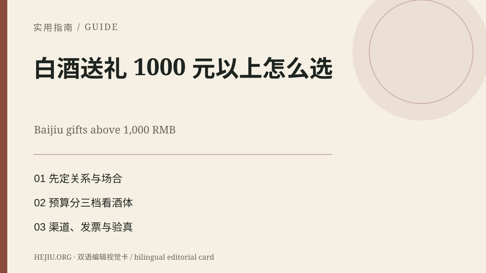

# Baijiu gifts above 1,000 RMB

A baijiu gift above 1,000 RMB is no longer just “a good bottle”. The recipient will place it in a setting: a business dinner, an elder's birthday, a wedding, a collection, or an important relationship. The higher the price, the clearer you need to be about who receives it, why, and whether they drink. Otherwise the budget goes into packaging, stories or channel premiums.

Figure: Baijiu gifts above 1,000 RMB, a project-made bilingual editorial card. It identifies the topic; it is not an on-site photograph.

> **Bottom line**
> **For:** anyone spending above 1,000 RMB on a presentable, traceable baijiu for business, elders, a wedding or a collection.
> **Not for:** people who only want “the most expensive bottle” and will not check the channel or invoice; nor for anyone treating a gift as an investment.
> **Three checks:** relationship and occasion first, then aroma and strength, then packaging. In the four-figure band, prefer a brand's main line or flagship over “internal supply” with no source.

## Relationship first, price band second

The relationship decides whether the recipient should recognise the brand at a glance. In business, elder birthdays and weddings, recognition and a complete box matter. For a friend who knows baijiu, a scarce batch, a single-estate high-end release or a regional distillery's best bottle may be more interesting than a famous name. Ask: will they drink it? Any dietary or alcohol restrictions? Do they already have this bottle?

The occasion decides how many people will share it and when. A wedding or banquet usually needs several bottles of the same wine, so budget by table, not by one bottle. An elder drinking at home cares more about softness, strength and how it feels the next day. A collector cares about batch, age proof and storage. Write these three facts down and the price band narrows quickly.

## The three budget bands above 1,000 RMB

| Budget | Best for | Look for | Avoid |
| --- | --- | --- | --- |
| 1,000–2000 RMB | important dinners, elder gifts | a brand's main line, complete box, invoice | “aged original liquor” with no standard or producer |
| 2000–5,000 RMB | business, wedding main table | brand flagship, limited batch, paired boxes | “special supply” or “internal” bottles from unauthorised shops |
| Above 5,000 RMB | top-level gifts, collections | scarce batch, age and provenance documents, professional packing | auction bottles or “story wine” with no provenance |

A price band is not a quality grade. One brand may have different product lines, strengths and packaging at different prices; identify the exact product before comparing price. The common mistake in the four-figure band is paying for a brand name while receiving an entry product.

## Spend on the liquid, not the box

A gift box has a job: it makes the present complete, easy to carry and visibly thoughtful. But the box is not the wine. For a bottle above 1,000 RMB, read the producer, aroma family, strength, volume, raw materials and execution standard on the label; then inspect the bottle finish, seal, batch and anti-counterfeit mark. Be cautious when the box is huge, the bottle is small, or the packaging costs more than the wine.

On a limited budget, put the liquid first: a brand's main line with clear strength and a traceable batch. Packaging can be arranged later, but do not buy an elaborate box from an unclear channel. Keep the invoice and purchase record; it helps with after-sales service and explains the source if the recipient asks.

## Reading age, strength and batch

“Age” has at least three meanings in baijiu: a year on the label, a distillery's historical narrative, and the time a base liquor spent in storage. They are not the same thing and do not automatically equal quality. When you see “aged original liquor”, “cave-aged” or “cellar-aged”, look for the execution standard, production licence, batch and producer. Without them, treat the words as marketing and do not pay thousands extra.

Around 50% ABV is common for many traditional products, but lower-strength products also have their own texture goals. High strength carries more aroma and more burn; low strength is softer but can taste watery. Consider the recipient's habits rather than “higher strength is more valuable”. Batch matters for consistency: the same product can vary slightly between batches, so note the batch for a collection or an important occasion.

## Channel and authenticity

Above 1,000 RMB, the channel matters more than the price. Prefer the brand's official flagship store, authorised distributors, large supermarkets and licensed alcohol shops that issue invoices. Do not trust “internal channel”, “special supply” or “leadership wine”. On arrival, check the seal, ink code, anti-counterfeit mark and bottle finish, then verify through the brand's official system. If the price is far below the market, walk away.

For a gift sent to another city, confirm the carrier's alcohol restrictions, insurance and damage policy. Bottles are fragile: packing must resist pressure, and summer heat or winter cold can affect flavour. Use a trackable service and remind the recipient to stand the bottle upright and keep it dark.

## Frequently asked questions

### Does a gift above 1,000 RMB have to be Moutai?

No. Moutai is highly recognisable, but the occasion, budget and recipient's preference matter more. For business, a brand's main line can work; a friend who knows baijiu may prefer a sauce-aroma single estate or a regional distillery's high-end release at the same price; an elder drinking at home does not need the most expensive bottle. Relationship first, brand second.

### Is older always more valuable?

No. The value of old baijiu depends on authenticity, storage, batch scarcity and market demand. An ordinary bottle does not necessarily appreciate; leakage, sunlight or a damaged seal can reduce value. For a gift, choose a traceable batch the recipient will actually drink rather than chasing “old”.

### Is a bigger box more impressive?

No. The box delivers completeness and convenience, not proof of quality. Read the label and the liquid first, then the box. If the packaging clearly crowds out the budget, or the bottle information is incomplete, choose a simpler box with a clear source. A handwritten card is more useful than another layer of packaging.

> **Continue:** Start with [baijiu](ref:baijiu) for the category, then compare [sauce aroma](ref:sauce) and [strong aroma](ref:strong); for a 300–800 RMB budget, return to the [mid-range gift guide](ref:gift300). For packaging and shipping, read [alcohol gift boxes](ref:box); for a first drink, follow the [beginner guide](ref:first). For specific products, read [Moutai](ref:moutai) and [Wuliangye](ref:wuliangye).
