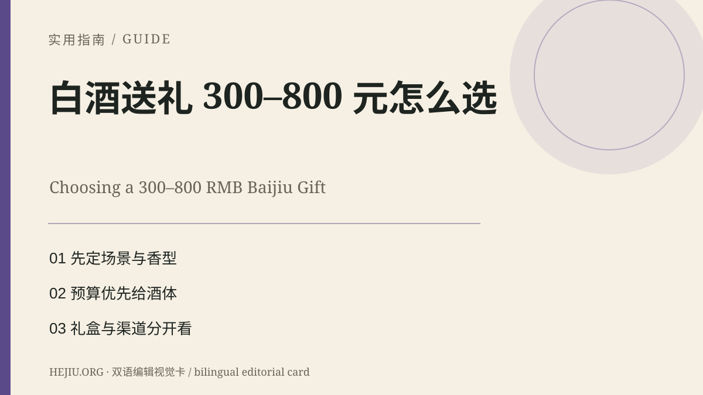

# Choosing a 300–800 RMB Baijiu Gift

300–800 RMB is the busiest baijiu gift band: major-brand core products, upgraded regional bottlings and gift boxes that spend the budget on packaging. There is no single correct bottle, only one that fits the recipient. Ask who drinks, on what occasion and how many will share it before choosing aroma, strength and size; a box only helps when presentation is part of the job.

图：300–800 RMB baijiu gift bilingual editorial card。Project-created bilingual editorial card for topic identification, not a documentary photograph.

> **Quick verdict**
> **Best for:** buyers who need a presentable, drinkable, traceable bottle in the mid-range.
> **Not for:** those who treat price as the only criterion or want an empty-looking box.
> **One line:** fix aroma and size first, then channel; the box should take only a small part of the budget.

## Occasion before brand

Occasion decides everything: business exchange needs something recognisable and presentable; family dinners need something drinkable that does not fight the food; older relatives drinking at home need something smooth rather than aggressive; friends can take an interesting niche aroma. At 300–800 RMB you can buy a major brand’s core product or a regional distillery’s upgraded bottling. Write down who drinks, how many share and when it will be opened before choosing one bottle or two, with or without a box. Do not let advertising decide and end with a bottle nobody opens.

## 300–500 RMB: spend on the liquor

In this band, prefer a major distillery’s core product or a regional producer’s age/grade bottling. Check the standard, strength, volume and production date. For strong aroma, look at pit aroma and sweetness; for light aroma, cleanliness and a clean finish; for sauce aroma, sauce and roasted notes and an empty-cup fragrance. Do not rely on the word “aged”. If the recipient usually drinks 42–52% abv, choose the same or slightly lower, not suddenly 60%+. Two-bottle sets are common, but first check whether they already own the same bottle; a different aroma is better than a duplicate.

## 500–800 RMB: box and brand premium

At 500–800 RMB, gift boxes and brand premium become visible. Judge in order: liquor, size, packaging, channel. Confirm whether the bottle is the brand’s core or commemorative release, then whether it is single, double or comes with accessories, and finally whether the box is excessive. Business settings can accept a moderate box, but do not treat “big box, small bottle” as value. For regional famous wines, ask origin, standard and batch; for development or licensed products, check the actual producer and authorisation rather than the trademark alone.

## Aroma and the recipient’s taste

Strong aroma has broad banquet acceptance; light aroma is clean and suits people who rarely drink high-strength spirits; sauce aroma is heavy and suits those who already like it; rice, phoenix and other regional aromas fit local tastes. Do not send sauce aroma to everyone because it is fashionable: people who dislike it read it as burnt and bitter. 52% is a common high-strength bottling, 42% is easier, and below 38% needs confirmation that the recipient accepts “low strength”. When unsure, a major-brand core bottle at moderate strength in a two-bottle set has the highest margin of error.

## Channel and verification

Prefer official flagship stores, brand direct shops, large supermarkets and authorised dealers; keep invoices, order screenshots and batch information. Deep discounts, private transfers and “internal liquor” sold only on social platforms should be downgraded. On receipt, check seals, codes, anti-counterfeit marks and packaging consistency. Photograph the batch before opening and smell for obvious off-notes after opening. Do not put the invoice in the gift box, but keep it yourself; if the recipient may regift, remind them to keep source information.

## A workable gift checklist

Write four lines first: what aroma the recipient drinks, what strength they accept, how many will share and whether a box is needed. Then split the budget: 300–500 RMB for a major core product or regional upgrade; 500–800 RMB only pay for the box after the liquor is confirmed. Check channel and batch, and keep the invoice. If completely unsure, choose a mainstream aroma at 42–52%, a two-bottle set and a traceable official product; that beats chasing a niche concept.

## Check before you go

- Confirm the recipient’s aroma preference
- Confirm acceptable strength
- Note how many will share it
- Keep the box a small part of the budget
- Check standard and batch
- Prefer official or authorised channels
- Keep invoice and order record
- Do not buy unclear “internal” liquor

## Limits and next steps

The 300–800 yuan band is not a "the more expensive, the safer" zone. Gift-box premium, channel markup and the actual cost of the liquid pull against one another. A single distillery may offer a bare bottle, a two-bottle presentation box and a "vintage" concept at the same price; the more elaborate the packaging, the smaller the share that usually reaches the wine itself. Decide first whether the recipient will drink it or display it, then decide how much of the budget should go to the box.

Before sending, check three things: the production or bottling date, the standard and aroma-type declaration, and whether the sales channel is traceable. "Special supply", "internal supply" and "commemorative" labels in a big e-commerce promotion do not create scarcity; they often lack a stable price anchor. If the recipient normally drinks light-aroma or rice-aroma baijiu, a heavily packaged strong-aroma bottle will sit unopened no matter how sensible the budget was.

In summer, avoid hot delivery vans and long waits at a package station. Ask whether the courier insures liquids and whether inter-provincial shipping is allowed; when the box arrives, check the cap and inner liner for movement. Keep the invoice or order screenshot: it helps with after-sales service and saves the recipient from having to explain the source when re-gifting.

Finally, do not spend the whole budget on the bottle. For someone who rarely drinks baijiu, a suitable glass, a handwritten card or a shared tasting session is usually more memorable than another two hundred yuan spent on the liquid.

## What else to watch

Match the aroma type to the recipient's daily taste. Sauce aroma is rich and long, suited to habitual drinkers; strong aroma has pronounced pit character and broad appeal; light aroma is clean and suits lighter meals; rice aroma is soft and suits lower strength. Write the aroma on the card; it is more thoughtful than a price and saves explanations when re-gifting.

Packaging waste matters too. Elaborate boxes usually end in the bin; for a minimalist recipient, reusable glassware or simpler packaging is better. Corporate gifting should also confirm whether the recipient may accept gifts, to avoid compliance risk.

## References

- National standards open system — GB/T 15109-2021 Terminology for baijiu industry — https://openstd.samr.gov.cn/bzgk/std/newGbInfo?hcno=D2F1ED3F0BAA0EBE99AEE34293C0BC43 (State Administration for Market Regulation and Standardization Administration of China, checked 2026-11-25)
- National standards open system — GB/T 17204-2021 Terminology and classification of alcoholic beverages — https://openstd.samr.gov.cn/bzgk/std/newGbInfo?hcno=B8F9CD37320835EEF17458CBA5962881 (State Administration for Market Regulation and Standardization Administration of China, checked 2026-11-25)
- China Alcoholic Drinks Association — https://www.cada.cn/ (China Alcoholic Drinks Association, checked 2026-11-25)
- The Oxford Companion to Spirits and Cocktails — https://global.oup.com/academic/product/the-oxford-companion-to-spirits-and-cocktails-9780199311132 (Oxford University Press, checked 2026-11-25)

Related entries: [baijiu](ref:baijiu), [strong-aroma baijiu](ref:strong), [First baijiu guide](ref:first), [Liquor gift-box guide](ref:box), [First tasting guide](ref:tasting), [China](ref:region), [Wuliangye](ref:brand), [History of Chinese wine](ref:history).
