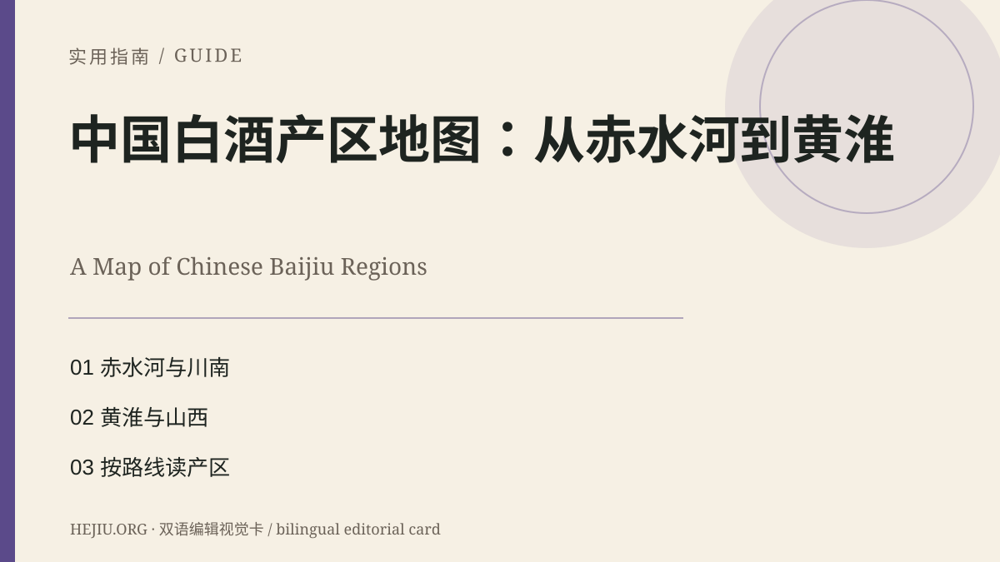

# A Map of Chinese Baijiu Regions

Baijiu regions are not administrative boundaries but long-run combinations of water, grain, climate, technique and market. The Chishui valley’s sauce aroma, Yibin–Luzhou’s strong aroma, Mianzhu’s Jiannanchun, Gulin and Xishui’s valley sauce aroma, Suqian’s soft strong aroma, Fenyang’s light aroma and Bozhou’s Gujinggong each have clear geographic clues. Read the map, then the technique, then connect the dots with routes.

图：Chinese baijiu regions bilingual editorial map card。Project-created bilingual editorial card for topic identification, not a documentary photograph.

> **Quick verdict**
> **Best for:** drinkers who want to understand baijiu by region or plan a regional route.
> **Not for:** those who treat “region” as a quality guarantee without checking the distillery and batch.
> **One line:** read water and grain, then technique and aroma, then verify on a route.

## Chishui River: a valley sauce-aroma belt

The Chishui River runs from Yunnan through Guizhou into Sichuan. Its deep valley, high humidity and hot summers suit high-temperature qu-making, stacking and multi-round fermentation. Moutai, Langjiu, Xijiu and others sit on both banks, creating differences of elevation and microclimate within one basin. Do not reduce the map to “Maotai town”: upstream, downstream, altitude, water source and plant layout all change the liquor.

## Yibin–Luzhou: the southern Sichuan strong-aroma corridor

Yibin and Luzhou sit on the upper Yangtze with river transport, grain and pit resources concentrated. Strong-aroma techniques—mud pits, continued grain and multi- or single-grain recipes—developed here over centuries. Wuliangye’s multi-grain, multi-pit approach and Luzhou Laojiao’s mud-pit continued grain are two representative paths. The cities are close, but style, pit age and grain ratios differ; a route should separate the distillery, museum and old pits.

## Mianzhu, Gulin and Xishui: valley and mountain variants

Mianzhu sits at the edge of the Chengdu Plain, where Jiannanchun’s Tianyi Laohao workshop and glacier-fed water are geographic clues. Gulin lies mid-Chishui, where Langjiu Estate and Erlang Town turn valley sauce aroma into a visitable space. Xishui is downstream, where Xijiu’s plant and Tucheng town connect brewing with river-transport history. Each combines water, grain, cave or pit and town into a route, not an isolated factory.

## Suqian, Fenyang, Bozhou: three northern answers

Suqian lies between Hongze Lake and the Huai River; its soft strong aroma emphasises lower strength, smoothness and banquet use. Fenyang sits in the Fen River valley, where light aroma uses separated earthen-jar fermentation and clean steaming for a fresh, clean style. Bozhou is on the Huaibei Plain, where Gujinggong links Ming–Qing pits and the “nine-ninth method” narrative to strong aroma. Climate, grain and drinking habits differ; do not apply southern Sichuan standards.

## How to read a baijiu map

Read water and terrain first: rivers shape transport, water source and microclimate. Then grain and qu: sorghum, wheat, rice and corn ratios shape flavour. Then pits, earthen jars or stone cellars and fermentation rounds. Finally distillery distribution and visitor access. Label “region” and “distillery” separately; do not let one town stand for a whole basin. Map distance is not drive time; mountain routes need real roads and schedules.

## Connect eight routes into one map

The southern Sichuan line covers Yibin and Luzhou; the Chishui line covers Gulin and Xishui; the northern Sichuan line covers Mianzhu; the Huang-Huai line covers Suqian and Bozhou; the Shanxi line covers Fenyang. For each, read water and grain first, then distillery and pits, and verify with a glass. Do not try all eight at once; choose one basin and follow the river or plain to see why one region differs.

## Check before you go

- Read water and terrain
- Then grain and qu
- Separate region from distillery
- Choose a route by basin
- Do not equate a town with a region
- Check real drive time and schedules
- Leave one comparative tasting per stop
- Verify the map with a glass

## Limits and next steps

A production-region map is not a set of distilleries pinned by latitude and longitude. It layers rivers, grain, climate, fermentation pits and transport together. The sauce-aroma belt of the Chishui valley depends on humid river air and long storage; the southern Sichuan belt around Yibin, Luzhou and Mianzhu is known for strong aroma and multi-grain processes; Xinghua village in Fenyang represents the ground-pit fermentation of light aroma; Gujing town in Bozhou sits on the Huanghuai plain, where strong aroma meets the old medicinal trade routes. Only by joining these points can you see why the same aroma type tastes different from town to town.

A "region" on the map is not the same as a brand. One town may host several distilleries sharing a microclimate, while only one company may open a visitor site; a "core region" label does not mean every bottle comes from a core plot. When reading a label, check the production and bottling addresses first, then the raw materials and process description. Do not turn an administrative place name into a quality grade.

When linking the eight routes into an itinerary, choose transport over fame. Mountain roads on both sides of the Chishui take far longer than map distance suggests; Yibin–Luzhou–Gulin deserves two or three days, Mianzhu can be a day trip from Chengdu or Deyang, and Suqian, Fenyang and Bozhou work better as separate lines. Trying to string three or four routes together usually leaves nothing but driving.

The map also has limits: it does not cover every small distillery, nor every relic in each county. For a serious study trip, define the aroma and process questions first, then choose sites by those questions rather than by a checklist of pins.

## What else to watch

Climate and water are changing the regions. Year-to-year differences in Chishui flow, temperature and rainfall affect fermentation and pit management; winter heating and summer heat in northern regions change storage conditions. The lines on the map overlay administration and craft; they are not fixed natural boundaries.

Geographical indications and protected regions need separating. Some regions carry a collective mark or GI protection, others are only an industry habit; when you see "core region" or "place of origin", check the body and certification number behind it. Do not treat a tourist map slogan as a legal appellation.

## References

- National standards open system — GB/T 15109-2021 Terminology for baijiu industry — https://openstd.samr.gov.cn/bzgk/std/newGbInfo?hcno=D2F1ED3F0BAA0EBE99AEE34293C0BC43 (State Administration for Market Regulation and Standardization Administration of China, checked 2026-11-25)
- National standards open system — GB/T 17204-2021 Terminology and classification of alcoholic beverages — https://openstd.samr.gov.cn/bzgk/std/newGbInfo?hcno=B8F9CD37320835EEF17458CBA5962881 (State Administration for Market Regulation and Standardization Administration of China, checked 2026-11-25)
- China Alcoholic Drinks Association — https://www.cada.cn/ (China Alcoholic Drinks Association, checked 2026-11-25)
- The Oxford Companion to Spirits and Cocktails — https://global.oup.com/academic/product/the-oxford-companion-to-spirits-and-cocktails-9780199311132 (Oxford University Press, checked 2026-11-25)

Related entries: [Yibin Wuliangye route](ref:yibin), [Luzhou Laojiao route](ref:luzhou), [Mianzhu Jiannanchun route](ref:mianzhu), [Gulin Langjiu route](ref:gulin), [Xishui Xijiu route](ref:xishui), [Suqian Yanghe route](ref:suqian), [Fenyang Fenjiu route](ref:fenyang), [Bozhou Gujing route](ref:bozhou).
