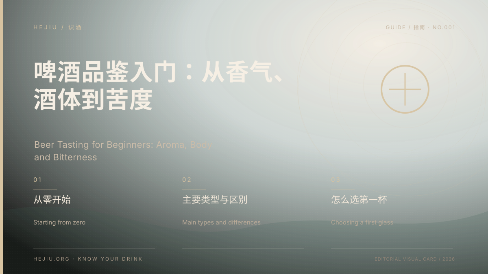

# Beer Tasting for Beginners: Aroma, Body and Bitterness

Beer is often treated as a thirst-quencher, but like wine and whisky it has raw materials, fermentation, aroma and structure. Tasting is not pretence; it is breaking a glass into comparable variables: aroma, appearance, sweetness, bitterness, body, carbonation and finish. Learn to describe first, then talk about liking and disliking.

Figure: thematic illustration for Beer Tasting for Beginners: Aroma, Body and Bitterness. Image: AI-assisted illustration generated with Doubao Seedream 5.0 (project-owned); not a photograph of the subject.

> **Decision checklist**
> Run these three checks before you buy or go.
>
> - **Starting from zero:** Beer's basic ingredients are water, malt, hops and yeast.
> - **Main types and differences:** Lager is a broad family; pilsner is a common pale type, golden with moderate bitterness and a clean finish; pale lager is lighter and suited to everyday drinking; amber and dark lagers bring.
> - **Choosing a first glass:** Start with a pilsner or pale lager: clean aroma, moderate bitterness, usually friendly prices, and an easy way to establish that beer can have layers.

## Starting from zero

Beer's basic ingredients are water, malt, hops and yeast. Malt provides sugar and colour, hops provide bitterness and aroma, yeast decides the direction of fermentation and flavour, and water affects texture and minerality. Some styles add wheat, maize, oats, spices or fruit, but the basic framework is still these four.

Fermentation broadly divides into two families: lager ferments at lower temperatures and usually gives a clean, fresh profile; ale ferments at higher temperatures and is often richer and more fruity. This division is about direction, not quality. Understanding it stops "lager" from becoming a synonym for "bland beer".

The usual tasting order is: look at colour and foam, then smell, then taste. On the palate, notice sweetness, bitterness, acidity, body, carbonation and finish. Write down one or two key words for each step; that is more useful than piling up adjectives.

## Main types and differences

Lager is a broad family; [pilsner](ref:pilsner) is a common pale type, golden with moderate bitterness and a clean finish; pale lager is lighter and suited to everyday drinking; amber and dark lagers bring malt sweetness and toasted notes.

[IPA](ref:ipa) is known for hop aroma and bitterness, from crisp pale IPAs to heavy double IPAs; bitterness and aroma are not the same thing, and a beer can be very aromatic without being extremely bitter. Stout and porter feature roasted malt, coffee and chocolate notes, usually with a fuller body.

Wheat beer often shows bread, banana and clove-like yeast notes with a soft texture; sour beer uses lactic or acetic fermentation for acidity, from refreshing to intense. These are style directions, not fixed recipes; the same style can be expressed differently in different regions.

## Choosing a first glass

Start with a pilsner or pale lager: clean aroma, moderate bitterness, usually friendly prices, and an easy way to establish that beer can have layers. If you like fruit and hops, try a pale ale or IPA; if you like coffee and chocolate, try a stout.

Look at freshness first. Hop aroma fades with time, so check the production or best-before date and prefer chilled, dark, fast-moving channels. Do not judge by packaging or the word "craft" alone; style, date and storage matter more than the label.

There is no need to buy many styles at once. Choose two or three different types, pour small amounts, and compare as you drink. Recording aroma, bitterness and body is more useful than deciding which bottle is "best".

## How to drink and what to use

Pour with the glass tilted, letting the beer run down the side, then straighten the glass at the end to form a moderate head. Foam is not a defect: it locks in aroma and softens the entry. Do not pour to the rim just to eliminate the foam.

Adjust temperature by style: lager and pilsner about 3–6°C, wheat beer and pale ale about 6–8°C, IPA and amber beer about 8–12°C, stout and strong beer closer to room temperature. Over-chilling closes the aroma; over-warming pushes alcohol and bitterness forward.

Glassware affects aroma. Tulip and narrowed glasses suit IPA and aromatic beer; straight or highball glasses suit lager; do not use an ice-cold glass, because condensation dilutes the beer and destabilises the foam. Pour about 150–300 millilitres per glass and drink slowly rather than filling it once.

## Price and buying

Beer prices depend on raw materials, process, scale, brand, imports and channel; check local market and official channels for current prices. For everyday drinking, choose fresh, well-stored basic beers; to explore a special style, buy a small bottle or single bottle first and repurchase only if you like it.

When buying, check the production date, storage temperature and bottle condition. Beer dislikes heat, light and prolonged vibration; clear or pale bottles are more vulnerable to light. Store it somewhere cool at home, not on a balcony or in a car boot for long periods. Drink an opened bottle soon; carbonation and aroma fade quickly.

## Common misconceptions

First, that darker means more bitter and stronger. Colour comes from malt roasting, bitterness from hops and alcohol from malt sugar; they are separate variables. Second, that a higher IBU is better. Bitterness is a style choice; a high IBU does not mean higher quality or better aroma.

Third, that more foam is better or that foam is a defect. Moderate foam helps aroma and texture; too much or too little usually points to pouring technique or glass condition. Fourth, that colder beer is always better. Over-chilling closes the aroma and dulls both malt sweetness and hop aroma.

Fifth, that all lagers are bland. Lager is a broad family with styles from crisp to rich. Sixth, that "craft" is always better. Craft is a label about scale and process, not a quality guarantee; freshness, storage and style match matter more.

## A path forward

First, fix on two or three basic styles and practise describing aroma, bitterness and body. Second, compare different products in the same style, noting raw material, origin and freshness. Third, try wheat beer, sour beer and stout to build your own preference map.

Fourth, learn to read labels: style, alcohol content, bitterness, ingredients and production date. Fifth, keep tasting notes: colour, foam, aroma, sweetness, bitterness, body, carbonation and finish. Sixth, return to pairing and match different beer styles with different foods to see how flavour changes. Progress is not drinking more but being able to explain the difference in each glass.

## See also

- [Beer](ref:beer): the basic production and classification of beer.
- [Lager](ref:lager): cool fermentation and fresh styles.
- [Pilsner](ref:pilsner): the classic pale lager type.
- [IPA](ref:ipa): hop aroma and bitterness.
- [Stout](ref:stout): dark malt and roasted flavour.
- [Bitterness](ref:ibu): IBU and the perception of bitterness.
- [Body](ref:body): body weight and mouthfeel.
- [Aroma](ref:aroma): the role of smell in tasting.

**Short definition:** Understand beer through raw materials, fermentation and style, then learn how to choose a first glass, how to pour and drink it, what glassware and temperature do, what prices and buying involve, and which tasting myths to drop.

For Beer Tasting for Beginners, begin with what it is, then where it comes from, and finish with how it is used; that order keeps the account grounded.

## Quick comparison: five beer styles to start with

| Style | Fermentation | Bitterness | Beginner fit |
| --- | --- | --- | --- |
| Lager / pilsner | Bottom-fermented | Low to medium | High; crisp and clean |
| Wheat beer | Top-fermented | Low | High; banana and clove |
| IPA | Top-fermented | Medium to high | Medium; start with low bitterness |
| Stout | Top-fermented | Medium | Medium; coffee and chocolate |
| Sour beer | Wild or lactic | Low | Try a small glass first |

How to use: narrow by setting first, then adjust for budget and taste; this is a starting table, not a score.
