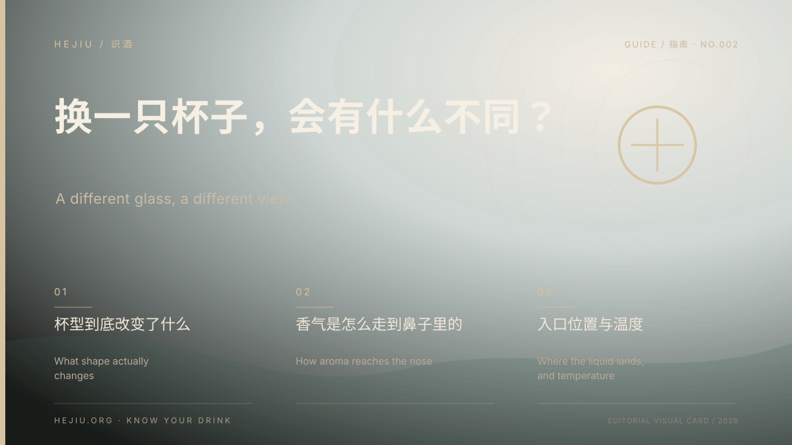

> **Topic guide: glass, drink and setting**
> - [Why the glass matters](https://hejiu.org/en/guides/choose-a-glass/)
> - [Red wine glass](https://hejiu.org/en/vessels/red-wine-glass/)
> - [White wine glass](https://hejiu.org/en/vessels/white-wine-glass/)
> - [Champagne flute](https://hejiu.org/en/vessels/champagne-flute/)
> - [Rocks glass](https://hejiu.org/en/vessels/rocks-glass/)
> - [Highball](https://hejiu.org/en/vessels/highball/)
> - [Snifter](https://hejiu.org/en/vessels/snifter/)

> **Decision checklist**
> Run these three checks before you buy or go.
>
> - **What shape actually changes:** The geometry of a glass determines the area of liquid exposed to air, the size of the space above the rim, and the path aroma takes from the surface to your nose.
> - **How aroma reaches the nose:** Aroma molecules evaporate from the surface, enter the space inside the glass and are carried to the nasal cavity with the breath.
> - **Where the liquid lands, and temperature:** The shape of the rim guides the liquid towards different parts of the mouth.

> **Topic guide: glass, drink and setting**
> - [Why the glass matters](https://hejiu.org/en/guides/choose-a-glass/)
> - [Red wine glass](https://hejiu.org/en/vessels/red-wine-glass/)
> - [White wine glass](https://hejiu.org/en/vessels/white-wine-glass/)
> - [Champagne flute](https://hejiu.org/en/vessels/champagne-flute/)
> - [Rocks glass](https://hejiu.org/en/vessels/rocks-glass/)
> - [Highball](https://hejiu.org/en/vessels/highball/)
> - [Snifter](https://hejiu.org/en/vessels/snifter/)

## What shape actually changes

The geometry of a glass determines the area of liquid exposed to air, the size of the space above the rim, and the path aroma takes from the surface to your nose. A wide bowl exposes more liquid and releases more aroma, but the aroma also disperses; a narrow bowl concentrates it but is harder to swirl. A narrowed rim directs aroma towards the nose, while an open rim lets it spread sideways. Wall thickness affects both hand feel and heat transfer.

None of these variables is inherently good or bad. A wide glass suits a spirit that needs to vent alcohol quickly; a narrowed glass suits detailed wine aroma. The same shape can work in opposite ways on different drinks. A glass can change the presentation, but it cannot turn one drink into another.

## How aroma reaches the nose

Aroma molecules evaporate from the surface, enter the space inside the glass and are carried to the nasal cavity with the breath. The smaller the opening, the more easily aroma concentration builds up; the larger the opening, the more easily it mixes with room air. "Aroma concentration" is not the glass actively collecting aroma; it is simply slowing how fast aroma escapes.

The fill level matters too. Fill it too full and there is no room for aroma to gather, while swirling becomes risky; fill it too little and the aroma is weak. In most cases, pouring to around the widest part of the bowl and leaving enough headspace is more practical than chasing an exact mark.

Temperature changes the rate of evaporation. The same drink at a higher temperature is more aromatic and more alcoholic; at a lower temperature the aroma is quiet and the structure feels tight. A glass cannot replace temperature control, but it affects how quickly the temperature changes. For more on this, see [Ice and temperature](ref:ice).

## Where the liquid lands, and temperature

The shape of the rim guides the liquid towards different parts of the mouth. A narrowed rim sends it more towards the front of the tongue; a wide rim lets it spread. With spirits, a very open rim lets alcohol vapour reach the nose first, making the drink feel harsher; a narrowed rim lets aroma arrive before alcohol.

A glass without a stem transmits body heat through the hand. Rocks glasses and tumblers both have this problem. When you need to keep a drink cold for a long time, hold it near the rim, or use a coaster or sleeve to reduce contact between hand and wall. A stemmed glass is held by the stem, which in theory affects the drink temperature less, but it is also easier to knock over.

Wall thickness affects touch and heat exchange. Thin walls warm quickly, thick walls slowly. For a drink you plan to linger over, thick walls can actually be an advantage; for a drink where you want to watch colour and bubbles, thin walls are clearer.

## Common shapes and their uses

- Tulip: a slightly wide bowl with a narrowed rim, suited to detailed [wine](ref:wine) aroma and often used for small neat serves of spirits.
- Rocks glass: short and wide, easy to fit a large ice cube, suited to neat drinks with ice and stirred short drinks such as the [Negroni recipe](ref:recipe). For the shape and its uses, see [rocks glass](ref:rocks).
- Highball: tall and narrow, giving ice and bubbles room to rise, suited to long drinks and sparkling mixes.
- Pint: large with a straight rim, suited to [beer](ref:beer) but poor at concentrating aroma.
- Champagne glass: slender or tulip-shaped, designed mainly for bubbles and low temperature, suited to [sparkling wine](ref:sparkling).
- Brandy glass: a wide bowl with a narrowed rim, suited to warming the drink in the hand and gathering aged aroma, and often used for nosing [whisky](ref:whisky).

These pairings are conventions, not regulations. The same drink in a different shape may improve or suffer, depending on what you want to emphasise.

## Is one all-purpose glass enough?

For most homes, one medium glass with a slightly wide bowl and a gently narrowed rim is enough. It can handle everyday wine, spirits served neat and some drinks with ice. The situations that genuinely call for a specialist glass are usually: comparing the same drink under different conditions, or keeping a drink cold for a long time while holding a large ice cube.

The value of a specialist glass is that it reduces variables. The same whisky, for example, is more concentrated for nosing in a small narrowed glass, and more comfortable with ice in a rocks glass. Neither is "correct"; the purpose differs. Decide the purpose first, then whether to add another glass.

## Run your own comparison

You do not need a whole set to test what shape does. Choose a drink you know, prepare two clean glasses with clearly different shapes, pour the same temperature and volume into each, smell both once, smell again after a few minutes, then take a sip from each. Note aroma intensity, alcohol, where the liquid lands and how the temperature changes.

Change only one variable at a time. If the two glasses hold drink at different temperatures, you cannot tell whether a difference comes from shape or from warmth. You can also record one glass at several points in time and watch how the aroma evolves.

## Cleaning and storage

A glass must be clean and free of detergent smell. Detergent residue masks fine aroma, especially in delicate wine and sake. Wash by hand with warm water and a little neutral detergent, rinse thoroughly, and leave upside down to dry. Do not wipe the inside repeatedly with a cloth; it leaves fibres and odour.

Storage matters too. Wooden cupboards, a kitchen full of cooking fumes and a storeroom with strong smells will all leave odour in the glass. Glasses kept for a long time can be stored upside down in a clean cupboard and rinsed and dried before use. Do not leave glasses in the refrigerator for long periods; the cold walls will pick up smells from the fridge.

## Common misconceptions

First, the more expensive the glass, the better. Shape, cleanliness and temperature matter more than price.

Second, the glass determines the quality of the drink. A glass changes the presentation, not the faults in the drink itself.

Third, you must own a full set. One or two suitable everyday glasses are more useful than a cupboard of specialist glasses you never use.

Fourth, the fuller the better value. Filling the glass compresses the aroma space and makes it easier to spill.

Fifth, a chilled glass is always better. Excessive chilling suppresses aroma; whether to chill depends on the drink and the purpose.

## A buying checklist

Before buying a glass, ask yourself four questions:

- What do I drink most? If wine dominates, start with a narrowed all-purpose glass; if you often drink spirits with ice, start with a rocks glass.
- Do I compare often? If so, two differently shaped glasses are more useful than one "universal" glass.
- Do I care about temperature? For long chilling, a thick-walled glass and a large ice cube suit better than a thin-walled one.
- Can I wash it properly? Complex shapes that are hard to clean tend to be used rarely.

On a limited budget, buy two identical medium all-purpose glasses first, then add a rocks glass or a highball as needed. Do not buy a rarely used shape just to look professional.

## Boundary

A glass is a tool, not an identity test. Temperature, ice, the drink itself and the pace of drinking usually matter more than shape. This guide recommends no brands and does not present any shape as the only correct answer; the choice of temperature and ice should combine the drink type with your own impression.

## Quick comparison: six common glasses

| Glass | Shape | Use | Why it works |
| --- | --- | --- | --- |
| Red wine glass | Large bowl, tapered rim | Red wine | Room for aroma |
| White wine glass | Medium bowl, tapered rim | White wine | Keeps it cool, focuses aroma |
| Champagne flute | Tall and narrow | Sparkling wine | Slows bubble loss |
| Coupe | Shallow and wide | Champagne, cocktails | Open aroma; bubbles fade faster |
| Rocks glass | Short and wide | Whisky, ice | Easy to add ice and stir |
| Highball | Tall and straight | Long drinks | Space for ice and bubbles |

How to use: narrow by setting first, then adjust for budget and taste; this is a starting table, not a score.
