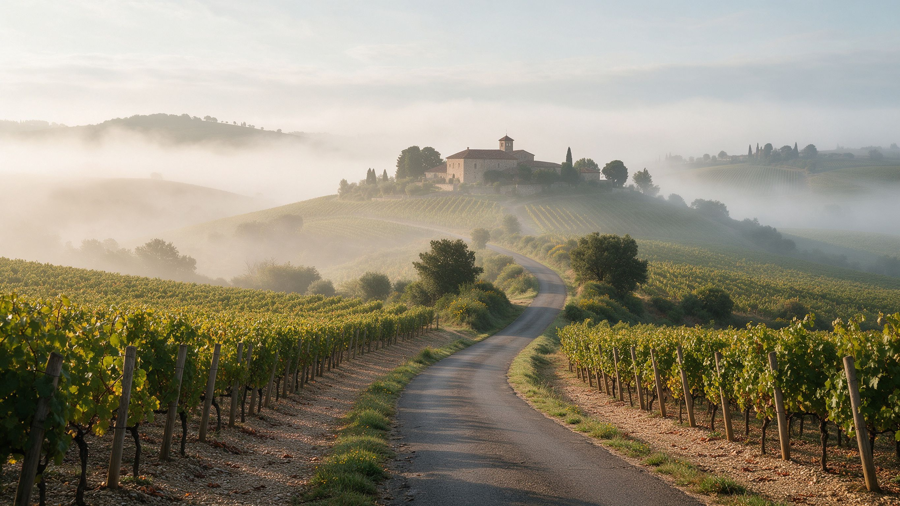

# A cocktail is another way in

A cocktail is not several spirits tipped into a glass. It has structure: a base spirit provides the frame, sweetness and acidity balance it, bitterness and aroma add layers, and ice and water bring dilution and temperature. Understand the structure and a recipe becomes meaningful; otherwise you are just moving numbers around and cannot explain why the drink tastes good or bad.

Figure: thematic illustration for A cocktail is another way in. Image: AI-assisted illustration generated with Doubao Seedream 5.0 (project-owned); not a photograph of the subject.

## Start with structure, not the recipe

A cocktail can roughly be divided into four layers: base spirit, seasoning, dilution and garnish. The base sets the overall direction; the seasoning balances sweet, sour and bitter; dilution determines the strength and temperature on entry; the garnish supplies aroma and shapes the first impression. If any layer is out of balance, it shows in the first sip.

Classic recipes are worth learning first because they set out these four layers fairly clearly. The [Negroni](ref:negroni) is equal parts base spirit, bitter and sweet vermouth; sour-style cocktails often follow a "spirit plus acid plus sugar" ratio. Make the standard ratio once before discussing adjustments; it is easier to find the problem than when you improvise from the start.

## The base spirit provides the frame

The base spirit usually supplies most of the alcohol in the recipe. [Gin](ref:gin) brings botanical aroma and a clean structure, [rum](ref:rum) brings the sweet aroma of sugar cane, and whisky brings grain and cask weight. Different base spirits are not simple swaps: change the base and the sweet-sour ratio, dilution and garnish often have to change with it.

Choose the base with its role in mind. For a clean, transparent structure, gin and rum suit better; for a heavier, cask-flavoured frame, whisky suits better. If the base is very expressive, keep the seasoning restrained, or the layers blur together.

## Sweet and sour: balance

Sweetness rounds the body and softens heat and alcohol; acidity freshens the palate and lengthens the finish. Neither is better the more it is used; they should balance across entry, middle and finish. Too sweet feels sticky, too sour feels sharp; at the right ratio neither stands out and the result simply feels smooth.

The most common home mistake is too much sweetness, because syrups and liqueurs both carry sugar. The fix is to follow the recipe first, then adjust in small increments, changing one variable at a time. Measuring in millilitres is more reliable than "a few spoons" and easier to repeat.

## Bitterness and aroma: layers

Bitterness often comes from bitter liqueurs, bitters or certain botanicals. Its job is not to make the drink bitter but to give sweetness a boundary so the whole is not monotonous. Too much bitterness buries other aromas; too little feels cloying. The bitter element in a Negroni is part of the structure, not an optional decoration.

Aroma comes from the base, liqueurs, citrus peel and herbs. Citrus peel in a garnish holds essential oils that are released when pressed, but adds little acidity; that makes it a way to add aroma, not flavour. Think about what a garnish is meant to provide rather than only how it looks.

## Dilution: the most overlooked ingredient

Stirring and shaking both add water, and ice keeps melting. Dilution is not a mistake; it is part of the recipe. Without dilution, a high-strength drink feels sharp and the aroma stays closed; dilute too much and the body thins, with sweetness and aroma washed out.

The key controls are ice quantity, ice shape and working time. Larger cubes melt more slowly and give more control; crushed ice chills fast but dilutes fast. Longer stirring means more dilution; shaking usually adds more dilution and aeration than stirring. Record these conditions to reproduce a drink.

## The role of ice

Ice does three things at once: it chills, dilutes and changes aroma release. It softens the entry and quiets the aroma. For short drinks, the finished liquid usually needs to be chilled thoroughly before being strained into a glass over ice; for long drinks, the ice keeps diluting, so the recipe must leave room for that water.

Ice hygiene and quality directly affect the result. Use ice made from drinking water and avoid ice with odours or impurities; store ice sealed in the freezer so it does not pick up other food smells. For ice shapes and temperature, see [Ice and temperature](ref:ice).

## Stir or shake

Stirring chills more slowly, dilutes less and leaves the drink clear; it suits recipes built mainly on spirit and sugar, such as the [Negroni recipe](ref:recipe). Shaking chills faster and adds air and fine ice shards; it suits recipes with juice, egg white or cream, which often gain a fine foam.

Choose by asking whether the recipe needs aeration or emulsification, then whether it needs to stay clear. Clear means stir; aeration or emulsification means shake. Both chill and dilute, but at different paces. For the motion itself, see [Shaking](ref:shaking).

## Equipment and order

Basic equipment includes a [cocktail shaker](ref:shaker), a jigger, a bar spoon, a strainer and a suitable glass. Short drinks often use a [rocks glass](ref:rocks); long drinks use a highball. You do not need everything at once, but measuring tools and a strainer are worth buying first because they directly affect ratio and texture.

The usual order is: chill the glass or prepare ice, measure the ingredients, stir or shake, then strain into the glass and garnish. Fixing the order reduces omissions and makes versions easier to compare. Changing one variable at a time is the most effective way for a home bartender to improve.

## Reproducing a drink at home

- Choose a classic recipe with clear structure; do not change the ratio at first.
- Prepare plenty of clean ice and pre-chill or pre-warm the glass as the recipe requires.
- Measure every ingredient in millilitres, including syrup and bitters.
- Stir or shake as the recipe says, and record the time.
- Strain into a suitable glass and complete the garnish as written.
- After drinking, note sweetness, acidity, bitterness, alcohol impact and dilution.
- Next time adjust one variable only, and record the result.

Being able to reproduce one drink reliably is more useful than memorising ten recipes. Reproducing means you know why each step exists and can tell which layer failed.

## Common mistakes

First, using "as needed" instead of measuring. Without a stable ratio you cannot tell whether a problem comes from the recipe or the technique.

Second, too little ice. Too little ice under-chills the drink and lets dilution run out of control, making the palate sharp.

Third, shaking too long or too little. Too long dilutes too much and adds excessive ice shards; too little under-chills and under-integrates.

Fourth, garnishing only for looks. A garnish with no aromatic role wastes ingredients and may affect the entry.

Fifth, changing too many variables at once. Swap the base, change the sugar and change the ice together and you cannot tell what did what.

## Boundary

Bartending does not replace responsible drinking. Watch the alcohol content, the serving size and the pace, and do not work with open flame without permission or safe conditions. A recipe is a starting point, not a law; but any change should be recorded, or it cannot be compared. This page recommends no brands and does not present any one ratio as the only correct answer.
