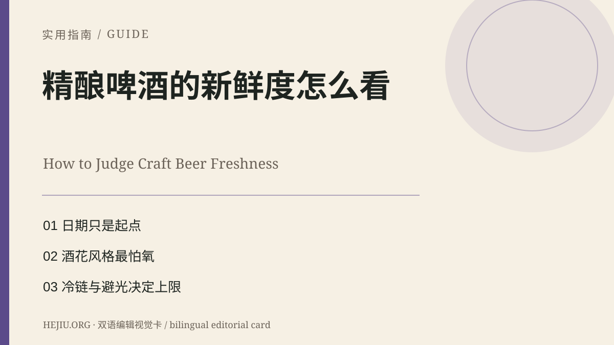

# How to Judge Craft Beer Freshness

Freshness in craft beer is a flavour concept, not one date. Hop-forward beers lose aroma quickly with oxygen, heat and light; high-strength, dark or sour beers often keep longer. Read style and packaging first, then production date and storage, and finally smell, bitterness and finish after opening to judge whether it is good now.

图：Craft beer freshness bilingual editorial card。Project-created bilingual editorial card for topic identification, not a documentary photograph.

> **Quick verdict**
> **Best for:** buyers who want to judge whether a bottle is still worth drinking.
> **Not for:** those who read only the production date and ignore style and storage.
> **One line:** hop-forward beers benefit most from freshness; shelf-stable styles depend on storage; the opened nose is more direct than the date.

## Dates: production, packaging, shelf

Separate production date, packaging date and shelf-life/best-before. Craft beer often uses a batch date and “best by”, and not every beer carries a shelf-life. Newer is not always better: a just-packaged hop beer may still be settling and improve in a few days, but too long loses aroma. If only a year or blurry code is printed, judge by storage and style, not one character.

## Style: who fears age

Hop-forward styles (IPA, NEIPA, pale ale) fear oxygen and heat; citrus and tropical aroma turns to hay and cardboard. Wheat and pale beers also dislike heat. High-strength, dark, imperial stout and sour beers often keep longer and may develop nutty or dried-fruit notes with oxygen. Do not apply one “golden window” to all: buy hop beers fresh and accept more age for shelf-stable styles.

## Packaging: bottle, can, keg

Cans block light and seal well, usually protecting hops better than clear glass; dark glass is next, clear glass fears light most. Check for swollen cans, loose caps or abnormal fill; a swollen can may mean unfinished fermentation or contamination, so do not buy. Draught is often fresh, but line cleaning and storage temperature matter; a takeaway cup is not better than drinking on site.

## Cold chain and shelf

Hop beers should be cold, dark and low-vibration; a warm shelf accelerates ageing. Touch the bottle, check whether the shelf is by a window or heater, and for online orders ask whether cold-chain shipping is used and whether the parcel sat in a locker. A hot journey can damage even a fresh date. Do not trust a “better cold” slogan; ask how it was actually stored.

## Opening: nose, bitterness, finish

Smell first: fresh hops should show clear citrus, pine, tropical fruit or floral notes; if only cardboard, hay, soy sauce or cloying sweetness remains, it may be oxidised. Taste for clean bitterness and a crisp finish; dull bitterness, empty aftertaste or low carbonation can point to age or storage. Do not condemn a beer just because it is bitter; bitterness is part of style—ask whether it supports the aroma.

## Buy and store: little and often

For home, buying little and often beats hoarding: buy a few days to two weeks of hop beer, and only a small amount of shelf-stable beer to age. Refrigerate and darken immediately; do not use the fridge door. Finish an opened bottle if possible, or seal, refrigerate and use within a day. To compare, buy two cans from the same batch, drink one now and keep one for a few days, recording aroma changes.

## A 30-second buying check

Read style: hop-forward first for freshness. Read date: clear batch and best-before. Touch temperature: cold beats ambient. Read package: can or dark glass beats clear. Check storage: dark and low-vibration. After opening, ask whether the nose is clear, bitterness clean and finish crisp. If anything is clearly off, try one before buying a case.

## Check before you go

- Separate production and best-before
- Prioritise freshness for hop beers
- Age shelf-stable styles in small amounts
- Check for swollen cans
- Touch the bottle temperature
- Confirm dark storage and cold chain
- Check a clear nose after opening
- Buy little and often

## Limits and next steps

Freshness in craft beer is not a date but a cold chain from filling to lip. Hop aroma is the most fragile part: every rise in temperature and every extra minute of light pushes citrus and pine notes further back, while malt sweetness and bitterness hold up better. "Within the shelf life" therefore does not mean "still good". The filling date on the can or bottle matters more than the "best before" date alone.

Each package needs its own check. Cans are light-proof and light to carry, good for short trips, but the lining and seam still dislike heat; glass bottles need a look at the fill level and cap, because vibration in transit speeds oxidation; draught beer depends on the shop's refrigeration, line cleaning and serving temperature, and bar hygiene often shapes a glass more than the brewery's reputation. If the staff cannot say when the keg was tapped, order a small glass first.

At home, keep beer cold, dark and stable, not upright against the fridge door; the temperature swings from repeated opening do more harm than steady refrigeration. Drink an opened bottle in one go: warming and air both scatter the aroma. Smell before sipping, and look for cardboard, vinegar or a cloying sweetness; these say more about condition than the level of bitterness.

This page does not judge which brewery is better. It helps you rule out beer in poor condition. To compare styles, match the filling dates and storage conditions first, then talk about hop varieties and yeast.

## What else to watch

Hop harvest and batch also affect freshness. The same beer can differ in aroma intensity between batches, especially a single-hop product; for a comparison, choose cans from the same batch or a close filling date. Bottles and cans have different oxygen transmission, and cans usually hold up better in long storage, but that does not make them automatically better.

Draught freshness also depends on the lines. A poorly cleaned system can give a first glass a cleaner or musty note; watch whether the tap is clean and the foam fine before ordering a second. For takeaway, use a cool bag and do not leave the beer in a car boot for an afternoon.

## References

- Brewers Association — https://www.brewersassociation.org/ (Brewers Association, checked 2026-11-25)
- The Brewers of Europe — https://www.europeanbreweries.com/ (The Brewers of Europe, checked 2026-11-25)
- Tasting Beer (Randy Mosher / Storey Publishing, checked 2026-11-25)
- BJCP — Beer Judge Certification Program style guidelines — https://www.bjcp.org/ (Beer Judge Certification Program, checked 2026-11-25)

Related entries: [beer](ref:beer), [low-alcohol beer](ref:low), [Beer tasting introduction](ref:intro), [fermentation](ref:ferment), [hops](ref:hop), [First tasting guide](ref:tasting), [Food-pairing guide](ref:pairing), [China](ref:region).
